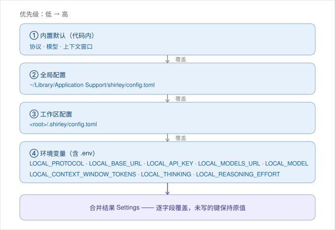

# Shirley

一个用 Rust 编写的 Coding Agent，名字取自《Code Geass》中的夏莉（Shirley）。

> [English](README.md) | 简体中文

仓库分为三层：

| 层     | 位置                                 | 职责                                |
| ----- | ---------------------------------- | --------------------------------- |
| 应用层   | `src/`                             | 可直接运行的 TUI 聊天 Agent：注册工具并驱动界面     |
| SDK 层 | `crates/shirley-agent-sdk/`        | 与业务无关的 Agent 基础能力（已发布到 crates.io） |
| 宏层    | `crates/shirley-agent-sdk-macros/` | `#[tool]` 属性宏                     |

## 运行

```sh
cp .env.example .env   # 参照 .env 里记录的键自行创建
cargo run
```

配置来自四层，每层逐字段覆盖上一层：

1. 内置默认（协议、模型、上下文窗口）
2. 全局 `<config_dir>/shirley/config.toml`
3. 工作区 `<root>/.shirley/config.toml`
4. 环境变量（`LOCAL_*`）

某一层只对它写了的键表态 —— 没写的键继续沿用下层的值。所以你在工作区配置里只改 `model`，`base_url` 仍会从全局配置继承。



最省事的方式是写进 `.env`：

```sh
LOCAL_BASE_URL=https://api.example.com/v1/chat/completions   # 必填，完整端点地址
LOCAL_API_KEY=sk-...                                          # 可选
LOCAL_MODEL=gpt-4o-mini
```

> 缺失 `base_url` 不会阻断启动，TUI 会自动进入 `/login` 引导你补齐。

### 桌面界面

除了 TUI，还有一个与之并存的桌面界面（Tauri 2 + React），需先构建前端再启动：

```sh
cd src/interface/desktop/web && npm install && npm run build
cargo desktop          # 等价于 cargo run --features desktop -- --desktop
```

两个界面是兄弟关系，共享同一份装配产物与同一份会话数据。详见 [`docs/desktop-interface.md`](docs/desktop-interface.md)。

## 协议

支持三种线协议，通过 `LOCAL_PROTOCOL`（或配置文件里的 `protocol`）选择：

| `LOCAL_PROTOCOL`          | 线格式                     | `base_url` 指向           |
| ------------------------- | ----------------------- | ----------------------- |
| `chat_completions` *（默认）* | OpenAI Chat Completions | `…/v1/chat/completions` |
| `responses`               | OpenAI Responses        | `…/responses`           |
| `anthropic_messages`      | Anthropic Messages      | `…/v1/messages`         |

`base_url` 是**完整的请求地址**，不是 base path —— 适配器会原样 POST 过去。协议名接受别名：`openai` 等价于 `chat_completions`，`anthropic` / `messages` 等价于 `anthropic_messages`。

### Chat Completions（默认）

```sh
LOCAL_PROTOCOL=chat_completions
LOCAL_BASE_URL=https://api.deepseek.com/v1/chat/completions
LOCAL_MODEL=deepseek-chat
LOCAL_API_KEY=sk-...
```

### Responses

```sh
LOCAL_PROTOCOL=responses
LOCAL_BASE_URL=https://api.deepseek.com/responses
LOCAL_MODEL=deepseek-chat
LOCAL_API_KEY=sk-...
```

### Anthropic Messages

Anthropic 使用 `x-api-key` 请求头（而不是 `Authorization: Bearer`）；适配器会替你设置好它，以及 `anthropic-version`。

```sh
LOCAL_PROTOCOL=anthropic_messages
LOCAL_BASE_URL=https://api.deepseek.com/anthropic/v1/messages
LOCAL_MODEL=deepseek-chat
LOCAL_API_KEY=sk-...
```

同样这三种，写成配置文件（`<root>/.shirley/config.toml` 或 `<config_dir>/shirley/config.toml`）：

```toml
# Chat Completions
[provider]
protocol = "chat_completions"
base_url = "https://api.deepseek.com/v1/chat/completions"
model = "deepseek-chat"
api_key = "sk-..."
```

```toml
# Responses
[provider]
protocol = "responses"
base_url = "https://api.deepseek.com/responses"
model = "deepseek-chat"
```

```toml
# Anthropic Messages
[provider]
protocol = "anthropic_messages"
base_url = "https://api.deepseek.com/anthropic/v1/messages"
model = "deepseek-chat"
api_key = "sk-..."
```

协议差异被适配层完全吸收 —— `Message` 模型与 SDK 的其余部分都与协议无关。见 [`docs/adapter-layer.md`](docs/adapter-layer.md) 以及 [`docs/`](docs/) 下各协议的说明。

要切换协议，修改 `LOCAL_PROTOCOL` 或配置文件后重启即可。TUI 的 `/login` 能在运行期更新 `base_url` / `api_key` / `model`（写入工作区配置），`/model` 则用于切换模型名 —— 但协议本身在启动时就已确定。

## 构建与测试

```sh
cargo build
cargo test
cargo test -p shirley-agent-sdk
cargo clippy --all-targets
```

## SDK

`shirley-agent-sdk` 可以作为独立库使用：

```sh
cargo add shirley-agent-sdk
```

详见 [`crates/shirley-agent-sdk/README.md`](crates/shirley-agent-sdk/README.md)。

## 文档

- `plan.md` —— 设计理由与决策记录
- `docs/` —— 分期落地的技术方案
- `Agent.md` —— 写给下一个接手本仓库的 Agent（或人）的项目指南

## 许可证

MIT OR Apache-2.0
