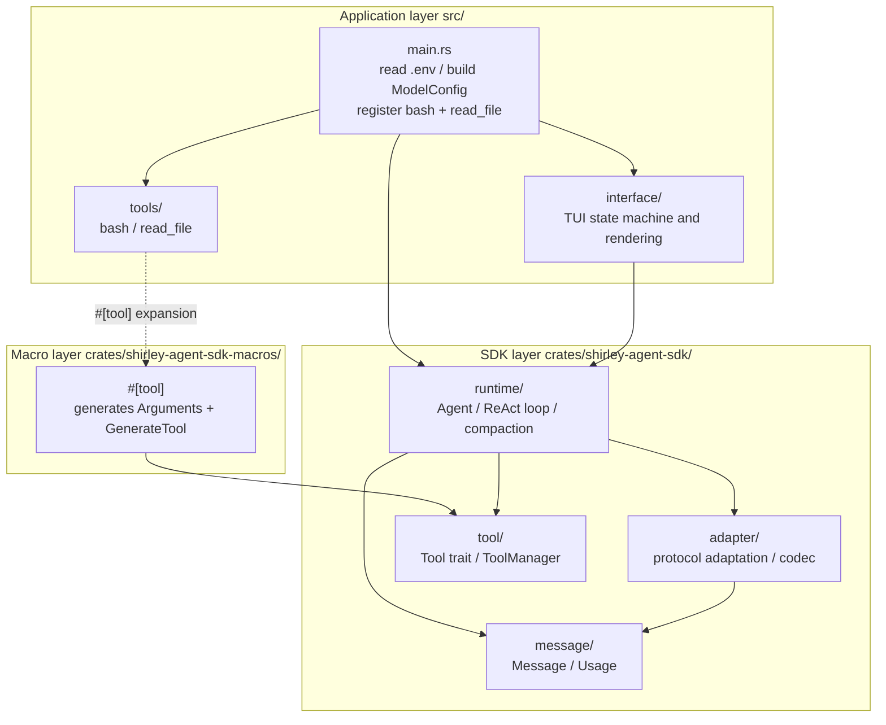
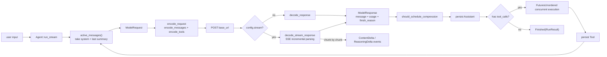
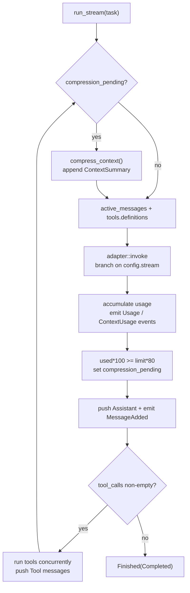
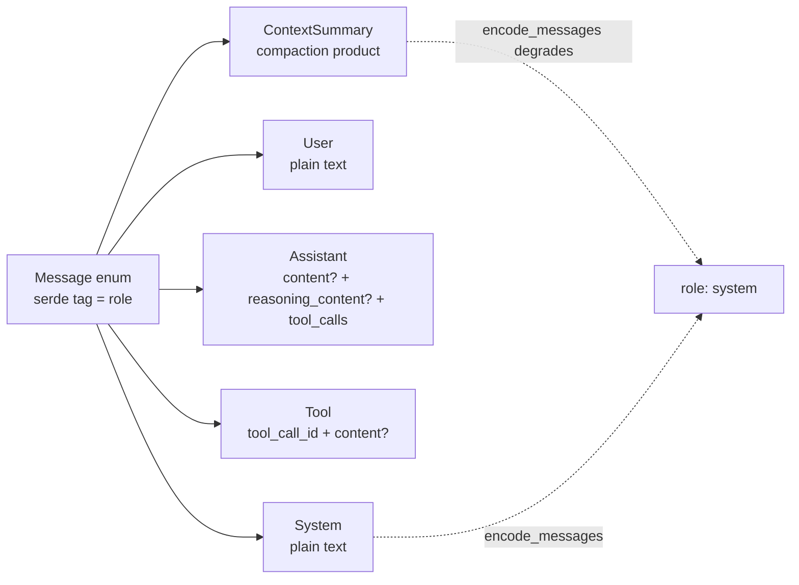
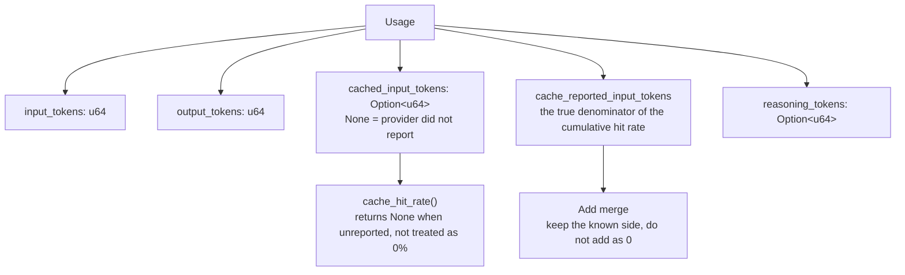
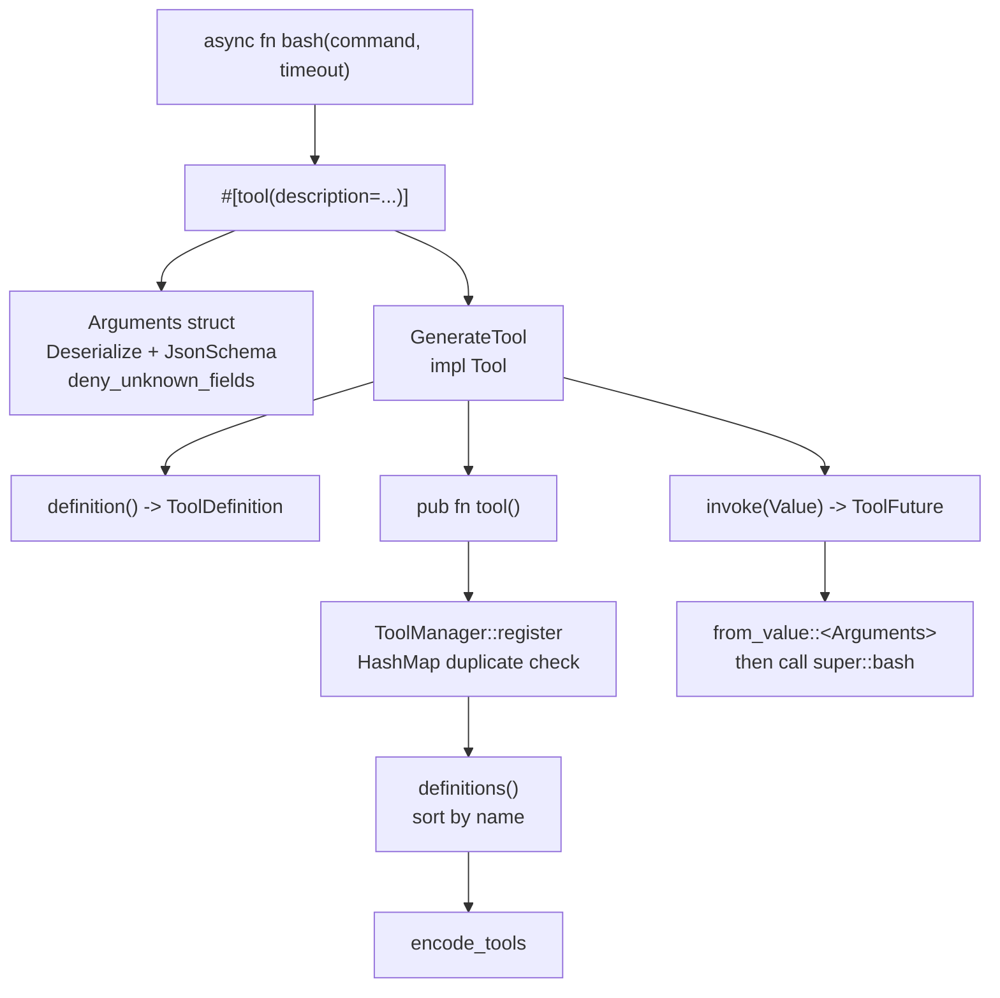
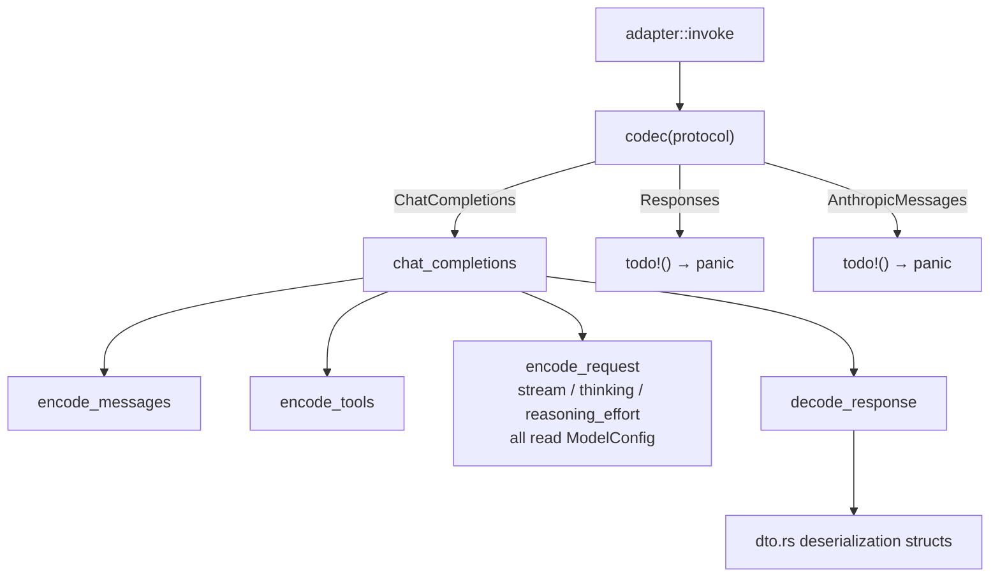
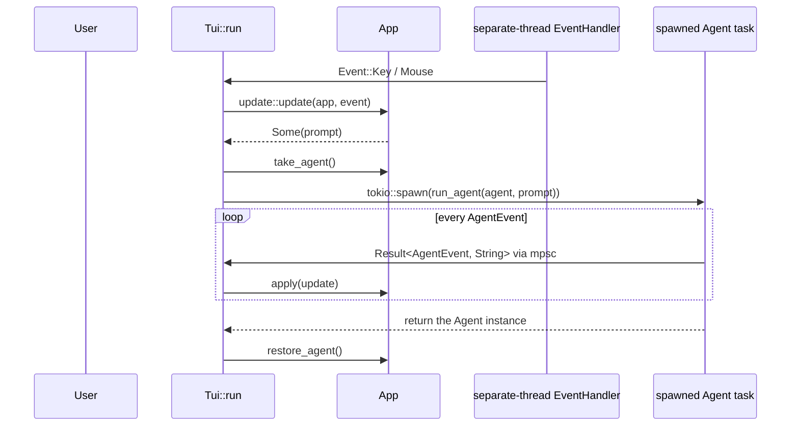
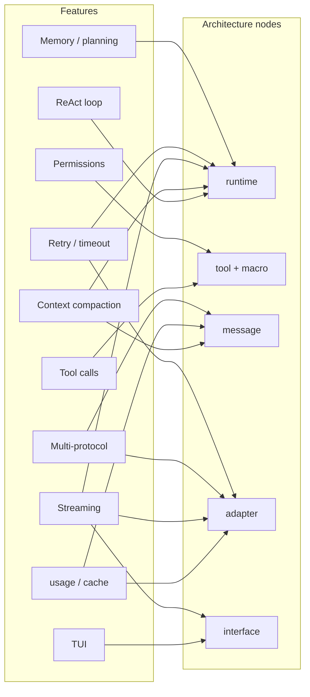

**Shirley technical design · Architecture diagram and feature placement**

This document answers two questions: how the project is layered (structure), and which layer each feature lives in and which files to change to touch it (placement). The supporting design details are in the topic documents referenced by `roadmap.md`.

**Legend (applies to all mermaid diagrams below)**

- **Directed graphs** (`graph TD` / `flowchart LR`): a box `[...]` is a module / component / step; a solid arrow `-->` is "dependency / call / data flow"; a dashed arrow `-.->` (optionally with `|"label"|`) is an indirect relationship (such as macro expansion) or "runs in parallel throughout, non-blocking".
- **Decision nodes**: a diamond `{...}` with `A -->|"yes/no"| B` is a conditional branch, routed by label.
- **Grouping** (`subgraph X["..."] ... end`): a dashed box groups nodes of the same layer / kind together (such as application layer / SDK layer / macro layer, feature / architecture nodes).
- **Sequence diagrams** (`sequenceDiagram`): `participant` is a participant, `->>` is a request / call, `-->>` is a return, and `loop … end` is a loop block.

> There are 9 diagrams below: one (layering), two (single-request data flow), three (ReAct main loop), four (message model + Usage semantics), five (a tool from function to callable), six (the current state of the adapter-layer codec), seven (TUI event flow), nine (feature<->architecture-node dependencies).

**1. Three-layer structure overview**

**Boundary rules** (principle one in `docs/README.md`): `main.rs` is the only place that does assembly; `interface` only consumes the SDK's public types; `tools` only depend on the macro and `ToolError`, and do not touch runtime. The SDK exposes externally only the names re-exported in `lib.rs`; `message` / `adapter` / `runtime` / `tool` are all private modules.

**2. The complete data flow of one request**

This corresponds to the main loop in `runtime/mod.rs`; `invoke` in `adapter/mod.rs` is the streaming/non-streaming fork (`config.stream`). Note that although `finish_reason` is decoded, **the runtime still does not consume it** -- `is_finished` only looks at `tool_calls.is_empty()`, so a `length` truncation is treated as a normal completion (see section 3 of `runtime-hardening.md`).

**3. The ReAct main loop (with compaction)**

**Three weak points here** (detailed in `runtime-hardening.md`):

1. The loop has no step cap; `MaxStepsReached` / `Cancelled` are defined but nobody produces them (`Completed` is the only value that is ever produced).
2. A `compress_context` failure `Err`s and aborts the whole stream; it is a single point of failure.
3. `compress_context` also goes through `adapter::invoke`, sharing the same error channel as the main loop.

**4. Message model**

`Usage` is the most semantically subtle part of the same layer:

These two rules are deliberate design; `testing.md` specifically lists the unit tests that guard them.

**5. Tool system: from function to callable**

The macro's hard constraints (pitfalls noted in `Agent.md`): the function cannot have `self`, parameters cannot be destructured, each parameter must write `#[param(description)]`, and the annotated function and the generated `mod` must be at the same level (because `invoke` calls `super::#name`).

The `sort_by(name)` in `definitions()` **must not be deleted** -- it keeps the tool-definition order stable, which is the precondition for prefix cache hits.

**6. Adapter layer: the current state of the codec**

Two unwired configurations are also in this layer: `ModelConfig.request_timeout` has never been used, and `ModelConfig`'s `temperature` / `max_output_tokens` do not enter the request body. `stream` / `thinking` / `reasoning_effort` have been changed to read `ModelConfig` (no longer hard-coded). As for `encode_messages` being written in the adapter layer, the code's own comment admits it "should be on the message side" (see `adapter-layer.md`).

**7. TUI event flow**

The hand-written `AgentUpdate` translation layer has been removed: `tui::apply` consumes the SDK's `AgentEvent` directly (`MessageAdded` / `ContentDelta` / `ReasoningDelta` / `Usage` / `Compression*` / `ContextUsage`). `ToolStarted` / `ToolFinished` / `Finished` are still explicitly ignored in `apply` (`Ok(_) => {}`), so the UI can only infer tool state from Assistant messages -- this has not been cleaned up yet.

**8. Feature placement table**

This table is the core of this document: which point in the architecture each feature belongs to.

| Feature | Main placement | Files involved | Status |
| --- | --- | --- | --- |
| ReAct loop | `runtime` | `runtime/agent.rs` | implemented |
| System prompt (static/function) | `runtime` + application layer | `runtime/prompt.rs`, `src/prompt.rs` | implemented |
| Message model / serialization | `message` | `message/mod.rs` | implemented |
| Tool registration and concurrent calls | `tool` + `runtime` | `tool/mod.rs`, `runtime/mod.rs` | implemented |
| `#[tool]` macro and argument schema | macro layer | `shirley-agent-sdk-macros/src/tool.rs` | implemented |
| Context compaction | `runtime` + `message` | `runtime/mod.rs` (`ContextSummary`) | implemented, fragile |
| usage / cache hit rate | `message` + `adapter` | `message/mod.rs`, `chat_completions` | implemented |
| ChatCompletions protocol | `adapter` | `adapter/chat_completions/` | implemented |
| TUI rendering and scrolling | application layer | `interface/ui.rs`, `app.rs` | implemented |
| Markdown -> TUI render layer | application layer | `interface/markdown.rs` (`parse` -> `Block` -> `render` -> `Line`/`Span`) | implemented |
| Streaming output | `adapter` + `runtime` + application layer | `adapter/chat_completions` (SSE parsing), `AgentEvent::ContentDelta` | implemented |
| reasoning streaming | `adapter` + `message` + application layer | `AgentEvent::ReasoningDelta`, `ReasoningDelta` event | implemented |
| Multi-protocol (Responses / Anthropic) | `adapter` | the `todo!()` in `codec` | not done, will panic |
| Tool-argument middle layer | `tool` + macro layer | `ToolDefinition.parameters` | not done |
| Permission / behavior restriction | `tool` + new `permission` | the `tools/bash.rs` blacklist | hard-coded only |
| Step cap | `runtime` | `StopReason::MaxStepsReached` | defined but unused |
| Cancellation | `runtime` + application layer | `StopReason::Cancelled` | defined but unused |
| Retry / timeout | `adapter` + `runtime` | `request_timeout` not wired | not done |
| Memory system | new module + `runtime` | none | not done |
| Task planning | new module + `runtime` | none | not done |
| Session persistence | application layer `session.rs` + `interface/session.rs` | the `SessionStore` contract (`src/session.rs`) + `JsonlSessionStore` + `SessionManager` orchestration; the SDK does not hold a session | implemented (JSONL backend) |

**9. Dependency graph of features and architecture nodes**

Two things are visible from this diagram:

- **`runtime` and `adapter` are the two most change-dense nodes**. Streaming, retry, compaction, memory, and planning all pass through them, so the P0 hardening should concentrate here.
- **`message` is a foundation reused in many places**. Compaction, usage, and multi-protocol all depend on it, so the semantics on the `message` side (especially `Usage`'s `Option`) carry the highest change risk and most deserve tests first.

**10. Phases and scheduling**

Scheduling is not maintained in this document, to avoid drifting in two places -- see "3. Dependencies" in `roadmap.md`. Here we record only one conclusion that follows directly from the architecture diagram:

**Rework of `runtime` and `adapter` must come before feature expansion**. Because streaming, retry, compaction degradation, memory, and planning all pass through these two nodes, filling in error classification, the step cap, and timeouts on them first saves one round of rework for every feature added later.

**11. Quick placement reference when changing code**

- Change the request body / add protocol parameters -> `encode_request` in `adapter/chat_completions/mod.rs`; be careful not to break prefix stability.
- Change message semantics -> `message/mod.rs`; first add the Usage unit tests from `testing.md`.
- Change loop behavior -> `runtime/mod.rs`; at the same time check whether `StopReason` has a corresponding production point.
- Add a tool -> write only one `#[tool]` function in `src/tools/*.rs` and register it in `main.rs`.
- Change rendering -> `interface/ui.rs`; pay attention to `MessageCache`'s invalidation logic and `row_offsets`'s line-wrap estimation.
- Change Markdown styling / add syntax -> `interface/markdown.rs`; parsing (`parse` -> `Block`) and rendering (`render` -> `Line`) are separate, so adding syntax touches only the `parse` side and styling touches only the `render` side.
