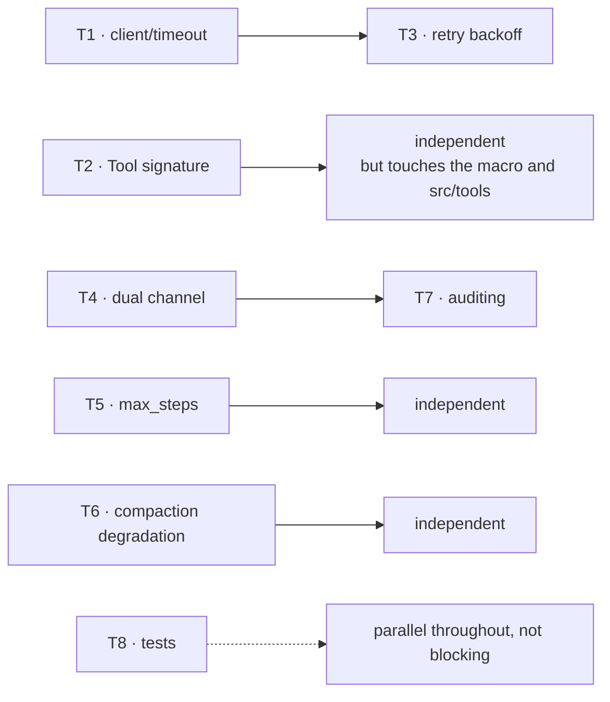

**Shirley technical design · Error-handling unification (execution plan)**

This document records the completed parts and the follow-up task list for the work of "uniformly and centrally handling Agent SDK errors".
It follows section 2 of `runtime-hardening.md` (structured errors) and the "failures must be classifiable" principle in `README.md`,
turning the design intent into a checkable state.

---

**1. Why do this**

The principle written in `docs/README.md` is "failures must be classifiable", but currently no place in the code actually achieves it:

- `AdapterError` only has two variants, `RequestError(String)` / `ResponseError(String)`; the HTTP status code is concatenated into a string in `format!` and then disappears, so a 429 and a 400 look identical.
- `AgentError` hand-writes `Display`, where the Adapter branch uses `{error:?}`, and the code itself notes `todo: this should format the error`.
- `ToolError` does not implement `std::error::Error`, so it cannot participate in `?` propagation and error chains.
- `WorkspaceError` has neither `Display` nor `Error`, and even imports from `futures::io` a type that is actually equivalent to `std::io`.
- The streaming branch of `adapter::codec` and `invoke` uses `todo!()` to express "protocol not implemented", so switching protocols panics the host process.

Conclusion: **the three things -- retry, degradation, and cancellation -- all depend on "which class this error belongs to", and currently no error type carries that information.**
So structured errors must come before feature expansion.

---

**2. Design conclusion (relationship with sandbox)**

The initial assumption was "handle it like sandbox's errors". After checking, it was confirmed that sandbox's **pattern** can be borrowed, but **not copied verbatim**.

Sandbox is a leaf module, facing only `std`, so it can define its own errors in its own module, flat and simple.
But the Agent SDK is layered, and errors need to converge bottom-up. Copying would result in a giant flat enum, which is actually harder to maintain.

So what we extract from sandbox is four contracts, not its code:

1. Errors are defined **in the module that owns them**, not centralized into an `errors.rs`.
2. A flat enum, variants carry **structured data**, not all String.
3. Implement `Display` + `std::error::Error` + `From`, so `?` can convert automatically.
4. **The error channel and the result channel are separate**: a command that fails goes through `SandboxOutput.exit_code`; only the sandbox itself breaking goes through `Err`.

The final landing shape is "layered definition + unified contract + top-level convergence".

---

**3. Step one complete: error contract and structured errors**

**3.1 Deliverables**

Added `crates/shirley-agent-sdk/src/error.rs`:

- `ErrorKind`: 7 stable classifications, used for logs / metrics / auditing, not changing with the wording.
  - `Transport` / `RateLimited` / `ServerError` / `BadRequest` / `Unsupported` / `ToolFailure` / `Internal`
- `ErrorKind::is_retryable()`: the single mapping from classification to retryability.
  - retryable: `Transport`, `RateLimited`, `ServerError`
  - not retryable: `BadRequest`, `Unsupported`, `ToolFailure`, `Internal`
- `ErrorKind`'s `Display`: one stable sentence for each classification.
- `SdkError` trait: `kind()` must be implemented, `is_retryable()` is derived from `kind()` by default, and a concrete type may override it.

New dependency: `crates/shirley-agent-sdk/Cargo.toml` explicitly adds `thiserror = "2.0.21"`.
(This version had already been pulled into `Cargo.lock` indirectly by other crates, but the SDK itself had not declared it.)

**3.2 Changes per layer**

| Type | File | Change |
| --- | --- | --- |
| `AdapterError` | `adapter/mod.rs` | rewritten as `Transport(#[source] reqwest::Error)` / `Http{status, body}` / `Decode` / `Encode` / `UnsupportedProtocol`; `thiserror` derived; implements `SdkError` |
| `AgentError` | `runtime/mod.rs` | variants renamed and `#[from]` converges Tool / Adapter / Sandbox / Workspace; hand-written `Display` removed; implements `SdkError` |
| `ToolError` | `tool/mod.rs` | adds the missing `std::error::Error`; implements `SdkError`; construction sites renamed |
| `SandboxError` | `sandbox/backend/mod.rs` | implements `SdkError` (`BackendUnavailable` / `Unsupported` -> `Unsupported`) |
| `WorkspaceError` | `workspace/mod.rs` | changed to a `thiserror` derive, adds `Display` / `Error`; `futures::io` switched back to `std::io`; implements `SdkError` |

**3.3 Three panic points cleared along the way**

These three are all in the `adapter` layer, originally using `todo!()` to express "not implemented":

1. `codec`'s `_ => todo!()` -> `Err(AdapterError::UnsupportedProtocol { protocol })`
2. `invoke`'s streaming branch `_ => todo!()` -> same as above
3. `todo!()` on the `id:` line in `chat_completions` SSE parsing -> ignore the line, with a comment noting that `last_event_id` will be consumed when disconnect-reconnect is implemented

The basis is section 7 of `runtime-hardening.md`: **any unimplemented path in the SDK must return `Err`, and must never panic in the SDK.**

**3.4 An easily overlooked key fix: the HTTP status code is no longer lost**

Before the change:

```rust
if !status.is_success() {
    Err(AdapterError::ResponseError(format!("HTTP {status}\n{text}")))?;
}
```

After the status code is formatted into a string, the caller gets only a sentence and cannot distinguish 429 (should back off and retry) from 400 (retrying is meaningless).

After the change, `ensure_success(response)` is extracted for unified handling, keeping the two fields `status: u16` and `body: String`.
The reason to extract it into a separate function is that `reqwest::Response` can only be consumed once, and "check the status first, then read the body" must be done in the same place,
and both the streaming and non-streaming branches need this logic.

**3.5 Public exports**

`lib.rs` added `pub mod error`, `pub mod workspace`, and re-exports of `AdapterError`, `ErrorKind`, `SdkError`.

The exports of `AdapterError` and `workspace` were forced out by Rust's private-type-leak rules:
`AgentError::Adapter` is a public variant, and if the type it wraps is not public, downstream cannot match on it.
If the public API is to be narrowed later, consider giving `AgentError` opaque accessors instead of exposing the variants directly.

**3.6 Display format unified**

The four error layers originally used two conventions: `ToolError` / `SandboxError` hand-wrote `Display` with `[prefix]:`;
`AdapterError` / `WorkspaceError` went through thiserror with bare wording. Now unified to **one mechanism + one format**:

- Mechanism: all go through the thiserror derive, and the two hand-written `Display` matches are deleted (`SandboxError`'s hand-written `From<io::Error>` is also replaced by `#[from]`).
- Format: all are `[prefix]: detail`, with square brackets added to `AdapterError` / `WorkspaceError`.

The prefix **stays next to each variant, and is not derived from `ErrorKind`**. The reason is that the mapping is many-to-one:
`ToolError::NotFoundError` and `ArgumentsError` both belong to `BadRequest`,
and `SandboxError::BackendUnavailable` and `Unsupported` both belong to `Unsupported`.
If the prefix were attached to `ErrorKind`, these variants would render as the same sentence, and the model could not distinguish
"the tool does not exist" (switch tools) from "the arguments are wrong" (change the arguments) -- the latter it can fix itself.
`ErrorKind` is a coarse-grained retry-decision axis, and the prefix is a fine-grained human label; the two are orthogonal.

**3.7 Tests**

Added `crates/shirley-agent-sdk/tests/error_contract.rs`, 6 cases, locking **classification semantics rather than wording**:

- `http_status_maps_to_kind`: 429 -> `RateLimited`, 5xx -> `ServerError`, 4xx -> `BadRequest`
- `unsupported_protocol_is_error_not_panic`: an unimplemented protocol returns `Err`
- `decode_and_encode_are_not_retryable`: parse / encode failures are not retryable
- `retryable_kinds_are_stable`: the retryability behavior of the 7 classifications
- `every_kind_has_display_text`: every classification has display text
- `error_source_chain_is_preserved`: the display text of `Http` contains the status code and the error body

**3.8 Acceptance results**

- `cargo check --workspace` passes, with no new warnings (11 on the SDK side, all pre-existing dead_code).
- `cargo test -p shirley-agent-sdk`: `error_contract` 6/6, `sandbox_smoke` 6/6, doc test 1/1.
- The `Display` output of the 11 variants across the four error layers (`Tool` / `Adapter` / `Sandbox` / `Workspace`) was checked one by one, all in the `[prefix]: detail` format.
- `cargo test --workspace` has 1 failure: `tools::bash::tests::reports_sandbox_degradation`.
  **This failure existed before the change** (reproduced on clean code with `git stash`); the cause is that the degradation hint in `render()`
  of `src/tools/bash.rs` is commented out while the test still asserts it. Unrelated to this change, not handled.

**3.9 Explicitly not done**

- The `Tool` trait signature was not changed (see follow-up task T2); the macro still does the hard `map_err(AgentError::Tool)?` conversion.
- Retry, backoff, and timeout wiring were not done (only the `is_retryable` decision basis was provided).
- The error channel and the result channel are still mixed together (see T4).

---

**4. Follow-up tasks**

Arranged in dependency order. T1 is a prerequisite for the rest -- retry, degradation, and cancellation all need to ask `is_retryable`.

**T1 · Wire up `request_timeout` and `reqwest::Client` reuse** (P0, independent)

- Status quo: `run_stream` in `runtime/mod.rs` calls `reqwest::Client::new()` every time, so the connection pool is not reused; `ModelConfig.request_timeout` is defined but never used.
- Approach: the `Agent` holds a `reqwest::Client`, configured with `request_timeout` at the builder stage; `invoke` is changed to accept `&Client`.
- Acceptance: a slow endpoint can trigger a timeout; multiple consecutive `run` calls reuse the same connection pool.

**T2 · Relocating the `Tool` trait signature** (P0, largest blast radius, do last)

- Status quo: `ToolFuture = Future<Output = Result<Value, AgentError>>`, but tool authors write `Result<String, ToolError>`, and the macro hard-converts with `map_err(::shirley_agent_sdk::AgentError::ToolError)?`. The result is that tool authors are forced to be aware of `AgentError` -- which is an SDK boundary type, not something a tool should see.
- Approach: change `ToolFuture` to `Result<serde_json::Value, ToolError>`; delete the `map_err` in the macro; the runtime converges to `AgentError` with `?` at the call site. This is consistent with sandbox -- `ProcessBackend::execute` only returns `SandboxError`.
- Blast radius: `crates/shirley-agent-sdk-macros/src/tool.rs`, `crates/shirley-agent-sdk/src/tool/mod.rs`, `src/tools/bash.rs`.
- Acceptance: the tool function signature only needs `Result<_, ToolError>`; the existing 6 bash tests all pass.

**T3 · Retry and exponential backoff** (P0, depends on T1)

- Status quo: 429 / 5xx / timeouts all bubble up directly, and a single network blip ruins a whole long task.
- Approach: wrap a retry layer outside `invoke`, using `SdkError::is_retryable()` to decide; `RateLimited` parses the `Retry-After` response header first; backoff includes jitter.
- Suggested addition: add a `retry_after()` method to `AdapterError` (`runtime-hardening.md` already lists the interface).
- Acceptance: inject 429 / 500, and after automatic backoff-retry it continues; inject 400, and it fails immediately without retry.

**T4 · Separate the error channel from the result channel** (P0)

- Status quo: in `runtime/mod.rs`, a tool failure is fed to the model directly via `Err(error) => error.to_string()`, and external consumers cannot see it at all; nearby code has `TODO: this feels a bit off`.
- Approach: dual-channel. `ToolError` is already `derive(Serialize)`, so the content goes into `Message::Tool` to let the model self-correct; at the same time add `AgentEvent::ToolFailed { call_id, error }` for the UI and auditing.
- Basis: `security.md` 6.1 -- the model needs to see failure details to self-correct; but auditing needs structured fields, not just a sentence.
- Acceptance: the model side can see stderr and the exit code; the UI side can get the structured error classification.

**T5 · `max_steps` and termination semantics** (P0)

- Status quo: `StopReason::MaxStepsReached` / `Cancelled` are defined but nothing in the code produces them; the main loop's only exit is "this round has no tool_calls".
- Approach: add `max_steps` to the builder (default 32), the main loop carries a counter; on reaching the limit, end with `MaxStepsReached` and return the existing messages.
- Acceptance: construct a fake response that keeps returning tool_calls, and the Agent ends normally after `max_steps` rather than looping infinitely.

**T6 · Compaction failure degradation** (P1)

- Status quo: a `compress_context` failure aborts the whole stream; and after compaction, if the summary itself is still over the threshold, it immediately triggers compaction again (thrashing).
- Approach: on compaction failure, keep the original messages and continue the task, reporting via an event; after compaction, determine whether the summary is still near the threshold, and if so do not re-compact.
- Acceptance: when the compaction instruction causes the model to return empty content, the task continues rather than aborting.

**T7 · Wire auditing and logging into `ErrorKind`** (P1)

- Status quo: the audit log `~/.shirley/audit.log` required by `security.md` 6.3 has not landed.
- Approach: the audit records `(timestamp, tool, arguments, decision, ErrorKind, exit_code)`; the log uses `ErrorKind` rather than `to_string()` as the classification dimension.
- Dependency: T4 provides the structured error event.
- Acceptance: the log can be aggregated and counted by `ErrorKind`; blocked calls are recorded.

**T8 · Test reinforcement** (P1, can run in parallel with the above)

- The Usage unit tests required by `testing.md` (the `Option` semantics, the "keep the known side" behavior of `Add`) have not been written, and `message` is the foundation reused in many places, with the highest change risk.
- Cache hit-rate benchmark: run a simple case against the real API, verify prefix stability, and set a threshold.
- Acceptance: `message::Usage` has unit tests covering the difference between `None` and `Some(0)`.

---

**5. Dependency relationships**



The key judgment is consistent with `roadmap.md`: **structured errors are a prerequisite for many things**.
This step (section 3) has delivered that prerequisite, and the subsequent T1-T6 can all directly consume `is_retryable` and `ErrorKind`,
without each inventing its own decision logic.

---

**6. Risks and cautions**

1. **The `Tool` trait signature change (T2) has the largest blast radius**, touching the macro, the SDK, and `src/tools/` at the same time. It is suggested to do it in a separate commit, and not to change tool implementations in parallel before then.
2. **`ErrorKind` is a stable contract**. The wording can change, but the classifications must not be casually added, removed, or have their semantics changed -- the upper layer's retry decisions hang on it. When adding a classification, update `is_retryable` and `error_contract.rs` in sync.
3. **`AgentError` currently exposes the wrapped types directly** (see 3.5). If the public API is to be narrowed later, it should be done within one version, to avoid a breaking change after downstream already `match`es on it.
4. **`futures::io` and `std::io`**: `workspace` originally used `futures::io::Error`, which is actually a re-export of `std::io::Error`, a misleading import, now changed back to `std::io`. Similar patterns are worth scanning across the whole repository.
