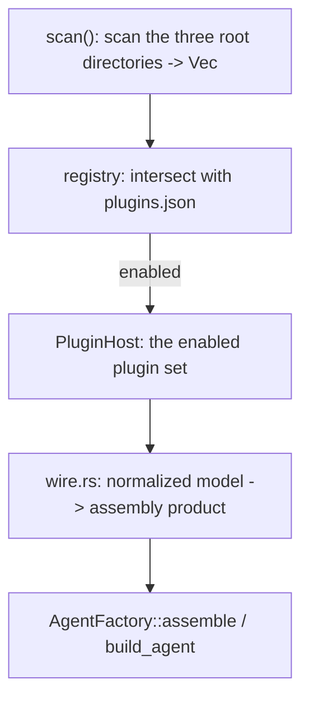

# Shirley technical design · Plugins and plugin marketplace (detailed design)

> Companion document: `docs/plugin-marketplace.md` (direction and decisions). This document lands it
> into **implementable interfaces, types, wiring, data flow, and tests**. **Status: design (not
> landed)**. Zero SDK changes is a hard constraint (same as skills / todo / memory).
>
> Reading order: first look at section 1's "one diagram + one vertical slice", then the corresponding
> chapters.

---

## 1. Overview: one vertical slice + layers

**Target vertical slice (P0+P1, the main deliverable of this document)**:

```
local plugin directory my-plugin/
  ├── shirley-plugin.json      # manifest
  ├── skills/weather/SKILL.md  # kind=skill
  └── mcp.json                 # kind=mcp (stdio server)

/plugin add ./my-plugin   →  import → normalize → register
   ├── skill  → one more entry in SkillCatalog → inject the Tier1 catalog each round
   └── mcp    → start the stdio server → tools/list → wrap each tool as impl Tool → ToolManager
```

The model calling `weather` (an MCP tool) works, and `activate_skill("weather")` gets the
instructions -- **once this is through, the marketplace is just its UI**.

**Layers (following the repository's existing paradigm)**:

```
application layer src/plugins/ (new in this document, at the same level as src/skills/)
├── mod.rs          # facade: PluginHost / re-exports
├── manifest.rs     # shirley-plugin.json parsing (lenient)
├── model.rs        # the normalized Plugin model (kind enum)
├── discovery.rs    # scan plugin directories / git sources
├── registry.rs     # enabled-plugin registration (plugins.json read/write + lock)
├── importer/       # adapter layer: native / claude_code / codex / mcpb
├── mcp/            # MCP client subsystem (transport / client / tool)
└── wire.rs         # bootstrap wiring: turn the normalized model into "skill list + tool factory + command candidates"
```

The SDK (`crates/shirley-agent-sdk/`) is **untouched**. Plugin registration reuses two existing
seams: `ToolManager::register` (tools) and `SkillCatalog` / `SkillContextProvider` (skills).

---

## 2. Normalized model (`src/plugins/model.rs`)

```rust
/// An imported plugin (after normalization). Every kind is a "declaration"; registration happens later.
#[derive(Debug, Clone)]
pub struct Plugin {
    /// Plugin name (manifest.name; the registry adds a suffix on collision).
    pub name: String,
    pub version: String,
    pub description: Option<String>,
    /// Plugin root directory (local directory / the directory after a git checkout).
    pub root: PathBuf,
    /// Source (for lock and display).
    pub source: PluginSource,
    /// The manifests of each kind (filled by the importer).
    pub capabilities: Capabilities,
    /// Declared permissions (**recorded only, not enforced**, see section 8).
    pub permissions: Vec<Permission>,
}

#[derive(Debug, Clone, PartialEq, Eq)]
pub enum PluginSource {
    Local { path: PathBuf },
    Git { url: String, rev: String },
}

/// The manifest of each kind. Each is a "relative path under the plugin root"; the registrar reads it accordingly.
#[derive(Debug, Clone, Default)]
pub struct Capabilities {
    pub skills: Vec<PathBuf>,      // directories containing SKILL.md
    pub commands: Vec<PathBuf>,    // *.md slash commands
    pub agents: Vec<PathBuf>,      // sub-agent *.md (deferred)
    pub mcp: Vec<McpServerDecl>,   // MCP server declarations
    pub ui: Vec<UiRendererDecl>,   // UI renderer declarations (deferred, see section 7)
}

/// MCP server declaration (normalized from .mcp.json / config.toml / manifest).
#[derive(Debug, Clone)]
pub struct McpServerDecl {
    pub name: String,
    pub transport: McpTransport,
    /// Keys that the user must provide but are not configured (normalized from the manifest's userConfig).
    pub config_required: Vec<ConfigField>,
}

#[derive(Debug, Clone)]
pub enum McpTransport {
    Stdio { command: String, args: Vec<String>, env: BTreeMap<String, String> },
    Http { url: String, headers: BTreeMap<String, String> },
}
```

**Design points**:

- **All paths store "relative to the plugin root"**, not absolute paths -- so they do not break when
  the plugin moves / the git checkout location changes. Resolve at registration time with
  `plugin.root.join(rel)`.
- `Capabilities` uses `Vec` rather than `Option`; empty = no such capability, saving `Option` checks.
- `PluginSource::Git` carries `rev` (commit SHA), the source of the lock's content fingerprint.

---

## 3. Manifest (`src/plugins/manifest.rs`)

**File**: `shirley-plugin.json` (the plugin root).

```json
{
  "name": "flight",
  "version": "1.0.0",
  "description": "Flight lookup + route map",
  "author": { "name": "Shirley" },
  "capabilities": {
    "skills": ["skills/"],
    "commands": ["commands/"],
    "mcp": ["mcp.json"]
  },
  "requires": {
    "shirley": ">=0.1",
    "permissions": ["network", "sandbox:bash"]
  }
}
```

**Parsing rules (aligned with `skills/parse.rs`'s lenient philosophy)**:

| Case | Handling |
| --- | --- |
| Missing `shirley-plugin.json` | treat as a **convention-directory plugin**: if `skills/` `commands/` `mcp.json` exist, accept them (compatible with the Claude Code style) |
| Missing `name` | use the directory name (the same as a skill name taking the directory name) |
| Missing `version` | `"0.0.0"`; fall back to `source.rev` in the lock |
| Missing `capabilities` | fall back to convention-directory auto-discovery |
| Unknown keys | leniently ignored (`#[serde(default)]`, no `deny_unknown_fields`) |
| JSON syntax error | log a warn, skip that plugin (do not drag down the others) |

**Why lenient**: compatibility is a core goal. Foreign formats vary wildly, and the parser must "save
what it can".

---

## 4. Discovery and registration (`discovery.rs` + `registry.rs`)

### 4.1 Discovery locations

| Level | Path | Description |
| --- | --- | --- |
| Project level | `<root>/.shirley/plugins/<name>/` | travels with the repository |
| User level | `~/.shirley/plugins/<name>/` | global |
| git source | `~/.shirley/plugins/.cache/<name>@<rev>/` | where `/plugin add <url>` lands after fetching |

Difference from skills: **skills are "use as soon as scanned", plugins are "only take effect when
explicitly enabled"** (decision 5). So discovery (scan) and enabling (enabled) are two separate
things.

### 4.2 Enable registration (`~/.shirley/plugins.json`)

```json
{
  "version": 1,
  "plugins": [
    {
      "name": "flight",
      "source": { "kind": "local", "path": "./my-plugin" },
      "enabled": true,
      "rev": null,
      "content_hash": "sha256:...",
      "enabled_capabilities": ["skill", "mcp"]
    }
  ]
}
```

- **`enabled`**: defaults to `false`. `/plugin add` only registers, does not enable; only
  `/plugin enable` takes effect.
- **`content_hash`**: the hash of all files in the plugin directory (excluding `.git`). **Content drift
  under the same version number** can be detected.
- **`enabled_capabilities`**: supports **enabling/disabling per kind** (the answer to open question 3:
  yes). E.g. enable only skill, not MCP (do not want to start a subprocess).

### 4.3 Data flow



**Assembly timing**: scan once in `AgentFactory::assemble` (at the same level as `skill_catalog`),
producing a `PluginHost` (read-only, shared across sessions). **But MCP connections are per-session**
(see section 6).

---

## 5. Adapter layer: importers (`src/plugins/importer/`)

```rust
/// Translate a source into a normalized Plugin. Only does mapping; does not register, execute, or start processes.
pub trait PluginImporter: Send + Sync {
    /// Whether it can handle this source (detect a marker file).
    fn can_import(&self, root: &Path) -> bool;
    /// Translate. `root` is the plugin root directory.
    fn import(&self, root: &Path, source: PluginSource) -> Result<Plugin, ImportError>;
}
```

### 5.1 NativeImporter (P0)

Reads `shirley-plugin.json`; if missing, convention-directory discovery. **Always the fallback** (put
at the end of the chain).

### 5.2 ClaudeCodeImporter (P2)

Detects `<root>/.claude-plugin/plugin.json`. Mapping:

| Claude Code | -> normalized |
| --- | --- |
| `.claude-plugin/plugin.json#name/version/description` | `Plugin.name/version/description` |
| `skills/` (or the manifest's `skills`) | `Capabilities.skills` |
| `commands/*.md` | `Capabilities.commands` |
| `.mcp.json` | `Capabilities.mcp` (parsed into `McpServerDecl`) |
| `agents/` | `Capabilities.agents` (deferred) |
| `hooks/` `output-styles/` `themes/` `monitors/` `bin/` `package.json` | **ignored + log a warn** |

**Command-syntax difference**: Claude's `.md` takes no args; Codex's has `$1..$9` / `$ARGUMENTS`.
Normalization **preserves the original text**; expansion happens at the command layer
(`CommandOutcome::Prompt`).

### 5.3 CodexImporter (P2)

Codex has no "plugin pack", only `~/.codex/config.toml`. Detect that `config.toml` exists and contains
`[mcp_servers]`. Mapping:

| Codex | -> normalized |
| --- | --- |
| `[mcp_servers.<name>]` | `McpServerDecl` (`command`/`args` -> Stdio; `url` -> Http) |
| `~/.codex/prompts/*.md` | `Capabilities.commands` |
| `.agents/skills/` | `Capabilities.skills` |

**Note**: the Codex config is a **global single file**, not "one directory = one plugin". The importer
imports **each `mcp_servers` entry** as a "pseudo-plugin" (`name` uses the server name). This is the
dirtiest spot in "smoothing over differences", and must be made clear in the UX (importing Codex =
importing server by server).

### 5.4 McpbImporter (deferred)

`.mcpb` is a zip (containing `manifest.json` + server code). Extract to a cache directory -> read the
manifest -> produce a Plugin of kind `mcp`. **After P3**.

### 5.5 Importer chain

```rust
// Try in order; the first can_import() == true wins; NativeImporter is the fallback.
let importers: Vec<Box<dyn PluginImporter>> = vec![
    Box::new(ClaudeCodeImporter),
    Box::new(CodexImporter),
    Box::new(McpbImporter),
    Box::new(NativeImporter),   // fallback, can_import is always true
];
```

---

## 6. MCP subsystem (`src/plugins/mcp/`) -- the heaviest part

MCP is the only proper way to "add tools at runtime". Three things to design: **transport / client /
tool wrapping**.

### 6.1 transport

```rust
pub enum Transport {
    /// Child-process stdio (local server).
    Stdio { child: Child, stdin: ChildStdin, reader: BufReader<ChildStdout> },
    /// HTTP (remote server).
    Http { client: reqwest::Client, url: String, headers: HeaderMap },
}
```

**The boundary of the stdio subprocess (key)**: an MCP server is an **external executable** and must
be started inside the sandbox. But the sandbox (`SandboxBackend`) is currently **not object-safe and
can only run one-shot commands**, not long-running ones. So the P1 compromise:

- **Start the stdio server directly with `tokio::process::Command`**, but apply: `env_clear()` +
  inject only the declared env, pin `current_dir` at the workspace, and route stdin/stdout through
  pipes.
- **Require `network` in the plugin manifest's `permissions` before allowing Http transport**;
  otherwise reject.
- **Honestly label the degradation**: the same as `SandboxOutput.degraded` -- P1's stdio isolation is
  **weaker than** a real sandbox, so state in the UI / logs "MCP server is not sandbox-isolated (P1)".
  **Do not pretend it is isolated**.

> Once a real sandbox backend (`sandbox-exec` / `bwrap`) lands, stdio should switch to it. This is the
> docking point with `docs/sandbox.md`.

### 6.2 client (protocol layer)

Implement a JSON-RPC subset of MCP: `initialize` / `tools/list` / `tools/call`.

```rust
pub struct McpClient {
    transport: Transport,
    next_id: AtomicU64,
    /// server capabilities (filled after initialize).
    capabilities: ServerCapabilities,
}

impl McpClient {
    pub async fn connect(decl: &McpServerDecl) -> Result<Self, McpError>;
    pub async fn list_tools(&mut self) -> Result<Vec<McpToolDef>, McpError>;
    pub async fn call_tool(&mut self, name: &str, args: Value) -> Result<Value, McpError>;
}
```

- `initialize` does **protocol version negotiation** + capability exchange.
- `tools/list` returns `McpToolDef { name, description, input_schema }` -- **`input_schema` is JSON
  Schema**, **isomorphic to `ToolDefinition.parameters`** (`Agent.md` already confirms Responses /
  ChatCompletions both use JSON Schema). **Zero conversion**.
- Requests carry a `timeout` (`tokio::time::timeout`); a timeout maps to `McpError::Timeout`.

### 6.3 tool wrapping (**the cleverest step**)

Wrap each MCP tool as an `impl Tool` and put it directly into `ToolManager`:

```rust
pub struct McpTool {
    definition: ToolDefinition,          // constructed directly from McpToolDef
    client: Arc<tokio::sync::Mutex<McpClient>>,  // shares the same connection
    remote_name: String,
}

impl Tool for McpTool {
    fn definition(&self) -> &ToolDefinition { &self.definition }

    fn invoke(&self, input: Value, _ctx: ToolContext) -> ToolFuture<'_> {
        let client = self.client.clone();
        let remote_name = self.remote_name.clone();
        Box::pin(async move {
            let mut client = client.lock().await;
            client.call_tool(&remote_name, input).await
                .map_err(|e| ToolError::ExecutionError(format!("[mcp] {e}")))
        })
    }
}
```

**Key points**:

- **Namespace**: `definition.name = format!("mcp__{server}__{tool}")` (the Claude style). Avoids name
  collisions with built-in tools / other servers.
- **Connection sharing**: `Arc<tokio::sync::Mutex<McpClient>>` -- stdio is a **single connection**, so
  concurrent tool calls need serialization (or multiplex requests by JSON-RPC id; P1 serializes first,
  simple and correct).
- **Error mapping**: MCP error -> `ToolError::ExecutionError`; for the four categories of `ToolError`
  semantics see `docs/tool-lifecycle.md`. MCP's "tool does not exist" should map to `NotFoundError`
  (the model can switch tools).
- **`ToolContext` is not needed**: an MCP tool is stateless; the state is in the client. An empty
  implementation suffices.

### 6.4 Lifecycle ownership (the answer to open question 2)

**Start one MCP connection per `Agent` (= per session)**, triggered by `build_agent`.

- Reason: like `ToolManager`, "created fresh per session", session isolation is natural.
- Cost: N sessions = N server processes. **Acceptable** (sessions are usually 1-3).
- Exit: when the `Agent` is dropped, `McpTool` holds `Arc<Mutex<McpClient>>`, and when the last
  reference is dropped, `Drop for McpClient` closes stdin / kills the child.
- **Crash restart**: P1 **does not** auto-restart (`call_tool` errors on failure, and the model sees
  `[mcp] ...` and decides for itself). The restart policy is recorded as a gap.

> Alternative (deferred): a globally shared connection pool + reference counting. P1 does one per
> session first, prioritizing simple and correct.

---

## 7. UI region plug-in (`ui` kind) -- two routes, do route A's registration point first

**Background** (verified): `AiMarkdown.tsx` uses streamdown's `renderers` to register
`{ language: "flightmap", component: FlightMapRenderer }` -- **the renderer is compiled into the web
app**.

### 7.1 Route A: host-native renderer (trusted; no plug-in-ization before P4)

The current flightmap state. **A plugin can only declare "I produce language X"; the renderer itself
must be built in**. So route A's "plug-in-ization" = the plugin declares the fence language in the
manifest, and it renders only when the host has the corresponding renderer **already built in**.

```json
// ui declaration (deferred)
{ "ui": [{ "kind": "fence", "language": "flightmap" }] }
```

**Do not do** "the plugin uploads renderer code into the main bundle" -- that requires recompiling,
which is equivalent to stuffing the supply chain into the binary.

### 7.2 Route B: isolated mounting (untrusted, the target form)

A foreign UI bundle goes through `<iframe sandbox="allow-scripts">` (**without** `allow-same-origin`) +
an independent origin + a postMessage bridge. The host only provides a **generic mount point**.

**Host-side prerequisite rework list** (P4, all missing):

| Item | Current state | To do |
| --- | --- | --- |
| CSP | `tauri.conf.json` `csp=null` | set a `frame-src` allowlist (the plugin bundle's origin) + `script-src` |
| Mount point | no iframe precedent | add a `<PluginFrame src=... sandbox="allow-scripts">` component |
| Message bridge | none | a postMessage protocol (host<->bundle), **exposing only data, not `invoke`** |
| bundle host | none | read from disk by `plugin.root` -> `srcdoc` / serve from a local origin |
| capability | only `core:default`+`dialog:default` | give the iframe no Tauri capability |

**Security iron rule**: the iframe is **never** same-origin, **never** able to call Tauri `invoke()`,
and **never** able to read session state. The bundle can only receive data fed by the host via
postMessage and send rendering events back.

### 7.3 slot model (the semantics of UI region plug-in)

| slot | Example | Route |
| --- | --- | --- |
| `message.fence:<lang>` | a flightmap code block | A (current) / B (target) |
| `composer.trailing` | the action on the right of the composer (the same slot as the model selector) | A |
| `sidebar.panel` | an extra panel in the left column | A / B |
| `tool.card:<name>` | a tool-specific result card | A / B |

**Do `message.fence` first** -- there is a flightmap precedent, and the payoff is the most direct.

### 7.4 TUI capability declaration

The TUI's `markdown.rs` **does not recognize** flightmap (a known gap). So when a plugin declares a UI
capability it **must carry an interface tag**:

```json
{ "ui": [{ "kind": "fence", "language": "flightmap", "interfaces": ["desktop"] }] }
```

On the TUI side, a fence whose `interfaces` does not include `tui` -> degrade to a code block. **This
fixes the old problem of "the skill contract being decoupled from the client's rendering
capabilities"**.

---

## 8. Command layer (`/plugin`)

### 8.1 Add a `CommandOutcome` branch + `Builtin`

```rust
// src/interface/tui/command.rs
enum Builtin { Init, Model, Rewind, Session, Login, Plugin }  // add Plugin

pub enum CommandOutcome {
    // ...existing...
    /// Open the plugin management panel (a local action).
    PluginManager,
    /// Not a known command.
    Unknown,
}
```

Candidate sources for `resolve` / `fuzzy_match`: built-in commands first, then skill names (already
present), and **finally plugin names** (operated inside the `/plugin` panel, not entering the
top-level candidates, to avoid pollution).

### 8.2 Panel (TUI + desktop share the orchestration)

`/plugin` opens a modal selector (the same style as `/session` / `/model`):

- List: enabled / registered-but-not-enabled / discoverable (local scan).
- Operations: `add <path|url>` / `enable <name>` / `disable <name>` / `remove <name>`.
- After enabling, **hot-update**: newly added skills go into `SkillCatalog`, MCP tools go into
  `ToolManager`. **But `ToolManager` is not `Clone` and the `Agent` already holds it** -- so enabling a
  plugin takes effect on the **next `build_agent`** (P1), or goes through `Agent::unregister_tool` +
  re-register (more complex, deferred).

> **Honest boundary**: P1's `/plugin enable` requires **rebuilding the Agent** for an **existing
> session** (or prompting "takes effect in a new session"). This differs from the existing seam of
> "hot-swapping run parameters" (`set_model` / `set_provider`) -- there is no hot seam for tool-table
> changes. Recorded as a gap.

---

## 9. bootstrap wiring (`wire.rs` + `bootstrap.rs`)

### 9.1 `assemble` stage

```rust
// inside AgentFactory::assemble, next to skill_catalog:
let plugin_host = PluginHost::load(&working_dir);   // scan + read plugins.json
// plugin_host.enabled() -> Vec<Plugin>
```

`PluginHost` provides:
- `plugin_skills() -> Vec<SkillMeta>`: parse all enabled plugins' `skills/*/SKILL.md` into `SkillMeta`
  (reusing `skills::parse`). **Merged into skill_catalog** (collision: plugin > project > user).
- `plugin_commands() -> Vec<CommandEntry>`: command candidates.
- `mcp_decls() -> Vec<McpServerDecl>`: MCP declarations (used to start a connection per session).

### 9.2 `build_agent` stage

```rust
// 1. skill: merge plugin skills into the catalog
let skill_catalog = Arc::new(self.skill_catalog.with_plugin_skills(
    self.plugin_host.plugin_skills()
));

// 2. MCP: start a connection per session, register tools
let mut tool_manager = assemble_tools();
for decl in self.plugin_host.mcp_decls() {
    match McpClient::connect(&decl).await {          // does build_agent become async?
        Ok(client) => {
            let client = Arc::new(Mutex::new(client));
            for tool_def in client.lock().await.list_tools().await? {
                tool_manager.register(McpTool::new(tool_def, client.clone()))?;
            }
        }
        Err(e) => eprintln!("[plugin] mcp `{}` connection failed: {e}", decl.name),
    }
}
```

**Problem**: `build_agent` is currently **synchronous** (`fn build_agent(...) -> Result<...>`). MCP
connections are **asynchronous**. Two options:

| Option | Description | Trade-off |
| --- | --- | --- |
| A. Make `build_agent` async | directly `.await` the connection | changes all callers (the TUI/desktop assembly points) |
| B. Defer the connection to the first call | lazy connect inside `McpTool::invoke` | `tools/list` is unavailable (cannot register tools) |
| C. **Warm up + lazy register** | `assemble` connects asynchronously in the background, and registers tools **through the hot seam** once connected | requires a tool hot-registration seam (none now) |

**P1 chooses A**: make `build_agent` `async`. Reason: assembly is already in an async context (the TUI
main loop / desktop command). **But** `build_agent`'s synchronicity is depended on in several places
(`SessionManager` etc.), which needs assessment. **Alternative**: add `build_agent_async` and keep the
sync version (goes sync when there is no MCP).

> This is the spot in this document that **most needs verification at landing time** (open question 1).
> Preference: keep `build_agent` sync, and have the caller make up the MCP connection with
> `register_plugin_tools(agent, decls).await` after `build_agent` returns -- but `Agent` does not
> expose a mutable `ToolManager` handle, so **the SDK still needs a new seam, or pass the
> already-connected tools in at construction**.

### 9.3 A cleaner approach: build MCP connections **at assemble time, with the connection pool shared
across sessions**

```
assemble() [async]:
  scan plugins -> for each mcp decl, build one McpClient -> put into Arc<McpPool>
build_agent() [sync]:
  McpPool.tools() synchronously returns the already-listed Vec<ToolDefinition> (listed at connect time)
  -> wrap each as an McpTool (sharing the client in the pool)
```

**Pros**: `build_agent` stays synchronous; the connection is built only once (shared across sessions,
saving processes).
**Cost**: the connection's lifecycle no longer follows the session -- it becomes an **application-level
singleton** (at the same level as `model_catalog`).
**This conflicts with 6.4's "one per session"** -- needs a re-decision.

> **Revision of 6.4**: leaning toward an **application-level connection pool** (built at assemble,
> shared across sessions), because: ① `build_agent` stays synchronous; ② server processes do not grow
> linearly with the number of sessions; ③ MCP servers usually have no session state. **Session
> isolation** is guaranteed by "the tool-name prefix contains the server name", without needing a
> separate process. This awaits Sean's decision (the final answer to open question 1).

---

## 10. Distribution (git source + lock)

### 10.1 `marketplace.json` (a git repository index)

```json
{
  "name": "shirley-official",
  "plugins": [
    { "name": "flight", "source": "./plugins/flight", "description": "...", "version": "1.0.0" },
    { "name": "weather", "source": "https://github.com/x/weather-plugin", "version": "2.1.0" }
  ]
}
```

`/plugin add <git-url>` -> clone to `.cache/<name>@<rev>/` -> read marketplace.json (if present) or
treat the root directly as a single plugin.

### 10.2 lock (content fingerprint)

Each plugin in `plugins.json` records `rev` (git SHA) + `content_hash` (directory hash). **Validate** on
load: if the content changed -> prompt "the plugin content has changed, re-trust?" (UX deferred; P1
only logs a warn).

### 10.3 Centralized registry (deferred)

Just **add another kind of `PluginSource`** (`Registry { url, name, version }`). The interface is
unchanged.

---

## 11. Security and trust (implementation)

| Risk | Specific handling | Landing point |
| --- | --- | --- |
| A plugin brings arbitrary code into the process | **forbidden**; tools can only come from MCP or skill scripts | importers execute no files |
| MCP stdio privilege escalation | `env_clear` + declared env; cwd pinned at the workspace; P1 labels "not sandboxed" | `mcp/transport.rs` |
| MCP Http unauthorized | requires `permissions: ["network"]` to allow | `registry` validation |
| UI bundle same-origin attack | route B forces a sandbox iframe + an independent origin; never inline | section 7 |
| Supply-chain tampering | `rev` + `content_hash`; explicit enabling | `registry.rs` |
| Declaration treated as authorization | `permissions` **recorded only, not enforced** (`PermissionPolicy` not landed) | stated plainly in the doc |
| A plugin blows up the context | skills follow the character cap; MCP tool-description injection has a cap | `wire.rs` |
| Plugin name collision | `mcp__{server}__{tool}` prefix; plugin name collision gets a suffix | `registry.rs` |

---

## 12. Test plan

**Unit tests (application layer)**:

1. `manifest`: lenient parsing (missing name / missing version / unknown keys / bad JSON skipped).
2. `importer::claude_code`: given a sample plugin directory, assert the mapped `Capabilities` is
   correct.
3. `importer::codex`: given a `config.toml`, assert `mcp_servers` are converted entry by entry into
   `McpServerDecl`.
4. `mcp::tool`: mock a transport (an in-memory echo server), assert `list_tools` / `call_tool` + error
   mapping (timeout -> ExecutionError).
5. `registry`: enable / disable / content-hash-change detection.
6. `wire`: after plugin skills are merged into `SkillCatalog`, `render_directory` contains the plugin
   skills.
7. **KV cache regression**: after plugin skills are merged, the catalog rendering is still a stable
   prefix (aligned with `skills/runtime.rs`'s `activation_is_append_only_kv_friendly`).

**Integration tests (outside the SDK, `tests/`)**:

8. **End-to-end vertical slice**: put a native plugin (a skill + a real stdio MCP server, e.g.
   `npx @modelcontextprotocol/server-everything`) in a temp directory, `/plugin add` -> enable ->
   assert the tool table contains `mcp__...__...` and the model can call it.

**Do not do mock-instead-of-verification** (aligned with Sean's preference): item 8 must **really
connect** to an MCP server.

---

## 13. File list (created / changed at implementation time)

**Created (application layer)**:

```
src/plugins/mod.rs
src/plugins/manifest.rs
src/plugins/model.rs
src/plugins/discovery.rs
src/plugins/registry.rs
src/plugins/importer/mod.rs
src/plugins/importer/native.rs
src/plugins/importer/claude_code.rs   # P2
src/plugins/importer/codex.rs         # P2
src/plugins/mcp/mod.rs
src/plugins/mcp/transport.rs
src/plugins/mcp/client.rs
src/plugins/mcp/tool.rs
src/plugins/wire.rs
```

**Changed (application layer)**:

| File | Change |
| --- | --- |
| `src/main.rs` | `mod plugins;` |
| `src/bootstrap.rs` | `assemble` adds `PluginHost::load`; `build_agent` merges skills + registers MCP tools; `AgentFactory` adds a `plugin_host` field |
| `src/interface/tui/command.rs` | `Builtin::Plugin` + `CommandOutcome::PluginManager` |
| `src/interface/tui/app.rs` | plugin panel state + operation wiring |
| `src/interface/tui/ui.rs` | plugin panel rendering |
| `src/interface/desktop/*` | `agent_list_plugins` / `agent_add_plugin` / ... commands |
| `src/skills/catalog.rs` | `SkillCatalog::with_plugin_skills` (union + collision rules) |
| `Cargo.toml` | MCP needs tokio's process/io feature (`tokio` already present); HTTP uses `reqwest` (already present) |

**Zero SDK changes** (hard constraint). If 9.2 finds a seam must be added (e.g. tool hot registration),
record it separately in `docs/sdk-gaps.md`.

---

## 14. Phases and acceptance

| Phase | Content | Acceptance |
| --- | --- | --- |
| **P0** | manifest + discovery + registry + native importer + skill/command kind registration + `/plugin` panel | a local plugin: its skills enter the catalog, commands are usable, enable/disable take effect |
| **P1** | MCP subsystem (stdio) + `mcp` kind + tool wrapping | vertical slice item 8: a real stdio server's tools can be called by the model |
| **P2** | ClaudeCode / Codex importers | a real community Claude Code plugin is correctly mapped |
| **P3** | git source + marketplace.json + lock | `/plugin add <git-url>` works; content drift is detectable |
| **P4** | UI route B (CSP + isolated mounting + the `message.fence` slot) | a plugin's own UI bundle is rendered in isolation |
| deferred | `agent` kind / `hook` kind / centralized registry / MCP Http / `.mcpb` | -- |

---

## 15. Open questions (need Sean's decision)

1. **MCP connection ownership**: one per session (6.4) vs an application-level shared pool (9.3)?
   Leaning toward a **shared pool** (`build_agent` stays synchronous, processes do not balloon), but
   the premise "servers have no session state" needs confirmation.
2. **Whether `build_agent` becomes async**: depends on 1. With a shared pool, keep it synchronous.
3. **The semantics of hot plugin enabling**: for P1, "takes effect in a new session" or "rebuild the
   current Agent"? The tool table has no hot seam.
4. **Whether UI route A is opened to plugins**: if the renderer must be built in, route A degrades to
   a "platform-exclusive capability list"; third parties can only go route B. **Needs a decision**.
5. **TUI capability degradation**: how should a plugin UI declaration tag the interface (7.4)? Is it
   acceptable for the TUI to degrade to a code block?
6. **The UX of Codex import**: Codex is a global config, not a plugin directory; is importing server
   by server reasonable?
7. **The `agents` kind dependency**: `docs/subagent.md` is not landed; should a plugin agent be treated
   as a skill first or wait?
8. **Compatibility acceptance sample**: which real Claude Code plugin should P2 use as the criterion
   for Done?

---

**Appendix: relationship to existing documents**

- Reused seams: `docs/skills.md` (the skill kind + `SkillCatalog`), `docs/tool-lifecycle.md`
  (`ToolManager` / `on_register`), `runtime/context.rs`'s `ContextProvider`.
- Siblings: `docs/subagent.md` (the agent kind), `docs/memory.md` / `docs/todo.md` (the provider
  paradigm).
- Boundaries: `docs/security.md` (`PermissionPolicy`), `docs/sandbox.md` (MCP subprocesses),
  `docs/desktop-interface.md` (UI slots).
- Upstream: Claude Code plugins, OpenAI Codex, MCP / MCPB / MCP Apps (SEP-1865), the Agent Skills
  open standard.
