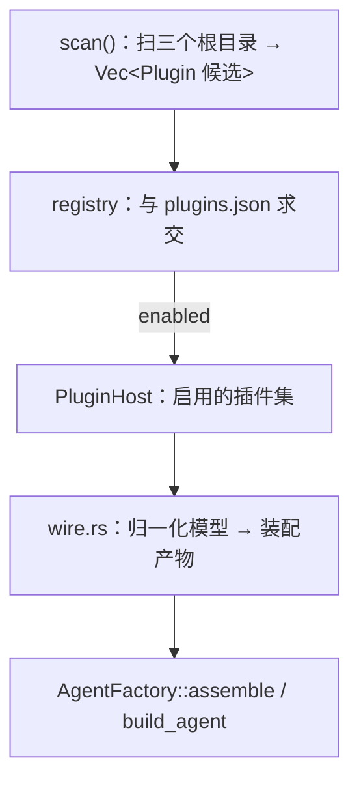

# Shirley 技术方案 · 插件与插件市场（详细设计）

> 配套文档：`docs/plugin-marketplace.md`（方向与决策）。本文把它落到**可实现的接口、类型、
> 接线、数据流、测试**。**状态：设计（未落地）**。SDK 零改动是硬约束（与 skills / todo /
> memory 同款）。
>
> 阅读顺序：先看第一节的「一张图 + 一个竖切」，再看对应章节。

---

## 一、总览：一条竖切 + 分层

**目标竖切（P0+P1，本文主要交付物）**：

```
本地插件目录 my-plugin/
  ├── shirley-plugin.json      # manifest
  ├── skills/weather/SKILL.md  # kind=skill
  └── mcp.json                 # kind=mcp（stdio server）

/plugin add ./my-plugin   →  导入 → 归一化 → 注册
   ├── skill  → SkillCatalog 多一条 → 每轮注入 Tier1 目录
   └── mcp    → 起 stdio server → tools/list → 每个 tool 包成 impl Tool → ToolManager
```

模型调 `weather`（MCP 工具）能跑通、能调 `activate_skill("weather")` 拿到指令 ——
**这条打通，市场只是它的 UI**。

**分层（沿用仓库既有范式）**：

```
应用层 src/plugins/（本文新增，与 src/skills/ 平级）
├── mod.rs          # 门面：PluginHost / 重导出
├── manifest.rs     # shirley-plugin.json 解析（宽容）
├── model.rs        # 归一化 Plugin 模型（kind 枚举）
├── discovery.rs    # 扫插件目录 / git 源
├── registry.rs     # 已启用插件登记（plugins.json 读写 + lock）
├── importer/       # 适配层：native / claude_code / codex / mcpb
├── mcp/            # MCP client 子系统（transport / client / tool）
└── wire.rs         # bootstrap 接线：把归一化模型变成「skill 列表 + 工具工厂 + 命令候选」
```

SDK（`crates/shirley-agent-sdk/`）**不动**。插件注册复用两个既有接缝：
`ToolManager::register`（工具）与 `SkillCatalog` / `SkillContextProvider`（skill）。

---

## 二、归一化模型（`src/plugins/model.rs`）

```rust
/// 一个已导入的插件（归一化后）。所有 kind 都是「声明」，注册发生在后面。
#[derive(Debug, Clone)]
pub struct Plugin {
    /// 插件名（manifest.name；冲突时由 registry 加后缀）。
    pub name: String,
    pub version: String,
    pub description: Option<String>,
    /// 插件根目录（本地目录 / git checkout 后的目录）。
    pub root: PathBuf,
    /// 来源（用于 lock 与展示）。
    pub source: PluginSource,
    /// 各 kind 的清单（导入器填）。
    pub capabilities: Capabilities,
    /// 声明的权限（**只记录不强制**，见第八节）。
    pub permissions: Vec<Permission>,
}

#[derive(Debug, Clone, PartialEq, Eq)]
pub enum PluginSource {
    Local { path: PathBuf },
    Git { url: String, rev: String },
}

/// 各 kind 的清单。每个都是「插件根下的相对路径」，注册器据此去读。
#[derive(Debug, Clone, Default)]
pub struct Capabilities {
    pub skills: Vec<PathBuf>,      // 含 SKILL.md 的目录
    pub commands: Vec<PathBuf>,    // *.md slash 命令
    pub agents: Vec<PathBuf>,      // 子 agent *.md（后置）
    pub mcp: Vec<McpServerDecl>,   // MCP server 声明
    pub ui: Vec<UiRendererDecl>,   // UI 渲染器声明（后置，见第七节）
}

/// MCP server 声明（归一化自 .mcp.json / config.toml / manifest）。
#[derive(Debug, Clone)]
pub struct McpServerDecl {
    pub name: String,
    pub transport: McpTransport,
    /// 需要用户提供但未配置的键（manifest 的 userConfig 归一化而来）。
    pub config_required: Vec<ConfigField>,
}

#[derive(Debug, Clone)]
pub enum McpTransport {
    Stdio { command: String, args: Vec<String>, env: BTreeMap<String, String> },
    Http { url: String, headers: BTreeMap<String, String> },
}
```

**设计要点**：

- **所有路径存「相对插件根」**，不存绝对路径 —— 插件移动 / git checkout 位置变化后不失效。
  注册时用 `plugin.root.join(rel)` 解析。
- `Capabilities` 用 `Vec` 而非 `Option`，空 = 无该类能力，省去 `Option` 判断。
- `PluginSource::Git` 带 `rev`（commit SHA），是 lock 的内容指纹来源。

---

## 三、manifest（`src/plugins/manifest.rs`）

**文件**：`shirley-plugin.json`（插件根）。

```json
{
  "name": "flight",
  "version": "1.0.0",
  "description": "航班查询 + 航线地图",
  "author": { "name": "Shirley" },
  "capabilities": {
    "skills": ["skills/"],
    "commands": ["commands/"],
    "mcp": ["mcp.json"]
  },
  "requires": {
    "shirley": ">=0.1",
    "permissions": ["network", "sandbox:bash"]
  }
}
```

**解析规则（对齐 `skills/parse.rs` 的宽容哲学）**：

| 情况 | 处理 |
| --- | --- |
| 缺 `shirley-plugin.json` | 视为**约定目录插件**：`skills/` `commands/` `mcp.json` 存在即收（兼容 Claude Code 风格） |
| `name` 缺失 | 用目录名（与 skill 名取目录名同款） |
| `version` 缺失 | `"0.0.0"`；lock 时用 `source.rev` 兜底 |
| `capabilities` 缺失 | 回退约定目录自动发现 |
| 未知键 | 宽容忽略（`#[serde(default)]`，不 `deny_unknown_fields`） |
| JSON 语法错误 | 记 warn、跳过该插件（不拖垮其它） |

**为什么宽容**：兼容是核心目标。外来格式千奇百怪，解析器必须「能救则救」。

---

## 四、发现与登记（`discovery.rs` + `registry.rs`）

### 4.1 发现位置

| 层级 | 路径 | 说明 |
| --- | --- | --- |
| 项目级 | `<root>/.shirley/plugins/<name>/` | 随仓库走 |
| 用户级 | `<config_dir>/shirley/plugins/<name>/` | 全局 |
| git 源 | `<config_dir>/shirley/plugins/.cache/<name>@<rev>/` | `/plugin add <url>` 拉取后落此 |

与 skill 的差别：**skill 是「扫到即用」，插件是「显式启用才生效」**（决策 5）。
所以发现（scan）与启用（enabled）是两件事。

### 4.2 启用登记（`<config_dir>/shirley/plugins.json`）

```json
{
  "version": 1,
  "plugins": [
    {
      "name": "flight",
      "source": { "kind": "local", "path": "./my-plugin" },
      "enabled": true,
      "rev": null,
      "content_hash": "sha256:...",
      "enabled_capabilities": ["skill", "mcp"]
    }
  ]
}
```

- **`enabled`**：默认 `false`。`/plugin add` 只登记不启用；`/plugin enable` 才生效。
- **`content_hash`**：插件目录全部文件的哈希（排除 `.git`）。**同版本号内容漂移**能被发现。
- **`enabled_capabilities`**：支持**按 kind 单独启停**（开放问题 3 的答案：支持）。
  比如只启 skill 不启 MCP（不想起子进程）。

### 4.3 数据流



**装配时机**：`AgentFactory::assemble` 里扫一次（与 `skill_catalog` 同级），
产出 `PluginHost`（只读、跨会话共享）。**但 MCP 连接是每会话的**（见第六节）。

---

## 五、适配层：导入器（`src/plugins/importer/`）

```rust
/// 把一个源翻译成归一化 Plugin。只做映射，不注册、不执行、不起进程。
pub trait PluginImporter: Send + Sync {
    /// 能否处理这个源（探测标志文件）。
    fn can_import(&self, root: &Path) -> bool;
    /// 翻译。`root` 是插件根目录。
    fn import(&self, root: &Path, source: PluginSource) -> Result<Plugin, ImportError>;
}
```

### 5.1 NativeImporter（P0）

读 `shirley-plugin.json`；缺则约定目录发现。**永远兜底**（放链尾）。

### 5.2 ClaudeCodeImporter（P2）

探测 `<root>/.claude-plugin/plugin.json`。映射：

| Claude Code | → 归一化 |
| --- | --- |
| `.claude-plugin/plugin.json#name/version/description` | `Plugin.name/version/description` |
| `skills/`（或 manifest `skills`） | `Capabilities.skills` |
| `commands/*.md` | `Capabilities.commands` |
| `.mcp.json` | `Capabilities.mcp`（解析成 `McpServerDecl`） |
| `agents/` | `Capabilities.agents`（后置） |
| `hooks/` `output-styles/` `themes/` `monitors/` `bin/` `package.json` | **忽略 + 记 warn** |

**命令语法差异**：Claude 的 `.md` 无参；Codex 的带 `$1..$9` / `$ARGUMENTS`。
归一化时**保留原文**，展开发生在命令层（`CommandOutcome::Prompt`）。

### 5.3 CodexImporter（P2）

Codex 没有「插件包」，只有 `~/.codex/config.toml`。探测 `config.toml` 存在且含
`[mcp_servers]`。映射：

| Codex | → 归一化 |
| --- | --- |
| `[mcp_servers.<name>]` | `McpServerDecl`（`command`/`args` → Stdio；`url` → Http） |
| `~/.codex/prompts/*.md` | `Capabilities.commands` |
| `.agents/skills/` | `Capabilities.skills` |

**注意**：Codex 配置是**全局单文件**，不是「一个目录 = 一个插件」。导入器把**每个
`mcp_servers` 条目**当成一个「伪插件」导入（`name` 用 server 名）。这是「抹平差异」
里最脏的一处，需在 UX 上说清（导入 Codex = 逐 server 导入）。

### 5.4 McpbImporter（后置）

`.mcpb` 是 zip（含 `manifest.json` + server 代码）。解压到缓存目录 → 读 manifest →
产出一个 `mcp` kind 的 Plugin。**P3 之后**。

### 5.5 导入器链

```rust
// 按顺序尝试，第一个 can_import() == true 的胜出；NativeImporter 兜底。
let importers: Vec<Box<dyn PluginImporter>> = vec![
    Box::new(ClaudeCodeImporter),
    Box::new(CodexImporter),
    Box::new(McpbImporter),
    Box::new(NativeImporter),   // 兜底，can_import 恒 true
];
```

---

## 六、MCP 子系统（`src/plugins/mcp/`）—— 最重的部分

MCP 是「运行期加工具」的唯一正道。设计三件事：**transport / client / tool 包装**。

### 6.1 transport

```rust
pub enum Transport {
    /// 子进程 stdio（本地 server）。
    Stdio { child: Child, stdin: ChildStdin, reader: BufReader<ChildStdout> },
    /// HTTP（远端 server）。
    Http { client: reqwest::Client, url: String, headers: HeaderMap },
}
```

**stdio 子进程的边界（关键）**：MCP server 是**外来可执行文件**，必须在沙盒里起。
但沙盒（`SandboxBackend`）当前**非 object-safe、只能跑一次性命令**，不能长驻。
所以 P1 的折中：

- **stdio server 用 `tokio::process::Command` 直起**，但施加：`env_clear()` + 只注入声明的
  env、`current_dir` 钉在工作区、stdin/stdout 走管道。
- **在插件 manifest 的 `permissions` 里要求 `network` 才允许 Http transport**；未声明则拒。
- **如实标注降级**：与 `SandboxOutput.degraded` 同款——P1 的 stdio 隔离**弱于**真沙盒，
  在 UI / 日志里写明「MCP server 未沙盒隔离（P1）」。**不假装隔离**。

> 真沙盒后端（`sandbox-exec` / `bwrap`）落地后，stdio 应改走它。这是与
> `docs/sandbox.md` 的对接点。

### 6.2 client（协议层）

实现 MCP 的 JSON-RPC 子集：`initialize` / `tools/list` / `tools/call`。

```rust
pub struct McpClient {
    transport: Transport,
    next_id: AtomicU64,
    /// server 能力（initialize 后填充）。
    capabilities: ServerCapabilities,
}

impl McpClient {
    pub async fn connect(decl: &McpServerDecl) -> Result<Self, McpError>;
    pub async fn list_tools(&mut self) -> Result<Vec<McpToolDef>, McpError>;
    pub async fn call_tool(&mut self, name: &str, args: Value) -> Result<Value, McpError>;
}
```

- `initialize` 做**协议版本协商** + 能力交换。
- `tools/list` 返回的 `McpToolDef { name, description, input_schema }` —— **`input_schema`
  就是 JSON Schema**，与 `ToolDefinition.parameters` **同构**（`Agent.md` 已确认 Responses /
  ChatCompletions 都用 JSON Schema）。**零转换**。
- 请求带 `timeout`（`tokio::time::timeout`），超时归 `McpError::Timeout`。

### 6.3 tool 包装（**最巧的一步**）

每个 MCP 工具包成 `impl Tool`，直接进 `ToolManager`：

```rust
pub struct McpTool {
    definition: ToolDefinition,          // 由 McpToolDef 直接构造
    client: Arc<tokio::sync::Mutex<McpClient>>,  // 共享同一连接
    remote_name: String,
}

impl Tool for McpTool {
    fn definition(&self) -> &ToolDefinition { &self.definition }

    fn invoke(&self, input: Value, _ctx: ToolContext) -> ToolFuture<'_> {
        let client = self.client.clone();
        let remote_name = self.remote_name.clone();
        Box::pin(async move {
            let mut client = client.lock().await;
            client.call_tool(&remote_name, input).await
                .map_err(|e| ToolError::ExecutionError(format!("[mcp] {e}")))
        })
    }
}
```

**关键点**：

- **命名空间**：`definition.name = format!("mcp__{server}__{tool}")`（Claude 风格）。
  避免与内置工具 / 其它 server 撞名。
- **连接共享**：`Arc<tokio::sync::Mutex<McpClient>>`——stdio 是**单连接**，并发工具调用
  需串行化（或用 JSON-RPC id 做请求多路复用，P1 先串行，简单正确）。
- **错误映射**：MCP 错误 → `ToolError::ExecutionError`；`ToolError` 的四类语义见
  `docs/tool-lifecycle.md`。MCP 的「工具不存在」应映射 `NotFoundError`（模型可换工具）。
- **`ToolContext` 用不上**：MCP 工具无状态，状态在 client 里。空实现即可。

### 6.4 生命周期归属（开放问题 2 的答案）

**每个 `Agent`（= 每个会话）起一份 MCP 连接**，由 `build_agent` 触发。

- 理由：与 `ToolManager` 一样「每会话新建」，会话隔离天然。
- 代价：N 个会话 = N 个 server 进程。**可接受**（会话通常 1~3 个）。
- 退出：`Agent` 被 drop 时，`McpTool` 持有 `Arc<Mutex<McpClient>>`，最后一个引用 drop
  时 `Drop for McpClient` 关 stdin / kill child。
- **崩溃重启**：P1 **不做**自动重启（`call_tool` 失败就报错，模型看到 `[mcp] ...` 自己决定）。
  重启策略记缺口。

> 备选（后置）：全局共享一份连接池 + 引用计数。P1 先每会话一份，简单正确优先。

---

## 七、UI 区域插拔（`ui` kind）—— 两条路线，先做路线 A 的注册点

**背景**（已核实）：`AiMarkdown.tsx` 用 streamdown 的 `renderers` 注册
`{ language: "flightmap", component: FlightMapRenderer }`——**渲染器编译进 web app**。

### 7.1 路线 A：宿主原生渲染器（可信，P4 前不做插件化）

flightmap 现状。**插件只能声明「我产出语言 X」，渲染器本身必须内置**。
所以路线 A 的「插件化」= 插件在 manifest 声明围栏语言，宿主**已内置**对应 renderer 时才渲染。

```json
// ui 声明（后置）
{ "ui": [{ "kind": "fence", "language": "flightmap" }] }
```

**不做**「插件上传 renderer 代码进主包」——那要重编译，等于把供应链塞进二进制。

### 7.2 路线 B：隔离挂载（不可信，目标形态）

外来 UI bundle 走 `<iframe sandbox="allow-scripts">`（**不含** `allow-same-origin`）
+ 独立 origin + postMessage 桥。宿主只做**通用挂载点**。

**宿主侧前置改造清单**（P4，全缺）：

| 项 | 现状 | 要做 |
| --- | --- | --- |
| CSP | `tauri.conf.json` `csp=null` | 设 `frame-src` 白名单（插件 bundle 的 origin）+ `script-src` |
| 挂载点 | 无 iframe 先例 | 新增 `<PluginFrame src=... sandbox="allow-scripts">` 组件 |
| 消息桥 | 无 | postMessage 协议（宿主↔bundle），**只暴露数据、不暴露 `invoke`** |
| bundle 宿主 | 无 | 按 `plugin.root` 读盘 → `srcdoc` / 本地 origin serve |
| capability | 只有 `core:default`+`dialog:default` | 不给 iframe 任何 Tauri capability |

**安全铁律**：iframe **绝不**同源、**绝不**能调 Tauri `invoke()`、**绝不**读会话状态。
bundle 只能通过 postMessage 收宿主喂的数据、回传渲染事件。

### 7.3 slot 模型（界面区域插拔的语义）

| slot | 例子 | 路线 |
| --- | --- | --- |
| `message.fence:<lang>` | flightmap 代码块 | A（现）/ B（目标） |
| `composer.trailing` | 发送框右侧动作（模型选择器同款槽位） | A |
| `sidebar.panel` | 左栏附加面板 | A / B |
| `tool.card:<name>` | 某工具的专属结果卡 | A / B |

**先做 `message.fence`**——有 flightmap 先例、收益最直接。

### 7.4 TUI 的能力声明

TUI 的 `markdown.rs` **不认** flightmap（已知缺口）。所以插件声明 UI 能力时**必须带界面标签**：

```json
{ "ui": [{ "kind": "fence", "language": "flightmap", "interfaces": ["desktop"] }] }
```

TUI 侧遇到 `interfaces` 不含 `tui` 的围栏 → 降级为代码块。**这修的是「skill 契约与
客户端渲染能力脱钩」的老问题**。

---

## 八、命令层（`/plugin`）

### 8.1 新增 `CommandOutcome` 分支 + `Builtin`

```rust
// src/interface/command.rs
enum Builtin { Init, Model, Rewind, Session, Login, Plugin }  // 加 Plugin

pub enum CommandOutcome {
    // ...既有...
    /// 打开插件管理面板（本地动作）。
    PluginManager,
    /// 不是已知指令。
    Unknown,
}
```

`resolve` / `fuzzy_match` 的候选来源：内置指令优先，其次 skill 名（已有），
**最后插件名**（`/plugin` 面板内操作，不进顶层候选，避免污染）。

### 8.2 面板（TUI + desktop 共用编排）

`/plugin` 打开模态选择器（与 `/session` / `/model` 同款）：

- 列表：已启用 / 已登记未启用 / 可发现（本地扫描）。
- 操作：`add <path|url>` / `enable <name>` / `disable <name>` / `remove <name>`。
- 启用后**热更新**：新增的 skill 进 `SkillCatalog`、MCP 工具进 `ToolManager`。
  **但 `ToolManager` 非 `Clone`、`Agent` 已持有它** —— 所以启用插件是**下次
  `build_agent` 生效**（P1），或走 `Agent::unregister_tool` + 重新注册（更复杂，后置）。

> **诚实边界**：P1 的 `/plugin enable` 对**已存在会话**需要**重建 Agent**（或提示
> 「新会话生效」）。这与「运行参数热切换」的既有接缝（`set_model` / `set_provider`）
> 不同——工具表变更没有热接缝。记为缺口。

---

## 九、bootstrap 接线（`wire.rs` + `bootstrap.rs`）

### 9.1 `assemble` 阶段

```rust
// AgentFactory::assemble 内，skill_catalog 旁边：
let plugin_host = PluginHost::load(&working_dir);   // 扫 + 读 plugins.json
// plugin_host.enabled() → Vec<Plugin>
```

`PluginHost` 提供：
- `plugin_skills() -> Vec<SkillMeta>`：把所有启用插件的 `skills/*/SKILL.md` 解析成
  `SkillMeta`（复用 `skills::parse`）。**并入 skill_catalog**（重名：插件 > 项目 > 用户）。
- `plugin_commands() -> Vec<CommandEntry>`：命令候选。
- `mcp_decls() -> Vec<McpServerDecl>`：MCP 声明（每会话起连接用）。

### 9.2 `build_agent` 阶段

```rust
// 1. skill：把插件 skill 并进目录
let skill_catalog = Arc::new(self.skill_catalog.with_plugin_skills(
    self.plugin_host.plugin_skills()
));

// 2. MCP：每会话起连接、注册工具
let mut tool_manager = assemble_tools();
for decl in self.plugin_host.mcp_decls() {
    match McpClient::connect(&decl).await {          // build_agent 变 async？
        Ok(client) => {
            let client = Arc::new(Mutex::new(client));
            for tool_def in client.lock().await.list_tools().await? {
                tool_manager.register(McpTool::new(tool_def, client.clone()))?;
            }
        }
        Err(e) => eprintln!("[plugin] mcp `{}` 连接失败：{e}", decl.name),
    }
}
```

**问题**：`build_agent` 现在是**同步**的（`fn build_agent(...) -> Result<...>`）。
MCP 连接是**异步**的。两个选择：

| 方案 | 说明 | 取舍 |
| --- | --- | --- |
| A. `build_agent` 变 async | 直接 `.await` 连接 | 改动所有调用方（TUI/desktop 的装配点） |
| B. 连接延迟到首次调用 | `McpTool::invoke` 里懒连接 | `tools/list` 拿不到（无法注册工具） |
| C. **预热 + 懒注册** | `assemble` 后台异步连接，连上后**通过热接缝注册工具** | 需要工具热注册接缝（现无） |

**P1 选 A**：`build_agent` 变 `async`。理由：装配本来就在 async 上下文（TUI 主循环 /
desktop command 里）。**但** `build_agent` 同步性被多处依赖（`SessionManager` 等），
需评估。**替代**：新增 `build_agent_async`，同步版保留（无 MCP 时走同步）。

> 这是本文**最需要落地时验证**的一处（开放问题 1）。倾向：`build_agent` 保持同步，
> MCP 连接在 `build_agent` 返回后由调用方 `register_plugin_tools(agent, decls).await`
> 补上——但 `Agent` 不暴露 `ToolManager` 可变句柄，所以**还是要 SDK 加一个接缝或
> 在构造时传入已连好的工具**。

### 9.3 更干净的方案：MCP 连接**在 assemble 时建、连接池跨会话共享**

```
assemble() [async]:
  扫插件 → 对每个 mcp decl 建一个 McpClient → 放进 Arc<McpPool>
build_agent() [sync]:
  McpPool.tools() 同步返回已 list 好的 Vec<ToolDefinition>（连接时已 list）
  → 每个包成 McpTool（共享 pool 里的 client）
```

**优点**：`build_agent` 保持同步；连接只建一次（跨会话共享，省进程）。
**代价**：连接的生命周期不再随会话——变成**应用级单例**（与 `model_catalog` 同级）。
**这与 6.4 的「每会话一份」冲突**——需重新拍板。

> **修正 6.4**：倾向**应用级连接池**（assemble 建、跨会话共享），因为：
> ① `build_agent` 保持同步；② server 进程不随会话数线性增长；③ MCP server 通常无
> 会话状态。**会话隔离**用「工具名前缀含 server 名」保证即可，不需要独立进程。
> 这条待 Sean 拍板（开放问题 1 的最终答案）。

---

## 十、分发（git 源 + lock）

### 10.1 `marketplace.json`（git 仓库索引）

```json
{
  "name": "shirley-official",
  "plugins": [
    { "name": "flight", "source": "./plugins/flight", "description": "...", "version": "1.0.0" },
    { "name": "weather", "source": "https://github.com/x/weather-plugin", "version": "2.1.0" }
  ]
}
```

`/plugin add <git-url>` → clone 到 `.cache/<name>@<rev>/` → 读 marketplace.json（若有）或
直接把根当单插件。

### 10.2 lock（内容指纹）

`plugins.json` 里每个插件记 `rev`（git SHA）+ `content_hash`（目录哈希）。
加载时**校验**：内容变了 → 提示「插件内容已变化，是否重新信任？」（UX 后置，P1 只记 warn）。

### 10.3 中心化 registry（后置）

只是**再加一种 `PluginSource`**（`Registry { url, name, version }`）。接口不变。

---

## 十一、安全与信任（落实）

| 风险 | 具体处置 | 落点 |
| --- | --- | --- |
| 插件带任意代码进进程 | **禁止**；工具只能来自 MCP 或 skill 脚本 | 导入器不执行任何文件 |
| MCP stdio 越权 | `env_clear` + 声明 env；cwd 钉工作区；P1 标注「未沙盒」 | `mcp/transport.rs` |
| MCP Http 未授权 | 需 `permissions: ["network"]` 才允许 | `registry` 校验 |
| UI bundle 同源攻击 | 路线 B 强制 sandbox iframe + 独立 origin；绝不内联 | 第七节 |
| 供应链篡改 | `rev` + `content_hash`；启用显式 | `registry.rs` |
| 声明当授权 | `permissions` **只记录不强制**（`PermissionPolicy` 未落地） | 文档明说 |
| 插件撑爆上下文 | skill 沿用字符上限；MCP 工具描述注入设上限 | `wire.rs` |
| 插件名冲突 | `mcp__{server}__{tool}` 前缀；插件名冲突加后缀 | `registry.rs` |

---

## 十二、测试计划

**单测（应用层）**：

1. `manifest`：宽容解析（缺 name / 缺 version / 未知键 / 坏 JSON 跳过）。
2. `importer::claude_code`：给一个样例插件目录，断言映射出的 `Capabilities` 正确。
3. `importer::codex`：给一个 `config.toml`，断言 `mcp_servers` 逐条转 `McpServerDecl`。
4. `mcp::tool`：mock 一个 transport（内存 echo server），断言 `list_tools` / `call_tool`
   + 错误映射（超时 → ExecutionError）。
5. `registry`：启用 / 停用 / 内容哈希变化检测。
6. `wire`：插件 skill 并入 `SkillCatalog` 后，`render_directory` 含插件 skill。
7. **KV 缓存回归**：插件 skill 并入后，目录渲染仍是稳定前缀（对齐
   `skills/runtime.rs` 的 `activation_is_append_only_kv_friendly`）。

**集成测试（SDK 外，`tests/`）**：

8. **端到端竖切**：临时目录放一个 native 插件（skill + 一个真 stdio MCP server，如
   `npx @modelcontextprotocol/server-everything`），`/plugin add` → 启用 → 断言工具表
   含 `mcp__...__...`、模型能调。

**不做 mock 冒充验证**（对齐 Sean 偏好）：第 8 条要**真连**一个 MCP server。

---

## 十三、文件清单（实现时新建 / 改动）

**新建（应用层）**：

```
src/plugins/mod.rs
src/plugins/manifest.rs
src/plugins/model.rs
src/plugins/discovery.rs
src/plugins/registry.rs
src/plugins/importer/mod.rs
src/plugins/importer/native.rs
src/plugins/importer/claude_code.rs   # P2
src/plugins/importer/codex.rs         # P2
src/plugins/mcp/mod.rs
src/plugins/mcp/transport.rs
src/plugins/mcp/client.rs
src/plugins/mcp/tool.rs
src/plugins/wire.rs
```

**改动（应用层）**：

| 文件 | 改动 |
| --- | --- |
| `src/main.rs` | `mod plugins;` |
| `src/bootstrap.rs` | `assemble` 加 `PluginHost::load`；`build_agent` 并 skill + 注册 MCP 工具；`AgentFactory` 加 `plugin_host` 字段 |
| `src/interface/command.rs` | `Builtin::Plugin` + `CommandOutcome::PluginManager` |
| `src/interface/app.rs` | 插件面板状态 + 操作接线 |
| `src/interface/ui.rs` | 插件面板渲染 |
| `src/interface/desktop/*` | `agent_list_plugins` / `agent_add_plugin` / ... commands |
| `src/skills/catalog.rs` | `SkillCatalog::with_plugin_skills`（并集 + 重名规则） |
| `Cargo.toml` | MCP 需要 `tokio` 的 process/io feature（已有 `tokio`）；HTTP 用 `reqwest`（已有） |

**SDK 零改动**（硬约束）。若 9.2 发现必须加接缝（如工具热注册），单独记 `docs/sdk-gaps.md`。

---

## 十四、分期与验收

| 期 | 内容 | 验收 |
| --- | --- | --- |
| **P0** | manifest + 发现 + registry + native 导入器 + skill/command kind 注册 + `/plugin` 面板 | 一个本地插件，skill 进目录、命令可用、启用/停用生效 |
| **P1** | MCP 子系统（stdio）+ `mcp` kind + 工具包装 | 竖切第 8 条：真 stdio server 的工具能被模型调用 |
| **P2** | ClaudeCode / Codex 导入器 | 一个真实社区 Claude Code 插件被正确映射 |
| **P3** | git 源 + marketplace.json + lock | `/plugin add <git-url>` 可用；内容漂移可检测 |
| **P4** | UI 路线 B（CSP + 隔离挂载 + `message.fence` slot） | 一个插件自带 UI bundle 被隔离渲染 |
| 后置 | `agent` kind / `hook` kind / 中心化 registry / MCP Http / `.mcpb` | — |

---

## 十五、开放问题（需 Sean 拍板）

1. **MCP 连接归属**：每会话一份（6.4）vs 应用级共享池（9.3）？倾向**共享池**
   （`build_agent` 保持同步、进程不膨胀），但需确认「server 无会话状态」的前提。
2. **`build_agent` 是否变 async**：取决于 1。若共享池则保持同步。
3. **插件热启用的语义**：P1 是「新会话生效」还是「重建当前 Agent」？工具表无热接缝。
4. **UI 路线 A 是否开放给插件**：若渲染器必须内置，路线 A 退化为「平台独家能力清单」；
   第三方只能走路线 B。**需拍板**。
5. **TUI 能力降级**：插件 UI 声明如何标界面（7.4）？TUI 降级成代码块是否可接受？
6. **Codex 导入的 UX**：Codex 是全局配置不是插件目录，逐 server 导入是否合理？
7. **`agents` kind 依赖**：`docs/subagent.md` 未落地，插件 agent 先当 skill 还是等？
8. **兼容验收样本**：P2 拿哪个真实 Claude Code 插件做 Done 的判据？

---

**附：与既有文档的关系**

- 复用接缝：`docs/skills.md`（skill kind + `SkillCatalog`）、`docs/tool-lifecycle.md`
  （`ToolManager` / `on_register`）、`runtime/context.rs` 的 `ContextProvider`。
- 同族：`docs/subagent.md`（agent kind）、`docs/memory.md` / `docs/todo.md`（provider 范式）。
- 边界：`docs/security.md`（`PermissionPolicy`）、`docs/sandbox.md`（MCP 子进程）、
  `docs/desktop-interface.md`（UI slot）。
- 上游：Claude Code plugins、OpenAI Codex、MCP / MCPB / MCP Apps（SEP-1865）、
  Agent Skills 开放标准。
