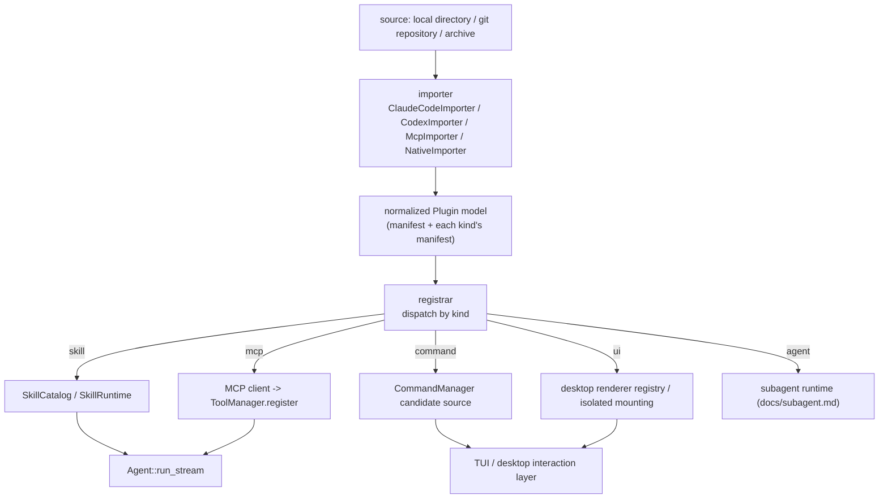

# Shirley technical design · Plugins and the plugin marketplace (plugin / marketplace)

> **Status: design exploration (not landed).** This document only converges direction and reasons
> through decisions; it contains no implementation commitment. The goal is to converge the scattered
> topics "skill / MCP / skill+MCP combination / Claude Code·Codex plugin compatibility / UI-region
> pluggability" onto one **unified plugin model**, and map each item to the **existing seams** in the
> repository.

---

**1. What it solves**

Shirley now has three kinds of "pluggable capability", but they are **each independent, each
discovered on their own, each injected on their own**:

| Existing capability | Landing point | Discovery | Injection seam |
| --- | --- | --- | --- |
| skill (`docs/skills.md`) | `src/skills/` | scan `.agents/skills` / `.claude/skills` | `SkillCatalog` + `SkillRuntime` + `ContextProvider` |
| memory / ledger | `src/memory/` `src/todo.rs` | fixed | `ContextProvider` |
| tools | `src/tools/` | **hard-coded at compile time** (`bootstrap::assemble_tools`) | `ToolManager::register` |

There are three layers to the problem:

1. **There is no concept of a "package".** A real capability often needs **multiple parts working
   together** -- for example "flight" = a rendering contract (the `flightmap` skill) + some
   data-fetching scripts (the `flight-cli` / `hnair-cli` skills) + a map renderer. Today they can only
   be scattered together by **directory convention**, with no manifest, no version, no dependencies,
   no enable/disable.
2. **Tools are hard-coded at compile time.** Beyond `bash` / `read` / `web_search`, the user
   **cannot** add tools to Shirley at runtime -- unless they modify Rust and recompile. This is the
   biggest experience gap compared with Claude Code / Codex.
3. **Compatibility is zero.** The ecosystem has already accumulated a large number of Claude Code
   plugins, MCP servers, and Codex configs. We have **no entry point** to consume them.

**What the "plugin marketplace" really needs to do is not a store, but an adapter layer + a
distribution layer.** The store is just one UI of it.

---

**2. External-ecosystem survey (three forms to align with)**

**2.1 Claude Code plugins** (`docs` / `plugin.json`)

A plugin is a directory, and `plugin.json` is the manifest (`name` required; `description` /
`version` / `author` / `homepage` strongly recommended); components are auto-discovered **by
convention directories**:

```
my-plugin/
├── .claude-plugin/plugin.json   # manifest (the only thing in this directory)
├── skills/*/SKILL.md            # Agent Skills
├── commands/*.md                # slash commands (also the flat form of a skill)
├── agents/*.md                  # sub-agents
├── hooks/hooks.json             # event hooks (PostToolUse etc.)
├── .mcp.json                    # MCP server config
├── output-styles/ themes/       # presentation-layer extensions added in 2026
├── monitors/ bin/               # background monitors / PATH executables
└── package.json                 # auto-install dependencies when enabled
```

Distribution: **marketplace.json (a git-repository index) + plugin directories**. `version` falls
back to the **git SHA** by default. Three things are worth copying: **convention directories +
single-file manifest + git source**.

**2.2 Codex** (`config.toml`-driven, no concept of a "plugin")

- All config is in `~/.codex/config.toml` (`[mcp_servers]` / `[profiles]` / custom providers).
- Skills are in `~/.agents/skills` and repo `.agents/skills` (**the same standard as Shirley**).
- Slash commands = `~/.codex/prompts/*.md` (`/prompts:<name>`, `$1..$9` / `$ARGUMENTS`).
- Project instructions = the `AGENTS.md` chain.

Codex has no "plugin package"; everything relies on **TOML config + standard directories**. Its value
is to remind us: **a plugin does not have to be a heavy format; config + directory convention can
carry capability just as well**.

**2.3 MCP / MCPB / MCP Apps**

- **MCP**: a **runtime protocol** for capabilities (tools / resources / prompts), over stdio or HTTP.
  Tools are dynamically discovered via `tools/list`, naturally "add a tool at runtime".
- **MCPB (.mcpb)**: packages a local MCP server into a **portable bundle** (with manifest +
  dependencies); this is "the distribution format of an MCP server".
- **MCP Apps (SEP-1865)**: the standard for hanging an **interactive UI** on an MCP tool
  (`modelcontextprotocol/ext-apps`, spec `2026-01-26`). **This is exactly the external basis for that
  preference in Sean's memory**: a skill carries its own self-contained UI bundle, and the host mounts
  it generically in isolation.

**2.4 Normalization observation (key)**

All three treat **skill / MCP / slash command** as **independent capability classes**, and
"plugin / marketplace" is merely the **container** that carries them. None treats "plugin" itself as a
kind of capability.

> **Conclusion: plugin = container, capability = a number of kinds.** This is the foundation of this
> document.

---

**3. Core decisions**

**Decision 1: plugin = container, capability = kind; Shirley only recognizes the "normalized plugin
model".**

Do not invent a "Shirley plugin runtime". Define a **normalized model**, into which foreign formats
(Claude Code / Codex / MCPB) are translated by an **importer**, and then a **registrar** hangs each
kind onto an **existing seam**. A new capability class = add a kind + a registration adapter, without
touching the core.

| kind | Source form | Landing seam (**existing preferred**) |
| --- | --- | --- |
| `skill` | `SKILL.md` directory | `SkillCatalog` / `SkillRuntime` / `SkillContextProvider` / `activate_skill` (**existing**) |
| `mcp` | MCP server (stdio/HTTP) | **new** MCP client -> wrap each remote tool as `impl Tool` -> `ToolManager::register` |
| `command` | `.md` slash / prompts | `CommandManager` + `CommandOutcome` (**existing**, extend the candidate source) |
| `agent` | sub-agent `.md` | the subagent runtime of `docs/subagent.md` (**a plan exists, not landed**) |
| `ui` | UI bundle / renderer | the desktop renderer registry + isolated mounting (**partly existing**, see section 7) |
| `hook` | `hooks.json` | **new** lifecycle event seam (Shirley currently has **none**) |
| `theme` / `output-style` | JSON / md | a productized presentation layer (**low priority**, can be deferred) |

**Decision 2: MCP is the only right way to "add a tool at runtime"; plugins do not carry native
Rust.**

Claude Code plugins can carry `bin/` and `package.json`; a Shirley plugin **cannot** carry arbitrary
executable code directly into the process. There are two legitimate sources of tool capability:

- **MCP server** (subprocess / HTTP) -- runtime, isolatable, cross-client universal. **Preferred.**
- **Scripts inside a skill** -- not executed automatically; the model explicitly goes through `bash`
  into the **sandbox** (`docs/sandbox.md`). **Existing** semantics (`docs/skills.md` decision 5).

> "A plugin can compile into Rust" is not in the design. That is equivalent to stuffing the supply-
> chain attack surface into the binary.

**Decision 3: compatibility relies on an "importer", not on "changing our format to accommodate
others".**

The path to compatibility with Claude Code / Codex is **reading their manifest/config -> translating
into the normalized model**, not making Shirley's plugin format look like one of them. Reason: formats
fork, and importers can evolve independently, keeping the core model clean. This is exactly what the
user called "making an adapter layer to smooth over differences".

**Decision 4: distribution copies Claude Code's "git source + index file", without building a
backend.**

`marketplace.json` lives in a git repository, and `plugin` points to a repository subdirectory / git
URL / local path. Zero backend is enough to distribute; when a centralized registry is wanted in the
future, it is just **adding one more source type**.

**Decision 5: trust tiers + isolated mounting are a precondition for UI extensions (not optional).**

A foreign UI bundle is **untrusted code**. It must never be inlined into the React tree / same origin
-- same origin means it can call Tauri `invoke()` and read session state. It **must** be a sandbox
iframe + a separate origin + postMessage. On the host side there is currently **no infrastructure at
all** for this (`csp=null`, no iframe precedent, see section 7).

---

**4. Normalized plugin model (draft)**

**4.1 On-disk form**

```
my-plugin/
├── shirley-plugin.json      # normalized manifest (the only required file)
├── skills/                  # kind=skill (following the Agent Skills standard directory)
├── commands/                # kind=command
├── agents/                  # kind=agent
├── ui/                      # kind=ui (bundle or renderer declaration)
├── mcp.json                 # kind=mcp (MCP server declaration)
├── hooks.json               # kind=hook (if implemented)
└── README.md / LICENSE
```

**4.2 manifest (draft)**

```json
{
  "name": "flight",
  "version": "1.0.0",
  "description": "flight search + route map (platform-exclusive)",
  "author": { "name": "Shirley" },
  "capabilities": {
    "skills": ["skills/"],
    "commands": ["commands/"],
    "agents": ["agents/"],
    "ui": { "renderers": ["ui/renderers.json"] },
    "mcp": ["mcp.json"]
  },
  "requires": { "shirley": ">=0.1", "permissions": ["network", "sandbox:bash"] }
}
```

Design points:

- `capabilities` **explicitly declares** each kind (convention-directory auto-discovery is also
  possible, consistent with Claude Code). Explicit declaration wins; absent falls back to convention
  -- **leniency** is the precondition for compatibility.
- `requires.permissions` is a **declaration** (like `allowed-tools`, phase one only records it and
  does not enforce it; before `docs/security.md`'s `PermissionPolicy` lands it is **not** a security
  boundary).
- `version` is semantic; absent falls back to the **git SHA** (copying Claude Code, helpful during
  development).

**4.3 Runtime data flow**



**The single assembly point is still `bootstrap::AgentFactory`** (`assemble` scans directories,
`build_agent` registers tools / wires the provider). The plugin registrar is **a new layer in front of
it**, translating "the plugin directory" into "the list of discovered skills + tools to register +
command candidates + renderer declarations", then feeding it to the existing assembly flow. **Zero SDK
changes** (the same reason as skills / todo / memory).

---

**5. Adapter layer (the concrete form of "smoothing over differences")**

**5.1 Importer interface**

```rust
trait PluginImporter {
    /// can it handle this source (is there a .claude-plugin/plugin.json in the directory? a config.toml? ...)
    fn can_import(&self, source: &Path) -> bool;
    /// translate into the normalized model (only mapping, no registration, no execution)
    fn import(&self, source: &Path) -> Result<NormalizedPlugin, ImportError>;
}
```

**5.2 Three mapping tables (where the differences are)**

| normalized kind | Claude Code | Codex | MCP |
| --- | --- | --- | --- |
| `skill` | `skills/*/SKILL.md` | `.agents/skills` | -- |
| `command` | `commands/*.md` | `~/.codex/prompts/*.md` | MCP `prompts` |
| `mcp` | `.mcp.json` | `config.toml` `[mcp_servers]` | native |
| `agent` | `agents/*.md` | -- | -- |
| `hook` | `hooks/hooks.json` | -- | -- |
| `ui` | `output-styles/` `themes/` (styling only) | -- | MCP Apps (SEP-1865) |

**The differences are mainly**: (1) container layout (`.claude-plugin/` vs scattered in the root vs
`config.toml`); (2) command syntax (Claude no-arg vs Codex `$1..$9`/`$ARGUMENTS`); (3) UI capability
(Claude has only styling; only MCP Apps has interactive components). **The core capabilities (skill /
tool) are highly consistent across all three** -- so the adapter layer is **thin**.

**5.3 Mappings not done (honest boundary)**

- Claude Code private fields (`context:fork` / the specific event names of `hooks` / `user-invocable`
  etc.): **read only, do not implement**, log a warn. The reason is the same as `docs/skills.md`
  section 9.
- A plugin's `bin/` + `package.json` auto-installing dependencies: **not done** (decision 2).
- Claude's `hooks` (`PostToolUse` etc.): requires Shirley to have a lifecycle event seam first;
  **deferred**.

---

**6. Distribution and marketplace**

**6.1 Three tiers, from light to heavy**

1. **Local directory** (P0): `<root>/.shirley/plugins/<name>/` or `~/.shirley/plugins/`. Zero network.
2. **git source** (P1): `marketplace.json` indexes multiple plugins in a git repository; `/plugin add <url>`.
   Copying Claude Code: `name` / `source` / `description` / `version`.
3. **Centralized registry** (deferred): just a **new source type** (HTTP fetch manifest + archive).
   The interface is unchanged, so it can be deferred until there is real demand. **Do not build a
   backend yet.**

**6.2 Enable state and locking**

- Enable/disable state lands in `~/.shirley/plugins.json` (the same family as
  `projects.json`).
- `version` + `source` + a **content hash** land in a lock (to prevent content drift under the same
  version number).
- Difference from skills: a skill is "use as soon as it is scanned", whereas a plugin takes effect
  only when **explicitly enabled** -- because a plugin may carry an MCP server (starts a process) and
  a UI bundle (runs code), and defaulting to fully automatic would enlarge the attack surface.

**6.3 `/plugin` interaction (TUI + desktop share the orchestration)**

`/plugin list` / `add <src>` / `enable|disable <name>` / `remove`. The same modal picker as `/session`
/ `/model` (`CommandOutcome` gains one branch). **Orchestration belongs to the application layer**,
on par with `SessionManager`.

---

**7. UI-region pluggability (two rendering routes, do not mix them)**

This is the part that most needs to be thought through first, because it decides the security model.
**Split into two layers**:

**Route A: host-native renderer (trusted, compile-time) -- the current state of flightmap**

Status quo: `AiMarkdown.tsx` registers `{ language: "flightmap", component: FlightMapRenderer }` via
streamdown's `renderers`. The renderer is **compiled into the web app** and lazy-loaded. **This is
trusted code**; it can touch the React tree and call `invoke()`.

- Use: **platform-exclusive** capability (flight is on this route). The rendering contract (the
  `flightmap` language) + the data source (the flight skill) + the renderer together constitute
  "platform-exclusive".
- Plugin implication: a plugin can **declare** "I produce language `flightmap`", but **the renderer
  itself still has to go into the main bundle** (compile-time). So route A's plugin extension point is
  "**registering the trigger condition of an already-built-in renderer**", not "uploading code". This
  also explains why flight is exclusive -- the renderer is inside the host.

**Route B: isolated mounting (untrusted, runtime) -- MCP Apps / iframe**

A foreign UI bundle goes through `<iframe sandbox="allow-scripts">` (**without**
`allow-same-origin`) + a separate origin + a postMessage bridge. The host only does a **generic mount
point**, rendering whatever content it gets -- i.e. "content as capability", and adding a new
component requires **zero host changes**.

- This is the direction explicitly preferred in Sean's memory.
- **All the prerequisite infrastructure is missing** (verified): `tauri.conf.json` `csp=null`, a
  single webview, no iframe precedent, and capabilities only `core:default`+`dialog:default`. To land
  it, we must first add **CSP + a mount point + a message bridge**.

**7.1 The pluggability semantics of "interface regions" (slot model)**

Split the UI into **named slots**, and a plugin declares which slot it contributes what to:

| slot | Example | Rendering route |
| --- | --- | --- |
| `message.fence:<lang>` | a flightmap code block | A (trusted) or B (isolated) |
| `composer.trailing` | the action on the right of the send box (the same slot as the model selector) | A |
| `sidebar.panel` | an extra panel in the left column | A / B |
| `tool.card:<name>` | a dedicated result card for a tool | A / B |

**Do `message.fence` first** -- it already has the flightmap precedent and gives the most direct
benefit (letting third parties define fence languages too).

**7.2 Relationship to the TUI**

The TUI's `markdown.rs` **does not recognize** flightmap (a known gap: `SkillContextProvider` is
unaware of the interface, so in the TUI the model is advised to output `flightmap` but it degrades to
raw JSON). UI pluggability is **naturally a desktop-only capability**; the TUI side can only degrade
to "an unknown fence is displayed as a code block". **This must be distinguished in the plugin
declaration as an interface capability** -- otherwise it is again the old problem of "the skill
contract being decoupled from the client's rendering capability".

---

**8. Security and trust**

| Risk | Handling |
| --- | --- |
| A plugin brings arbitrary code into the process | **Forbidden**; tools can only come from MCP or skill scripts (through the sandbox) |
| An MCP server overreaching (files/network) | Go through `SandboxSpec` (network policy / cwd / read-write paths); the stdio subprocess is constrained by the sandbox |
| A foreign UI bundle same-origin attack | Route B forces a sandbox iframe + a separate origin + postMessage; **never inline** |
| Supply chain (a git source being tampered with) | The lock records a **content hash**; enabling is an **explicit** action; the first enable can require confirmation (UX TBD) |
| A declaration treated as authorization | `requires.permissions` / `allowed-tools` are **recorded but not enforced**, stated clearly in the docs |
| A plugin blowing up the context | Follow skills' character cap; the injection of MCP tool descriptions is also capped |
| Plugins competing for names | Keep a `plugin::name` namespace during normalization; conflicts are logged as a warn |

> **What is not done**: no auto-trust, no auto-execution, no plugin-level process isolation (that is
> what `PermissionPolicy` and the real sandbox backends `sandbox-exec`/`bwrap` should handle, an
> independent prerequisite).

---

**9. Relationship to flight (making "platform-exclusive" clear)**

"flight is platform-exclusive" does not mean the code is secret, but that **it depends on a renderer
inside the host**:

- The **contract** of the `flight-map` skill is "output a `flightmap` fence" -- only a **client that
  recognizes that fence** can render a map.
- The renderer (`FlightMapRenderer`) is **compiled into Shirley** (route A).
- Data fetching is in the `flight-cli` / `hnair-cli` skills (scripts + sandbox).

So a "flight plugin" = 1 UI contract + 1 built-in renderer + N data-fetching skills. Another client
given the same skill, **without the renderer, degrades to a code block** -- this is the technical
definition of "exclusive".

**Corollary**: if route B (isolated mounting) lands, flight can **migrate from route A to route B** --
the renderer no longer needs to be compiled into the host, and becomes a bundle carried by the plugin.
**This is the relationship between the two routes**: A is the present, B is the goal.

---

**10. Phasing (recommended)**

| Phase | Content | Dependency | Risk |
| --- | --- | --- | --- |
| **P0** | normalized manifest + local-directory discovery + `skill`/`command` kind registration (reusing existing seams) + `/plugin list·enable·disable` | none | low |
| **P1** | `mcp` kind: MCP client (stdio/HTTP) -> wrap as `Tool` -> `ToolManager`; the `mcp.json` importer | MCP protocol implementation | medium (protocol + process management) |
| **P2** | importers: Claude Code `plugin.json` + Codex `config.toml` (smoothing over differences) | P0/P1 | medium (format drift) |
| **P3** | git source + `marketplace.json` index + lock | P0 | low |
| **P4** | `ui` kind route B: CSP + isolated mounting + slot model (do `message.fence` first) | host security infrastructure | **high** |
| **Deferred** | `hook` event seam, centralized registry, `theme`/`output-style` | -- | -- |

**The minimal verifiable slice = a vertical slice of P0 + P1**: a local plugin declaring one skill +
one stdio MCP server, which can be enabled via `/plugin add`, with the skill entering the catalog, the
MCP tool appearing in the tool table, and the model able to call it. **Once this is through, the
marketplace is just its UI.**

---

**11. Open questions (to be decided)**

1. **Who owns the MCP process/HTTP lifecycle**: one per session? one shared globally? crash-restart
   policy? (Affects `build_agent` and the sandbox wiring.)
2. **MCP tool name conflicts**: the prefix `mcp__<server>__<tool>` (Claude style) or `plugin::name`?
3. **The "enable" granularity of a plugin**: enable the whole package, or enable/disable individually
   by kind (e.g. enable only the skill and not the MCP)?
4. **Whether route A's plugin extension point can exist at all**: if the renderer must be compiled
   into the main bundle at compile time, then "a third party defining a fence language" can only go
   through route B; route A degrades to "a list of platform-exclusive capabilities". A decision is
   needed on whether A is open.
5. **TUI capability declaration**: how does a plugin declare "this UI of mine is only supported by
   desktop"? How does the TUI side degrade gracefully?
6. **The dependency of the `agents` (subagent) kind**: `docs/subagent.md` is not landed; can an agent
   in a plugin only be treated as a skill for now, or should we wait?
7. **The acceptance criterion for compatibility**: is getting a real Claude Code plugin (e.g. some
   community plugin) working counted as P2 Done? A concrete sample is needed.
8. **Relationship to skill discovery**: when a plugin's `skills/` and `.agents/skills/` share a name,
   who wins? (Suggested: explicitly enabled plugin > project level > user level.)

---

**Appendix: relationship to existing documents**

- Reused seams: `docs/skills.md` (skill kind), `ContextProvider` in `runtime/context.rs`,
  `ToolManager` (`docs/tool-lifecycle.md`).
- Same-family capabilities: `docs/subagent.md` (agent kind), `docs/memory.md` / `docs/todo.md` (the
  provider pattern).
- Boundary ownership: `docs/security.md` (the permission layer, the attachment point for
  `requires.permissions`), `docs/sandbox.md` (the boundary for MCP subprocesses / skill scripts),
  `docs/desktop-interface.md` (UI slot).
- Upstream standards: Claude Code plugins (`plugin.json` + `marketplace.json`), OpenAI Codex
  (`config.toml` + `AGENTS.md` + `.agents/skills`), MCP / MCPB / MCP Apps (SEP-1865), the Agent Skills
  open standard (`agentskills.io`).
