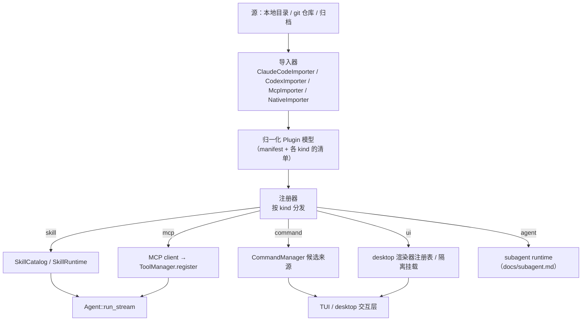

# Shirley 技术方案 · 插件与插件市场（plugin / marketplace）

> **状态：设计探索（未落地）**。本文只做方向收敛与决策推演，不含实现承诺。
> 目标是把「skill / MCP / skill+MCP 组合 / 兼容 Claude Code·Codex 插件 / UI 区域插拔」
> 这几件散着提的事，收敛到一个**统一的插件模型**上，并逐条映射到仓库里**已有的接缝**。

---

**一、要解决什么**

Shirley 现在已经有三种「可插拔能力」，但它们**各自独立、各自发现、各自注入**：

| 已有能力 | 落点 | 发现方式 | 注入接缝 |
| --- | --- | --- | --- |
| skill（`docs/skills.md`） | `src/skills/` | 扫 `.agents/skills` / `.claude/skills` | `SkillCatalog` + `SkillRuntime` + `ContextProvider` |
| 记忆 / 账本 | `src/memory/` `src/todo.rs` | 固定 | `ContextProvider` |
| 工具 | `src/tools/` | **编译期硬编码**（`bootstrap::assemble_tools`） | `ToolManager::register` |

问题有三层：

1. **没有「包」的概念**。一个真实能力往往需要**多个部件协同**——比如「航班」=
   一个渲染契约（`flightmap` skill）+ 若干取数脚本（`flight-cli` / `hnair-cli` skill）
   + 一个地图渲染器。现在它们只能靠**目录约定**散落在一起，没有 manifest、没有版本、
   没有依赖、没有启用/停用。
2. **工具是编译期写死的**。`bash` / `read_file` / `web_search` 之外，用户**没法**在
   运行期给 Shirley 加工具——除非改 Rust 重编译。这是与 Claude Code / Codex 最大的
   体验落差。
3. **兼容是零**。生态里已经沉淀了大量 Claude Code 插件、MCP server、Codex 配置。
   我们**没有任何入口**去吃它们。

**「插件市场」真正要做的，不是商店，是适配层 + 分发层。** 商店只是它的一个 UI。

---

**二、外部生态调研（三个可对齐的形态）**

**2.1 Claude Code 插件**（`docs` / `plugin.json`）

一个插件是一个目录，`plugin.json` 是 manifest（`name` 必填，`description` /
`version` / `author` / `homepage` 强烈建议），组件**按约定目录**自动发现：

```
my-plugin/
├── .claude-plugin/plugin.json   # manifest（只有它在该目录内）
├── skills/*/SKILL.md            # Agent Skills
├── commands/*.md                # slash 命令（也是 skill 的扁平形态）
├── agents/*.md                  # 子 agent
├── hooks/hooks.json             # 事件钩子（PostToolUse 等）
├── .mcp.json                    # MCP server 配置
├── output-styles/ themes/       # 2026 新增的展示层扩展
├── monitors/ bin/               # 后台监控 / PATH 可执行
└── package.json                 # 启用时自动装依赖
```

分发：**marketplace.json（git 仓库索引）+ 插件目录**。`version` 缺省回退 **git SHA**。
这三点值得抄：**约定目录 + 单文件 manifest + git 源**。

**2.2 Codex**（`config.toml` 驱动，无「插件」概念）

- 配置全在 `~/.codex/config.toml`（`[mcp_servers]` / `[profiles]` / 自定义 provider）。
- skill 在 `~/.agents/skills` 与 repo `.agents/skills`（**和 Shirley 同一标准**）。
- slash 命令 = `~/.codex/prompts/*.md`（`/prompts:<name>`，`$1..$9` / `$ARGUMENTS`）。
- 项目指令 = `AGENTS.md` 链。

Codex 没有「插件包」，一切靠 **TOML 配置 + 标准目录**。它的价值是提醒我们：
**插件不必是重格式，配置 + 目录约定同样能承载能力**。

**2.3 MCP / MCPB / MCP Apps**

- **MCP**：能力（tools / resources / prompts）的**运行期协议**，stdio 或 HTTP。工具是
  `tools/list` 动态发现的，天然「运行期加工具」。
- **MCPB（.mcpb）**：把本地 MCP server 打成一个**便携 bundle**（含 manifest + 依赖），
  这是「MCP server 的分发格式」。
- **MCP Apps（SEP-1865）**：给 MCP 工具挂**交互式 UI** 的标准（`modelcontextprotocol/ext-apps`，
  spec `2026-01-26`）。**这正是 Sean 记忆里那条偏好的外部依据**：skill 自带自包含 UI
  bundle、宿主通用隔离挂载。

**2.4 归一化观察（关键）**

三家都把 **skill / MCP / slash 命令** 当作**独立的能力类**，而「插件 / 市场」只是承载
它们的**容器**。没有一家把「插件」本身当成一种能力。

> **结论：插件 = 容器，能力 = 若干 kind。** 这是本文的地基。

---

**三、核心决策**

**决策 1：插件 = 容器，能力 = kind；Shirley 只认「归一化插件模型」。**

不发明「Shirley 插件运行时」。定义一个**归一化模型**，外来格式（Claude Code / Codex /
MCPB）经**导入器（importer）**翻译成它，再由**注册器**把每个 kind 挂到**已有接缝**上。
新能力类 = 加一个 kind + 一个注册适配器，不动核心。

| kind | 来源形态 | 落点接缝（**已有优先**） |
| --- | --- | --- |
| `skill` | `SKILL.md` 目录 | `SkillCatalog` / `SkillRuntime` / `SkillContextProvider` / `activate_skill`（**已有**） |
| `mcp` | MCP server（stdio/HTTP） | **新增** MCP client → 每个远端 tool 包成 `impl Tool` → `ToolManager::register` |
| `command` | `.md` slash / prompts | `CommandManager` + `CommandOutcome`（**已有**，扩候选来源） |
| `agent` | 子 agent `.md` | `docs/subagent.md` 的 subagent runtime（**已有方案，未落地**） |
| `ui` | UI bundle / renderer | desktop 渲染器注册表 + 隔离挂载（**部分已有**，见第七节） |
| `hook` | `hooks.json` | **新增**生命周期事件接缝（Shirley 目前**没有**） |
| `theme` / `output-style` | JSON / md | 产品化展示层（**低优先**，可后置） |

**决策 2：MCP 是「运行期加工具」的唯一正道；插件不携带原生 Rust。**

Claude Code 插件能带 `bin/` 与 `package.json`；Shirley 插件**不能**带任意可执行代码
直接进进程。工具能力的两种合法来源：

- **MCP server**（子进程 / HTTP）——运行期、可隔离、跨客户端通用。**首选**。
- **skill 里的脚本**——不自动执行，模型显式经 `bash` 走**沙盒**（`docs/sandbox.md`）。
  **已有**语义（`docs/skills.md` 决策 5）。

> 「插件能编译进 Rust」不在设计内。那等于把供应链攻击面塞进二进制。

**决策 3：兼容靠「导入器」，不靠「改我们的格式去迁就」。**

兼容 Claude Code / Codex 的路径是**读它们的 manifest/配置 → 翻译成归一化模型**，
而不是让 Shirley 的插件格式长得像某一家。理由：格式会分叉，导入器可以各自独立演进，
核心模型保持干净。这也正是用户说的「做适配层去抹平差异」。

**决策 4：分发抄 Claude Code 的「git 源 + 索引文件」，不自建后端。**

`marketplace.json` 放在 git 仓库里，`plugin` 指向仓库子目录 / git URL / 本地路径。
零后端即可分发；将来要中心化 registry 时，只是**再加一种 source 类型**。

**决策 5：信任分级 + 隔离挂载，是 UI 扩展的前置条件（不是可选项）。**

外来 UI bundle 是**不可信代码**。绝不能内联进 React 树 / 同源——同源即可调 Tauri
`invoke()`、读会话状态。**必须** sandbox iframe + 独立 origin + postMessage。这条
在宿主侧目前**完全没有设施**（`csp=null`、无 iframe 先例，见第七节）。

---

**四、归一化插件模型（草案）**

**4.1 磁盘形态**

```
my-plugin/
├── shirley-plugin.json      # 归一化 manifest（唯一必需）
├── skills/                  # kind=skill（沿用 Agent Skills 标准目录）
├── commands/                # kind=command
├── agents/                  # kind=agent
├── ui/                      # kind=ui（bundle 或 renderer 声明）
├── mcp.json                 # kind=mcp（MCP server 声明）
├── hooks.json               # kind=hook（若实现）
└── README.md / LICENSE
```

**4.2 manifest（草案）**

```json
{
  "name": "flight",
  "version": "1.0.0",
  "description": "航班查询 + 航线地图（平台独家）",
  "author": { "name": "Shirley" },
  "capabilities": {
    "skills": ["skills/"],
    "commands": ["commands/"],
    "agents": ["agents/"],
    "ui": { "renderers": ["ui/renderers.json"] },
    "mcp": ["mcp.json"]
  },
  "requires": { "shirley": ">=0.1", "permissions": ["network", "sandbox:bash"] }
}
```

设计要点：

- `capabilities` **显式声明**各 kind（也可**约定目录**自动发现，与 Claude Code 一致）。
  显式声明优先，缺省回退约定——**宽容**是兼容的前提。
- `requires.permissions` 是**声明**（与 `allowed-tools` 一样，第一期只记录不强制，
  `docs/security.md` 的 `PermissionPolicy` 未落地前它**不是**安全边界）。
- `version` 语义化；缺省回退 **git SHA**（抄 Claude Code，利于开发期）。

**4.3 运行时数据流**



**唯一装配点仍是 `bootstrap::AgentFactory`**（`assemble` 扫目录、`build_agent` 注册工具 /
接 provider）。插件注册器是**它前面的新一层**，把「插件目录」翻译成「已发现的 skill 列表 +
待注册的工具 + 命令候选 + 渲染器声明」，再喂给既有装配流程。**SDK 零改动**（与
skills / todo / memory 同款理由）。

---

**五、适配层（「抹平差异」的具体形态）**

**5.1 导入器接口**

```rust
trait PluginImporter {
    /// 能否处理这个源（目录里有 .claude-plugin/plugin.json？有 config.toml？…）
    fn can_import(&self, source: &Path) -> bool;
    /// 翻译成归一化模型（只做映射，不注册、不执行）
    fn import(&self, source: &Path) -> Result<NormalizedPlugin, ImportError>;
}
```

**5.2 三张映射表（差异在哪）**

| 归一化 kind | Claude Code | Codex | MCP |
| --- | --- | --- | --- |
| `skill` | `skills/*/SKILL.md` | `.agents/skills` | — |
| `command` | `commands/*.md` | `~/.codex/prompts/*.md` | MCP `prompts` |
| `mcp` | `.mcp.json` | `config.toml` `[mcp_servers]` | 原生 |
| `agent` | `agents/*.md` | — | — |
| `hook` | `hooks/hooks.json` | — | — |
| `ui` | `output-styles/` `themes/`（仅样式） | — | MCP Apps（SEP-1865） |

**差异主要在**：① 容器布局（`.claude-plugin/` vs 散在根 vs `config.toml`）；② 命令语法
（Claude 无参 vs Codex `$1..$9`/`$ARGUMENTS`）；③ UI 能力（Claude 只有样式，MCP Apps 才有
交互组件）。**核心能力（skill / tool）三家高度一致**——所以适配层是**薄**的。

**5.3 不做的映射（诚实边界）**

- Claude Code 私有字段（`context:fork` / `hooks` 的具体事件名 / `user-invocable` 等）：
  **只读不实现**，记 warn。理由同 `docs/skills.md` 第九节。
- 插件的 `bin/` + `package.json` 自动装依赖：**不做**（决策 2）。
- Claude 的 `hooks`（`PostToolUse` 等）：需要 Shirley 先有生命周期事件接缝，**后置**。

---

**六、分发与市场**

**6.1 三层，从轻到重**

1. **本地目录**（P0）：`<root>/.shirley/plugins/<name>/` 或 `~/.shirley/plugins/`。零网络。
2. **git 源**（P1）：`marketplace.json` 索引一个 git 仓库里的多个插件；`/plugin add <url>`。
   抄 Claude Code：`name` / `source` / `description` / `version`。
3. **中心化 registry**（后置）：只是一个**新的 source 类型**（HTTP 拉 manifest + 归档）。
   接口不变，故可推迟到真有需求再建。**先不做后端**。

**6.2 启用状态与锁定**

- 启用/停用状态落 `<config_dir>/shirley/plugins.json`（与 `projects.json` 同族）。
- `version` + `source` + **内容哈希**落一个 lock（防同一版本号内容漂移）。
- 与 skill 的差别：skill 是「扫到即用」，插件是「**显式启用**才生效」——因为插件可能
  带 MCP server（起进程）与 UI bundle（跑代码），默认全自动会放大攻击面。

**6.3 `/plugin` 交互（TUI + desktop 共用编排）**

`/plugin list` / `add <src>` / `enable|disable <name>` / `remove`。与 `/session` / `/model`
同款模态选择器（`CommandOutcome` 增一个分支）。**编排归应用层**，与 `SessionManager` 平级。

---

**七、UI 区域插拔（两条渲染路线，别混）**

这是最需要先想清楚的部分，因为它决定安全模型。**分两层**：

**路线 A：宿主原生渲染器（可信，编译期）——flightmap 现状**

现状：`AiMarkdown.tsx` 用 streamdown 的 `renderers` 注册
`{ language: "flightmap", component: FlightMapRenderer }`。渲染器**编译进 web app**，
lazy 加载。**这是可信代码**，能碰 React 树、能调 `invoke()`。

- 用途：**平台独家**能力（flight 就属这条）。渲染契约（`flightmap` 语言）+ 数据来源
  （flight skill）+ 渲染器，三者一起构成「平台独家」。
- 插件化含义：插件可以**声明**「我产出语言 `flightmap`」，但**渲染器本身仍要进主包**
  （编译期）。所以路线 A 的插件扩展点是「**注册一个已内置的 renderer 的触发条件**」，
  不是「上传代码」。这也解释了为什么 flight 是独家——渲染器在宿主里。

**路线 B：隔离挂载（不可信，运行期）——MCP Apps / iframe**

外来 UI bundle 走 `<iframe sandbox="allow-scripts">`（**不含** `allow-same-origin`）+
独立 origin + postMessage 桥。宿主只做**通用挂载点**，拿到内容就渲染——即
「内容即能力」，新增组件**宿主零改动**。

- 这是 Sean 记忆里明确偏好的方向。
- **前置设施全缺**（已核实）：`tauri.conf.json` `csp=null`、单 webview、无 iframe 先例、
  capabilities 仅 `core:default`+`dialog:default`。要落地必须先补 **CSP + 挂载点 + 消息桥**。

**7.1 「界面区域」的插拔语义（slot 模型）**

把 UI 拆成**具名插槽（slot）**，插件声明往哪个 slot 贡献什么：

| slot | 例子 | 渲染路线 |
| --- | --- | --- |
| `message.fence:<lang>` | flightmap 代码块 | A（可信）或 B（隔离） |
| `composer.trailing` | 发送框右侧动作（模型选择器同款槽位） | A |
| `sidebar.panel` | 左栏附加面板 | A / B |
| `tool.card:<name>` | 某工具的专属结果卡 | A / B |

**先做 `message.fence`**——它已经有 flightmap 先例、收益最直接（让第三方也能定义围栏语言）。

**7.2 与 TUI 的关系**

TUI 的 `markdown.rs` **不认** flightmap（已知缺口：`SkillContextProvider` 不感知界面，
TUI 里会被建议输出 `flightmap` 却退化成裸 JSON）。UI 插拔**天然是 desktop 专属能力**；
TUI 侧只能降级为「未知围栏按代码块显示」。**这点必须在插件声明里区分界面能力**——
否则又是「skill 契约与客户端渲染能力脱钩」的老问题。

---

**八、安全与信任**

| 风险 | 处置 |
| --- | --- |
| 插件带任意代码进进程 | **禁止**；工具只能来自 MCP 或 skill 脚本（走沙盒） |
| MCP server 越权（文件/网络） | 走 `SandboxSpec`（网络策略 / cwd / 读写路径）；stdio 子进程受沙盒约束 |
| 外来 UI bundle 同源攻击 | 路线 B 强制 sandbox iframe + 独立 origin + postMessage；**绝不内联** |
| 供应链（git 源被篡改） | lock 记**内容哈希**；启用是**显式**动作；首次启用可要确认（UX 待定） |
| 声明被当授权 | `requires.permissions` / `allowed-tools` **只记录不强制**，文档明说 |
| 插件撑爆上下文 | 沿用 skills 的字符上限；MCP 工具描述注入也设上限 |
| 插件互抢名字 | 归一化时保留 `plugin::name` 命名空间；冲突记 warn |

> **不做的**：不自动信任、不自动执行、不做插件级进程隔离（那是 `PermissionPolicy`
> 与真沙盒后端 `sandbox-exec`/`bwrap` 该管的，属独立前置工作）。

---

**九、与 flight 的关系（把「平台独家」讲清）**

「flight 是平台独家」不是指代码保密，而是指**它依赖宿主内的渲染器**：

- `flight-map` skill 的**契约**是「输出 `flightmap` 围栏」——**只有认识该围栏的客户端**
  才渲染得出地图。
- 渲染器（`FlightMapRenderer`）**编译在 Shirley 里**（路线 A）。
- 取数在 `flight-cli` / `hnair-cli` skill（脚本 + 沙盒）。

所以一个「flight 插件」= 1 个 UI 契约 + 1 个内置渲染器 + N 个取数 skill。别的客户端
拿到同样的 skill，**没有渲染器就退化成代码块**——这就是「独家」的技术定义。

**推论**：如果路线 B（隔离挂载）落地，flight 可以**从路线 A 迁到路线 B**——渲染器不再
需要编译进宿主，变成插件自带的 bundle。**这是两条路线的关系**：A 是现在，B 是目标。

---

**十、分期（建议）**

| 期 | 内容 | 依赖 | 风险 |
| --- | --- | --- | --- |
| **P0** | 归一化 manifest + 本地目录发现 + `skill`/`command` kind 注册（复用现有接缝）+ `/plugin list·enable·disable` | 无 | 低 |
| **P1** | `mcp` kind：MCP client（stdio/HTTP）→ 包装成 `Tool` → `ToolManager`；`mcp.json` 导入器 | MCP 协议实现 | 中（协议 + 进程管理） |
| **P2** | 导入器：Claude Code `plugin.json` + Codex `config.toml`（抹平差异） | P0/P1 | 中（格式漂移） |
| **P3** | git 源 + `marketplace.json` 索引 + lock | P0 | 低 |
| **P4** | `ui` kind 路线 B：CSP + 隔离挂载 + slot 模型（先做 `message.fence`） | 宿主安全设施 | **高** |
| **后置** | `hook` 事件接缝、中心化 registry、`theme`/`output-style` | — | — |

**最小可验证切片 = P0 + P1 的一条竖切**：一个本地插件，声明一个 skill + 一个 stdio MCP
server，能被 `/plugin add` 启用、skill 进目录、MCP tool 出现在工具表、模型能调用。
**这条打通了，市场只是它的 UI。**

---

**十一、开放问题（待决策）**

1. **MCP 的进程/HTTP 生命周期归谁**：每个会话起一份？全局共享一份？崩溃重启策略？
   （影响 `build_agent` 与沙盒接线）
2. **MCP tool 命名冲突**：前缀 `mcp__<server>__<tool>`（Claude 风格）还是 `plugin::name`？
3. **插件的「启用」粒度**：整包启用，还是可按 kind 单独启停（比如只启 skill 不启 MCP）？
4. **UI 路线 A 的插件扩展点到底能不能有**：若渲染器必须编译期进主包，那「第三方定义
   围栏语言」就只能走路线 B；路线 A 退化为「平台独家能力清单」。需拍板 A 是否开放。
5. **TUI 的能力声明**：插件如何声明「我这段 UI 只有 desktop 支持」？TUI 侧怎么优雅降级？
6. **`agents`（subagent）kind 的依赖**：`docs/subagent.md` 未落地，插件里的 agent 只能先
   当 skill 处理还是等？
7. **兼容的验收口径**：拿一个真实 Claude Code 插件（如某个社区插件）跑通，算不算 P2 的
   Done？需要一个具体样本。
8. **与 skill 发现的关系**：插件里的 `skills/` 与 `.agents/skills/` 重名时谁赢？
   （建议：显式启用的插件 > 项目级 > 用户级）

---

**附：与既有文档的关系**

- 复用接缝：`docs/skills.md`（skill kind）、`runtime/context.rs` 的 `ContextProvider`、
  `ToolManager`（`docs/tool-lifecycle.md`）。
- 同族能力：`docs/subagent.md`（agent kind）、`docs/memory.md` / `docs/todo.md`（provider 范式）。
- 边界归属：`docs/security.md`（权限层，`requires.permissions` 的挂靠点）、
  `docs/sandbox.md`（MCP 子进程 / skill 脚本的边界）、`docs/desktop-interface.md`（UI slot）。
- 上游标准：Claude Code plugins（`plugin.json` + `marketplace.json`）、
  OpenAI Codex（`config.toml` + `AGENTS.md` + `.agents/skills`）、MCP / MCPB / MCP Apps（SEP-1865）、
  Agent Skills 开放标准（`agentskills.io`）。
