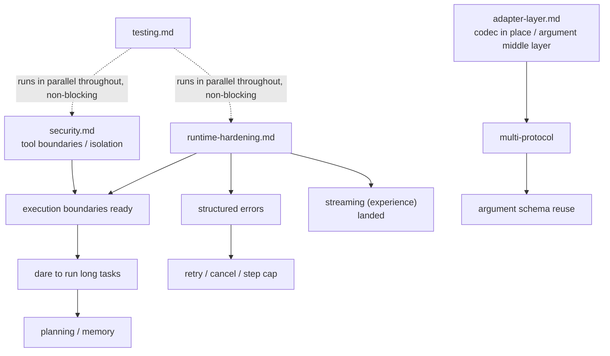

**Shirley technical design · Overall roadmap**

**1. Assessment**

The current repository is a v0.1 that "has a working pipeline, but is not yet something you can entrust a real repository to". The ReAct loop, tool registration, context compaction, usage statistics, the TUI, and streaming output all run, and the direction in `plan.md` is right. The problems fall into two categories:

- **Boundary class**: it runs, but the moment it is connected to a real scenario it bites (security, unbounded loops, no retry, protocol panics).
- **Accumulation class**: `plan.md` made clear what to do, but it has never been done (argument middle layer, memory, planning).

The former is P0, because it decides whether this Agent can touch my code. The latter is P1, because it decides the marginal cost of every subsequent step.

**2. Phases**

**P0 · Make it trustworthy (no architecture change)**

Goal: run a migration task once on a real repository without a disaster in the middle.

- Security boundary (see `security.md`)
  - key rotation + `.env.example`
  - `bash` returns stderr / exit code, fix the blacklist bypass
  - workspace root restriction (cwd allowlist + path canonicalization)
  - per-call permission policy and human approval are deferred by product decision
    (2026-10-24); the previous implementation has been removed, while tool-local checks remain
- Runtime hardening (see `runtime-hardening.md`)
  - a `max_steps` cap, so `StopReason::MaxStepsReached` is actually produced
  - wire up `request_timeout` + reuse `reqwest::Client`
  - structured errors + retryability decision + exponential backoff
  - change `todo!()` to `Err`
  - degrade on compaction failure instead of aborting

**P1 · Make it pleasant to use, and cheap going forward**

- ~~Streaming output and reasoning streaming (see `streaming.md`)~~ -- landed (`stream` config + `ContentDelta` / `ReasoningDelta` + SSE incremental parsing)
- Adapter middle layer: tool-argument normalization, `encode_messages` put back in its place (see `adapter-layer.md`)
- SDK unit tests + cache hit-rate benchmark (see `testing.md`)

**P2 · Make it stronger**

- Memory system ("distillation-verified" persistence)
- Task planning and progress tracking
- ~~Multi-protocol (Responses / Anthropic) truly landed~~ -- landed (all three protocols `ChatCompletions` / `Responses` / `AnthropicMessages` include streaming; Anthropic is in `docs/anthropic-messages-api.md`)
- ~~Session persistence and restore~~ -- landed (`docs/session.md`; **the `SessionStore` contract and implementation are both in the application layer `crates/shirley/src/session.rs`**; the SDK no longer holds a session, and persistence is event-driven by the application layer)

**3. Dependencies**

Key judgment: **structured errors are a prerequisite for many things**. The retry strategy, compaction degradation, and cancellation semantics all depend on "can this error be retried". So the error rework in `runtime-hardening.md` should be the first item inside that file.

**4. Acceptance criteria**

Definition of P0 done (testable):

1. Run one real migration sub-task against the repository, with no human intervention throughout and no infinite loop.
2. Inject a 429 / 500 once; the Agent can back off, retry, and continue.
3. When `bash` runs a command that fails to compile, the model receives stderr and the exit code.
4. Attempting to `read` a file outside the workspace is rejected with a clear error. (**implemented**: `crates/shirley/src/tools/read.rs`, validated via `WorkSpace::resolve`)
5. Switching to an unimplemented protocol returns `Err` rather than panicking.

Definition of P1 done:

1. The TUI shows character-by-character output and the reasoning stream. (implemented)
2. `cargo test -p shirley-agent-sdk` covers Usage semantics, compaction slicing, and threshold decisions. (still not done; 0 tests on the SDK side)
3. The cache hit rate has a benchmark case and a threshold, and the percentage in the UI has a reference. (still not done)

**5. What we are not doing (explicit boundaries)**

- Do not introduce a vector store / external memory storage in this round.
- Do not rewrite the TUI; only subtract at the event layer (remove the duplicate `AgentUpdate` translation). (done)
- Do not abstract multi-protocol ahead of time into "everything can convert"; only do the necessary normalization at the argument schema layer.
