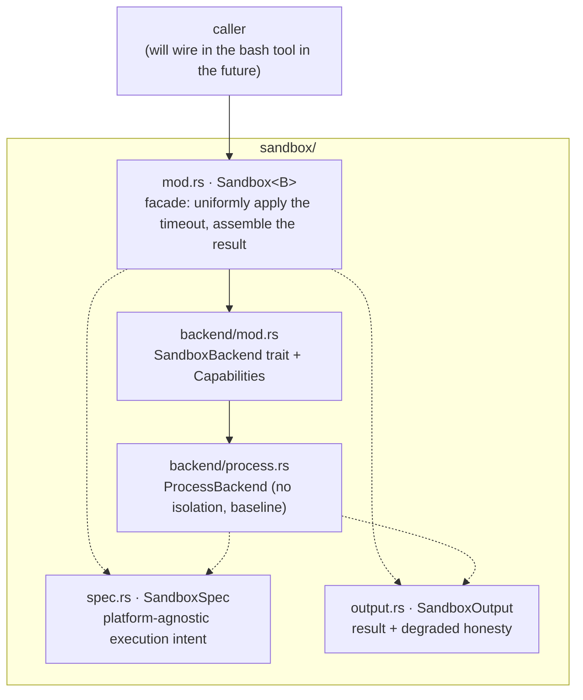
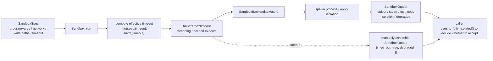

**Shirley technical design · Process sandbox (P0)**

This document distills the current design of `crates/shirley-agent-sdk/src/sandbox/`. It is the landing of the "OS-level sandbox" step in section 6 ("Runtime constraints") of `security.md`, answering one question: **when the Agent wants to execute an external command, how do we guarantee it runs in a "fake world" and cannot disturb the real world.**

**1. Why a separate layer**

`security.md` already set the boundary at the "workspace root" layer, but that only solved "file read/write escaping the boundary". The real problem with a tool like `bash` is deeper: it hands arbitrary commands to a shell, and the semantics of a command **cannot be statically judged at the string level** (`/bin/rm`, `base64 | bash`, `r''m` are all bypasses). The conclusion is: **do not do pattern matching on the command string; do physical isolation at the "what can be touched" layer.**

The sandbox layer therefore has a clear division of labor with the permission layer (`PermissionPolicy`):

| Layer | Question it answers | Timing |
| --- | --- | --- |
| permission layer policy | "should this command be executed" | before execution, a static decision |
| sandbox layer sandbox | "even if executed, it cannot touch the real world" | during execution, a physical constraint |

The correct order is `policy.check() -> Allow/Deny/Ask`, and only after being allowed is it handed to `Sandbox::run`. **The sandbox does not make decisions for the policy, and the policy does not assume the sandbox necessarily exists.**

**2. Five design principles**

1. **The boundary is in "what can be touched", not in the command string.** `SandboxSpec` passes `program + args` separately, and does not do `bash -c "..."`. Semantics hidden in a string cannot be statically judged -- this is the root cause of `bash.rs`'s status quo.
2. **Deny by default.** Network is off by default (`NetworkPolicy::Disabled`), environment variables are not inherited by default (`env_clear` then inject), and write paths are empty by default. Opening anything up must be declared explicitly.
3. **Replaceable backend.** The isolation mechanism is provided by the `SandboxBackend` trait. Local development uses `ProcessBackend`, production switches to `bwrap` / `sandbox-exec` / a microVM. When switching backends, the facade and upper-layer call sites do not change a single line.
4. **The timeout cannot be evaded.** The timeout is applied by the facade `Sandbox::run` at the outermost layer with `tokio::time::timeout`, together with the backend's `kill_on_drop`. Even if the backend wants to stall and not stop, it will be dropped + killed, not relying on the process to voluntarily exit.
5. **Degradation is transparent.** Constraints the backend cannot enforce must be written into `SandboxOutput::degraded`, so the upper layer can reject the result based on it, rather than being fooled by "it looks like it ran".

**3. Layered structure**



Responsibility boundaries:

- **`spec.rs`** only describes intent, platform-agnostic. "What I want to run, and what I allow it to touch."
- **`backend/`** lands the intent as real execution. **Only responsible for execution and isolation**, it does not make permission decisions, and is not responsible for the timeout (the timeout belongs to the facade).
- **`output.rs`** unifies the result. It keeps `stderr` / `exit_code` (the model needs to see failure details to self-correct, see `security.md` 6.1), as well as `degraded` (auditing needs to know whether isolation was actually in effect at the time).
- **`mod.rs`** the facade. Applies the timeout, assembles the result, and passes everything else through.

**4. The complete data flow of one execution**



**5. What `degraded` is, and who produces it**

`degraded` is the backend's **voluntary "I admit I can't" declaration**: while executing, it checks itself item by item against the constraints required in the `spec`, and pushes the ones it cannot satisfy into the list.

It is **not** a post-hoc monitoring record, but **knowing its own limits up front**. `ProcessBackend` knows from birth that "I do not isolate", so it does not need to monitor anything; it simply declares "I cannot block anything". Every execution it fills in:

```
no filesystem isolation: the process can access the host's entire filesystem
no resource limits: no memory/process-count cap applied
no network isolation: NetworkPolicy::Disabled is not enforced
```

Three-party division of labor:

| Role | What it does with degraded | Location |
| --- | --- | --- |
| backend implementation | **write** -- report the constraints it cannot satisfy item by item against the spec | `backend/process.rs` (future bwrap/sandbox-exec the same) |
| facade `Sandbox` | **basically does not touch it** -- only the timeout path gives an empty `Vec` (a timeout does not count as isolation degradation) | `mod.rs` |
| caller | **read** -- `is_fully_isolated()` / iterate, deciding whether to accept the result | upper-layer business |

**Key limitation**: `degraded` is currently **self-reported** by the backend, and in theory a lazy implementation could lie. In production, an **external verification** layer should be added -- at backend startup, run self-check probes (try writing outside the workspace, try connecting to the internet) to validate the capabilities it declares with actual behavior, rather than just believing what it says.

**6. Backend selection roadmap**

`ProcessBackend` only gets the pipeline working; it **must never be used for untrusted input**. Connect real isolation per platform:

| Platform / scenario | Backend | Isolation strength |
| --- | --- | --- |
| local development / testing | `ProcessBackend` | none (degraded all filled in) |
| macOS | `sandbox-exec` (SBPL profile: `(deny default)` + allow read/write/network) | medium |
| Linux | `bwrap` (`--ro-bind` / `--tmpfs` / `--unshare-net` / `--die-with-parent`) | medium |
| Linux high-assurance | `gVisor` (runsc) | high (user-space kernel) |
| multi-tenant / extreme isolation | `Firecracker` microVM (separate kernel) | highest |

Adding a backend only requires implementing the single `SandboxBackend` trait, and the facade and upper-layer call sites need no changes. This is exactly the point of making it a trait: **first fix the pipeline and the contract; isolation strength is a pluggable implementation.**

**7. Capability matrix**

`Capabilities` is what the backend **statically declares** it can do; `degraded` is what was **actually degraded in this execution**. The upper layer must look at both:

| Backend | filesystem | network | resource | runtime degraded |
| --- | --- | --- | --- | --- |
| `ProcessBackend` | ✗ | ✗ | ✗ | all filled in every time |
| `bwrap` normal | ✓ | ✓ | partial | empty |
| `bwrap` failed to set up | ✓ | ✓ | partial | "isolation did not come up this time" (temporary admission) |

**8. Acceptance**

1. `SandboxSpec` uses `program + args`, does not go through a shell, so bypasses like `/bin/rm` and `r''m` are structurally impossible.
2. Environment variables are not inherited by default: the host sets `SANDBOX_LEAK_TEST`, and it cannot be read inside the sandbox; only explicitly injected ones are visible.
3. The timeout is enforced by the facade: `sleep 5` + a 200ms timeout must return `timed_out=true`, and the process is cleaned up.
4. `ProcessBackend` returns `is_fully_isolated() == false` on every execution, with a non-empty `degraded`.
5. On command failure the model can get `stderr` and `exit_code` (following `security.md` 6.1).
6. After connecting a real backend, trying to write outside the workspace must fail, and `degraded` is empty.

Currently 1-5 are covered (see `crates/shirley-agent-sdk/tests/sandbox_smoke.rs`, 6 cases). Item 6 awaits the `sandbox-exec` / `bwrap` backends.

**9. Design gap: who decides whether a tool is sandboxed**

In the current implementation, **whether to go through the sandbox is decided by the tool author themselves**. Look at `crates/shirley/src/tools/bash.rs`:

```rust
let sandbox = Sandbox::new(ProcessBackend::default());
let output = sandbox.run(&spec).await?;
```

It is the `bash` tool **choosing for itself** to call `Sandbox::run`. Any tool can **choose not to** -- directly spawning a process with `tokio::process::Command::new(...)`, bypassing the sandbox, and the SDK will not stop it.

**Three possible ownership models**

| Option | Who decides | Assessment |
| --- | --- | --- |
| A (status quo) | the tool author, in the tool code | flexible, but insecure by default, scattered policy, hard-coded backend |
| B | the SDK uniformly mandates: all tools go through the sandbox by default | safe, but not flexible enough (some tools should not be sandboxed) |
| C | the assembler (`main.rs`) declares it when registering the tool | centralized, configurable, secure by default |

**The right direction is C, then B, and A is the worst.**

**Why A is the worst**

1. **Insecure by default.** If the tool author forgets to use the sandbox, or takes a shortcut and directly uses `Command::new`, it runs bare. Security depends on "every author remembering", which is the most fragile design -- allow by default, deny by self-discipline.
2. **Scattered policy.** Workspace, timeout, network, backend are all written in `bash.rs` now. Writing a second external-execution tool means deciding it all over again, and it cannot be centrally audited.
3. **The backend cannot be swapped.** `bash.rs` hard-codes `ProcessBackend::default()`, so swapping the backend means changing each tool.
4. **Conflicts with the principles.** Principle 3 of `security.md` says "the permission policy is an SDK capability, not application-layer hard-coding". Now the isolation policy is **hard-coded at the tool layer**, one layer lower than the application layer.

**What it should look like (direction, not the current change)**

Tools only declare "execution requirements", the SDK uniformly applies them, and the backend is injected by the assembler:

```rust
// a tool only describes "I want to run an external command", it does not decide the isolation method
trait Tool {
    fn definition(&self) -> &ToolDefinition;
    fn invoke(&self, input: Value) -> ToolFuture;
    // new: declare execution requirements, default = must sandbox + strictest constraints
    fn execution_policy(&self) -> ExecutionPolicy;
}

// the assembler decides the backend and default policy in main.rs
let agent = Agent::builder()
    .sandbox_backend(ProcessBackend::default())  // or sandbox-exec / bwrap
    .tool(bash::tool())        // declares it needs a sandbox
    .tool(read::tool())        // declares it needs filesystem constraints
    .tool(http_fetch::tool())  // explicitly declares outbound network is allowed
    .build()?;
```

Key points: sandbox by default (using the strictest default if nothing is declared); tools declare "what they need", the SDK decides "how to satisfy it"; the backend is injected by the assembler, not hard-coded; the policy is centralized and auditable.

**Technical blocker**

Landing "the assembler injects the backend" is blocked on object-safety: `SandboxBackend::execute` returns `impl Future`, the trait **is not object-safe**, and `Box<dyn SandboxBackend>` cannot be dynamically injected (see the TODO in `bash.rs`). It is necessary to first change `execute` to return `BoxFuture<'_>` (`Pin<Box<dyn Future + Send>>`), trading a little performance for object-safety.

**Timing suggestion**

Right now there is only one tool, `bash`, and one backend, `ProcessBackend`; the downsides of option A have not yet surfaced, so **there is no rush to change the architecture**. Do the "declare + inject" when a second and third tool needing external execution appear, where the marginal benefit is greatest. At that time, `ExecutionPolicy` and an object-safe `SandboxBackend` should be added together.

**10. Not yet done (explicitly bounded)**

- **Real isolation backends**: `sandbox-exec` / `bwrap` / microVM are all unconnected. Currently only `ProcessBackend`.
- ~~**`Sandbox` is not wired into the `bash` tool**~~: it is wired in. `crates/shirley/src/tools/bash.rs` goes through `Sandbox::run`, keeping `bash -c` (without breaking pipes/redirection), the timeout is handed to the facade, and the result includes stderr/exit_code/a degradation hint. The blacklist is downgraded to a "temporary static fallback".
- **External verification of `degraded`**: currently only the backend's self-report is trusted, with no self-check probes.
- **Outbound proxy**: `NetworkPolicy::Proxy` is only a declaration; the proxy itself (domain allowlist + auditing + content inspection) is not implemented. This is the key layer against data exfiltration, and also a high-incident area.
- **Execution policy ownership not centralized**: currently whether to go through the sandbox is decided by the tool author; see section 9. Solve it together when a second external-execution tool appears.
- **Audit persistence**: `SandboxOutput` is already `Serialize`, but it is not yet written to `~/.shirley/audit.log` (see `security.md` 6.3).
