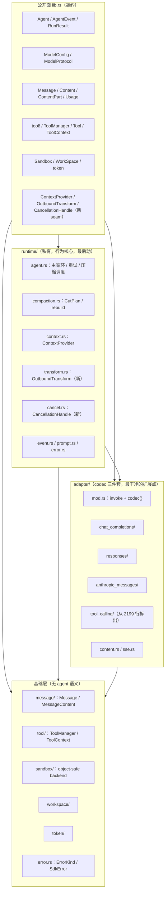
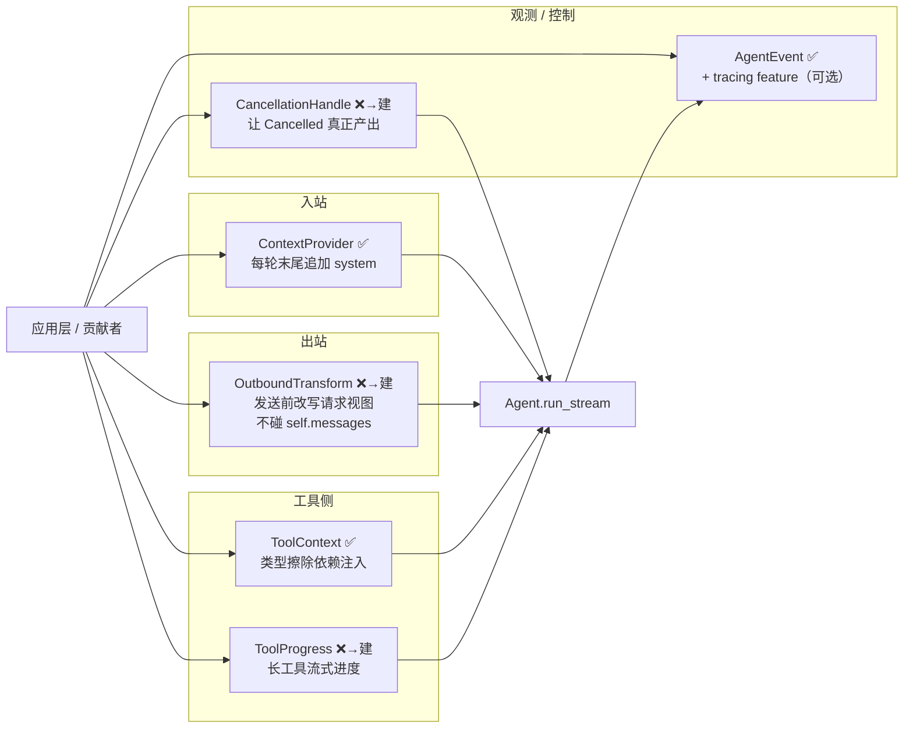

# Shirley SDK · 0.0.3 重构设计（架构归位 + 命名重设计 + 迁移路径）

> 定位：这是一份**可执行的重构方案**（设计文档 + 迁移清单），不是纯提案。
> 目标是把 `shirley-agent-sdk` 从「能跑、但边界与命名有债」的 `0.0.2`，整理成
> 「扩展面清晰、命名自洽、可信」的 `0.0.3`。
>
> 关联文档：`docs/sdk-gaps.md`（能力缺口修复）、`docs/adapter-layer.md`（协议适配中间层）、
> `docs/testing.md`（SDK 单测与缓存基准）、`docs/sandbox.md`（沙箱后端）。

---

## 0. 一句话结论

这次重构**不是重新设计**，而是三件事：

1. **归位**：把放错层的代码搬回它该在的地方（巨型 `tool_calling.rs` 拆分）。注：`encode_messages` **不搬** —— 见 §5.1 决策记录，协议 wire 编码属 adapter 职责。
2. **补缝**：把 `Agent.md` 已经承诺、但代码里没有的 seam 补上（`OutboundTransform` / `Cancellation` / `ToolProgress` / 可选 `tracing`）。
3. **正名**：把一路长出来、彼此不一致的命名收敛成一套自洽的术语表。

**核心 runtime 的行为一行都不因「重构」而改变。** 任何行为增量都必须是「新增 seam」，而不是「改写旧路径」。

---

## 1. 四条硬约束（先立规矩）

| # | 约束 | 具体含义 |
| --- | --- | --- |
| C1 | **不破坏 prefix cache 稳定性** | 消息顺序、tool 定义顺序、system 位置不变。任何「顺手整理」先跑 cache hit-rate 对比。 |
| C2 | **公开面只增不改（除非刻意 breaking）** | `lib.rs` 的 `pub use` 是契约。`0.0.x` 允许破，但必须记入 CHANGELOG，且三个 crate 版本同步。 |
| C3 | **不为抽象而抽象** | 应用层（memory/skills/subagent/plugins）已经是 `ContextProvider` + `#[tool]` 的消费者 —— 这说明 seam 够了。只补漏掉的 seam，不加大抽象。 |
| C4 | **先归位、再拆分、后加能力** | 纯机械的「搬位置」和「拆文件」先行；行为变更后行。每批可独立合入、可回滚。 |

---

## 2. 目标架构（重构后）

### 2.1 分层



### 2.2 目标目录（ASCII tree）

```
crates/shirley-agent-sdk/src/
├── lib.rs                      # 门面：pub use 是全部公开契约
├── error.rs                    # ErrorKind / SdkError（跨层错误契约）
├── message/
│   └── mod.rs                  # Message / MessageContent / ContentPart / Usage
│                               # （wire 编码留在各自 adapter，见 §5.1）
├── tool/
│   └── mod.rs                  # Tool trait / ToolManager / ToolContext / ToolError
├── token/mod.rs
├── workspace/mod.rs
├── sandbox/
│   ├── mod.rs                  # Sandbox 门面
│   ├── spec.rs / output.rs
│   └── backend/
│       ├── mod.rs              # 【改】SandboxBackend 改 object-safe
│       └── process.rs
├── adapter/
│   ├── mod.rs                  # invoke / codec() / ModelConfig / ModelFinishReason
│   ├── content.rs / sse.rs
│   ├── chat_completions/
│   ├── responses/
│   ├── anthropic_messages/
│   └── tool_calling/           # 【拆】2199 行 → 目录
│       ├── mod.rs              #   ToolCallingMode / 门面
│       ├── protocol.rs         #   ContentToolProtocol trait
│       ├── tagged.rs           #   内置 XML tag 协议
│       ├── catalog.rs          #   工具目录渲染
│       └── parser.rs           #   文本 → tool_calls 解析
└── runtime/
    ├── mod.rs                  # 只做 wiring + re-export
    ├── agent.rs                # 主循环（行数下降，细节下沉）
    ├── compaction.rs
    ├── context.rs              # ContextProvider
    ├── transform.rs            # 【新】OutboundTransform
    ├── cancel.rs               # 【新】CancellationHandle
    ├── event.rs / prompt.rs / error.rs
```

---

## 3. 命名重设计（本章是核心）

### 3.1 审计结论：现存命名不一致

| # | 问题 | 现状 | 影响 |
| --- | --- | --- | --- |
| N1 | **Compress / Compact 混用** | 模块叫 `compaction`、类型叫 `CompressionConfig`、事件叫 `CompressionStarted`、错误叫 `AgentError::Compression` | 同一个概念四种词根，外部读者困惑 |
| N2 | **`Content` 类型名过泛** | `message::Content` 实际是「文本或图文混合的消息体」 | 与 `ContentPart` / `ContentDelta` 语义混淆 |
| N3 | **`complete()` 与 `run` 命名不对称** | `run` / `run_stream` / `run_content`，突然来个 `complete` | 不知道 `complete` 是不是同一族 |
| N4 | **两个「finish」语义并存** | `ModelFinishReason`（协议层）与 `StopReason`（运行时层） | 概念不同但都叫 finish/stop，易混 |
| N5 | **`ToolFinished.error_kind` 与 `AdapterError`/`AgentError` 不统一** | 事件带 `error_kind`，但 `ToolError` 没有独立 kind 映射文档 | 分类来源分散 |
| N6 | **`request_session_id` 命名** | 字段叫 session，但 SDK 明确「无 session 概念」 | 与「SDK 不持有 session」原则冲突 |

### 3.2 术语表（重构后唯一权威）

> 原则：**一个概念一个词根**。跨层允许不同粒度，但同一层内必须自洽。

| 概念 | 唯一术语 | 说明 |
| --- | --- | --- |
| 上下文压缩（动作/结果） | **Compaction** | 统一词根。类型 `CompactionConfig`、事件 `CompactionStarted/Finished`、错误 `AgentError::Compaction`、模块 `compaction` |
| 压缩产物 | **ContextSummary** | `Message::ContextSummary` 不变 |
| 消息体 | **MessageContent** | 原 `message::Content` 重命名（保留 `Content` 为 deprecated 别名一个版本） |
| 一次完整 Agent 任务 | **Run** | `run` / `run_stream` 不变 |
| 单轮无工具补全 | **Complete** | `complete` 保留，但补文档：它是「不带工具、关流、关思考的一次性补全」，与 Run 并列而非子集 |
| 模型侧结束原因 | **ModelFinishReason** | 协议层，保持 |
| 运行时停止原因 | **StopReason** | 运行时层，保持（`Completed`/`MaxStepsReached`/`Cancelled`） |
| 会话标识 | **request_session_id → correlation_id** | 它是「给本地代理做会话复用的关联 id」，不是 SDK session。重命名为 `correlation_id`（或 `request_correlation_id`） |
| 工具进度 | **ToolProgress** | 新增事件，与 `ToolStarted/ToolFinished` 同族 |
| 出站改写 | **OutboundTransform** | 新增 seam |
| 取消 | **CancellationHandle** | 新增 seam |

### 3.3 命名迁移映射（breaking，记入 CHANGELOG）

```rust
// 类型重命名（0.0.3）
CompressionConfig      -> CompactionConfig
AgentEvent::CompressionStarted  -> AgentEvent::CompactionStarted
AgentEvent::CompressionFinished -> AgentEvent::CompactionFinished
AgentError::Compression         -> AgentError::Compaction
message::Content       -> message::MessageContent   // 保留 `pub type Content = MessageContent;` 过渡一版
Agent::set_request_session_id  -> Agent::set_correlation_id
```

**保留策略**：`0.0.3` 只做「新名 + deprecated 别名」，`0.0.4` 再删旧名。这样应用层（`crates/shirley`）可以分批跟随，不阻塞 SDK 发布。

> 注意：`Message::User { content: Content }` 这类**字段名**不变，只改类型名。序列化格式（`role`/`content` JSON）完全不变 → **不影响 prefix cache**（C1）。

### 3.4 不做重命名的（避免无意义 churn）

- `Message` / `ToolCall` / `Usage` / `ToolDefinition` / `ModelConfig` / `Sandbox*` / `WorkSpace`：语义已清晰，不动。
- `AgentEvent::*` 除 Compaction 外不动。
- `ErrorKind` 变体不动（错误分类稳定是硬要求，见 `Agent.md` 第 5 条）。

---

## 4. 扩展面收敛：5 个 seam 成一套契约

重构的灵魂：把现在**散落、未被当整体设计**的扩展点，收敛成一份正式契约。



### 4.1 OutboundTransform（最高优先级）

**为什么**：`Agent.md` 白纸黑字承诺「发送前 redact/rewrite 用出站变换 seam，别动存储历史」，但代码里 **grep 不到任何实现**。这是文档与代码的直接矛盾，且脱敏 / 消息改写都会踩。

**设计**（草案）：

```rust
/// 出站请求视图的变换：只影响本次请求，绝不写回 self.messages。
pub trait OutboundTransform: Send + Sync {
    /// 在 adapter::invoke 之前调用，返回本次请求要用的 messages 视图。
    /// 默认实现返回原样，因此零成本。
    fn transform(&self, messages: &[Message]) -> Vec<Message> { messages.to_vec() }
}
```

**挂载点**：`agent.rs` 在组装 `ModelRequest` 前调用一次，`transform` 的输出只喂给 adapter，不进 `self.messages`。
**C1 保证**：默认实现是 identity，未注入时请求字节完全不变。

### 4.2 CancellationHandle

**为什么**：`StopReason::Cancelled` 定义了却永不产出；现在唯一取消是 drop stream，靠 `finish_interrupted_turn()` 兜底。长任务需要显式 cancel。

**设计**（草案）：

```rust
#[derive(Clone)]
pub struct CancellationHandle(tokio::sync::watch::Sender<bool> /* 或 CancellationToken */);
impl CancellationHandle {
    pub fn cancel(&self);
    pub fn is_cancelled(&self) -> bool;
}
// Agent::run_stream 内部在每轮开始 + 每次 await 边界检查，命中则 yield Finished(Cancelled)
```

**注意**：不引入 `tokio-util` 也可用 `watch` 通道；避免新增重依赖。

### 4.3 ToolProgress（streaming tool）

**为什么**：`plan.md` 最早有 `StreamToolTrait`，后来砍了。但产品方向（personal agent 操作软件）里，`bash` 长命令、浏览器操作**需要过程反馈**。这属于「工具协议」的一部分，该进 SDK。

**设计**（草案）：给 `Tool` 加一个可选回调，或在 `invoke` 里通过 `ToolContext` 拿到一个 `ProgressSink`，emit `AgentEvent::ToolProgress { call_id, chunk }`。默认无进度 = 现状。

### 4.4 可选 `tracing`

新增 `tracing` 可选 feature，`#[instrument]` 覆盖 `adapter::invoke` / `tool::invoke` / `run_stream` 主循环。不污染 API。

---

## 5. 迁移路径（4 批，每批可独立合入）

```mermaid
flowchart LR
    subgraph B1["批次 1 · 纯归位（零行为变更）"]
        M1["encode_messages 搬回 message/encode.rs"]
        M2["tool_calling.rs 2199 行拆分"]
        M3["文档与代码对齐（multimodal/max_steps/complete）"]
    end
    subgraph B2["批次 2 · 正名 + 补缝（新增，不改旧行为）"]
        S1["命名迁移 + deprecated 别名"]
        S2["OutboundTransform"]
        S3["CancellationHandle"]
        S4["tracing feature"]
    end
    subgraph B3["批次 3 · 可信度（安全短板）"]
        T1["SandboxBackend 改 object-safe"]
        T2["接 sandbox-exec / bwrap"]
        T3["ToolProgress + streaming tool"]
    end
    subgraph B4["批次 4 · 稳态"]
        U1["SDK 单测 + cache benchmark"]
        U2["CONTRIBUTING + 扩展点文档"]
        U3["CHANGELOG + 三 crate 同步 0.0.3"]
    end
    B1 --> B2 --> B3 --> B4
```



### 批次 1 · 纯归位（零行为变更）

| 项 | 动作 | 验收 |
| --- | --- | --- |
| 1.1 | ~~`encode_messages` 搬回 `message/`~~ → **决策：不搬**（见 §5.1）。只改正 `chat_completions/mod.rs` 的过时注释 | 注释与边界原则一致 |
| 1.2 | `tool_calling.rs`（2199 行）拆成 `tool_calling/` 目录（protocol / tagged / catalog / parser） | 编译通过；`tests/tool_calling_content.rs` 全绿 |
| 1.3 | 更新 `Agent.md`：multimodal 已落地、`max_steps` 生效、`complete()` 存在、`ModelFinishReason` 拼写已修 | 文档与代码一致 |

### 5.1 决策记录：`encode_messages` 不搬

原方案把「`encode_messages` 从 `adapter/chat_completions/mod.rs` 搬回 `message/`」列为批次 1.1，理由是那句过时注释「this conversion logic feels like it belongs on the message side」。**复核后否决，改为不搬**：

- **它不是「一个」函数，而是每个协议各一份**：`chat_completions::encode_messages`（OpenAI `role`/`tool_calls`/`reasoning_content` 键）、`anthropic_messages::encode_messages`（content blocks / `tool_result` 在 user 内）、`responses::encode_input`（order-preserving item 列表）。三者形状完全不同，没有「一份可共用的 message 编码」可搬。
- **`message::Message` 的 serde 形态是协议无关的内部格式**（`#[serde(tag = "role")]`），它已经是「message 侧」的唯一表示。把某个协议的 wire 格式搬进 `message/`，等于让 message 模块反过来依赖具体协议 —— 正是 docs 设计原则「边界不得泄漏」要禁止的。
- **正确动作**：删掉那句误导性注释，改为说明「wire 编码按协议留在各自 adapter，是刻意的」。`encode_tools` 同理留在 adapter。

一句话：**wire 编码属 adapter 职责；`message/` 只负责协议无关的内部表示。** 这条也回填进 CHANGELOG 的 Docs 段。

### 批次 2 · 正名 + 补缝

| 项 | 动作 | 验收 |
| --- | --- | --- |
| 2.1 | 命名迁移（3.3 表）+ deprecated 别名 | 应用层仍编译；`cargo doc` 无 broken link |
| 2.2 | 新增 `OutboundTransform` trait + `Agent` builder 参数 | 默认 identity；注入后能改写视图且 `self.messages` 不变（单测） |
| 2.3 | 新增 `CancellationHandle` + `StopReason::Cancelled` 真实产出 | 单测：cancel 后 stream 产出 `Finished(Cancelled)` |
| 2.4 | `tracing` 可选 feature | 不开 feature 时零依赖；开了能打点 |

### 批次 3 · 可信度

| 项 | 动作 | 验收 |
| --- | --- | --- |
| 3.1 | `SandboxBackend::execute` 改返回 `Pin<Box<dyn Future + Send>>`，trait object-safe | 可 `Box<dyn SandboxBackend>` 注入（单测） |
| 3.2 | 新增 `SandboxExecBackend`（macOS）/ `BwrapBackend`（Linux） | `sandbox_smoke.rs` 在对应平台跑通，`is_fully_isolated()` 为 true |
| 3.3 | `ToolProgress` 事件 + 工具进度回调 | 单测：长工具能 emit 进度 |

### 批次 4 · 稳态

| 项 | 动作 | 验收 |
| --- | --- | --- |
| 4.1 | SDK 单测（Usage 语义、compaction 切片、阈值决策）+ cache hit-rate benchmark | `cargo test -p shirley-agent-sdk` 有实质覆盖 |
| 4.2 | `CONTRIBUTING.md` + 「扩展点清单」文档 | 贡献者知道「加协议看 adapter/、加隔离看 sandbox/backend/、加工具看 examples/tools.rs」 |
| 4.3 | `CHANGELOG.md` + 三 crate + workspace 依赖版本同步 `0.0.3` | 版本一致；`cargo publish --dry-run` 通过 |

---

## 6. 发布清单（0.0.3 Definition of Done）

1. 批次 1-4 全部合入，或明确标注「deferred 到 0.0.4」。
2. 门禁全绿：
   ```sh
   cargo build --workspace --all-targets --features server
   cargo test --workspace --features server
   cargo clippy --workspace --all-targets --features server   # exit 0
   cargo fmt --all -- --check
   ```
3. 三 crate 版本 + `[workspace.dependencies]` 全部 `0.0.3`。
4. `CHANGELOG.md` 记录所有 breaking（命名迁移）。
5. `docs/README.md` 索引新增本文。
6. `Agent.md` 与代码对齐（批次 1.3）。
7. 应用层 `crates/shirley` 跟随新名后仍编译通过。

---

## 7. 明确不做的（守住边界）

- **不把 subagent / memory / skills / plugins / MCP 拉进 SDK**：它们已是 `ContextProvider` + `#[tool]` 的消费者，拉进来就是 `plan.md` 最警惕的「anticipated every requirement 然后死掉」。
- **不做「万物可转」的通用抽象**（roadmap 已明确不做）。
- **不为好看拆分 runtime 主循环**：prefix cache / event order 的稳定性 > 代码整洁（`Agent.md` 第 9 条）。
- **不在 0.0.3 删 deprecated 旧名**：留到 0.0.4，给应用层缓冲。

---

## 8. 风险与回滚

| 风险 | 缓解 |
| --- | --- |
| 命名迁移漏改导致应用层编译失败 | deprecated 别名过渡；分批跟随；CI `--workspace` 编译门禁 |
| `encode_messages` 搬家改变请求字节 | golden 测试锁死逐字节一致 |
| `tool_calling` 拆分改变解析行为 | `tests/tool_calling_content.rs` 全绿作为回归 |
| 沙箱 object-safe 改造有 API 影响 | 放批次 3，单独 PR，先加 trait 再切实现 |
| 取消机制引入竞态 | 用 `watch` 通道 + 单测覆盖 cancel 边界 |

回滚单位 = 单个批次。每批独立 PR，main 上始终可编译可发布。

---

## 9. 落地状态（0.0.3）

> 本表随重构推进更新；`✅ landed` = 已在 0.0.3 落地，`⏭ deferred` = 明确顺延到 0.0.4。

| 项 | 批次 | 状态 | 备注 |
| --- | --- | --- | --- |
| `Compress` → `Compact` 全量正名 | 2.1 | ✅ landed | `CompactionConfig` / `CompactionStarted` / `CompactionFinished` / `AgentError::Compaction` / `compact_context` / `should_schedule_compaction` / `compaction_*` 字段 / prompt 文件改名 |
| `message::Content` → `MessageContent` | 2.1 | ✅ landed | 保留 `#[deprecated] pub type Content = MessageContent;` 一版 |
| 修正 `chat_completions` 过时注释 | 1.1 | ✅ landed | 见 §5.1 决策 |
| 修 `shirley-agent-sdk` 单独编译失败（tokio `macros`） | — | ✅ landed | `try_join!` 需要 `macros` feature |
| `tool_calling.rs`（2199 行）拆分 | 1.2 | ⏭ deferred | 0.0.4；有 `tool_calling_content` 回归兜底 |
| `Agent.md` 与代码对齐（multimodal/max_steps/complete/拼写） | 1.3 | ⏭ deferred | 0.0.4 文档批 |
| `OutboundTransform` seam | 2.2 | ⏭ deferred | 0.0.4，最高优先级缺口 |
| `CancellationHandle` + `StopReason::Cancelled` 真实产出 | 2.3 | ⏭ deferred | 0.0.4 |
| `tracing` 可选 feature | 2.4 | ⏭ deferred | 0.0.4 |
| `SandboxBackend` object-safe + `sandbox-exec`/`bwrap` | 3.1-3.2 | ⏭ deferred | 0.0.4 |
| `ToolProgress` + streaming tool | 3.3 | ⏭ deferred | 0.0.4 |
| SDK 单测 + cache benchmark / CONTRIBUTING | 4.1-4.2 | ⏭ deferred | 0.0.4 |
| CHANGELOG + 三 crate 同步 0.0.3 | 4.3 | ✅ landed | 版本已 bump；`CHANGELOG.md` 已建 |
| 删除 `Content` deprecated 别名 | — | ⏭ deferred | 0.0.4（见 §7） |
