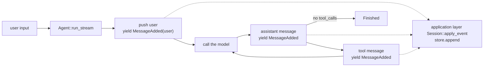
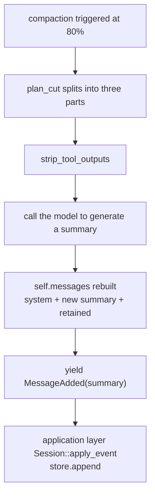
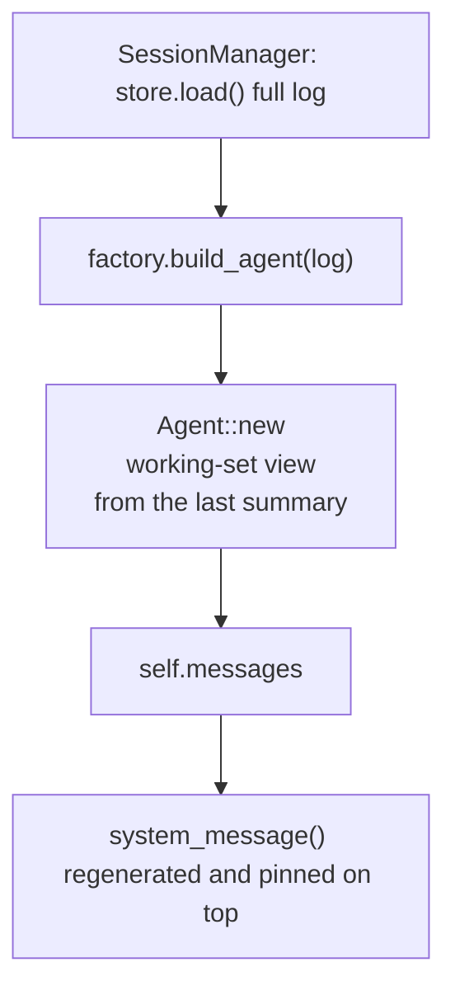

**Shirley technical design · Session persistence and recovery**

This document lands the line in `plan.md` -- "the AI model died halfway through the chat, and I did not
dare close the window" -- into a concrete plan.

**Scope statement**: this round only fixes the SDK-side contract and recovery semantics. The concrete
storage backend (SQLite / JSONL / ...) is implemented by the application layer, and the SDK does not
care. What is persisted is the **full raw Message log**; the **system prompt is not persisted** (the
system is regenerated on recovery).

---

**1. Core decisions (setting the tone first)**

**Decision 1: what is persisted is the raw Message.**

What is persisted is the **full raw Message log**: the log is the single source of truth, and the
working set is rebuilt from it on recovery. There is no transaction problem of "the log and some other
derived structure disagreeing" -- because there is only one copy of the data.

**Decision 2: the system prompt does not go into the log; it is regenerated on recovery.**

`system_prompt` may be in function form, resolved dynamically per `SystemPromptContext` (the working
directory), and its content changes with `Agent.md` and the working directory. This is exactly what
compaction-rebuild does (`compress_context` calls `system_message()` to fetch one fresh and put it on
top, rather than copying from the old messages). **Recovery must reuse the same rules**: the log
contains no system, and `Agent::new` regenerates it.

**Decision 4: the log is append-only; rewind only truncates the tail.**

The persisted log is append-only (normal rounds and compaction both go through append). The only
exception is rewind -- it **only acts on the last user message** (the application layer's `/rewind`
narrowed from "pick any historical message" to "only rewind the latest one"). Because it is "only
touching the tail", rewind = `messages` tail truncation + log tail truncation in sync, and **there is
no hole in the middle**.

> Why not do "arbitrary-position rewind + a prefix cursor": once a middle rewind is allowed and
> resent, the log would have a "discarded branch -> new branch" hole that a prefix cursor cannot
> express, and recovery would be misaligned. Tail-only truncation eliminates this complexity entirely.
> If a discarded branch really needs to be audited in the future, an operation log (`Append` /
> `RewindTo` sequences) would be needed, an order of magnitude more complex, and unnecessary now.

**Decision 5: the priority of the sources of truth for `messages` vs `session` -- at construction,
`messages` adjudicates.**

- `messages` non-empty -> **it wins; reset session to look like messages**;
- `messages` empty -> recover from `session.load()`.

If this is not nailed down, attaching a session with existing content produces "ghost messages": the
session has an old tail, messages is the truth, and appending after mounting forks, so the ghost
revives on the next cold start. "messages wins" is equivalent to "at the moment of mounting, the
session must be reset to look like messages".

---

**2. Application-layer contract** (**evolved: the contract has moved out of the SDK**)

> After the multi-session refactor, session persistence is **entirely owned by the application
> layer**: `SessionStore` / `SessionError` and the concrete implementation both live in
> `src/session.rs`, and the SDK no longer holds any session concept (the `Agent` has no `session`
> field, no recovery / persistence / truncation logic, and only emits `MessageAdded`). The following
> section records the **shape** of the contract (the content is unchanged, the ownership changed to
> the application layer); for the historical ownership see section 7.

**2.1 The `SessionStore` trait**

```rust
// src/session.rs (application layer)
pub trait SessionStore: Send + Sync {
    /// Append a message to the tail of the log. A ContextSummary produced by compaction also goes here.
    fn append(&self, message: &Message) -> Result<(), SessionError>;

    /// Read the full log (read-only, in order).
    fn load(&self) -> Result<Vec<Message>, SessionError>;

    /// Truncate to the first len entries (used by rewind; tail-only truncation).
    fn truncate(&self, len: usize) -> Result<(), SessionError>;
}
```

The three methods correspond to three operations, **exactly the entirety of the write semantics in the
architecture**: append (normal rounds + compaction), read back (recovery), tail truncation (rewind).
There is **deliberately no** `delete` / `update` / `search` -- they are not needed.

**Design points**:

- **The interface takes `&Message`, not `&[Message]`, and certainly not raw JSON.** What is stored is
  the SDK's semantic type, so switching protocols (OpenAI / Anthropic) does not touch the storage
  layer; a single-entry append naturally aligns with "persist round by round".
- **Synchronous signatures.** Session recovery / truncation happen on the synchronous path
  (`SessionManager` switching / `App::submit` rollback), and a synchronous interface saves the caller
  from going async. If the storage backend is async-driven, the implementation absorbs it internally
  (a synchronous driver like `rusqlite` is the least trouble). **Contract synchronous, implementation
  free.**
- **`SessionError` stays in `src/session.rs`** (living with the implementation), defined with
  `thiserror`, display format `[prefix]: detail` (two variants `Io` / `Backend`). The application
  layer no longer funnels it into `AgentError` via `#[from]` -- it no longer crosses the SDK boundary.

**2.2 Error handling**

An `append` failure = **exposed as an error**, not degraded into continuing. Reason: continuing to run
after a persistence failure is equivalent to pretending there is a save, which is more dangerous than
erroring directly. On the application layer, `Session::persist_message` records the failure as an
error entry (visible in the UI), but does not interrupt the whole conversation because of it.

**2.3 External exposure**

It is an application-layer internal type, not part of the SDK facade. The SDK's `lib.rs` **no longer
exports** `SessionStore` / `SessionError` / `InMemoryStore`.

---

**3. Application-layer wiring** (**evolved: the SDK no longer holds a session**)

**3.1 The persistence hook: event-driven**

The SDK's `run_stream` `yield MessageAdded` for every message that enters `self.messages` (user /
assistant / tool / summary; system is not emitted), but **does not persist**. The application layer,
in `Session::apply_event`, does `store.append` on receiving `MessageAdded` -- the TUI and desktop share
this one path (`App::apply_event` -> `Session::apply_event`).

| Event | Action |
| --- | --- |
| `MessageAdded(user)` | `store.append(user)` (the view entry is recorded by the driver side's `begin_turn` / `submit`) |
| `MessageAdded(assistant)` | `store.append(assistant)` + update the view |
| `MessageAdded(tool)` | `store.append(tool)` + update the view |
| `MessageAdded(summary)` | `store.append(summary)` + update the view |
| `Session::rewind_last_user_turn` | the application layer locates the last user -> `Agent::truncate_messages` (atomic tail truncation) + `store.truncate` (minus the system length) |

**The key point about compaction**: compaction **appends one summary**, it does not rewrite the log.
The log looks like `[original... old summary even more original... new summary]`, all kept, and on
recovery `active_messages` naturally recognizes only the last summary. **Self-consistent with
append-only.**

**3.2 Recovery: load then build**

Session persistence is in the application layer, and recovery no longer happens inside `Agent::new`.
When `SessionManager` switches / creates, it first does `store.load()` to get the full log, then
`factory.build_agent(log)` to start an `Agent` (`Agent::new` regenerates the system and puts it on
top). The log contains no system, so the recovered working set is necessarily consistent with a cold
start; `build_agent(Vec::new())` = a brand-new session.

**3.3 `rewind` cleanup: the atomic capability in the SDK, the business judgment in the application
layer**

"Rolling back the last user turn" is **session / UI business semantics** (who defines a "turn",
whether the assistant / tool chain after it is discarded along with it), and should not live in the
SDK. The SDK only provides the **atomic capability**:

```rust
// SDK: tail-truncate the working set to the first len entries, returning the new length.
// Maintains the internal invariant -- does not cross the pinned system, and clamps out-of-range len.
pub fn truncate_messages(&mut self, len: usize) -> usize;

// Application-layer Session: locate the business target + roll back memory + truncate the log
pub fn rewind_last_user_turn(&mut self) -> Option<String>;
```

The application layer's `Session::rewind_last_user_turn` itself does `rposition(User)` to find the last
user message, takes out the original text, calls `Agent::truncate_messages(index)` to roll back memory,
and then `store.truncate` according to the post-rollback `agent.messages()` length (minus the pinned
system). **The SDK no longer has `rewind_last_user_turn`** -- it only provides the atomic operation
"become shorter", and "how far to truncate" is computed by the upper layer.

---

**4. Data flow**

**4.1 Normal operation (append)**



**4.2 Compaction (append a summary, do not rewrite)**



**4.3 Recovery (one data source, one view)**



**4.4 On-disk structure (application-layer perspective)**

```
log file / table (append-only):
  ├── Message::User        { content }
  ├── Message::Assistant   { content?, reasoning_content?, tool_calls }
  ├── Message::Tool        { tool_call_id, content? }
  ├── Message::ContextSummary { content }   ← compaction product, also appended
  └── (no System)                            ← the system is regenerated on recovery

in-memory derived (not persisted):
  └── self.messages   = [system] + [from the last summary]
```

---

**5. Boundaries and invariants**

1. **The log contains no system.** On recovery, `system_message()` regenerates it and pins it on top,
   reflecting the latest working directory / `Agent.md`. The same rule as compaction-rebuild.
2. **The log is append-only; the only exception is rewind's tail truncation.** There is no hole in the
   middle.
3. **`ContextSummary` is a first-class message in the log**; compaction only appends, never rewrites.
4. **Recovery = the application layer first `load`, then `build_agent(log)`**; the log contains no
   system, so the recovered working set is necessarily consistent with a cold start. The `Agent` no
   longer holds a session, and there is no "reset session" semantics.
7. **Persistence is event-driven by the application layer** (`MessageAdded` -> `append`), and the SDK
   does not persist; `Session` is the only container holding the `store`, so the write points are not
   scattered.

---

**6. Relationship to existing documents**

- **`compaction.md`**: the `<compacted_range>` hook of compaction still holds. This document adds:
  the summary produced by compaction must enter the log, otherwise the working set is missing a
  segment on recovery.
- **`roadmap.md`**: the basis for promoting "session persistence and recovery" from P2 -- it is the
  foundation of long tasks (`plan.md`: the model dies and you dare not close the window), and it is
  the precondition for rewind to break through "not traceable after compaction".
- **`architecture.md`**: the "session persistence" row in the table is updated to: the application
  layer `session.rs` (the `SessionStore` contract + the `JsonlSessionStore` implementation) +
  `SessionManager` orchestration; the SDK no longer holds a session.

---

**7. Landing order (all landed; the contract has moved out of the SDK)**

> Originally the `SessionStore` contract landed in the SDK
> (`crates/shirley-agent-sdk/src/session/mod.rs`), with the `Agent` holding a `session` field and
> syncing on construction / write / rewind. After the multi-session refactor, the session was
> **extracted wholesale to the application layer**: the SDK deleted the `session` module / field /
> `SessionError` variant, the atomic capability `truncate_messages` only rolls back memory and returns
> the new length; the business method `Session::rewind_last_user_turn` lives with the contract in
> `src/session.rs`, and persistence is changed to application-layer event-driven.

1. ~~**`SessionStore` + `SessionError`**~~ -- landed, **owned by `src/session.rs`** (defined with
   `thiserror`, two variants `Io` / `Backend`); no longer exported by the SDK.
2. ~~**Persistence wiring**~~ -- landed: the SDK only `yield MessageAdded`; the application layer's
   `Session::apply_event` does `store.append` on receipt (a path shared by TUI / desktop).
3. ~~**Recovery wiring**~~ -- landed: `SessionManager` first `store.load()`, then
   `factory.build_agent(log)`; `Agent::new` only regenerates the system and pins it on top.
4. ~~**`rewind` cleanup**~~ -- landed: the SDK keeps only the atomic capability
   `truncate_messages(len)` (tail truncation + invariant maintenance, returning the new length); the
   application layer's `Session::rewind_last_user_turn` does the business judgment itself (locate the
   last user, take the original text), then `store.truncate` according to the post-rollback
   `agent.messages()` length (minus system).

**Application-layer backend**: `JsonlSessionStore` in `src/session.rs` is a real `SessionStore`
implementation -- one `Message` per line persisted as JSONL. `Session` holds
`Arc<dyn SessionStore>`, so a session is therefore **visible across process restarts** (recovery
happens when `SessionManager` switches / creates). `truncate` first writes a temp file then atomically
replaces and reopens the append handle; the internal `rewrite_locked` must be called while already
holding the lock, otherwise the non-reentrant lock deadlocks.

**Acceptance criteria**:

- When no session is passed, all existing tests and behavior are unchanged;
- Passing a session, running several rounds, restarting (a new Agent reusing the same store), the
  `messages` are consistent with before the restart (except system, which should reflect the latest
  context);
- After a rewind and restart, the discarded messages **do not revive** (the log is tail-truncated in
  sync);
- The recovered system is the **current** working directory / `Agent.md`, not the old one.

---

**8. Multi-session switching (`/session`)**

The previous seven sections solve "how one session is persisted and recovered". This section solves
"how to have and switch between multiple sessions".

**Decision 1: one session = one independent log; the directory is the index.**

The single file `<root>/.shirley/session.jsonl` is upgraded to a directory
`~/.shirley/workspaces/<workspace-id>/sessions/<name>.jsonl`, where each session is still a complete JSONL log (reusing
`JsonlSessionStore`, semantics unchanged). The name defaults to the creation timestamp
(`YYYYMMDD-HHMMSS`), and **scanning the directory is "listing the sessions"** -- no extra index file is
needed, and there is no consistency problem of "the index and the log disagreeing" (continuing
decision 1's single source of truth).

**Decision 2: switching is an SDK seam, not an application hack.** (**evolved: the seam moved up to
the application layer**)

> **This decision has been superseded by `docs/multi-session.md`.** After multi-session parallelism
> landed (P1), `Agent::switch_session(Arc<dyn SessionStore>)` has been **removed from the SDK** --
> "which session is active" is application-layer orchestration, carried by `SessionManager`'s `active`
> pointer. Each `Agent` corresponds to a fixed log source, and there is no longer a "switch the current
> session" action. **Further (this round): the `SessionStore` contract itself has also moved out of
> the SDK** -- the SDK no longer holds a session concept, recovery is done by the application layer's
> `store.load()` then `build_agent(log)`, and persistence is changed to application-layer event-driven
> (see sections 2 / 3). The following paragraph is the **transitional semantics of the single-session
> era**, kept as a historical record; for the current implementation see `SessionManager::switch_to`
> in `src/interface/session/mod.rs`.

`Agent::switch_session(Arc<dyn SessionStore>)` was once the only newly added SDK public method,
symmetric with `/model`'s `set_model`: the model config, system prompt, working directory, tools, and
compression instruction are **kept as-is**, and only the "current session" is replaced. The semantics
**share the same rules** with `Agent::new`'s recovery path (`restore_from_session`): clear the
in-memory working set -> rebuild from the new log -> regenerate the system per the current context and
pin it on top. Therefore "the working set switched out" is necessarily consistent with "the working
set recovered by a cold start".

**Decision 3: the session catalog (`SessionCatalog`) converges "where sessions come from", symmetric
with `ModelCatalog`.**

`src/session.rs` defines the `SessionCatalog` trait (`list` / `open` / `create` / `create_named` /
`create_lazy` / `rename` / `delete`) and the local implementation `FileSessionCatalog`. The `/session`
command and the picker UI depend only on the interface, so if a remote / database backend is wanted in
the future, the UI does not need to change. The last four methods have default implementations
(`create_named` / `create_lazy` fall back to `create`, `rename` / `delete` report a `Backend` error),
so a backend that does not support metadata (such as `EmptySessionCatalog`) needs no changes.

`SessionEntry`, besides `name` / `label` / `preview`, also carries `modified_ms` (the file mtime; the
list is sorted descending by it) and `turns` (the number of user turns) -- aligned with the time and
turn count shown by Codex's resume picker.

**Decision 4: lazily open an empty session at startup, compatible with the old single-file log.**

At startup, `bootstrap::assemble` **directly `create_lazy()` a new session** (rather than recovering
the "most recently modified" old session): the starting point for a user running a coding agent should
be a clean new conversation, avoiding carrying the context of a historical session right away.
Historical sessions are still in the `<state>/sessions/` directory, opened with the `/session` picker
when needed.

**"Lazy" = do not persist at startup** (Codex's UX): at this moment only the session name is
determined (for display in the footer / current-session marker), and **no file is created**; the file
is materialized only when a message is really sent (`SessionStore::append` is called for the first
time) -- persisting the JSONL under the already-determined name (and writing the title sidecar). This
way, "opening the app but not chatting" does not leave an empty session file in the list. The
implementation lands in `LazySessionStore`: it is just an ordinary `SessionStore` (held by the
application-layer `Session`, with the persistence path unchanged), the only difference being that
`append` triggers materialization the first time, and before materialization `load` / `truncate` are
treated as an empty log / a no-op. The TUI's "+ New Session" and the desktop's `agent_new_session`
both go through `create_lazy`, with consistent semantics.

If an old single-file `<root>/.shirley/session.jsonl` is found and the directory is still empty, it is
first adopted as the `legacy` session (`adopt_legacy`), ensuring no history is lost on upgrade (after
adoption, a new session is opened as usual).

**Decision 5: the picker merges "switch" and "new" into one panel.**

`/session` opens a modal picker (the same style as `/model`), with the first list item fixed as the
"+ New Session" sentinel (`name` is an empty string) and the rest real sessions, each showing a
preview of the first user message on its second line (to recognize the session). On confirm, it is
routed by the sentinel to `create_lazy` (lazy, see decision 4) or `open`; after confirm, the interface
items are rebuilt (`rebuild_items_from_agent`) and the session-bound statistics (usage / context
occupancy) are reset.

**Decision 6: the title is a sidecar; renaming does not touch the identifier or the content.**

The session name is a timestamp (the file stem), unreadable and hard to recognize; it is allowed a
**custom title**. The title is **not written into the JSONL** -- the log stores only `Message`
(decision 1), and stuffing the title in would break this invariant; instead it is stored as a plain-
text sidecar `<name>.title` (empty / absent = no title, falls back to `name`).

`rename(name, title)` **only changes the title, not the session name, and not the log content** --
consistent with Codex's `/rename` ("does not change the transcript"). Incidentally it sidesteps
trouble like "after renaming the file, the already-open `JsonlSessionStore` handle still points at the
old inode". `delete(name)` deletes the log and best-effort deletes the title sidecar.

**Decision 7: desktop and TUI share the same session data.**

The two interfaces **share the directory described by the same `FileSessionCatalog` instance**
(`~/.shirley/workspaces/<workspace-id>/sessions`) -- this is the landing point of "sharing one copy of data": complete the
operations at the catalog layer, and the two interfaces automatically share them. The desktop side
puts the factory's `session_catalog` (previously TUI-only) into `DesktopState` as well, adding
commands:

- `agent_list_sessions` / `agent_current_session`: list / query the current session;
- `agent_new_session(title?)` / `agent_switch_session(name)`: new (optionally named) / switch, both
  going through the application-layer `SessionManager` (`create_new` / `switch_to`, **the same
  orchestrator** as the TUI);
- `agent_rename_session(name, title)` / `agent_delete_session(name)`: management;
- `agent_load_history`: take the User / Assistant body text from `agent.messages()` (skipping system /
  tool / context_summary) into `HistoryMessageWire`, from which the frontend rebuilds the transcript.

Session operations and `agent_send` **share `Arc<Mutex<Option<Agent>>>`**: while running, `agent=None`,
and at this point any session operation returns "agent is running", so the same `Agent` is not driven
concurrently. The frontend `SessionSidebar.tsx` (the left sidebar) follows the `ModelSelector`
pattern, providing new (optionally named) / switch / rename (inline edit) / delete (two-click confirm)
under the **project grouping**; for multi-project (multi-workspace) registration / switching /
renaming / archiving / restoring see `docs/desktop-interface.md` 4.5.

**Scope this phase**: session list / new (optionally named) / switch / rename / delete; project list /
add / switch / rename / archive / restore.
**Not doing**: fork / startup `--resume` (recorded as a follow-up).

**Acceptance criteria**:

- After switching sessions, the working set reflects only the new session; the old session's content
  does not bleed in;
- After switching, subsequent rounds' `append` lands in the new log, and the old log is not modified;
- The working set switched out is exactly consistent with "cold-starting directly into that session"
  (sharing the recovery rules);
- The old single-file log is adopted on the first startup, with no history lost;
- **Startup does not persist**: when the app is opened but no message is sent, no empty session file
  appears in `<state>/sessions/`; the session appears only after the first message is sent (the same
  for TUI / desktop);
- The TUI and desktop see the same session list; creating / renaming / deleting on one side is visible
  on the other after a refresh.
