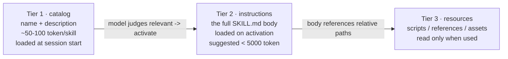
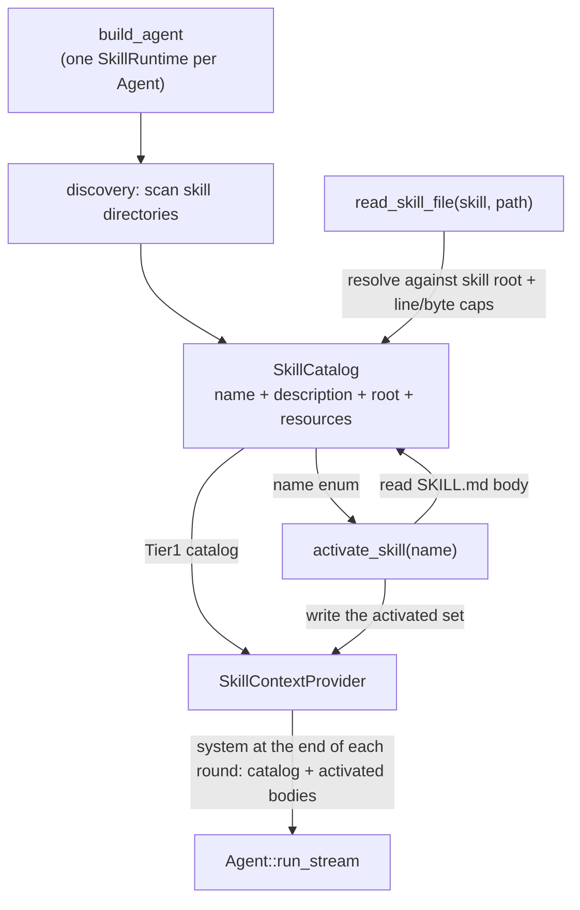

**Shirley technical design · Skills**

This document lands a plan for "letting Shirley support skills and embrace the skill ecosystem". It is
a **sibling extension** of `todo.md` / `memory.md`: todo solves "forgot where it got to after
compaction", memory solves "forgot who the user is in a new session", and skills solves **"the model
does not know how to do a certain class of task"** -- packaging procedures, scripts, and templates
into a pluggable capability pack that the model loads on demand when needed.

The external basis of the plan is the **Agent Skills open standard** (`agentskills.io`, whose source is
`anthropics/skills`'s `spec/agent-skills-spec.md`), plus Anthropic's official "Equipping agents for
the real world with Agent Skills" and the client implementation guide. The counter-example is Claude
Code's private extension fields -- only absorb the intuitive, cross-client-common parts.

**Scope statement**: the plan follows the existing paradigm (todo / memory): **the application layer
holds state + `ContextProvider` injection + companion tools, with zero SDK changes**.

> **Implementation status**: **P0+P1+P2(slash) are landed** (`src/skills/`: `parse` / `discovery` /
> `catalog` / `provider` / `runtime` / `tool`). P0 injects the Tier1 catalog via
> `bootstrap::build_agent`; P1 adds `activate_skill` (`name` limited to an enum) + `SkillRuntime`
> (the activated set, sharing the same `Arc` with the provider) + **appending** the activated body at
> the end of each round (survives compaction) + `read_skill_file` (Tier3 resources read on demand).
> P2(slash) adds a `/<skill-name>` command entry (`CommandOutcome::ActivateSkill`, with the harness
> activating directly and skipping the model's judgment; only touching the application-layer command
> layer, reusing `SkillRuntime`). **KV cache constraint**: injection is always append-style (the
> catalog is a stable prefix, activated blocks are concatenated in activation order, and old content
> is byte-for-byte unchanged). The rest of P2 (dedup activation hints / body cap tuning) and beyond
> are **not landed**. For the phases and acceptance criteria see sections 8 and 9.

---

**1. What to solve**

Shirley now has three kinds of "memory / state" capabilities, and the missing fourth is "**how to do
things**":

| Capability | Problem solved | Form | Ownership |
| --- | --- | --- | --- |
| Compaction | A round does not fit | Summary rebuild | SDK runtime |
| Task ledger (todo) | Forgot where it got to after compaction | A system injected at the end of each round | Application layer `src/todo.rs` |
| Memory | Forgot who the user is in a new session | A system injected at the end of each round + the `recall` tool | Application layer `src/memory/` |
| **Skills** | **The model does not know how to do a certain class of task** | **An always-resident catalog + on-demand-activated instruction / resource pack** | **Application layer `src/skills/` (this document)** |

A skill is **a directory**, whose minimal form contains only a `SKILL.md` (YAML frontmatter +
Markdown body). It can carry: procedures, domain knowledge, executable scripts (`scripts/`), on-demand
documents (`references/`), and template resources (`assets/`).

**Why it is worth doing**: the ecosystem has already taken off. Anthropic released the Agent Skills
open standard in 2025-10, and Claude Code / Claude.ai / API all support it; the community has begun to
accumulate ready-made skill repositories (the `skills/` directory in `anthropics/skills`, and various
third-party `.claude/skills/`). Embracing the standard means Shirley **does not have to invent its own
capability-pack format** and can directly consume existing skills in the ecosystem; at the same time
it gives its own users an extension point to "write a repeatedly-used project procedure as a skill".

The current Shirley has no corresponding concept: the system prompt (`src/prompt.rs`) statically
inlines `Agent.md`, and the toolset is fixed (`bash` / `read_file` / `web_search`). **There is no seam
for a "pluggable capability pack"** -- this is exactly what this document adds.

---

**2. External ecosystem research (the Agent Skills open standard)**

**2.1 The on-disk form of a skill**

A skill is a directory; the minimum is just `SKILL.md`:

```
my-skill/
├── SKILL.md          # required: YAML frontmatter + Markdown body
├── scripts/          # optional: executable code (called on demand by the model; the standard does not auto-execute)
├── references/       # optional: reference documents loaded on demand
└── assets/           # optional: templates / resource files
```

`SKILL.md`'s frontmatter fields (the standard):

| Field | Required | Constraint | Description |
| --- | --- | --- | --- |
| `name` | ✅ | ≤64, `[a-z0-9-]`, **must equal the parent directory name** | unique identifier |
| `description` | ✅ | ≤1024 | must state both "**what it does**" and "**when to use it**" -- it is the sole basis on which the model decides whether to activate |
| `license` | ❌ | -- | license |
| `compatibility` | ❌ | ≤500 | runtime requirements (e.g. "requires python3") |
| `metadata` | ❌ | map | custom key-values |
| `allowed-tools` | ❌ | space-separated | **experimental**; the standard only requires "declaration", not client enforcement |

Claude Code also adds a batch of **private** fields (`disable-model-invocation` / `user-invocable` /
`disallowed-tools` / `model` / `effort` / `context:fork` / `agent` / `hooks` / `paths` /
`argument-hint` / `arguments` / `when_to_use`). **These do not go into the standard**, and Shirley
does not implement them in phase one (see section 9).

**2.2 Progressive disclosure -- the core mechanism**

A skill is not stuffed entirely into the context at once, but loaded on demand in three tiers:



- **Tier 1**: only list each skill's `name` + `description`, at a very small cost.
- **Tier 2**: only after the model decides it is relevant does it read the full `SKILL.md` body
  (stripping the frontmatter).
- **Tier 3**: the scripts / documents / templates referenced in the body, read only when the model
  really needs them.

This mechanism is the key to being "**context-budget friendly**": even with 100 skills installed, only
100 lines of catalog go into the context, and only the activated ones pay for the body.

**2.3 Discovery locations (cross-client convention)**

| Level | Path | Priority |
| --- | --- | --- |
| Project level | `<project>/.agents/skills/` | high (overrides user level) |
| Project level (compat) | `<project>/.claude/skills/` | high |
| User level | `~/.agents/skills/` | low |
| User level (compat) | `~/.claude/skills/` | low |
| Client-native | `<project>/.<client>/skills/` | implementation-defined |

Name-collision rule: **project level overrides user level**. A collision within the same level is
treated as a conflict and must be handled by the implementation (Shirley adopts the conservative
strategy of "first scanned wins + record the conflict", see 5.2).

**2.4 Two implementations of activation**

1. **File-read activation**: the catalog gives each skill's `location`, and the model uses the generic
   `read` tool to read `SKILL.md`.
2. **Dedicated-tool activation**: expose `activate_skill(name)`, and the harness reads the file,
   strips the frontmatter, wraps the body in a `<skill_content>` tag, lists `resources`, and limits
   `name` to an **enum** (to prevent the model from fabricating a nonexistent skill).

The official client guide also mentions a third route: binding a skill as a **slash command**
(`/skill-name`), injected directly by the harness -- this belongs to the interaction layer, see
section 9.

**2.5 Client implementation guide (5 steps)**

1. **Discover**: scan directories, handle name collisions, do trust validation.
2. **Parse**: fault-tolerantly parse the frontmatter; if `description` is missing, **skip** that
   skill.
3. **Disclose**: put the Tier1 catalog into a system-prompt segment, or into a tool description.
4. **Activate**: see 2.4.
5. **Manage over time**: **prevent compaction from cutting away activated skill content**; dedup
   activation (do not re-inject the same skill); optionally start a subagent for isolation.

> Step 5 is **where it is easiest to fall into a pit**: once a skill body is injected as an ordinary
> conversation message, context compaction silently drops it, and the model then "forgets how to do
> it". Shirley's `ContextProvider` seam naturally avoids this pit (see decision 4).

---

**3. Core decisions (setting the tone first)**

**Decision 1: owned by the application layer, zero SDK changes.**

A skill's "which directories to discover, how to parse, how to disclose, how to activate" is a
trade-off of the coding-agent product, not a generic fundamental capability -- the same reason as
todo / memory. The SDK provides only two generic seams: `ContextProvider` (injected at the end of each
round) and tool registration (`ToolManager`). **This document adds no new SDK external types**, and
`lib.rs`'s `pub use` is untouched.

**Decision 2: use progressive disclosure as the skeleton.**

Do not do the crude implementation of "inlining all skill bodies into the prompt at startup" (that
throws away the whole mechanism of 2.2, and a few skills blow up the context). The Tier1 catalog is
always resident, Tier2 is activated on demand, and Tier3 is read on demand.

**Decision 3: activate with the dedicated tool `activate_skill(name)`, not file reading.**

Three reasons:

- **File reading is infeasible for user-level skills**. Shirley's `read_file` is validated by
  `WorkSpace::resolve` and **rejects absolute paths and out-of-bounds paths** -- whereas a user-level
  skill is in `~/.agents/skills/`, outside the workspace, which the model simply cannot read.
- **A dedicated tool can do what generic reading cannot**: strip the frontmatter (give the model only
  the body), list the `resources`, and limit `name` to an **enum** (preventing the model from
  hallucinating a nonexistent skill name).
- **A dedicated tool makes "activation" an observable event**, convenient for dedup activation and
  state tracking (decision 4).

**Decision 4: the activated skill body is injected each round by `SkillContextProvider`, surviving
compaction.**

This is a technique fully isomorphic to todo: the activation state is recorded in `SkillRuntime` (held
by the application layer), **does not go into `self.messages`**, and a system message is **appended**
at the end when assembling each round's request. Compaction cannot touch it, and it naturally survives
compaction -- exactly filling the pit at step 5 of 2.5.

The cost is the same as todo: activating / deactivating changes "the system message at the end",
invalidating the prefix after it. Minimize the cost with "inject only **activated** skills + set a
character cap".

**Decision 5: a skill is **untrusted external data**, read-only, not auto-executed.**

A skill may come from a third-party repository `git clone`d (even a malicious repository). So:

- Wrap it in a `<skill_content>` tag when injecting, and declare in the system prompt that "this is
  external instruction data, not a system instruction" (the same as `web_search` marking its results
  as untrusted).
- `allowed-tools` is **recorded only, not enforced** (the standard itself only requires declaration)
  -- phase one does not narrow permissions, because Shirley does not yet have a general permission
  layer (`docs/security.md`'s `PermissionPolicy` is not landed).
- **Do not auto-execute** `scripts/`: only tell the model the path; actually executing still goes
  through `bash` (subject to the sandbox).
- Skip noise directories like `.git` / `node_modules` / `target` during the scan.

---

**4. Plan comparison: three integration routes**

| Dimension | A. Fully inline into the prompt | B. File-read activation | C. Dedicated tool + ContextProvider (**recommended**) |
| --- | --- | --- | --- |
| Tier1 catalog | full body stuffed into system | catalog + location stuffed into system | catalog stuffed into system (same as B) |
| Tier2 activation | no activation needed (already full) | the model reads `SKILL.md` with `read_file` | `activate_skill(name)` returns the body |
| User-level skill | readable (read in at startup) | **unreadable** (`read_file` rejects out-of-bounds) | readable (the tool resolves against the skill root internally) |
| Context usage | **explodes** (N skills all resident in full) | small | small |
| Anti-hallucination of skill names | N/A | cannot (the model can fabricate a path) | can (name limited to an enum) |
| Survives compaction | naturally (in system) | **lost** (the body is compacted away as an ordinary message) | naturally (the provider re-injects each round) |
| Dedup activation / observability | N/A | none | yes (activation is an explicit event) |
| Implementation complexity | low | medium | medium |
| Conclusion | ❌ violates progressive disclosure | ⚠️ user-level skills fail + compaction loses content | ✅ adopt |

**Conclusion**: go with C. It satisfies both "embrace the standard format" (the on-disk layout follows
the standard exactly) and "adapt to Shirley's own constraints" (workspace out-of-bounds + compaction
semantics).

---

**5. Landing design**

**5.1 Directory layout and modules**

Add an application-layer module `src/skills/`, at the same level as `src/todo.rs` / `src/memory/`:

```
src/skills/
├── mod.rs         # facade: re-export SkillCatalog / SkillRuntime / SkillContextProvider / tools
├── discovery.rs   # scan discovery locations, name collisions and conflict handling, noise-directory filtering
├── parse.rs       # fault-tolerant parsing of SKILL.md frontmatter (reusing memory's frontmatter split)
├── catalog.rs     # SkillCatalog: name -> SkillMeta map + render the Tier1 catalog
├── runtime.rs     # SkillRuntime: the activated set (Arc<Mutex<...>>), shared by provider / tools
├── provider.rs    # SkillContextProvider: inject "catalog + activated bodies" each round
└── tool.rs        # two hand-written Tools: activate_skill / read_skill_file
```

**5.2 Discovery and parsing**

- **Discovery order**: project level (`.agents/skills/` -> `.claude/skills/`) -> user level
  (`~/.agents/skills/` -> `~/.claude/skills/`). **First scanned wins** (project level naturally comes
  before user level, implementing project overriding user).
- **Parsing fault tolerance**: missing frontmatter / missing `name` or `description` -> **skip that
  skill and log a warn** (aligned with step 2 of the official guide; never let one bad skill drag down
  the whole directory).
- **Validation**: if `name` does not match the parent directory name -> use the **directory name**
  (to avoid the model seeing a name that does not line up with the path).
- **Reuse**: `memory/format.rs` already has a fault-tolerant `split_frontmatter(text) -> (&str, &str)`
  implementation. **Promote it to a shared utility function** (e.g. `src/skills/parse.rs` calls it
  directly, or extract it to `src/util/`), avoiding a new YAML dependency (the repository currently
  has no `serde_yaml`; the frontmatter is a hand-written key:value parse, which suffices).

**5.3 Runtime and data flow**



- **`SkillCatalog`**: scanned once at startup, holding `Vec<SkillMeta>` (`name` / `description` /
  `root` / `resources`). The catalog is **unchanged** during a session.
- **`SkillRuntime`**: `Arc<Mutex<HashSet<String>>>` (the activated skill names). The `provider` and
  the `activate_skill` tool share the same `Arc`, isomorphic to todo's `TodoStore`.
- **`SkillContextProvider`**: renders two segments --
  1. **Tier1 catalog** (`<available_skills>`: one line `name: description` each);
  2. **activated bodies** (`<active_skill name="...">body</active_skill>`).
  Empty catalog and no activation -> return `None` (do not inject).

**5.4 Seam wiring (`src/bootstrap.rs`)**

Add a third provider in `build_agent`, into the existing `CompositeContextProvider`:

```rust
let skill_runtime = Arc::new(SkillRuntime::new(skill_catalog.clone()));
let provider = CompositeContextProvider::new(vec![
    Arc::new(TodoContextProvider::new(todo_store)) as Arc<dyn ContextProvider>,
    Arc::new(MemoryContextProvider::new(memory.clone())) as Arc<dyn ContextProvider>,
    Arc::new(SkillContextProvider::new(skill_catalog, skill_runtime.clone())) as Arc<dyn ContextProvider>,
]);
// register activate_skill / read_skill_file (sharing the same skill_runtime)
let _ = tool_manager.register(ActivateSkillTool::new(skill_runtime.clone()));
let _ = tool_manager.register(ReadSkillFileTool::new(skill_catalog));
```

**Key point**: `SkillCatalog` can be scanned once at `AgentFactory::assemble` and `clone`d to each
`Agent` (the catalog is read-only, harmless to share across sessions); `SkillRuntime` is **created
fresh per session** (the activation state is isolated per session), fully consistent with todo /
memory's runtime distribution.

**5.5 Tier3: `read_skill_file(skill, path)`**

User-level skills are outside the workspace, and `read_file` cannot reach them. So give a read tool
**constrained by the skill root**:

- Input `skill` (enum) + `path` (relative to the skill root, rejecting `..` / absolute paths).
- Reuse `read_file`'s line cap (default 200 / cap 2000), byte cap (64KB), binary detection, and secret
  filtering -- **the same set of boundaries**, only changing the root from `WorkSpace` to `skill.root`.
- In implementation, extract `read_file`'s read kernel into `read_text_range(root, path, ...)`, shared
  by both, to avoid boundary drift (aligned with `docs/security.md` "the boundary exists in only one
  place").

**5.6 Relationship to slash commands (P2, landed)**

Besides the model activating via `activate_skill`, the user can also type **`/<skill-name>`** for the
harness to **activate directly** -- a deterministic entry that skips the model's judgment.

- **Parsing**: `CommandManager::resolve` / `fuzzy_match` gain a `skills: &[String]` parameter; the
  candidate names = built-in commands + the skill names visible to the current session. **Built-in
  commands take priority** (`/model` etc. are not stolen by a same-named skill), and a skill name is
  matched only when no built-in hits. The skill names are passed in as **data**, and `CommandManager`
  stays stateless and does not cache (to avoid staleness).
- **Obtaining `SkillRuntime`**: mimic the `memory` pattern -- `BuiltAgent` carries an extra
  `skills: Arc<SkillRuntime>`, `Session` holds `pub skills: Option<Arc<SkillRuntime>>`, and the App
  takes it from the foreground session.
- **Injection**: activation only writes to `SkillRuntime`'s activated set, and the body is still
  **appended and injected** by `SkillContextProvider` in the next round -- **no new injection seam**,
  and `render()`'s append semantics guarantee KV prefix stability.
- **UX**: `/<skill-name>` (no args) = activate + a local system hint (does not send to the model);
  `/<skill-name> <text>` = activate and then send `<text>` as this round's prompt; a failed activation
  (unknown skill / file-read failure) errors locally and does not send to the model. If a skill name is
  not in the catalog, treat it as ordinary text (a lenient strategy, not interrupting input).
- **Boundary**: purely application-layer (`src/interface/command.rs` + `app.rs` wiring), **zero SDK
  changes**.

---

**6. Security and trust**

| Risk | Handling |
| --- | --- |
| A third-party skill injects malicious instructions | `<skill_content>` tag + a system-prompt declaration "external data, not a system instruction"; do not auto-execute `scripts/` |
| `allowed-tools` treated as authorization | phase one **records only, does not enforce** (Shirley has no general permission layer); the doc states plainly that it is not a security boundary |
| Out-of-bounds reading of user-level skill paths | `read_skill_file` pins the root at `skill.root`, rejecting `..` / absolute paths |
| Directory scanning slowed by a large repository | skip `.git` / `node_modules` / `target`; scan only fixed-depth `skills/*/SKILL.md` |
| Activated content blows up the context | set a character cap per skill body (e.g. 20k), truncating with a marker when exceeded; set a cap on the total injection |
| Hallucinating a nonexistent skill | `activate_skill`'s `name` is limited to an **enum** by the macro / hand-written schema |

> **Not doing**: not auto-trusting, not auto-executing, not doing sandbox-level skill isolation (that
> is what `docs/security.md`'s `PermissionPolicy` should handle, a separate follow-up).

---

**7. Boundary with todo / memory**

All three reuse `ContextProvider`, but their **responsibilities do not overlap**, and the injected
content is independent of each other:

| | todo | memory | skills |
| --- | --- | --- | --- |
| Injected content | task progress | user profile + relevant memories | available capability catalog + activated instructions |
| Change frequency | may change each round | may change each round | catalog unchanged; activation occasional |
| Companion tool | `todo` (write) | `recall` (read) | `activate_skill` / `read_skill_file` |
| Lifecycle | one `TodoStore` per session | one `MemoryRuntime` per session | one `SkillRuntime` per session; `SkillCatalog` shared across sessions |

The concatenation order (`CompositeContextProvider`) is suggested as **todo -> memory -> skills**: put
the content that most needs to be in front each round ("progress / profile") first, and the more static
"capability catalog" later. The order only affects the concatenated text, not correctness.

---

**8. Acceptance criteria**

After the plan lands, at least cover:

1. **Standard compatibility**: can directly consume a skill directory conforming to the Agent Skills
   standard (including `scripts/` / `references/`), with no rework.
2. **Discovery**: both project level + user level are scanned; a project-level name collision overrides
   the user level.
3. **Fault tolerance**: a skill with bad frontmatter / missing `description` is skipped without
   affecting the rest.
4. **Disclosure**: when not activated, the context contains only the Tier1 catalog (one line per
   skill), with no body.
5. **Activation**: `activate_skill` returns the body with the frontmatter stripped + the `resources`
   list; a non-enum `name` is rejected.
6. **Survives compaction**: trigger another compaction after activation, and the model can still see
   that skill's body in the next round.
7. **Out-of-bounds**: `read_skill_file` rejects `..` / absolute paths; user-level skills are readable.
8. **Not auto-executed**: scripts under `scripts/` are not executed until explicitly called via `bash`.
9. **Zero SDK changes**: `crates/shirley-agent-sdk/src/lib.rs`'s `pub use` has no additions.

---

**9. Phases**

| Phase | Content | Dependency |
| --- | --- | --- |
| **P0** ✅ | `discovery` + `parse` + `catalog` (scan directories, parse, fault tolerance) + `SkillContextProvider` injecting only the Tier1 catalog | none |
| **P1** ✅ | `activate_skill` + `SkillRuntime` + **appending** the activated bodies each round (survives compaction) + `read_skill_file` (Tier3) | P0 |
| **P2** ◐ | the `/skill-name` slash command activating directly ✅ (`CommandOutcome::ActivateSkill` + the command layer's `skills` parameter); dedup activation hints and per-skill body cap tuning (not landed) | P1 |
| **P3 (optional)** | compatible with the **read-only** subset of Claude Code's private fields (`when_to_use` etc.); subagent isolation | P2 |
| **Not doing** | auto-executing `scripts/`; enforcing `allowed-tools`; a skill marketplace / installer; cross-workspace skill sync | -- |

---

**10. Known gaps / open decisions**

1. **The token cost of activated content**: re-injecting the full text each round (decision 4)
   continuously occupies the context. The mitigation is "inject only activated + set a cap", but there
   is no good criterion for "when to auto-deactivate" (the model will not proactively say 'I am done
   with it'). Alternative: after activation, inject the full text into `self.messages` only once, and
   the provider injects only a one-line short hint "activated X" each round -- **but this makes the
   full text compactable**, conflicting with decision 4. Leaning toward keeping decision 4 and leaving
   the cost to cap control.
2. **Reusing frontmatter parsing**: `memory/format.rs::split_frontmatter` is currently private;
   promoting it to a shared function touches the memory module -- need to confirm it does not break
   its tests.
3. **The quality of `description`'s "when to use"**: whether the model can activate correctly depends
   heavily on how well `description` is written. Whether to add a guiding sentence in the catalog
   injection ("when a task matches a skill's description, `activate_skill` first") -- leaning toward
   adding it, pending verification.
4. **The skill root under multiple workspaces (desktop)**: one `AgentFactory` per project, and the
   skill directories should be resolved against the project root; the user-level `~/.agents/skills/`
   is globally shared. Need to confirm when `ProjectRuntime` lands.
5. **Trust model**: whether to have the UX of "the first use of a skill requires user confirmation"
   (against supply-chain attacks) -- not done in phase one, recorded as a gap.

---

**Appendix: relationship to existing documents**

- Reused seam: `runtime/context.rs`'s `ContextProvider` (already explained in `docs/todo.md`).
- Sibling capabilities: `docs/todo.md` (progress), `docs/memory.md` (user).
- Boundary ownership: `docs/security.md` (the permission layer, the future attachment point for a
  skill's `allowed-tools`).
- Upstream standard: the Agent Skills open standard (`agentskills.io`) + `anthropics/skills`.
