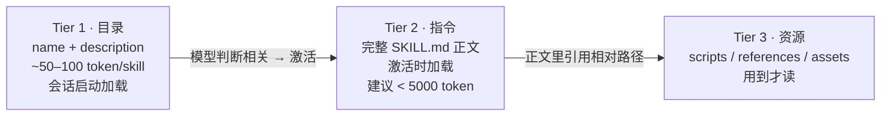
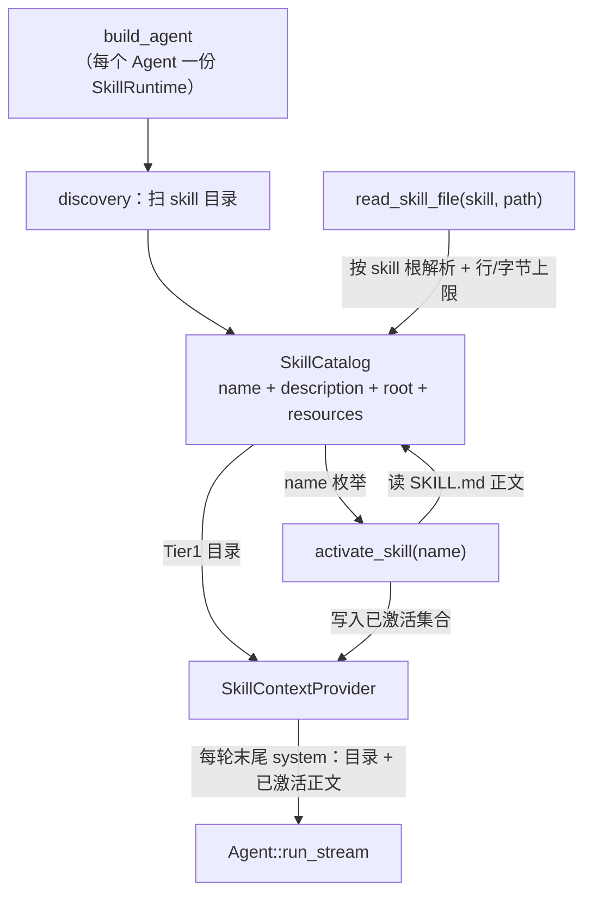

**Shirley 技术方案 · 技能（skills）**

这份文档给"让 Shirley 支持 skills 能力、拥抱 skill 生态"落地一个方案。它是
`todo.md` / `memory.md` 的**同族延伸**：todo 解决"压缩后忘了做到哪"，memory 解决
"新会话忘了用户是谁"，而 skills 解决**"模型不知道某类任务该怎么做"**——把操作
流程、脚本、模板打包成可插拔的能力包，模型在需要时按需加载。

方案的外部依据是 **Agent Skills 开放标准**（`agentskills.io`，源头是
`anthropics/skills` 的 `spec/agent-skills-spec.md`），以及 Anthropic 官方的
《Equipping agents for the real world with Agent Skills》与客户端实现指南。
反面参照是 Claude Code 的私有扩展字段——只吸收它直观、跨客户端通用的部分。

**范围声明**：本轮只做调研与方案（用户原话是"先调研一下 skill 的方案"），
**不含实现**。方案遵循既有范式（todo / memory）：**应用层持有状态 +
`ContextProvider` 注入 + 配套工具，SDK 零改动**。

> **实现状态**：**未落地**。本文是设计提案。分期与验收见第八、九节。

---

**一、要解决什么**

Shirley 现在有三种"记忆/状态"能力，缺的是第四种——"**怎么做事**"：

| 能力 | 解决的问题 | 形态 | 归属 |
| --- | --- | --- | --- |
| 压缩（compaction） | 一轮对话装不下 | 摘要重建 | SDK runtime |
| 任务账本（todo） | 压缩后忘了做到哪 | 每轮末尾注入的 system | 应用层 `src/todo.rs` |
| 记忆（memory） | 新会话忘了用户是谁 | 每轮末尾注入的 system + `recall` 工具 | 应用层 `src/memory/` |
| **技能（skills）** | **模型不知道某类任务该怎么做** | **目录常驻 + 按需激活的指令/资源包** | **应用层 `src/skills/`（本文）** |

一个 skill 就是**一个目录**，最小形态只含一个 `SKILL.md`（YAML frontmatter +
Markdown 正文）。它能携带：操作步骤、领域知识、可执行脚本（`scripts/`）、按需
文档（`references/`）、模板资源（`assets/`）。

**为什么值得做**：生态已经起来了。Anthropic 在 2025-10 发布 Agent Skills 开放
标准，Claude Code / Claude.ai / API 三端都支持，社区开始沉淀现成 skill 仓库
（`anthropics/skills` 里的 `skills/` 目录、以及各类第三方 `.claude/skills/`）。
拥抱标准意味着 Shirley **不用自己发明能力包格式**，直接吃生态里已有的 skill；
同时给自己的用户一个"把项目里反复用的流程写成一个 skill"的扩展点。

Shirley 现状里没有对应概念：系统提示词（`src/prompt.rs`）静态内联 `Agent.md`，
工具集固定（`bash` / `read_file` / `web_search`）。**没有一个"可插拔能力包"的
接缝**——这正是本文要补的。

---

**二、外部生态调研（Agent Skills 开放标准）**

**2.1 skill 的磁盘形态**

一个 skill 是一个目录，最小只需 `SKILL.md`：

```
my-skill/
├── SKILL.md          # 必需：YAML frontmatter + Markdown 正文
├── scripts/          # 可选：可执行代码（模型按需调用，标准不自动执行）
├── references/       # 可选：按需加载的参考文档
└── assets/           # 可选：模板 / 资源文件
```

`SKILL.md` 的 frontmatter 字段（标准）：

| 字段 | 必填 | 约束 | 说明 |
| --- | --- | --- | --- |
| `name` | ✅ | ≤64，`[a-z0-9-]`，**须等于父目录名** | 唯一标识 |
| `description` | ✅ | ≤1024 | 必须同时写清"**做什么**"和"**何时用**"——它是模型决定要不要激活的唯一依据 |
| `license` | ❌ | — | 许可证 |
| `compatibility` | ❌ | ≤500 | 运行环境要求（如"需要 python3"） |
| `metadata` | ❌ | map | 自定义键值 |
| `allowed-tools` | ❌ | 空格分隔 | **实验性**；标准只要求"声明"，不要求客户端强制 |

Claude Code 还加了一批**私有**字段（`disable-model-invocation` /
`user-invocable` / `disallowed-tools` / `model` / `effort` / `context:fork` /
`agent` / `hooks` / `paths` / `argument-hint` / `arguments` / `when_to_use`）。
**这些不进标准**，Shirley 第一期不实现（见第九节）。

**2.2 渐进式披露（progressive disclosure）—— 核心机制**

skill 不一次性全塞进上下文，而是分三层按需加载：



- **Tier 1**：只把每个 skill 的 `name` + `description` 列出来，代价极小。
- **Tier 2**：模型决定相关后，才读完整 `SKILL.md` 正文（剥掉 frontmatter）。
- **Tier 3**：正文里引用的脚本/文档/模板，模型真正需要时再读。

这个机制是"**上下文预算友好**"的关键：装 100 个 skill 也只在上下文里放 100 行
目录，只有被激活的才付正文的钱。

**2.3 发现位置（跨客户端约定）**

| 层级 | 路径 | 优先级 |
| --- | --- | --- |
| 项目级 | `<project>/.agents/skills/` | 高（覆盖用户级） |
| 项目级（兼容） | `<project>/.claude/skills/` | 高 |
| 用户级 | `~/.agents/skills/` | 低 |
| 用户级（兼容） | `~/.claude/skills/` | 低 |
| 客户端原生 | `<project>/.<client>/skills/` | 实现自定义 |

重名规则：**项目级覆盖用户级**。同一层级内重名视为冲突，实现需处理（Shirley
采用"先扫到的赢 + 记录冲突"的保守策略，见 5.2）。

**2.4 激活的两种实现**

1. **文件读取激活**：目录里给出每个 skill 的 `location`，模型用通用 `read`
   工具读 `SKILL.md`。
2. **专用工具激活**：暴露 `activate_skill(name)`，由 harness 读文件、剥
   frontmatter、把正文包进 `<skill_content>` 标签、列出 `resources`，并把
   `name` 限制成**枚举**（防模型编造不存在的 skill）。

官方客户端指南还提到第三条路：把 skill 绑成 **slash 命令**（`/skill-name`），
由 harness 直接注入——这条属交互层，见第九节。

**2.5 客户端实现指南（5 步）**

1. **Discover**：扫目录、处理重名、做信任校验。
2. **Parse**：容错解析 frontmatter；`description` 缺失就**跳过**该 skill。
3. **Disclose**：把 Tier1 目录放进系统提示词段，或放进工具 description。
4. **Activate**：见 2.4。
5. **Manage over time**：**防止压缩把已激活的 skill 内容剪掉**；去重激活（同一
   skill 不重复注入）；可选起 subagent 隔离。

> 第 5 步是**最容易踩坑**的地方：skill 正文一旦作为普通对话消息注入，上下文
> 压缩会把它静默丢掉，模型随后就"忘了怎么做"。Shirley 的 `ContextProvider`
> 接缝天然规避了这个坑（见决策 4）。

---

**三、核心决策（先定调）**

**决策 1：归属应用层，SDK 零改动。**

skill 的"发现哪些目录、怎么解析、怎么披露、怎么激活"是 coding agent 这个产品
的取舍，不是通用基础能力——与 todo / memory 同款理由。SDK 只提供两个通用接缝：
`ContextProvider`（每轮末尾注入）与工具注册（`ToolManager`）。**本文不新增任何
SDK 对外类型**，`lib.rs` 的 `pub use` 不动。

**决策 2：以渐进式披露为骨架。**

不做"启动时把全部 skill 正文内联进提示词"的粗暴实现（那是把 2.2 的机制整个
丢掉，装几个 skill 就把上下文撑爆）。Tier1 目录常驻、Tier2 按需激活、Tier3
按需读取。

**决策 3：激活用专用工具 `activate_skill(name)`，不用文件读取。**

三条理由：

- **文件读取对用户级 skill 不可行**。Shirley 的 `read_file` 经
  `WorkSpace::resolve` 校验，**拒绝绝对路径与越界路径**——而用户级 skill 在
  `~/.agents/skills/`，在工作区外，模型根本读不到。
- **专用工具能做通用读取做不到的事**：剥 frontmatter（只把正文给模型）、列出
  `resources` 清单、把 `name` 限制成**枚举**（防止模型幻觉出一个不存在的
  skill 名）。
- **专用工具让"激活"成为可观测事件**，便于做去重激活与状态跟踪（决策 4）。

**决策 4：已激活的 skill 正文由 `SkillContextProvider` 每轮注入，跨压缩存活。**

这是与 todo 完��同构的手法：激活状态记在 `SkillRuntime`（应用层持有），
**不进 `self.messages`**，每轮组装请求时在**末尾**追加一条 system。压缩碰不到
它，天然跨压缩存活——正好补上 2.5 第 5 步那个坑。

代价与 todo 一样：激活/取消激活会改动"末尾那条 system"，使其后的前缀失效。
用"只注入**已激活**的 skill + 设字符上限"把代价压到最小。

**决策 5：skill 是**不可信外部数据**，只读、不自动执行。**

skill 可能来自 `git clone` 的第三方仓库（甚至恶意仓库）。所以：

- 注入时用 `<skill_content>` 标签包裹，并在系统提示词里声明"这是外部指令数据，
  不是系统指令"（与 `web_search` 把结果标为不可信同款）。
- `allowed-tools` **只记录、不强制**（标准本身也只要求声明）——第一期不做权限
  收窄，因为 Shirley 还没有通用权限层（`docs/security.md` 的
  `PermissionPolicy` 未落地）。
- **不自动执行** `scripts/`：只把路径告诉模型，真要执行仍走 `bash`（受沙盒
  约束）。
- 扫描时跳过 `.git` / `node_modules` / `target` 等噪音目录。

---

**四、方案对比：三条集成路径**

| 维度 | A. 全量内联提示词 | B. 文件读取激活 | C. 专用工具 + ContextProvider（**推荐**） |
| --- | --- | --- | --- |
| Tier1 目录 | 全量正文塞进 system | 目录 + location 塞进 system | 目录塞进 system（同 B） |
| Tier2 激活 | 无需激活（已全量） | 模型用 `read_file` 读 `SKILL.md` | `activate_skill(name)` 返回正文 |
| 用户级 skill | 可读（启动时读入） | **读不到**（`read_file` 越界拒绝） | 可读（工具内部按 skill 根解析） |
| 上下文占用 | **爆炸**（N 个 skill 全量常驻） | 小 | 小 |
| 防幻觉 skill 名 | 不适用 | 不能（模型可编路径） | 能（name 限制为枚举） |
| 跨压缩存活 | 天然（在 system 里） | **丢失**（正文作为普通消息被压掉） | 天然（provider 每轮重注入） |
| 去重激活 / 可观测 | 不适用 | 无 | 有（激活是显式事件） |
| 实现复杂度 | 低 | 中 | 中 |
| 结论 | ❌ 违反渐进式披露 | ⚠️ 用户级 skill 失效 + 压缩丢内容 | ✅ 采纳 |

**结论**：走 C。它同时满足"拥抱标准格式"（磁盘布局完全按标准）与"适配 Shirley
自身约束"（工作区越界 + 压缩语义）。

---

**五、落地设计**

**5.1 目录布局与模块**

新增应用层模块 `src/skills/`，与 `src/todo.rs` / `src/memory/` 平级：

```
src/skills/
├── mod.rs         # 门面：重导出 SkillCatalog / SkillRuntime / SkillContextProvider / 工具
├── discovery.rs   # 扫描发现位置、重名与冲突处理、噪音目录过滤
├── parse.rs       # SKILL.md frontmatter 容错解析（复用 memory 的 frontmatter 切分）
├── catalog.rs     # SkillCatalog：name → SkillMeta 映射 + 渲染 Tier1 目录
├── runtime.rs     # SkillRuntime：已激活集合（Arc<Mutex<...>>），provider / 工具共享
├── provider.rs    # SkillContextProvider：每轮注入「目录 + 已激活正文」
└── tool.rs        # activate_skill / read_skill_file 两个手写 Tool
```

**5.2 发现与解析**

- **发现顺序**：项目级（`.agents/skills/` → `.claude/skills/`）→ 用户级
  （`~/.agents/skills/` → `~/.claude/skills/`）。**先扫到的赢**（项目级天然先于
  用户级，实现项目覆盖用户）。
- **解析容错**：frontmatter 缺失 / `name` 或 `description` 缺失 → **跳过该
  skill 并记一条 warn**（对齐官方指南第 2 步，绝不因为一个坏 skill 拖垮整个
  目录）。
- **校验**：`name` 与父目录名不一致 → 以**目录名**为准（避免模型看到一个和
  路径对不上的名字）。
- **复用**：`memory/format.rs` 里已有 `split_frontmatter(text) -> (&str, &str)`
  的容错实现。把它**提升为共享工具函数**（如 `src/skills/parse.rs` 直接调用、
  或抽到 `src/util/`），避免引入新的 YAML 依赖（仓库当前没有 `serde_yaml`，
  frontmatter 是手写的 key:value 解析，够用）。

**5.3 运行时与数据流**



- **`SkillCatalog`**：启动时扫描一次，持 `Vec<SkillMeta>`（`name` /
  `description` / `root` / `resources`）。目录在会话期间**不变**。
- **`SkillRuntime`**：`Arc<Mutex<HashSet<String>>>`（已激活的 skill 名）。
  `provider` 与 `activate_skill` 工具共享同一 `Arc`，与 todo 的 `TodoStore`
  同构。
- **`SkillContextProvider`**：渲染两段——
  1. **Tier1 目录**（`<available_skills>`：每行 `name: description`）；
  2. **已激活正文**（`<active_skill name="...">正文</active_skill>`）。
  空目录且无激活 → 返回 `None`（不注入）。

**5.4 接缝接线（`src/bootstrap.rs`）**

`build_agent` 里新增第三个 provider，加入既有的 `CompositeContextProvider`：

```rust
let skill_runtime = Arc::new(SkillRuntime::new(skill_catalog.clone()));
let provider = CompositeContextProvider::new(vec![
    Arc::new(TodoContextProvider::new(todo_store)) as Arc<dyn ContextProvider>,
    Arc::new(MemoryContextProvider::new(memory.clone())) as Arc<dyn ContextProvider>,
    Arc::new(SkillContextProvider::new(skill_catalog, skill_runtime.clone())) as Arc<dyn ContextProvider>,
]);
// 注册 activate_skill / read_skill_file（共享同一 skill_runtime）
let _ = tool_manager.register(ActivateSkillTool::new(skill_runtime.clone()));
let _ = tool_manager.register(ReadSkillFileTool::new(skill_catalog));
```

**关键点**：`SkillCatalog` 可在 `AgentFactory::assemble` 时扫一次并 `clone` 给每个
`Agent`（目录只读、跨会话共享无碍）；`SkillRuntime` **每会话新建**（激活状态
随会话隔离），与 todo / memory 的运行时分发完全一致。

**5.5 Tier3：`read_skill_file(skill, path)`**

用户级 skill 在工作区外，`read_file` 够不到。所以给一个**受 skill 根约束**的
读取工具：

- 入参 `skill`（枚举）+ `path`（相对 skill 根，拒绝 `..` / 绝对路径）。
- 复用 `read_file` 的行数上限（默认 200 / 上限 2000）、字节上限（64KB）、
  二进制探测、密钥过滤——**同一套边界**，只是把根从 `WorkSpace` 换成
  `skill.root`。
- 实现上把 `read_file` 的读取内核抽成 `read_text_range(root, path, ...)`，
  两处共用，避免边界漂移（对齐 `docs/security.md` "边界只有一处"）。

**5.6 与 slash 命令的关系**

可选增强：`/skill-name` 由 TUI harness 直接激活（`CommandOutcome` 加一个
`ActivateSkill` 分支）。这属交互层、不影响 SDK 与 provider 接缝，放 P2。

---

**六、安全与信任**

| 风险 | 处置 |
| --- | --- |
| 第三方 skill 注入恶意指令 | `<skill_content>` 标签 + 系统提示词声明"外部数据，非系统指令"；不自动执行 `scripts/` |
| `allowed-tools` 被当成授权 | 第一期**只记录不强制**（Shirley 无通用权限层）；文档明说它不是安全边界 |
| 用户级 skill 路径越界读取 | `read_skill_file` 把根钉死在 `skill.root`，拒绝 `..` / 绝对路径 |
| 目录扫描被大仓库拖慢 | 跳过 `.git` / `node_modules` / `target`；只扫固定深度的 `skills/*/SKILL.md` |
| 激活内容撑爆上下文 | 每 skill 正文设字符上限（如 20k），超限截断并标注；总注入设上限 |
| 幻觉出不存在的 skill | `activate_skill` 的 `name` 由宏/手写 schema 限制为**枚举** |

> **不做的**：不自动信任、不自动执行、不做沙盒级别的 skill 隔离（那是
> `docs/security.md` 的 `PermissionPolicy` 该管的，属后续独立工作）。

---

**七、与 todo / memory 的边界**

三者都复用 `ContextProvider`，但**职责不重叠**，注入内容彼此独立：

| | todo | memory | skills |
| --- | --- | --- | --- |
| 注入内容 | 任务进度 | 用户画像 + 相关记忆 | 可用能力目录 + 已激活指令 |
| 变化频率 | 每轮可能变 | 每轮可能变 | 目录不变；激活偶发 |
| 配套工具 | `todo`（写） | `recall`（读） | `activate_skill` / `read_skill_file` |
| 生命周期 | 每会话一份 `TodoStore` | 每会话一份 `MemoryRuntime` | 每会话一份 `SkillRuntime`；`SkillCatalog` 跨会话共享 |

拼接顺序（`CompositeContextProvider`）建议 **todo → memory → skills**：把"进度 /
画像"这类每轮最需要在前的内容放前，把"能力目录"这类偏静态的放后。顺序只影响
拼接文本，不影响正确性。

---

**八、验收口径**

方案落地后，至少覆盖：

1. **标准兼容**：能直接消费一个符合 Agent Skills 标准的 skill 目录（含
   `scripts/` / `references/`），无需改造。
2. **发现**：项目级 + 用户级都被扫到；项目级重名覆盖用户级。
3. **容错**：坏 frontmatter / 缺 `description` 的 skill 被跳过，不影响其余。
4. **披露**：未激活时，上下文里只有 Tier1 目录（每 skill 一行），无正文。
5. **激活**：`activate_skill` 返回剥掉 frontmatter 的正文 + `resources` 清单；
   非枚举的 `name` 被拒。
6. **跨压缩存活**：激活后再触发一次压缩，模型下一轮仍能看到该 skill 正文。
7. **越界**：`read_skill_file` 拒绝 `..` / 绝对路径；用户级 skill 可读。
8. **不自动执行**：`scripts/` 里的脚本在未显式 `bash` 调用前不会被执行。
9. **SDK 零改动**：`crates/shirley-agent-sdk/src/lib.rs` 的 `pub use` 无新增。

---

**九、分期**

| 期 | 内容 | 依赖 |
| --- | --- | --- |
| **P0** | `discovery` + `parse` + `catalog`（扫目录、解析、容错）+ `SkillContextProvider` 只注入 Tier1 目录 | 无 |
| **P1** | `activate_skill` + `SkillRuntime` + 每轮注入已激活正文（跨压缩存活）+ `read_skill_file`（Tier3） | P0 |
| **P2** | `/skill-name` slash 命令直接激活；去重激活提示；每 skill 正文上限调优 | P1 |
| **P3（可选）** | 兼容 Claude Code 私有字段中的**只读**子集（`when_to_use` 等）；subagent 隔离 | P2 |
| **不做** | 自动执行 `scripts/`；`allowed-tools` 强制；skill 市场 / 安装器；跨工作区 skill 同步 | — |

---

**十、已知缺口 / 待决策**

1. **激活内容的 token 成本**：每轮重注入全文（决策 4）会持续占上下文。缓解是
   "只注入已激活 + 设上限"，但"何时自动取消激活"没有好判据（模型不会主动说
   '我不用了'）。备选：激活后只注入一次全文进 `self.messages`，provider 仅每轮
   注入一行"已激活 X"的短提示——**但这会让全文可被压缩掉**，与决策 4 冲突。
   倾向保持决策 4，把成本交给上限控制。
2. **frontmatter 解析复用**：`memory/format.rs::split_frontmatter` 目前是私有的，
   提升为共享函数会动 memory 模块——需确认不破坏其测试。
3. **`description` 的"何时用"质量**：模型能否正确激活高度依赖 `description`
   写得好不好。是否要在目录注入里加一句引导语（"当任务与某 skill 描述匹配时，
   先 `activate_skill`"）——倾向加，待验证。
4. **多工作区（desktop）下的 skill 根**：每个项目一份 `AgentFactory`，skill
   目录应按项目根解析；用户级 `~/.agents/skills/` 全局共享。需在 `ProjectRuntime`
   落地时确认。
5. **信任模型**：是否要"首次使用某 skill 需用户确认"的 UX（防供应链攻击）——
   第一期不做，记为缺口。

---

**附：与既有文档的关系**

- 复用接缝：`runtime/context.rs` 的 `ContextProvider`（`docs/todo.md` 已阐明）。
- 同族能力：`docs/todo.md`（进度）、`docs/memory.md`（用户）。
- 边界归属：`docs/security.md`（权限层，skill 的 `allowed-tools` 未来挂靠点）。
- 上游标准：Agent Skills 开放标准（`agentskills.io`）+ `anthropics/skills`。
