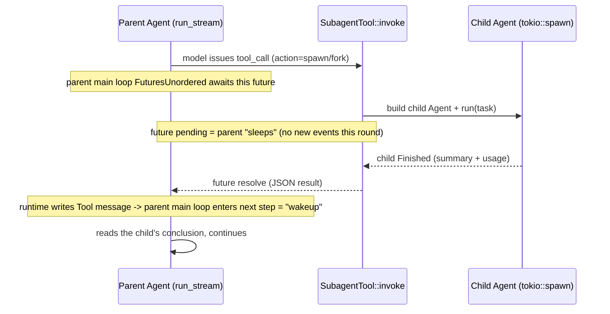
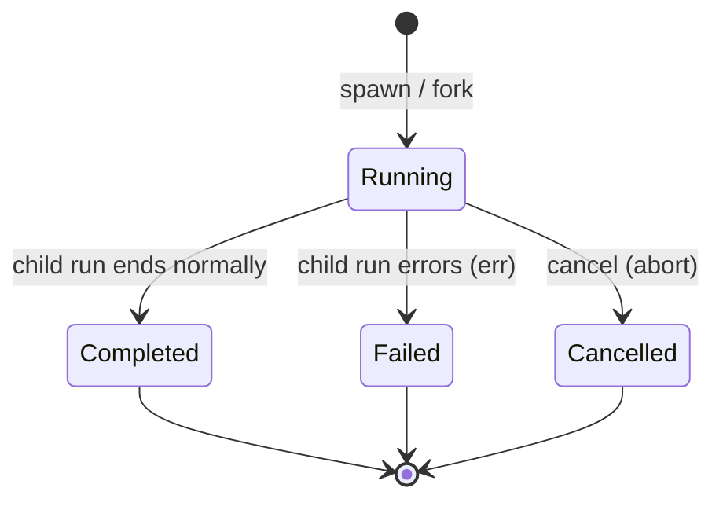

# docs/subagent.md

**Shirley technical design · Subagent**

This document lands "let the main Agent dispatch a subtask, and have the subtask run to completion
and come back" as a design. It is the natural extension of `multi-session.md` (multi-session
parallelism) and `skills.md` (progressive disclosure, which mentions `context:fork` but does not land
it): multi-session solves "multiple **user** sessions each running on their own", while subagent
solves "within the **same** session, toss a chunk of independently-doable work to a clean/derived
executor to run".

**Scope statement**: this round only does a **single-machine, same-process, application-layer**
subagent (`spawn` / `fork` / sleep-wakeup / management / persistence); it introduces no separate
process or remote executor.

**Ownership statement (set the tone first)**: subagent **belongs to the application layer**
(`src/subagent/`), for the same reason as `todo.rs` / `memory/` / `skills/` -- "what counts as a
subtask, how to dispatch, how to present, how to persist" is a trade-off of the coding-agent
product, not a generic fundamental capability. **SDK zero changes**: subagent fully reuses the SDK's
three existing seams -- `Tool` (dispatch entry), `Agent` (child executor), `ContextProvider`
(optional state injection) -- adding no external types, not touching `Message` / `AgentEvent`.

---

**1. What to solve**

The main Agent's context is **a single line**: all exploration, all tool output, all reasoning pile
up in the same `self.messages`, so:

- **The context is flooded by a one-off task.** Dispatch a job like "list all call sites under this
  directory", and the dozens of intermediate `read` / `bash` calls all stay on the main line,
  and once compaction comes they get compressed into a summary -- the information loss lands on the
  main Agent, while this exploration **should have been one-off**.
- **Cannot parallelize.** The main Agent can only advance one thing at a time; two mutually
  independent investigations can only be serial.
- **Cannot isolate.** A subtask like "help me translate TS usage into Rust" does not actually need
  any of the main line's context about the UI or about the session; showing it to the child instead
  dilutes attention and raises cost.

subagent takes another path: **outsource a chunk of work to an independent executor**. The executor
has its own `Agent` / its own `self.messages` / its own compression budget, and when it finishes it
only hands back the **conclusion** (a summary). The main line therefore only gains one tool result,
not a whole exploration process.

The two primitives solve two kinds of outsourcing:

| Primitive | Context source | What it solves |
| --- | --- | --- |
| `spawn` | **from scratch** (only the task description is given) | a one-off job with a clean context; parallelizable; most token-efficient |
| `fork` | **copies the parent's working-set snapshot** | "use the same context to do another requirement" -- the child continues from the files the parent already read and the conclusions already drawn |

---

**2. The semantics of the two primitives (decision 1)**

**Decision 1: `spawn` and `fork` are two actions, not two parameters of one action.**

Their **initial context construction** is completely different; merging them into one action would
make the schema ambiguous (`inherit_context: bool` cannot say "inherit up to which step"), and would
also bind together their future separate evolution (fork supporting selective inheritance, spawn
supporting a small seed). Split into two `action`s.

### 2.1 `spawn` (clean dispatch)

- The child `Agent` is created by the factory `AgentFactory::build_agent(vec![])` -- **an empty
  working set**, sharing the same system prompt / working directory / compression strategy with the
  parent; **the tool registry is specified by the parent** (see §4.2 and the recursion guard in §5).
- Only `task` is fed in as the child's one-round `user` message.
- When the child finishes, its **final assistant body** (or a structured summary explicitly produced
  by the model) is returned to the main line as the tool return value.
- Applies to: independent, context-free, parallelizable subtasks.

### 2.2 `fork` (derived dispatch)

- The child `Agent` is created by the factory `build_agent(parent.messages().to_vec())` -- **a
  snapshot of the parent's working set** (`Agent::messages()` is a read-only slice, so you naturally
  get a snapshot).
- **Key detail: fork must first strip the `System` message at the start of the parent's working
  set.** `Agent::new` **unconditionally regenerates and `insert(0)`s a system message** (the
  construction-time logic in `agent.rs`); if the parent's system is also shoved in, the child would
  get two system messages, and the parent's one would be "stale" (the working directory / project
  guide may have changed). The correct fork posture: `messages.iter().filter(non-first System).cloned()`
  and then hand it to `build_agent`.
- Then **append** `task` as a new round's `user` message **at the end of the snapshot**.
- When the child finishes, likewise only the conclusion is returned.
- Applies to: exploration / investigation -- "based on what you already know, go confirm X".

> **Write-back boundary (hard constraint)**: the fork's child **never writes its `self.messages`
> back to the parent**. The child's working set is a **derived copy**, the parent's working set is
> the **truth**. There is only one return path: the tool return value. This is fully consistent with
> the SDK's `messages` ownership boundary (`Agent.md` section 4, "what should be handed over is the
> right to record, not the right to mutate core state") -- fork introduces no second writer.

---

**3. Core mechanism: dispatch -> sleep -> wakeup (decision 2)**

**Decision 2: express sleep with "the tool future is pending", express wakeup with "the tool future
returns" -- no new runtime state machine.**

The user's mental model is "after dispatching a sub-agent the parent should sleep, and activate after
the child notifies". In the existing SDK, **this semantics can be expressed with zero changes**:



- **Sleep point** = the future returned by `SubagentTool::invoke` is `Pending`. The parent
  `run_stream` awaits it on `FuturesUnordered` and produces no new `AgentEvent` -- this is "sleep".
- **Wakeup point** = the child's `Agent::run` completes and the future is `Ready`. The runtime writes
  the returned JSON as a `Tool` message, and the parent main loop does `steps += 1` into the next
  round -- this is "activated after being notified".
- **"Notification"** = the `JoinHandle` of the completed subtask resolving; P2 can then bubble the
  child's process events to the UI through a channel.

**Concurrent dispatch holds naturally**: the model issues multiple `subagent` tool_calls in **the
same assistant message**, and `FuturesUnordered` will concurrently await them (the existing tool
concurrency mechanism) -- the parent "sleeps at the same time, and all wake up together when all
finish". This is exactly the "dispatch multiple background investigations and then converge them"
usage, **with no extra scheduler needed**.

### 3.1 Two waiting strategies (decision 3)

**Decision 3: default "blocking wait", with an optional "detach to background + `wait` to
converge".**

| Strategy | Trigger | Semantics | Applies to |
| --- | --- | --- | --- |
| **Blocking wait (default)** | `action=spawn/fork` (no `detach` passed) | the tool future awaits until the child finishes, returning the conclusion directly | most common: dispatch one, wait for it, continue |
| **Background detach** | `action=spawn/fork, detach=true` | immediately return a handle `{id, status:"running"}` | dispatch several long tasks first, let the parent do other things first |

After detach, to converge the parent calls `action=wait`:

- `wait` with no `id` -> wait for **all** running subtasks;
- `wait { id }` -> wait for one specified;
- `wait` with `timeout_ms` -> on timeout return "still running", and the parent can continue doing
  other things and come back to wait later (this is the seam that splits a "long task" into "multiple
  polling rounds", preventing the parent from being pinned by an out-of-control subtask).

> **Why not introduce a "true async wakeup injection"**: that approach requires the SDK to be able to
> **stuff a message in and wake up** while the parent's `run_stream` is halfway through running. The
> current SDK **has no such seam** (`messages` only enters the `run_stream` main loop; there is no
> `add`/`push`/`inject`), and proactively adding a "mid-run injection" opening precisely violates the
> red line in `Agent.md` section 4, "do not add a pre-add mutation hook" (second writer, smashing the
> prefix cache). So P0/P1 **does not** do it; if it is truly needed later, go through the same family
> as the **outbound transform seam** or a separate "wakeup channel", and make a separate decision at
> that time.

---

**4. Tool shape (decisions 4 / 5)**

**Decision 4: expose only **one** tool `subagent` externally, using `action` to distinguish actions.**

Reason: one tool = one stable prefix (`definitions()` sorted, so the prefix is stable and
cache-friendly), and it also avoids the model facing a bunch of tools with similar names. The actions
converge to 6:

```rust
// hand-written impl Tool (same style as TodoTool), holding Arc<SubagentManager>
#[tool(description = "Dispatch and manage subagents: spawn clean dispatch / fork derived / wait wait / list list / status detail / cancel cancel")]
pub async fn subagent(
    ctx: &ToolContext,
    #[param(description = "action: spawn | fork | wait | list | status | cancel")] action: String,
    #[param(description = "subtask description (required for spawn/fork)")] task: Option<String>,
    #[param(description = "target subagent id (for wait/status/cancel; wait omitted = wait for all)")] id: Option<String>,
    #[param(description = "true = dispatch to background and immediately return a handle, default false = block waiting for the result")] detach: Option<bool>,
    #[param(description = "wait timeout in milliseconds (for wait; on timeout returns still running)")] timeout_ms: Option<u64>,
) -> Result<String, ToolError> { ... }
```

Returns unified JSON (easy for the model to parse, same style as `web_search`):

```jsonc
// spawn/fork (blocking): give the conclusion directly
{ "id": "sa_7f3a", "kind": "spawn", "status": "completed",
  "summary": "...final conclusion...", "stop_reason": "Completed",
  "usage": { "input_tokens": 1234, "output_tokens": 567 } }

// spawn/fork (detach): give only the handle
{ "id": "sa_7f3a", "kind": "fork", "status": "running" }

// list / status
{ "subagents": [ { "id": "...", "kind": "...", "status": "...", "task": "...", "elapsed_ms": 8123 } ] }

// wait timeout
{ "id": "sa_7f3a", "status": "running", "waited_ms": 60000, "timed_out": true }
```

**Argument validation** (`ToolError::ArgumentsError`, the model can succeed by changing its writing,
same convention as `read`): `action` is limited to the enum; `spawn`/`fork` require `task` to be
non-empty and <= the char cap; `wait`/`status`/`cancel` require `id` to be present (`wait` may omit
it); `timeout_ms` has a cap.

**4.2 The subagent's tool table is controlled by the parent (decision 5)**

**Decision 5: at dispatch time, explicitly specify the tool set the subagent may use, rather than
letting the child unconditionally inherit all tools.**

The `subagent` tool gains two more optional parameters:

- `tools: Option<Vec<String>>` -- the **allowlist** of tool names the child may call (`None` = use
  the configured default set);
- `deny_tools: Option<Vec<String>>` -- the **denylist** (subtracted from the default set).

Merge rule (child tool table = the following set):

```
( tools ?? configured default set )  -  deny_tools  -  { "subagent" } (recursion guard, always removed)
```

**Why the boundary belongs to the "parent", not the "child"**: what a tool can touch is the
**dispatcher's** responsibility -- the parent best knows whether this subtask "should touch bash /
can write files / needs network". Only by handing out the boundary can the parent issue constraints
like "read-only investigation child" (give only `read`), "no-network child" (do not give
`web_search`), "cannot-modify-files child". This is exactly the prototype of `PermissionPolicy` in
`docs/security.md`, landing first at the subagent layer.

**Landing**: `AgentFactory::build_agent` gains a `tool_filter: Option<&ToolSelection>` (or
`Option<&[String]>`) parameter; after `assemble_tools()` builds the default set, it trims by
allowlist/denylist before registering (the existing `ToolManager::unregister(name)` suffices, or
simply do not register it in the factory). The **default set** is decided by the `[subagent]`
configuration's `default_tools` (default = all tools).

**Validation** (`ToolError::ArgumentsError`, same convention as `read`): an unknown tool name is
**rejected outright**, not silently ignored -- if the model writes a wrong name it must be able to
find out immediately; `subagent` itself can never enter the allowlist (recursion guard).

> **Prefix-cache note**: the difference in the child tool table **does not affect the parent's**
> `definitions()` (the child is an independent `Agent`). If the same parent repeatedly dispatches
> children with **different tool sets** in the same session, it will make **the child's** prefix
> jitter -- acceptable (the child is a short-lived executor anyway); but the **parent's** default set
> for children should be stable.

---

**5. Lifecycle management (decisions 6 / 7 / 8)**

**Decision 6: one `SubagentManager` (application layer) uniformly holds the runtime state of all
subagents.**

```rust
// src/subagent/manager.rs (application layer)
pub struct SubagentManager {
    registry: Mutex<HashMap<SubagentId, SubagentHandle>>, // single source of truth
    factory: Arc<AgentFactory>,                            // the ability to create child Agents
    limits: SubagentLimits,                                // caps (decision 8)
    next_seq: AtomicU64,
}

pub struct SubagentHandle {
    pub id: SubagentId,
    pub kind: SubagentKind,        // Spawn | Fork
    pub task: String,
    pub status: SubagentStatus,    // Running | Completed | Failed | Cancelled
    pub started_ms: u64,
    pub finished_ms: Option<u64>,
    pub abort: Option<tokio::task::AbortHandle>, // for cancel
    pub result: Option<SubagentResult>,          // the conclusion + usage after completion
    // completion notification: tokio::sync::watch / Notify, for wait to subscribe
    pub done: Arc<tokio::sync::Notify>,
}
```

**State machine**:



**Decision 7: the child Agent runs inside `tokio::spawn`, and the `AbortHandle` lands in the
registry.**

- The only reason to put it in a separate task (rather than directly `run().await` in the tool
  future): **cancellability**. The parent (or UI) can take `AbortHandle::abort()` to cut off an
  out-of-control subtask.
- The tool future then awaits a "completion signal" (`Notify` / `watch` / `JoinHandle`), consistent
  with the sleep-wakeup semantics in §3.
- The child's `run_stream` events are **discarded by default** (P0); from P1 on they can bubble to
  the UI through a channel (§7).

**Decision 8: there must be three caps, otherwise subagent becomes a resource black hole.**

| Cap | Default | Role |
| --- | --- | --- |
| `max_concurrent` | 4 | number of subagents running at the same time; beyond this, queue or reject outright (return `Failed` + a clear error) |
| `max_depth` | 1 (i.e. **a child cannot dispatch a child**) | recursion guard -- see below |
| `per_task_max_steps` | independent of the parent, default lower than the parent (e.g. 24) | a single child's execution-step budget |

**Recursion guard (important)**: when creating the child Agent, **do not register the `subagent`
tool** in the tool set (or register it per `depth < max_depth`). Otherwise the child will dispatch a
child, nesting without bound. The semantics of `max_depth=1` is "a child cannot dispatch a child",
which is the P0 default. The child can still use bash / read / todo etc.

> On `max_steps`: Sean thinks the SDK default of 64 is too low for long tasks (memory). subagent's
> `per_task_max_steps` is **independently configurable**, and because the subtask scope is narrower,
> a lower default suffices; when it truly cannot finish, return `stop_reason: MaxStepsReached` so the
> parent can decide whether to dispatch again.

**Configuration location**: `.shirley/config.toml` gains a `[subagent]` table (`enabled` /
`max_concurrent` / `max_depth` / `per_task_max_steps` / `default_timeout_ms`), at the same level as
`[compression]` / `[provider]`, loaded by `settings.rs`.

---

**6. Session storage format extension (decision 9)**

**Decision 9: the parent session JSONL format is **unchanged**; subagent goes to an independent
sidecar.**

Status quo (`src/session.rs`): `<state>/sessions/<name>.jsonl` has one `Message` per line
(`serde(tag="role")`), and `load()` does **line-by-line `serde_json::from_str::<Message>`**.

If subagent events were stuffed into the same line stream as the parent JSONL, it would **break
`load()`** (those lines are not `Message`s, and deserialization is `SessionError::Backend`). To use
the same file you would have to change to a fault-tolerant envelope (has `role` -> Message,
otherwise -> another type) -- it would run, but it dirties the clear invariant "the parent log = a
pure Message stream", and the `truncate` (rewind) semantics would have to be redefined.

**Therefore: the parent log stays pure `Message`, zero breakage.** subagent's persistence is split
into two layers:

```
<state>/sessions/
├── <session>.jsonl            # parent session: still pure Message lines (unchanged, zero breakage)
├── <session>.title
└── <session>.agents/
    ├── index.jsonl            # the lifecycle record of each subagent (append-only, last-wins)
    └── <subagent-id>.jsonl    # that subagent's full Message transcript (reusing JsonlSessionStore)
```

**How does the parent side record subagent?** It already records it naturally, **no new format
needed**:

- the assistant message has a `tool_calls` = `{name:"subagent", arguments:{action:"spawn",...}}`;
- immediately followed by a `Tool` message = the JSON (conclusion) returned by the subtask.
  Both are existing `Message`s, and the parent log holds them as-is. **To the parent log, subagent is
  "just another tool call".**

**Sidecar format**:

`index.jsonl` -- one `SubagentRecord` per line, append-only, collapsed by `id` on load (last-wins):

```jsonc
{ "record": "started",  "id": "sa_7f3a", "kind": "fork", "task": "...",
  "parent": "<session>", "started_ms": 1730000000000 }
{ "record": "finished", "id": "sa_7f3a", "status": "completed",
  "stop_reason": "Completed", "finished_ms": 1730000005000,
  "summary": "...conclusion...", "usage": { "input_tokens": 1234, "output_tokens": 567 } }
```

`<subagent-id>.jsonl` -- **it is just a standard `Message` log** (does it include the child's system?
No, same rule as the parent session: system is regenerated on restore), directly readable/writable
with `JsonlSessionStore`, replayable with `load()`, and able to reuse the parent session's restore
path.

**Restore semantics**:

- When restoring the parent session, the subagent result **is already in the parent log as a Tool
  message**, so the parent's context is complete, **with no need to replay the child transcript** --
  the child transcript is only read on demand when the UI wants to "expand and see what the subagent
  did" (P2).
- `index.jsonl` provides the session list / sidebar with "how many subagents this session has
  dispatched, and what state each is in".
- **Do not implement "restore a running subagent after a restart"**: on process restart, any running
  child is recorded as `Failed` (or `Cancelled`) + reason "process exited"; no checkpoint-resume
  (P3+ topic).

> **Alternative (not adopted)**: make subagent a new variant of `Message` (e.g.
> `Message::Subagent {...}`). **Rejected** -- it would touch the SDK's `Message` enum, dragging in
> the three adapters' `encode_messages`, the `MessageAdded` event, and all storage/render paths,
> violating "keep the external contract small". subagent is an application-layer concept, so it
> should not enter `Message`.

---

**7. Preview and events (decision 10)**

**Decision 10: the subagent's transcript and events must be observable by the UI -- "click to
preview the sub-session".**

Observation has **two granularities**, corresponding respectively to the two layers of data in §6:

1. **Full sub-session transcript (static, on demand) -- the main entry of "click to preview"**.
   `<subagent-id>.jsonl` is just a standard `Message` log. Every subagent tool card / sidebar entry
   in the UI is **clickable**; clicking does `load()` on that file and renders a **read-only
   sub-session view** -- using the same rendering as the parent session (`Session::items_from_messages`
   / `ItemWire` / `markdown::render`), so you can see which files the child read, what commands it
   ran, and what conclusion it drew. **Real-time is not required**: you can view it once the child
   finishes, and also while it is running (the part already appended).
2. **Sub-session real-time stream (dynamic, optional)**. The child's `run_stream` incremental events
   (`ContentDelta` / `ToolStarted` ...) bubble to the UI while it runs. Currently **`Tool` cannot
   emit `AgentEvent`**, so there are two paths:
   1. Add a "tool can emit events" seam to the SDK (e.g. stuff an `EventSink` into `ToolContext`) --
      **SDK change**;
   2. Application-layer bypass: `SubagentManager` self-holds a per-subagent channel (the same
      `broadcast` style as `Session::events`), and the UI subscribes directly. **Lean path 2**
      (application-layer self-consistent, SDK zero changes).

**Consistency**: whether real-time or static, what is rendered is **the same `Message` transcript** --
real-time is "append while running", static is "load and replay". So the preview view **naturally
reuses the parent session's render path**, not building a separate one (echoing Sean's preference:
multiple entries share the same set of render components).

**P0 fallback**: without adding any new UI, subagent in the parent's `AgentEvent` stream is just one
`ToolStarted{name:"subagent"}` -> `ToolFinished{name:"subagent", ok, output}`; the TUI's existing
tool card and the desktop's `AiToolActivityDisclosure` collapsible area **work out of the box**, zero
changes.

**Landing**:

- **TUI**: the subagent tool card is focusable -> `Enter` opens an overlay / inline panel rendering
  the child transcript (reusing `markdown::render`), `Esc` returns.
- **desktop**: new commands -- `agent_list_subagents { project, session }` returns
  `SubagentSummaryWire[]` (reads `index.jsonl`); `agent_load_subagent { project, session, id }`
  returns the child transcript's `HistoryMessageWire[]` (same style as the existing
  `agent_load_history`); `agent_subscribe_subagent` / `agent_unsubscribe_subagent` subscribe to the
  real-time stream. The **session page** renders the subagent list inline (not as a separate
  sidebar panel), and clicking a row expands the child transcript.
- **Cancel**: the preview panel can `cancel` (`agent_cancel_subagent` / a TUI key) ->
  `SubagentManager::cancel(id)` (`AbortHandle::abort`), consistent with the cancellability in
  decision 7.

---

**8. Wiring to existing seams (decision 11)**

**Decision 11: subagent only **reuses** existing seams, adding no new SDK concept.**

| Existing seam | How subagent uses it |
| --- | --- |
| `Tool` / `ToolManager` | `SubagentTool` (hand-written `impl Tool`, same style as `TodoTool`); on `on_register` injects via `ctx.insert(Arc<SubagentManager>)`, and on `on_unregister` does `ctx.remove` (same lifecycle technique as `web_search`) |
| `AgentFactory` (`bootstrap.rs`) | `SubagentManager` holds `Arc<AgentFactory>`; creating a child = `build_agent(vec![])` (spawn) or `build_agent(parent snapshot with system stripped)` (fork); **`build_agent` gains a `tool_filter` parameter** to trim the child tool table (decision 5) |
| `Agent` | The child is just an ordinary `Agent`, running `run(task)`; concurrency/compression/tools are all reused |
| `ContextProvider` | **Optionally** add a `SubagentContextProvider` that injects "you have N running subagents + their status" at the end of each round (same style as todo injection, appended at the end, KV-friendly). P0 can skip |
| `Session` (`interface/session.rs`) | one `Arc<SubagentManager>` per session (alongside `todo` / `memory` / `skills`, entering `BuiltAgent` and `Session` fields); subagents are isolated per session |
| `SessionStore` (`session.rs`) | add a `SubagentStore` (index + per-agent logs), reusing the `JsonlSessionStore` core; `FileSessionCatalog` gains `<name>.agents/` directory management; **the child transcript can be `load()`-replayed for the preview** (decision 10) |

The wiring of `bootstrap::build_agent` (illustrative):

```rust
let subagents = Arc::new(SubagentManager::new(self.clone(), subagent_limits));
tool_manager.register(SubagentTool::new(subagents.clone()));   // recursion guard: register only at depth=0
// ...(optional) add SubagentContextProvider::new(subagents.clone()) to the provider
Ok(BuiltAgent { agent, todo, memory, skills, subagents })      // BuiltAgent gains one field
```

---

**9. Phased landing**

| Phase | Content | Dependency |
| --- | --- | --- |
| **P0 · skeleton** | `SubagentTool` (`spawn`/`fork` blocking + `list`/`status`) + `SubagentManager` (registry/state machine/`tokio::spawn`) + the three caps + recursion guard; **child tool-table control (`tools`/`deny_tools` + `build_agent`'s `tool_filter`)**; `AgentFactory` creates the child; tool card reused | none (pure application layer) |
| **P1 · convergence and persistence** | `wait` + `detach` + `timeout_ms`; `SubagentStore` (`index.jsonl` + per-agent log); `cancel` (`AbortHandle`); `[subagent]` configuration (including `default_tools`); `SubagentContextProvider` (optional); **child transcript `load()` + TUI click-to-preview (overlay)** | P0 |
| **P2 · presentation** | child event bubbling (application-layer channel, path 2); desktop session-page inline subagent list + click to expand transcript (`agent_list_subagents` / `agent_load_subagent` / `agent_subscribe_subagent`) + cancel; TUI nested view | P1 |
| **P3 (not doing / to be discussed)** | resume in-flight subagents after a process restart; subagent marketplace / templates; cross-workspace subagents | — |

---

**10. Acceptance criteria**

1. **spawn is clean**: the child's `messages` initially has only `[system, user(task)]`, with none of
   the parent's history; after the child finishes the parent working set gains only two entries
   (assistant tool_call + tool result).
2. **fork inherits**: the child's `messages` = the parent snapshot (**with the first system
   stripped**) + the new `user(task)`; after the child finishes **the parent working set is not
   written back** (`agent.messages()` length only grows per the main-loop protocol).
3. **Sleep-wakeup**: while `spawn` blocks, the parent `run_stream` produces no new `ContentDelta`;
   after the child `Finished`, that `Tool` message appears in the parent's next-step request.
4. **Concurrency**: issuing 3 `spawn`s in the same assistant message, the 3 children run
   **simultaneously** (verifiable via `SubagentManager`'s started_ms), and the parent is woken after
   the last one finishes.
5. **Recursion guard**: with `max_depth=1`, the child Agent's tool table has **no** `subagent` tool.
6. **Caps**: a dispatch beyond `max_concurrent` is rejected outright (returns a readable error, not
   silently queued).
7. **Cancel**: after `cancel`, the child's `JoinHandle` is aborted, the status is set to `Cancelled`,
   and the parent receives a "cancelled" tool result.
8. **Persistence**: the parent `<session>.jsonl` is still pure `Message` lines and `load()` does not
   error; `.agents/index.jsonl` has the started/finished lines; `<id>.jsonl` can be read back by
   `JsonlSessionStore::load()`.
9. **Prefix cache**: adding subagent does not change the order of existing tools'
   `definitions()` (`subagent` is placed by name sorting); no "changes every round" system is
   injected (unless `SubagentContextProvider` is enabled, and its content also follows "stable prefix
   + write only the changes").
10. **Tool-table control**: a child `Agent` created by `spawn { tools:["read"] }` has **only
    `read`** in its `ToolManager` (no `bash` / no `subagent`); an unknown tool name returns
    `ArgumentsError`; `deny_tools` correctly subtracts from the default set.
11. **Click to preview**: after the child finishes, `load()` on `<subagent-id>.jsonl` yields a full
    `Message` transcript and can be rendered; desktop `agent_load_subagent` returns a non-empty
    `HistoryMessageWire[]`; `index.jsonl` can list all subagents dispatched by that session.

---

**11. Open questions**

1. **The subtask's conclusion format**: use the child's final assistant body directly, or require the
   child to produce a structured `summary` by template (with an XML contract like
   `COMPACTION_TEMPLATE`)? The latter is more controllable and better suited to parent consumption,
   but costs one extra "summarize" call. **Lean the latter, decide at P1**.
2. **fork's context trimming**: the parent snapshot may be large; would forking directly make the
   child approach the compression threshold from the start? Should there be "run a cut first when
   forking, carrying only the summary + the most recent N entries"? **P2 topic**.
3. **Whether child events bubble**: see the two paths of decision 10 in §7; path 2
   (application-layer channel) is cleaner, but the UI must consume two event sources at the same
   time. **Decide at P2**.
4. **`wait` fairness**: multiple parents (multi-session) waiting on the same batch of subagents at
   the same time -- the broadcast semantics of `Notify` must be confirmed (using `watch` is more
   stable). **Confirm at P1 implementation**.
5. **Cost visibility**: should the child's `usage` be accumulated into the parent session's
   `total_usage`? **Lean separate statistics** (the child records its own usage in `index.jsonl`), to
   avoid the parent's "context usage" being misled by the child's consumption. **Decide at P1**.
6. **Preview granularity**: does the preview only read the transcript, or also allow "continuing the
   conversation" inside the sub-session view (reviving the child into a sustainable session)? The
   latter is equivalent to promoting subagent to a sub-session, with heavier semantics. **Lean
   read-only preview**, decide at P2.

---

**12. Things not to do (explicit boundaries)**

- **Do not change `Message` / `AgentEvent`**: subagent does not enter the SDK's message model, and
  adds no event variant (P0/P1).
- **Do not do "inject a message into the parent mid-run"**: violates the `messages` ownership
  boundary (§3.1).
- **Do not do cross-process / remote executors**: this round is entirely same-process `tokio::spawn`.
- **Do not do process-restart resume**: in-flight subagents die with the process, recorded as
  `Failed`.
- **Do not do direct communication between subagents**: the child only communicates with the parent
  (via the tool return value); between children either the parent orchestrates, or they each do their
  own thing.

---

**13. Relationship to existing documents**

- `multi-session.md`: multi-session is "multiple **user** sessions each holding one `Agent`";
  subagent is "**dispatching** a temporary `Agent` within one session". Both share the
  `AgentFactory`'s ability to create `Agent`s, but their orchestration levels differ (session level
  vs turn level), and they **do not conflict or merge**.
- `skills.md`: its `context: fork` / "optionally spin up a subagent for isolation" (P3 not landed) is
  exactly this document's `fork` primitive; a later skill's `context:fork` can reuse this design,
  landing "run a certain skill in an isolated context" as a single `fork`.
- `todo.md`: a subagent can have its own `TodoStore` (a clean/derived task ledger), and the parent's
  ledger is unaffected; `SubagentContextProvider` (if enabled) and `TodoContextProvider` are
  concatenated in order via `CompositeContextProvider`, with exactly the same injection path.
