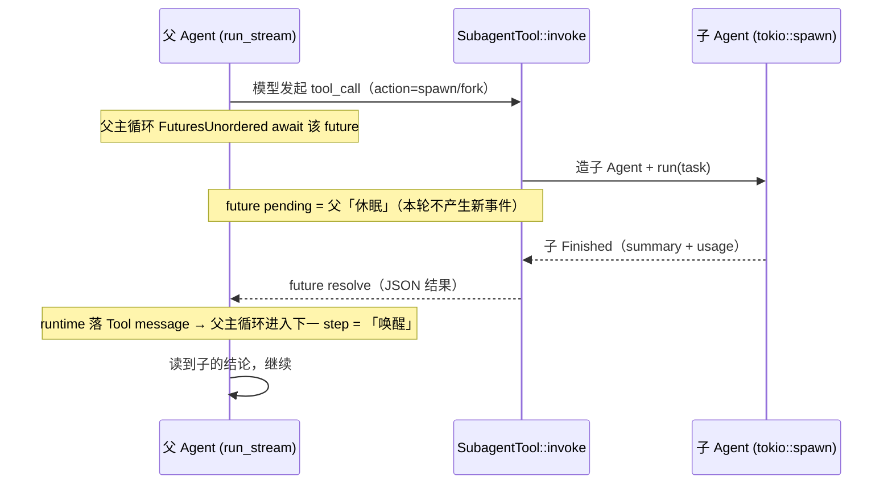
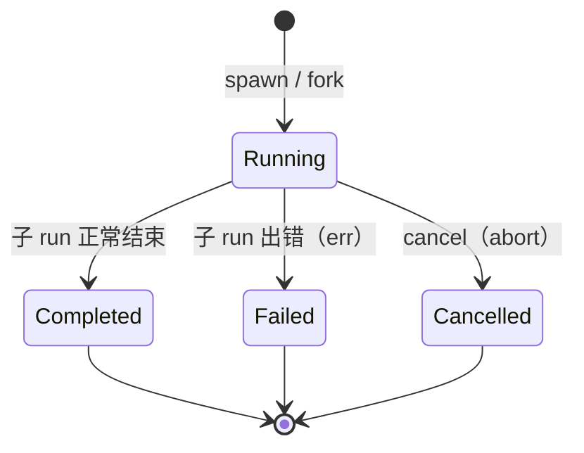

**Shirley 技术方案 · 子代理（subagent）**

这份文档把"让主 Agent 派发子任务、子任务跑完再回来"落地成方案。它是
`multi-session.md`（多会话并行）与 `skills.md`（渐进式披露，提到 `context:fork`
但未落地）的自然延伸：多会话解决"多个**用户**会话各跑各的"，subagent 解决
"**同一个**会话里，把一段可独立的活儿甩给一个干净/派生的执行体去跑"。

**范围声明**：本轮只做**单机、同进程、应用层**的 subagent（`spawn` / `fork` /
休眠唤醒 / 管理 / 落盘），不引入独立的进程或远端执行体。

**归属声明（先定调）**：subagent **属于应用层**（`src/subagent/`），与
`todo.rs` / `memory/` / `skills/` 同款理由——"什么算子任务、怎么派发、怎么呈现、
怎么落盘"是 coding agent 这个产品的取舍，不是通用基础能力。**SDK 零改动**：
subagent 完全复用 SDK 已有的三个接缝——`Tool`（派发入口）、`Agent`（子执行体）、
`ContextProvider`（可选的状态注入），不新增对外类型、不改 `Message` / `AgentEvent`。

---

**一、要解决什么**

主 Agent 的上下文是**一条单线**：所有探索、所有工具输出、所有推理都堆在同一条
`self.messages` 里，于是：

- **上下文被一次性任务灌满**。派一个"把这个目录下所有调用点列出来"的活儿，中间
  几十次 `read_file` / `bash` 全留在主线上，压缩一来又被压成摘要——信息损耗在主
  Agent 身上，而这段探索**本来就该是一次性的**。
- **不能并行**。主 Agent 一次只能推进一件事；两件互不依赖的调查只能串行。
- **不能隔离**。一个"帮我把 TS 的用法翻成 Rust"的子任务，其实不需要主线上关于
  UI、关于 session 的一切上下文；给它看反而稀释注意力、抬高成本。

subagent 换一条路：**把一段活儿外包给一个独立的执行体**。执行体有自己的
`Agent` / 自己的 `self.messages` / 自己的压缩预算，跑完只把**结论**（一段摘要）
交回来。主线因此只增一条 tool 结果，而不是增一整个探索过程。

两个原语分别解决两类外包：

| 原语 | 上下文来源 | 解决什么 |
| --- | --- | --- |
| `spawn` | **从零**（只给任务描述） | 干净上下文的一次性活；可并行；最省 token |
| `fork` | **复制父的工作集快照** | "利用相同上下文去做另一个需求"——子从父已经读过的文件、已经得出的结论继续 |

---

**二、两个原语的语义（决策 1）**

**决策 1：`spawn` 与 `fork` 是两个动作，不是一个动作的两个参数。**

它们的**初始上下文构造**完全不同，混成一个动作会让 schema 含糊（`inherit_context:
bool` 说不清"继承到哪一步"），也让将来各自演进（fork 支持选择性继承、spawn 支持
带少量种子）被绑死。分成两个 `action`。

### 2.1 `spawn`（干净派发）

- 子 `Agent` 由工厂 `AgentFactory::build_agent(vec![])` 造出——**空工作集**，
  与父共享同一份 system prompt / 工作目录 / 压缩策略；**工具注册表由父指定**
  （见 §4.2 与 §5 的递归护栏）。
- 只把 `task` 作为子的一轮 `user` 消息喂进去。
- 子跑完，把**最终 assistant 正文**（或由模型显式产出的结构化 summary）作为工具
  返回值交回主线。
- 适用：独立的、上下文无关的、可并行的子任务。

### 2.2 `fork`（派生派发）

- 子 `Agent` 由工厂 `build_agent(parent.messages().to_vec())` 造出——**父工作集
  的快照**（`Agent::messages()` 是只读切片，天然拿到快照）。
- **关键细节：fork 必须先剥掉父工作集开头的 `System` 消息**。`Agent::new` 会
  **无条件重新生成并 `insert(0)` 一条 system**（`agent.rs` 构造期逻辑），若把父的
  system 一起塞进去，子会拿到两条 system、且父的那条是"过期"的（工作目录/项目指南
  可能已变）。fork 的正确姿势：`messages.iter().filter(非首条 System).cloned()` 再
  交给 `build_agent`。
- 再把 `task` 作为新的一轮 `user` 消息**追加在快照末尾**。
- 子跑完，同样只回传结论。
- 适用：探索/调查类——"基于你已经知道的，再去确认 X"。

> **写回边界（硬约束）**：fork 的子**绝不把它的 `self.messages` 写回父**。子工作集
> 是**派生副本**，父工作集是**真相**。回传只有一条：工具返回值。这与 SDK 的
> `messages` 所有权边界（`Agent.md` 第四节、"该交出去的是记录权，不是改核心状态的权"）
> 完全一致——fork 不引入第二写者。

---

**三、核心机制：派发 → 休眠 → 唤醒（决策 2）**

**决策 2：用"工具 future 挂起"表达休眠，用"工具 future 返回"表达唤醒——不新增运行时状态机。**

用户的心智模型是"派发 sub-agent 后父应该休眠，等子通知后激活"。在现有 SDK 里，
**这个语义零改动即可表达**：



- **休眠点** = `SubagentTool::invoke` 返��的 future 处于 `Pending`。父 `run_stream`
  在 `FuturesUnordered` 上 await 它，不产生新的 `AgentEvent`——这就是"休眠"。
- **唤醒点** = 子的 `Agent::run` 完成、future `Ready`。runtime 把返回 JSON 落成
  `Tool` message，父主循环 `steps += 1` 进入下一轮——这就是"被通知后激活"。
- **"通知"** = 子任务完成的 `JoinHandle` resolve；P2 可再经通道把子的过程事件冒泡给 UI。

**并发派发天然成立**：模型在**同一条 assistant 消息**里发多个 `subagent` tool_call，
`FuturesUnordered` 会并发 await 它们（现有工具并发机制）——父"同时休眠，全部完成
一起唤醒"。这正是"派发多个后台调查再统一收口"的用法，**不需要额外的调度器**。

### 3.1 两种等待策略（决策 3）

**决策 3：默认「阻塞等待」，可选「detach 后台 + `wait` 收口」。**

| 策略 | 触发 | 语义 | 适用 |
| --- | --- | --- | --- |
| **阻塞等待（默认）** | `action=spawn/fork`（不传 `detach`） | 工具 future 一直 await 到子完成，直接返回结论 | 最常见：派一个、等它、继续 |
| **后台 detach** | `action=spawn/fork, detach=true` | 立即返回句柄 `{id, status:"running"}` | 派多个长任务先铺开，父先干别的 |

detach 之后父要收口，调 `action=wait`：

- `wait` 无 `id` → 等**所有**在跑的子任务；
- `wait { id }` → 等指定的一个；
- `wait` 带 `timeout_ms` → 超时返回"仍在运行"，父可继续干别的再回来 wait
  （这是把"长任务"拆成"多轮轮询"的接缝，避免父被一个失控子任务钉死）。

> **为什么不引入"真·异步唤醒注入"**：那种做法要求 SDK 能在父 `run_stream` 运行到
> 一半时**往里塞一条消息并唤醒**。当前 SDK **没有这个接缝**（`messages` 只进
> `run_stream` 主循环，无 `add`/`push`/`inject`），而且主动加一个"运行中注入"口子
> 恰恰违反 `Agent.md` 第四节那条"不新增 add 前 mutation hook"的红线（第二写者、
> 砸前缀缓存）。所以 P0/P1 **不做**；若将来确需，走**出站 transform seam 的同族**
> 或独立"唤醒通道"，届时单列决策。

---

**四、工具形态（决策 4 / 5）**

**决策 4：对外只暴露**一个**工具 `subagent`，用 `action` 区分动作。**

理由：一个工具 = 一段稳定前缀（`definitions()` 排序后 prefix 稳定，缓存友好），
也避免模型面对一堆名字相近的工具。动作收敛为 6 个：

```rust
// 手写 impl Tool（与 TodoTool 同款），持有 Arc<SubagentManager>
#[tool(description = "派发与管理子代理：spawn 干净派发 / fork 派生 / wait 等待 / list 列表 / status 详情 / cancel 取消")]
pub async fn subagent(
    ctx: &ToolContext,
    #[param(description = "动作：spawn | fork | wait | list | status | cancel")] action: String,
    #[param(description = "子任务描述（spawn/fork 必填）")] task: Option<String>,
    #[param(description = "目标子代理 id（wait/status/cancel 用；wait 省略=等全部）")] id: Option<String>,
    #[param(description = "true=后台派发立即返回句柄，默认 false=阻塞等待结果")] detach: Option<bool>,
    #[param(description = "等待超时毫秒（wait 用；超时返回仍在运行）")] timeout_ms: Option<u64>,
) -> Result<String, ToolError> { ... }
```

返回统一 JSON（便于模型解析，与 `web_search` 同风格）：

```jsonc
// spawn/fork（阻塞）：直接给结论
{ "id": "sa_7f3a", "kind": "spawn", "status": "completed",
  "summary": "……最终结论……", "stop_reason": "Completed",
  "usage": { "input_tokens": 1234, "output_tokens": 567 } }

// spawn/fork（detach）：只给句柄
{ "id": "sa_7f3a", "kind": "fork", "status": "running" }

// list / status
{ "subagents": [ { "id": "...", "kind": "...", "status": "...", "task": "...", "elapsed_ms": 8123 } ] }

// wait 超时
{ "id": "sa_7f3a", "status": "running", "waited_ms": 60000, "timed_out": true }
```

**参数校验**（`ToolError::ArgumentsError`，模型换写法即可成功，与 `read_file`
同款约定）：`action` 限枚举；`spawn`/`fork` 要求 `task` 非空且 ≤ 上限字符；
`wait`/`status`/`cancel` 要求 `id` 存在（`wait` 可省）；`timeout_ms` 有上限。

**4.2 子代理的工具表由父控制（决策 5）**

**决策 5：派发时显式指定子代理能用的工具集，而不是让子无条件继承全部工具。**

`subagent` 工具再增两个可选参数：

- `tools: Option<Vec<String>>` —— 允许子调用的工具名**白名单**（`None` = 用配置默认集）；
- `deny_tools: Option<Vec<String>>` —— **黑名单**（在默认集上减去）。

合并规则（子工具表 = 下列集合）：

```
( tools ?? 配置默认集 )  −  deny_tools  −  { "subagent" }（递归护栏，永远剔除）
```

**为什么边界归"父"不归"子"**：工具能碰什么，是**派发方**的职责——父最清楚这个子任务
"该不该碰 bash / 能不能写文件 / 要不要联网"。把边界交出去，父才能下达诸如"只读调查子"
（只给 `read_file`）、"禁止联网子"（不给 `web_search`）、"不能改文件子"这类约束。
这正是 `docs/security.md` 里 `PermissionPolicy` 的雏形，先落在 subagent 这一层。

**落地**：`AgentFactory::build_agent` 增一个 `tool_filter: Option<&ToolSelection>`（或
`Option<&[String]>`）参数；`assemble_tools()` 造完默认集后，按白名单/黑名单裁剪再注册
（现成的 `ToolManager::unregister(name)` 即可，或在工厂里就不注册）。**默认集**由
`[subagent]` 配置的 `default_tools` 决定（缺省 = 全部工具）。

**校验**（`ToolError::ArgumentsError`，与 `read_file` 同款约定）：未知工具名**直接拒绝**，
不静默忽略——模型写错名字要能立刻发现；`subagent` 自己永远不可进白名单（递归护栏）。

> **前缀缓存注意**：子工具表的差异**不影响父**的 `definitions()`（子是独立 `Agent`）。
> 同一父在同一会话里若反复派发**不同工具集**的子，会让**子的** prefix 抖动——可接受
> （子本就是短命执行体）；但**父**给子的默认集应稳定。

---

**五、生命周期管理（决策 6 / 7 / 8）**

**决策 6：一个 `SubagentManager`（应用层）统一持有所有子代理的运行态。**

```rust
// src/subagent/manager.rs（应用层）
pub struct SubagentManager {
    registry: Mutex<HashMap<SubagentId, SubagentHandle>>, // 唯一真相源
    factory: Arc<AgentFactory>,                            // 造子 Agent 的能力
    limits: SubagentLimits,                                // 上限（决策 8）
    next_seq: AtomicU64,
}

pub struct SubagentHandle {
    pub id: SubagentId,
    pub kind: SubagentKind,        // Spawn | Fork
    pub task: String,
    pub status: SubagentStatus,    // Running | Completed | Failed | Cancelled
    pub started_ms: u64,
    pub finished_ms: Option<u64>,
    pub abort: Option<tokio::task::AbortHandle>, // cancel 用
    pub result: Option<SubagentResult>,          // 完成后的结论 + usage
    // 完成通知：tokio::sync::watch / Notify，供 wait 订阅
    pub done: Arc<tokio::sync::Notify>,
}
```

**状态机**：



**决策 7：子 Agent 在 `tokio::spawn` 里跑，`AbortHandle` 落进注册表。**

- 放进独立任务（而非在 tool future 里直接 `run().await`）的唯一理由：**可取消**。
  父（或 UI）能拿 `AbortHandle::abort()` 掐掉失控的子任务。
- 工具 future 则 await 一个"完成信号"（`Notify` / `watch` / `JoinHandle`），
  与 §3 的休眠唤醒语义一致。
- 子 `run_stream` 的事件**默认丢弃**（P0）；P1 起可经通道冒泡给 UI（§7）。

**决策 8：必须有三条上限，否则 subagent 会变成资源黑洞。**

| 上限 | 默认 | 作用 |
| --- | --- | --- |
| `max_concurrent` | 4 | 同时运行的子代理数；超出则排队或直接拒绝（返回 `Failed` + 明确错误） |
| `max_depth` | 1（即**子不能再派子**） | 递归护栏——见下 |
| `per_task_max_steps` | 独立于父，默认比父低（如 24） | 单个子的执行步数预算 |

**递归护栏（重要）**：造子 Agent 时，工具集里**不注册 `subagent` 工具**（或按
`depth < max_depth` 注册）。否则子会再派子、无限套娃。`max_depth=1` 的语义就是
"子不能再派子"，这是 P0 的默认。子仍可用 bash / read_file / todo 等。

> 关于 `max_steps`：Sean 认为 SDK 默认 64 对长任务偏低（记忆）。subagent 的
> `per_task_max_steps` **独立可配**，且因为子任务范围更窄，默认给更低值即可；
> 真正跑不完时返回 `stop_reason: MaxStepsReached` 让父决定是否再派。

**配置落点**：`.shirley/config.toml` 新增 `[subagent]` 表（`enabled` /
`max_concurrent` / `max_depth` / `per_task_max_steps` / `default_timeout_ms`），
与 `[compression]` / `[provider]` 同层，由 `settings.rs` 装载。

---

**六、会话存储格式扩展（决策 9）**

**决策 9：父会话 JSONL 格式**不变**；subagent 走独立 sidecar。**

现状（`src/session.rs`）：`.shirley/sessions/<name>.jsonl` 每行一条 `Message`
（`serde(tag="role")`），`load()` **逐行 `serde_json::from_str::<Message>`**。

若把 subagent 事件塞进父 JSONL 同一行流，会**破坏 `load()`**（那些行不是
`Message`，反序列化即 `SessionError::Backend`）。要同文件就得改成容错 envelope
（有 `role` → Message，否则 → 别的类型）——能跑，但把"父日志 = 纯 Message 流"
这条清晰不变量弄脏了，且 `truncate`（rewind）语义要重新定义。

**因此：父日志保持纯 `Message`，零破坏。** subagent 的落盘分两层：

```
.shirley/sessions/
├── <session>.jsonl            # 父会话：仍是纯 Message 行（不改，零破坏）
├── <session>.title
└── <session>.agents/
    ├── index.jsonl            # 每个子代理的生命周期记录（append-only，last-wins）
    └── <subagent-id>.jsonl    # 该子代理的完整 Message 转录（复用 JsonlSessionStore）
```

**父侧怎么记录 subagent？** 已经天然记了，**不需要新格式**：

- assistant 消息里有一条 `tool_calls` = `{name:"subagent", arguments:{action:"spawn",...}}`；
- 紧跟一条 `Tool` 消息 = 子任务返回的 JSON（结论）。
  这两条都是既有 `Message`，父日志原样容纳。**subagent 对父日志"只是又一次工具调用"。**

**sidecar 格式**：

`index.jsonl` —— 每行一条 `SubagentRecord`，append-only，加载时按 `id` 折叠（last-wins）：

```jsonc
{ "record": "started",  "id": "sa_7f3a", "kind": "fork", "task": "……",
  "parent": "<session>", "started_ms": 1730000000000 }
{ "record": "finished", "id": "sa_7f3a", "status": "completed",
  "stop_reason": "Completed", "finished_ms": 1730000005000,
  "summary": "……结论……", "usage": { "input_tokens": 1234, "output_tokens": 567 } }
```

`<subagent-id>.jsonl` —— **就是一份标准 `Message` 日志**（含子的 system？不含，
与父会话同规则：system 恢复时现生成），可直接用 `JsonlSessionStore` 读写、可
`load()` 回放、可复用父会话的恢复路径。

**恢复语义**：

- 恢复父会话时，subagent 结果**已经作为 Tool 消息在父日志里**，父的上下文完整，
  **无需重放子转录**——子转录只在 UI 想"展开看看子代理干了啥"时按需读（P2）。
- `index.jsonl` 给会话列表/侧栏提供"这个会话派过几个子代理、都啥状态"。
- **不实现"重启后恢复运行中的子代理"**：进程重启时在跑的子一律记 `Failed`
  （或 `Cancelled`）+ 原因"进程退出"，不做断点续跑（P3+ 议题）。

> **替代方案（不采用）**：把 subagent 做成 `Message` 的新变体（如
> `Message::Subagent {...}`）。**否决**——会动 SDK 的 `Message` 枚举，牵动三个
> 适配器的 `encode_messages`、`MessageAdded` 事件、以及全部存储/渲染路径，
> 违反"对外契约保持小"。subagent 是应用层概念，就不该进 `Message`。

---

**七、预览与事件（决策 10）**

**决策 10：子代理的转录与事件必须能被 UI 观测——"点击预览子会话"。**

观测有**两种粒度**，分别对应 §6 的两层数据：

1. **子会话完整转录（静态、按需）——"点击预览"的主入口**。
   `<subagent-id>.jsonl` 就是一份标准 `Message` 日志。UI 上每个 subagent 工具卡 /
   侧栏条目**可点击**，点击即 `load()` 该文件、渲染成一个**只读子会话视图**——与父会话
   用同一套渲染（`Session::items_from_messages` / `ItemWire` / `markdown::render`），
   于是能看到子读了哪些文件、跑了什么命令、得出什么结论。**不要求实时**：子跑完能看，
   跑着（已 append 的部分）也能看。
2. **子会话实时流（动态、可选）**。子 `run_stream` 的增量事件（`ContentDelta` /
   `ToolStarted` …）在跑的时候冒泡到 UI。当前 **`Tool` 无法 emit `AgentEvent`**，两条路：
   1. 给 SDK 加"工具可发事件"接缝（如 `ToolContext` 里塞一个 `EventSink`）——**SDK 改动**；
   2. 应用层旁路：`SubagentManager` 自持 per-subagent 通道（与 `Session::events` 同款
      `broadcast`），UI 直接订阅。**倾向路线 2**（应用层自洽、SDK 零改动）。

**一致性**：无论实时还是静态，渲染的都是**同一份 `Message` 转录**——实时是"边跑边
append"，静态是"load 回放"。所以预览视图**天然复用父会话的渲染路径**，不另造一套
（呼应 Sean 的取向：多入口共用同一套渲染组件）。

**P0 兜底**：不加任何新 UI 时，subagent 在父的 `AgentEvent` 流里就是一次
`ToolStarted{name:"subagent"}` → `ToolFinished{name:"subagent", ok, output}`；TUI 既有
工具卡、desktop 的 `AiToolActivityDisclosure` 折叠区**开箱即用**，零改动。

**落点**：

- **TUI**：subagent 工具卡可聚焦 → `Enter` 打开覆盖层/内嵌面板渲染子转录（复用
  `markdown::render`），`Esc` 返回。
- **desktop**：新增 commands —— `agent_list_subagents { project, session }` 返回
  `SubagentSummaryWire[]`（读 `index.jsonl`）；`agent_load_subagent { project, session, id }`
  返回子转录的 `HistoryMessageWire[]`（与既有 `agent_load_history` 同款）；
  `agent_subscribe_subagent` / `agent_unsubscribe_subagent` 订阅实时流。
  侧栏渲染子代理列表，点击展开转录。
- **取消**：预览面板内可 `cancel`（`agent_cancel_subagent` / TUI 按键）→
  `SubagentManager::cancel(id)`（`AbortHandle::abort`），与决策 7 的可取消一致。

---

**八、与现有接缝的接线（决策 11）**

**决策 11：subagent 只**复用**现有接缝，不新增 SDK 概念。**

| 现有接缝 | subagent 怎么用 |
| --- | --- |
| `Tool` / `ToolManager` | `SubagentTool`（手写 `impl Tool`，与 `TodoTool` 同款）；`on_register` 时经 `ctx.insert(Arc<SubagentManager>)` 注入，`on_unregister` 时 `ctx.remove`（与 `web_search` 的生命周期手法一致） |
| `AgentFactory`（`bootstrap.rs`） | `SubagentManager` 持 `Arc<AgentFactory>`；造子 = `build_agent(vec![])`（spawn）或 `build_agent(父快照剥 system)`（fork）；**`build_agent` 增 `tool_filter` 参数**裁剪子工具表（决策 5） |
| `Agent` | 子就是一个普通 `Agent`，跑 `run(task)`；并发/压缩/工具全复用 |
| `ContextProvider` | **可选**加一个 `SubagentContextProvider`，每轮末尾注入"你派了 N 个在跑的子代理 + 状态"（与 todo 注入同款，末尾追加、KV 友好）。P0 可省 |
| `Session`（`interface/session.rs`） | 每会话一份 `Arc<SubagentManager>`（与 `todo` / `memory` / `skills` 并列，进 `BuiltAgent` 与 `Session` 字段），子代理随会话隔离 |
| `SessionStore`（`session.rs`） | 新增 `SubagentStore`（index + per-agent 日志），复用 `JsonlSessionStore` 内核；`FileSessionCatalog` 增 `<name>.agents/` 目录管理；**子转录可 `load()` 回放给预览**（决策 10） |

`bootstrap::build_agent` 的接线（示意）：

```rust
let subagents = Arc::new(SubagentManager::new(self.clone(), subagent_limits));
tool_manager.register(SubagentTool::new(subagents.clone()));   // 递归护栏：仅 depth=0 注册
// ...（可选）provider 里加 SubagentContextProvider::new(subagents.clone())
Ok(BuiltAgent { agent, todo, memory, skills, subagents })      // BuiltAgent 增一个字段
```

---

**九、落地分期**

| 阶段 | 内容 | 依赖 |
| --- | --- | --- |
| **P0 · 骨架** | `SubagentTool`（`spawn`/`fork` 阻塞 + `list`/`status`）+ `SubagentManager`（注册表/状态机/`tokio::spawn`）+ 三条上限 + 递归护栏；**子工具表控制（`tools`/`deny_tools` + `build_agent` 的 `tool_filter`）**；`AgentFactory` 造子；工具卡复用 | 无（纯应用层） |
| **P1 · 收口与落盘** | `wait` + `detach` + `timeout_ms`；`SubagentStore`（`index.jsonl` + per-agent 日志）；`cancel`（`AbortHandle`）；`[subagent]` 配置（含 `default_tools`）；`SubagentContextProvider`（可选）；**子转录 `load()` + TUI 点击预览（覆盖层）** | P0 |
| **P2 · 呈现** | 子事件冒泡（应用层通道，路线 2）；desktop 侧栏子代理列表 + 点击展开转录（`agent_list_subagents` / `agent_load_subagent` / `agent_subscribe_subagent`）+ cancel；TUI 嵌套查看 | P1 |
| **P3（不做/待议）** | 进程重启续跑在途子代理；子代理市场/模板；跨工作区子代理 | — |

---

**十、验收口径**

1. **spawn 干净**：子的 `messages` 初始只有 `[system, user(task)]`，不含父的任何
   历史；子跑完父工作集只多两条（assistant tool_call + tool 结果）。
2. **fork 继承**：子的 `messages` = 父快照（**剥掉首条 system**）+ 新 `user(task)`；
   子跑完**父工作集不被写回**（`agent.messages()` 长度只按主循环协议增长）。
3. **休眠唤醒**：`spawn` 阻塞期间父 `run_stream` 不产出新的 `ContentDelta`；
   子 `Finished` 后父下一 step 的请求里出现该 `Tool` 消息。
4. **并发**：同一条 assistant 消息发 3 个 `spawn`，3 个子**同时**运行（可用
   `SubagentManager` 的 started_ms 验证），父在最后一个完成后被唤醒。
5. **递归护栏**：`max_depth=1` 时子 Agent 的工具表里**没有** `subagent` 工具。
6. **上限**：超过 `max_concurrent` 的派发被明确拒绝（返回可读错误，不是静默排队）。
7. **取消**：`cancel` 后子的 `JoinHandle` 被 abort，状态置 `Cancelled`，
   父收到"已取消"的 tool 结果。
8. **落盘**：父 `<session>.jsonl` 仍是纯 `Message` 行、`load()` 不报错；
   `.agents/index.jsonl` 有 started/finished 两行；`<id>.jsonl` 可被
   `JsonlSessionStore::load()` 读回。
9. **前缀缓存**：加 subagent 不改变既有工具的 `definitions()` 顺序（`subagent`
   按名排序落位）；不注入任何"每轮都变"的 system（除非启用 `SubagentContextProvider`，
   且其内容也遵循"稳定前缀 + 只写变化"）。
10. **工具表控制**：`spawn { tools:["read_file"] }` 造出的子 `Agent`，其 `ToolManager`
   里**只有 `read_file`**（无 `bash` / 无 `subagent`）；未知工具名返回 `ArgumentsError`；
   `deny_tools` 在默认集上正确做减法。
11. **点击预览**：子跑完后 `load()` `<subagent-id>.jsonl` 得到完整 `Message` 转录并可
   渲染；desktop `agent_load_subagent` 返回非空 `HistoryMessageWire[]`；`index.jsonl`
   能列出该会话派过的全部子代理。

---

**十一、开放问题**

1. **子任务的结论格式**：是直接用子最后的 assistant 正文，还是要求子按模板产出
   结构化 `summary`（像 `COMPACTION_TEMPLATE` 那样有 XML 契约）？后者更可控、
   更适合父消费，但要多一次"总结"调用。**倾向后者，P1 定**。
2. **fork 的上下文裁剪**：父快照可能很大，直接 fork 会不会让子一开始就接近压缩
   阈值？是否需要"fork 时先跑一次 cut，只带摘要 + 最近 N 条"？**P2 议题**。
3. **子事件是否冒泡**：见 §7 决策 10 的两条路，路线 2（应用层通道）更干净，但
   UI 要同时消费两条事件源。**P2 定**。
4. **`wait` 的公平性**：多个父级（多会话）同时 `wait` 同一批子代理，`Notify`
   的广播语义要确认（用 `watch` 更稳）。**P1 实现时确认**。
5. **成本可见性**：子的 `usage` 要不要累加进父会话的 `total_usage`？**倾向单独
   统计**（子在 `index.jsonl` 记自己的 usage），避免父的"上下文占用"被子的消耗
   误导。**P1 定**。
6. **预览的粒度**：预览只读转录，还是也允许在子会话视图里"接着对话"（把子复活成
   一个可持续的会话）？后者等于把 subagent 升格成子会话，语义更重。**倾向只读预览**，
   P2 定。

---

**十二、不做的事（明确划界）**

- **不改 `Message` / `AgentEvent`**：subagent 不进 SDK 的消息模型，不新增事件变体
  （P0/P1）。
- **不做"运行中向父注入消息"**：违反 `messages` 所有权边界（§3.1）。
- **不做跨进程 / 远端执行体**：本轮全是同进程 `tokio::spawn`。
- **不做进程重启续跑**：在途子代理随进程消亡，记 `Failed`。
- **不做子代理之间的直接通信**：子只与父（经工具返回值）通信；子之间要么由父
  编排，要么各干各的。

---

**十三、与既有文档的关系**

- `multi-session.md`：多会话是"多个**用户**会话各持一个 `Agent`"；subagent 是
  "一个会话内**派发**出临时 `Agent`"。两者共用 `AgentFactory` 造 `Agent` 的能力，
  但编排层级不同（会话级 vs 轮次级），**不冲突、不合并**。
- `skills.md`：其中 `context: fork` / "可选起 subagent 隔离"（P3 未落地）正是本
  文档的 `fork` 原语；后续 skill 的 `context:fork` 可复用本方案，把"某个 skill
  在隔离上下文里跑"落成一次 `fork`。
- `todo.md`：子代理可以有自己的 `TodoStore`（干净/派生的任务账本），父的账本不受
  影响；`SubagentContextProvider`（若启用）与 `TodoContextProvider` 经
  `CompositeContextProvider` 顺序拼接，注入路径完全一致。
