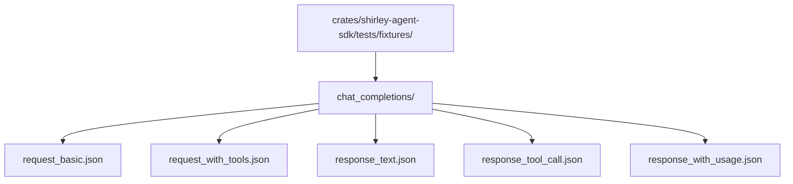

**Shirley technical design · Testing and benchmarks (P1)**

**1. Current state**

The whole repository has 3 tests, all in the `read` tool. The SDK side has 0 tests. Yet the parts of the SDK that most need testing are precisely the "subtle semantics, silently wrong when changed" spots:

- the `Option` semantics of `Usage` ("not reported" != 0)
- the "keep the known side" merge logic of `Usage::Add`
- the `None` branch of `cache_hit_rate`
- the summary slicing of `active_messages`
- the integer comparison of the compaction threshold

Once these are broken, the numbers in the UI quietly go wrong without raising an error.

**2. Test layers**

| Layer | What it tests | Tool |
| --- | --- | --- |
| Unit | Usage, Message encode/decode, argument schema, macro expansion | `#[test]` / `trybuild` |
| Contract | Request/response conversion of the protocol codec | Fixed JSON snapshots |
| Integration | ReAct loop, compaction, cancellation, retry | Fake model service |
| Benchmark | Cache hit rate | Real API + threshold |

**3. Unit tests (priority)**

**3.1 `Usage` semantics**

This is the first group that should be written, because it carries the author's deliberate design decisions:

```rust
#[test]
fn adding_unreported_cache_does_not_become_zero() {
    let a = Usage { input_tokens: 100, cached_input_tokens: None, ..Default::default() };
    let b = Usage { input_tokens: 100, cached_input_tokens: Some(50), ..Default::default() };
    let sum = a + b;
    // must not become anything other than Some(50); and must not drop b just because a is None
    assert_eq!(sum.cached_input_tokens, Some(50));
    assert_eq!(sum.input_tokens, 200);
}

#[test]
fn cache_hit_rate_is_none_when_unreported() {
    let usage = Usage { input_tokens: 100, cached_input_tokens: None, ..Default::default() };
    assert_eq!(usage.cache_hit_rate(), None);
}

#[test]
fn cache_hit_rate_is_none_when_reported_zero_input() {
    let usage = Usage {
        input_tokens: 0,
        cached_input_tokens: Some(0),
        cache_reported_input_tokens: Some(0),
        ..Default::default()
    };
    assert_eq!(usage.cache_hit_rate(), None); // a zero denominator does not return NaN
}
```

**3.2 `active_messages` slicing**

Compaction is "irreversible", and the `start_index` semantics are easy to break:

```rust
#[test]
fn active_messages_keeps_leading_system_and_latest_summary() {
    // System, User, Assistant, ContextSummary, User, Assistant
    // expected: System + ContextSummary and everything after it
}

#[test]
fn active_messages_uses_last_summary_when_multiple() {
    // two ContextSummary, start only from the last one
}
```

**3.3 Compaction threshold**

`should_schedule_compression` uses an integer comparison to avoid floating-point issues; the boundary must be guarded:

```rust
#[test]
fn compression_triggers_at_exactly_eighty_percent() {
    // used * 100 >= limit * 80
    // limit=1000, used=800 -> true
    // limit=1000, used=799 -> false
}
```

**3.4 Macro expansion**

Use `trybuild` to lock down the macro's compile-time constraints (the pitfalls listed in `Agent.md`):

- missing `#[param(description)]` -> compile failure
- parameter destructuring -> compile failure
- function name and mod at different levels -> compile failure

Also test whether `Arguments`'s `deny_unknown_fields` takes effect.

**4. Contract tests**

Use fixed JSON snapshots for the protocol codec's inputs and outputs, so that every refactor does not rely on eyeballing:



Use `insta` or hand-written snapshot comparison. Focus on covering both the missing and present cases of `Usage`'s `prompt_tokens_details.cached_tokens`.

**5. Integration tests: fake model service**

A controllable fake model is needed to test the loop, retry, and cancellation:

```rust
// crates/shirley-agent-sdk/tests/support/mock_server.rs
pub struct MockModel {
    // return preset responses in order
    responses: Vec<ModelResponse>,
    // record received requests, to assert prefix stability
    received: Arc<Mutex<Vec<Value>>>,
}
```

It can be implemented on top of `wiremock` or a minimal `axum`. Scenarios to cover:

1. A normal round: user -> assistant (no tools) -> Finished
2. Tool call: assistant(tool_calls) -> tool -> assistant -> Finished
3. Multiple tools concurrently: verify the result order of `FuturesUnordered` matches `tool_call_id`
4. Infinite tool loop: verify `max_steps` takes effect (see `runtime-hardening.md`)
5. Success after 429: verify retry
6. Compaction failure: verify the degradation does not abort
7. Cancellation: verify `StopReason::Cancelled` and a complete history

**6. Cache hit-rate benchmark**

`plan.md` explicitly asked for this and it has never been done:

> Actually, it is just using some simple cases, then running some API endpoints to test how much is cached. Set a threshold.

Plan: a standalone integration test, `#[ignore]` by default, that reads the real key from an environment variable and runs a fixed sequence:

1. First round: long system prompt + tool definitions -> record `cached_input_tokens` (expected close to 0)
2. Second round: same prefix + a new user message -> record the hit rate (expected high)
3. Assert the second round's hit rate > threshold (suggest measuring the actual value first, e.g. 0.5)

Key: **any code that changes the request prefix must rerun this benchmark**. The first item of section 7 of `Agent.md` is "do not break prefix stability", and this benchmark is the enforcement mechanism for that rule.

**7. Performance**

After streaming lands, rebuilding `MessageCache` every frame becomes a bottleneck (currently it sets the whole thing to `None` for every incoming message, which is O(n²) for long sessions). Needed:

- Change it to incremental appending: only render the newly added part of a new message and append it to `lines` and `row_offsets`.
- Remove the per-frame `.to_vec()` clone in `visible_lines`.
- Along the way, fix the mismatch between `row_offsets`'s line-wrap estimation and ratatui's `Wrap` (see the scroll offset mentioned in `roadmap.md`).

**8. CI**

Add `.github/workflows/ci.yml`:

```yaml
- cargo fmt --check
- cargo clippy --all-targets -- -D warnings
- cargo test --all
```

The current 36 clippy warnings (`shirley-agent-sdk` 32 + application layer 4) should either be fixed or explicitly `allow`ed with a written reason. `-D warnings` is the only way to stop "things that could be fixed in passing" from piling up.

**9. Acceptance**

1. `cargo test --all` covers Usage semantics, compaction slicing, and threshold boundaries.
2. The fake-model integration tests cover 7 scenarios.
3. The cache hit-rate benchmark has an executable script and a threshold.
4. CI is green and `clippy -D warnings` passes.
