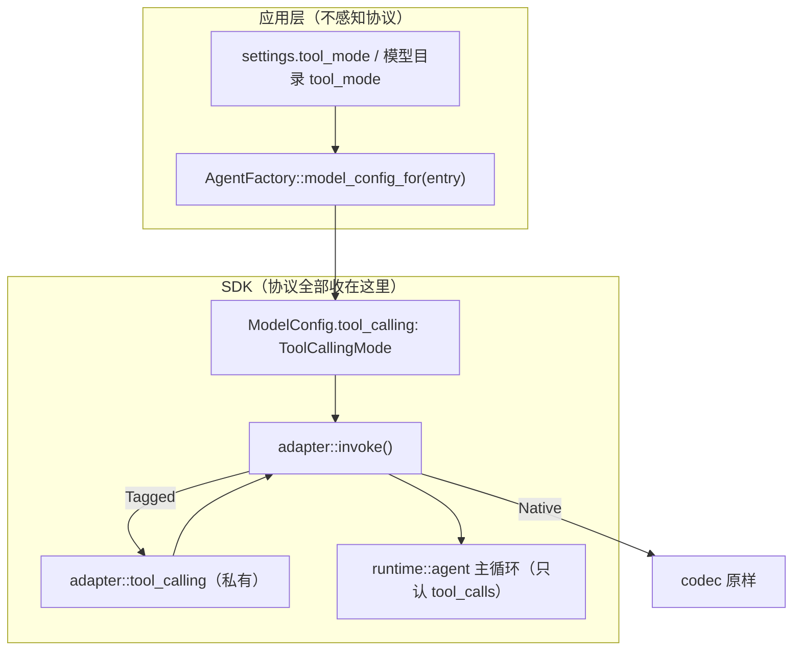

**Shirley 技术方案 · Content 工具调用协议收口（Tool-Calling Containment）**

> **状态：部分已落地。** 本文是对 `docs/tool-calling.md`（Content 工具调用协议初版）
> 的**重构方案**。初版把协议跑通了，但把协议类型、选择逻辑、切换时机漏到了 SDK 之外，
> runtime 也直接读了协议。本文把这层**全部收回 SDK adapter**，对外只暴露一个声明式
> 枚举 `ToolCallingMode`，由 `ModelConfig` 决定。
>
> **落地进度：Step 1–7 全部落地并验证。** 本文原先标注的 Step 3–5（应用层一次解析下发、
> 请求编码修正、解析一致性与容错）、Step 6（历史回放）、Step 7（提示词与测试）均已在当前
> 代码中实现——`Agent::set_model_config` 单入口下发、多工具结果合并成一条 user、
> `__protocol__` 错误回灌、reasoning 优先级、escape_xml、thinking 不回放、提示词通用化都已到位。
> 端到端集成测试见 `tests/tool_calling_content.rs`；提示词正文抽到 `prompts/tool_calling_*.md`。
> 本文其余部分保留为设计记录（历史决策链）。
>
> **背景一句话**：给不支持原生 function calling 的模型加一层文本（XML）协议，
> 让它也能驱动工具，但**外部（应用层 / UI / runtime 主循环）不应感知这层协议**。

---

**一、问题：协议漏出去了**

初版暂存区的改动共 13 个文件、+2152/-23，核心是新增
`crates/shirley-agent-sdk/src/adapter/tool_calling.rs`（1422 行）。协议**核心**
（字符级解析状态机、历史回放、流式过滤）确实落在 SDK adapter 层，方向正确；但
**边界**没守住，问题分五类：

| 类别 | 表现 | 违背的目标 |
| --- | --- | --- |
| 对外导出太多 | `lib.rs` 导出 7 个类型；应用层 `Arc::new(TaggedToolProtocol::builder().build())` 自己组装协议实例 | 外部不感知 |
| 两步调用易漏 | `set_model` 之后必须再调 `set_tool_calling`；TUI / desktop 各写一遍；`/login` 漏判 | 统一入口 |
| 供应商特判写死 | `resolve_tool_calling_for_model` 里 `provider == "figma-make" \|\| starts_with("figma-make-")` | 能力声明应是数据 |
| runtime 知道协议 | `agent.rs::system_message()` 读 `tool_calling.as_content()` 拼工具目录，写进 `self.messages` | 差异收敛在 adapter |
| 默认值穿透 UI | `default_tool_calling` 穿过 `interface::run → Tui::new → App` 4 层签名 | 解析收在 factory |

另有**正确性**问题：请求体 `body.remove("tools")` 只删一半（残留 `tool_choice`）；
多工具结果生成多条连续 user 消息；流式展示与最终解析结果不一致；解析失败无信号
（缺 name / 截断 / 引号不配对 → 静默当正常完成或带垃圾参数执行）；回放调用 id 用
进程级全局计数器（重启后重复）；原生 reasoning 也被写进 `<thinking>` 回放。

---

**二、目标与分层边界**

**目标**：`ToolCallingMode` 是 SDK 对外**唯一**的工具协议抽象；应用层只声明模式，
不碰协议实例、不碰解析器、不碰回放渲染。



**边界规则（硬约束）**：

1. `lib.rs` 只 `pub use ToolCallingMode`；`ContentToolProtocol` / `TaggedToolProtocol` /
   `ParsedDocument` / `ParsedToolCall` / `VisibleChunk` / `ContentStreamParser` 全部
   `pub(crate)`。要支持自定义协议，以后再开 trait，不预支。
2. `runtime` **零协议知识**：`agent.rs` 不出现 `tool_calling` / `render_instructions` /
   `set_tool_calling`。工具目录在 adapter 的**请求视图**里拼，不写 `self.messages`。
3. 应用层只产出 `ToolCallingMode`（从配置 / 模型目录），在**一处**解析、在
   **一次**下发（见 Step 3）。
4. 协议差异只允许出现在 `adapter/tool_calling.rs` + `adapter/mod.rs::invoke()`。

---

**三、逐条改法**

### Step 1（已落地）对外收口为 `ToolCallingMode`

`adapter/tool_calling.rs`：

```rust
#[derive(Debug, Clone, Copy, Default, PartialEq, Eq, serde::Serialize, serde::Deserialize)]
#[serde(rename_all = "lowercase")]
pub enum ToolCallingMode {
    #[default]
    Native,   // 结构化 tools / tool_calls
    Tagged,   // 内置 XML 标签文本协议
}

impl ToolCallingMode {
    pub fn is_content(self) -> bool { !matches!(self, Self::Native) }
    // 协议实例由模式在 SDK 内部构造，外部不感知
    pub(crate) fn protocol(self) -> Option<Arc<dyn ContentToolProtocol>> {
        match self {
            Self::Native => None,
            Self::Tagged => Some(Arc::new(TaggedToolProtocol::builder().build())),
        }
    }
}
```

- `lib.rs`：`pub use adapter::{AdapterError, ModelConfig, ModelProtocol, ToolCallingMode};`
- `ModelConfig.tool_calling: ToolCallingMode`（`#[builder(default)]`）。
- 其余协议类型改 `pub(crate)`。

### Step 2（已落地）工具说明挪进 adapter，回退 `agent.rs`

`adapter/mod.rs::invoke()` 内部构造协议、拼请求视图：

```rust
let protocol = config.tool_calling.protocol();
let content_view = protocol.as_deref().map(|p| {
    tool_calling::encode_messages_for_content(input.messages, input.tools, p)
});
// content 模式：从源头不发 tools、清掉 tool_choice（不再 body.remove）
let no_tools: [&tool::ToolDefinition; 0] = [];
let content_config;
let encode_config = if protocol.is_some() {
    content_config = ModelConfig { tool_choice: None, ..config.clone() };
    &content_config
} else { config };
let encode_input = ModelRequest {
    messages: content_view.as_deref().unwrap_or(input.messages),
    tools: if protocol.is_some() { &no_tools } else { input.tools },
};
let prepared = encode(encode_config, &encode_input)?;
```

`encode_messages_for_content(messages, tools, protocol)`：把 `render_instructions(tools)`
拼到**请求视图**首条 system 之后（工具集按名排序且会话内稳定 → 前缀稳定，KV 缓存不受
影响）；`Message::Tool` → 回灌文本；带 `tool_calls` 的 assistant → 协议原文。

`runtime/agent.rs` **整体回退到 HEAD**：删除 `set_tool_calling` / `refresh_system_message`
及 `system_message()` 里的协议分支。

### Step 3（待落地）应用层收口：一次解析、一次下发

**问题**：`set_model` + `set_tool_calling` 两步易漏；`/login` 走 `set_provider` 没重判协议；
figma-make 前缀写死；`default_tool_calling` 穿透 4 层。

**改法**：

1. **SDK 提供一次性下发接缝**（二选一，推荐 A）：
   - A. `Agent::set_model_config(&mut self, config: ModelConfig)` —— 整体替换
     `model_config`，调用方先改好 `model` / `tool_calling` 再传。语义最清晰、无顺序依赖。
   - B. 扩展 `Agent::set_model(&mut self, model: &str, mode: ToolCallingMode)` —— 保持小接缝。
   - 二选一后，**删除** `Agent::set_tool_calling`。`set_provider` 保持只换端点 / 密钥。
2. **解析收进 factory 一处**：
   ```rust
   impl AgentFactory {
       /// 模型条目 → 完整 ModelConfig（model + tool_calling 一次算好）。
       pub fn model_config_for(&self, entry: &ModelEntry) -> ModelConfig {
           let mode = resolve_tool_calling(entry.tool_mode.as_deref(), self.default_tool_calling);
           ModelConfig { model: entry.value.clone(), tool_calling: mode, ..self.model_config.clone() }
       }
   }
   ```
   UI 只把选中的 `ModelEntry` 交过来，不自己解析。
3. **删掉 `default_tool_calling` 的 UI 穿透**：`interface::run` / `Tui::new` / `App`
   不再持有它；切换模型时调 `factory.model_config_for(entry)`（TUI 已有 factory 句柄；
   desktop 经 `runtime.factory`）。
4. **figma-make 特判改成数据**：删 `resolve_tool_calling_for_model` 里的
   `provider == "figma-make" || starts_with(...)`。改为：
   - 模型目录 `GET /v1/models` 返回的 `tool_mode` 字段（已有 `ModelEntry::tool_mode`）；或
   - `StaticCatalog` 兜底条目上直接标 `with_tool_mode(Some("content"))`；
   - 或工作区配置 `[provider] tool_mode`。
5. **`/login` 也要重判**：登录成功、拿到新端点 / 模型后，按同一 `resolve_tool_calling`
   算 mode 并一次性下发（避免从 figma-make 换端点后仍停留在 content）。

### Step 4（待落地）请求编码修正

- **多工具结果合并**：`encode_messages_for_content` 里，把**同一轮相邻的 `Message::Tool`**
  合并成**一条** user 消息（`\n\n` 分隔各结果块），避免 Anthropic 等要求角色交替的协议报错。
  判断"同一轮"用前一条 assistant 的 `tool_calls` 集合。
- **`parallel_tool_calls`**：content 模式一并清掉（若配置里写入过），与 `tool_choice` 同理。
  （当前三个 codec 未写 `parallel_tool_calls`，仅需在 `extra_body` 层面提醒，或统一在
  content 模式下清理。）

### Step 5（待落地）解析一致性与容错

- **流式 / 最终一致**：工具轮里"标签外的散落文本"当前会作为 `ContentDelta` 推给 UI，
  但 `parse_content_response` 有调用时只保留 `description`。统一为**同一规则**（推荐都丢弃，
  或都保留），`TaggedStreamParser` 与 `parse_tagged` 共用该判定。
- **思考来源优先级**：`document.thinking.or(reasoning_content)` 会覆盖原生 reasoning。
  改为明确规则：`reasoning_content`（原生）优先，`<thinking>` 作为**追加**或仅在其为空时使用。
- **解析错误信号**：`ParsedDocument` 增加 `errors: Vec<String>`；下列情况**不静默**：
  - `<tool>` 缺 `<name>`；
  - 被 max_tokens 截断的未闭合 `<params>`（`finish()` 时仍处于标签内）；
  - `params` 非法 JSON。
  在 `parse_content_response` 里把这些合成**一条可纠正的回灌**（如
  `{"tool":"__protocol__"}` + "工具块不完整：… 请重发"），交回主循环作为下一轮输入，
  而不是判 `Completed` 静默结束、或带垃圾参数执行。
- **引号不配对兜底**：`params_json_in_string` 卡在 `true` 时，遇 `</params>` 先尝试
  `serde_json` 校验，能解析就闭合，避免吞掉后续标签。
- **工具名缺失占位**：`id_to_name.get(...).unwrap_or("")` 改为显式占位 + 日志，避免
  `{"tool":""}` 回灌。

### Step 6（待落地）历史回放

- **调用 id 唯一化**：去掉进程级 `NEXT_CONTENT_CALL_ID`；改用 `uuid` 或
  `format!("content_call_{msg_index}_{n}")`（消息下标 + 轮内序号），恢复会话后不冲突。
- **不回放 thinking**：`render_assistant` 默认只回放 `<tool>`（必要时加 `<description>`），
  不回放 `<thinking>`——原生模式历史 reasoning 本就不回传，content 模式也不该每轮带上，
  否则上下文膨胀、更早触发压缩。
- **转义**：`render_assistant` 对 `content` / `description` 做转义（或拒绝含标签字面量的
  文本），保证往返解析无损。

### Step 7（待落地）提示词与测试

- **提示词去特判**：`render_instructions` 里"不要把模型服务自身的工作区 / 文件或工具当成
  用户项目环境"这类针对 figma-make 的句子，移到**应用层** `src/prompt.rs`；SDK 提示词
  保持通用。硬编码中文可考虑做成可配置（低优先级）。
- **补测试**：
  - `invoke` 级：断言 content 模式请求体**无** `tools` / `tool_choice`，且流式事件序列
    与 `Finished` 结果一致；
  - 截断 / 缺 name / 引号不配对 → 产出 `errors` 且回灌可纠正；
  - 多工具结果合并成一条 user；恢复会话后 id 不冲突。
  - （`reports_sandbox_degradation` 的红与本次无关，不动。）

---

**四、验收口径**

1. `crates/shirley-agent-sdk/src/lib.rs` 只导出 `ToolCallingMode`，无其它协议类型。
2. 全仓库 `rg 'as_content|TaggedToolProtocol|ContentToolProtocol|ParsedDocument' src/`
   在**应用层**无命中（仅 `crates/.../adapter` 内出现）。
3. `runtime/agent.rs` 相对 HEAD **零改动**（`git diff HEAD -- .../runtime/agent.rs` 为空）。
4. content 模式请求体不含 `tools` / `tool_choice` / `parallel_tool_calls`。
5. `/model` 切换、`/login`、desktop `agent_set_model` 都经**同一** `resolve_tool_calling`
   + **一次**下发；figma-make 判定来自**数据**而非代码分支。
6. 缺 name / 截断 / 引号不配对 → 有 `errors` 且回灌可纠正，不静默 `Completed`。
7. `cargo build && cargo test && cargo clippy --all-targets` 通过。

---

**五、迁移顺序（建议按此提交）**

1. **SDK 收口**（Step 1+2，已做）：一个 commit，`lib.rs` / `adapter/*` / 回退 `agent.rs`。
2. **应用层收口**（Step 3）：`bootstrap.rs` / `settings.rs` / `models.rs` /
   `interface/{mod,tui,app}.rs` / `desktop/shell.rs` 一个 commit——去掉 `ToolCalling`
   穿透，改一次性下发。
3. **编码 + 解析修正**（Step 4+5）：`tool_calling.rs` 一个 commit，含新增测试。
4. **回放 + 提示词**（Step 6+7）：`tool_calling.rs` + `src/prompt.rs` 一个 commit。

> 按主题拆 commit：SDK 协议收口 与 应用层接线 分开，保证每个 commit 自洽、可单独回滚。

---

**六、已知缺口（本次不解决）**

- 自定义协议（第三方 `impl ContentToolProtocol`）暂不开放——先只有 `Native` / `Tagged` 两档。
- 流式解析器目前只有 `Tagged` 实现；`NoopStreamParser` 吞掉一切是保守默认，若将来 UI
  纯靠 delta 渲染正文会空白，需确认 UI 用 `Finished` 兜底（当前 TUI / desktop 会用
  `Finished` 重建，安全）。
- 协议提示词硬编码中文，未做 i18n / 可配置。
