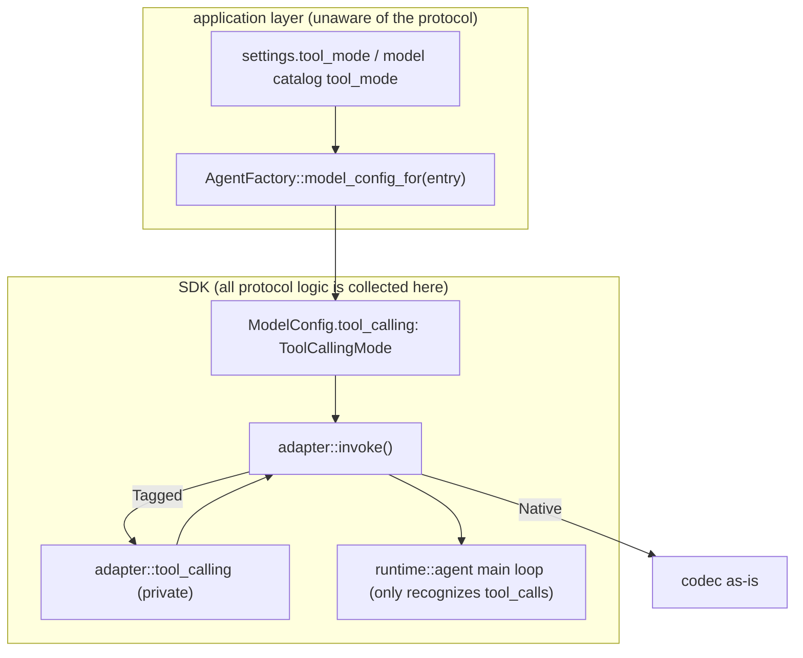

**Shirley technical design · Content tool-calling protocol containment (Tool-Calling Containment)**

> **Status: partially landed.** This document is a **refactor plan** for `docs/tool-calling.md`
> (the first version of the Content tool-calling protocol). The first version got the protocol working,
> but leaked the protocol type, the selection logic, and the switch timing outside the SDK, and the
> runtime also read the protocol directly. This document **pulls all of that back into the SDK adapter**,
> exposing externally only a declarative enum `ToolCallingMode`, decided by `ModelConfig`.
>
> **Landing progress: Steps 1-7 all landed and verified.** Steps 3-5 (application-layer single parse
> and single dispatch, request-encoding fix, parse consistency and fault tolerance), Step 6 (history
> replay), and Step 7 (prompts and tests) originally marked in this document have all been implemented
> in the current code -- `Agent::set_model_config` as the single dispatch entry, multiple tool results
> merged into one user message, `__protocol__` error re-injection, reasoning priority, escape_xml,
> thinking not replayed, and generalized prompts are all in place.
> For the end-to-end integration test see `tests/tool_calling_content.rs`; the prompt body text is
> extracted into `prompts/tool_calling_*.md`. The rest of this document is kept as a design record
> (the historical decision chain).
>
> **One-sentence background**: add a text (XML) protocol layer for models that do not support native
> function calling, so they can also drive tools, but **the outside (application layer / UI / runtime
> main loop) should not be aware of this protocol layer**.

---

**1. The problem: the protocol leaked out**

The first version's staged changes totaled 13 files, +2152/-23, the core being the newly added
`crates/shirley-agent-sdk/src/adapter/tool_calling.rs` (1422 lines). The protocol **core**
(the character-level parse state machine, history replay, streaming filter) did land in the SDK adapter
layer, which is the right direction; but the **boundary** was not held, and the problems fall into five
categories:

| Category | Manifestation | Goal violated |
| --- | --- | --- |
| Too many exports | `lib.rs` exports 7 types; the application layer assembles the protocol instance itself via `Arc::new(TaggedToolProtocol::builder().build())` | the outside is unaware |
| Two-step call is easy to miss | after `set_model` you must then call `set_tool_calling`; the TUI / desktop each write it once; `/login` misses the check | a single entry point |
| Vendor special-casing hard-coded | in `resolve_tool_calling_for_model`, `provider == "figma-make" \|\| starts_with("figma-make-")` | a capability declaration should be data |
| The runtime knows the protocol | `agent.rs::system_message()` reads `tool_calling.as_content()` to build the tool catalog and writes it into `self.messages` | differences converge in the adapter |
| The default value pierces the UI | `default_tool_calling` passes through 4 signature layers: `interface::run -> Tui::new -> App` | parsing is collected in the factory |

There are also **correctness** problems: the request body `body.remove("tools")` only removes half
(it leaves `tool_choice` behind); multiple tool results generate multiple consecutive user messages;
the streaming display and the final parse result are inconsistent; a parse failure has no signal
(missing name / truncation / unpaired quotes -> silently treated as normal completion or executed with
garbage arguments); the replayed call id uses a process-level global counter (duplicated after a
restart); and native reasoning is also written into `<thinking>` for replay.

---

**2. Goal and layering boundary**

**Goal**: `ToolCallingMode` is the SDK's **only** external tool-protocol abstraction; the application
layer only declares the mode, and does not touch the protocol instance, the parser, or the replay
rendering.



**Boundary rules (hard constraints)**:

1. `lib.rs` only does `pub use ToolCallingMode`; `ContentToolProtocol` / `TaggedToolProtocol` /
   `ParsedDocument` / `ParsedToolCall` / `VisibleChunk` / `ContentStreamParser` are all
   `pub(crate)`. To support custom protocols, open a trait later; do not pre-spend it.
2. The `runtime` has **zero protocol knowledge**: `agent.rs` does not contain `tool_calling` /
   `render_instructions` / `set_tool_calling`. The tool catalog is built in the adapter's **request
   view**, and is not written into `self.messages`.
3. The application layer only produces a `ToolCallingMode` (from config / the model catalog), parsed
   in **one place** and dispatched in **one** call (see Step 3).
4. Protocol differences are allowed to appear only in `adapter/tool_calling.rs` +
   `adapter/mod.rs::invoke()`.

---

**3. Change by change**

### Step 1 (landed) Externally contain to `ToolCallingMode`

`adapter/tool_calling.rs`:

```rust
#[derive(Debug, Clone, Copy, Default, PartialEq, Eq, serde::Serialize, serde::Deserialize)]
#[serde(rename_all = "lowercase")]
pub enum ToolCallingMode {
    #[default]
    Native,   // structured tools / tool_calls
    Tagged,   // built-in XML tag text protocol
}

impl ToolCallingMode {
    pub fn is_content(self) -> bool { !matches!(self, Self::Native) }
    // the protocol instance is constructed inside the SDK from the mode; the outside is unaware
    pub(crate) fn protocol(self) -> Option<Arc<dyn ContentToolProtocol>> {
        match self {
            Self::Native => None,
            Self::Tagged => Some(Arc::new(TaggedToolProtocol::builder().build())),
        }
    }
}
```

- `lib.rs`: `pub use adapter::{AdapterError, ModelConfig, ModelProtocol, ToolCallingMode};`
- `ModelConfig.tool_calling: ToolCallingMode` (`#[builder(default)]`).
- The remaining protocol types are changed to `pub(crate)`.

### Step 2 (landed) Move the tool description into the adapter, revert `agent.rs`

Inside `adapter/mod.rs::invoke()`, construct the protocol and build the request view:

```rust
let protocol = config.tool_calling.protocol();
let content_view = protocol.as_deref().map(|p| {
    tool_calling::encode_messages_for_content(input.messages, input.tools, p)
});
// content mode: do not send tools from the source, clear tool_choice (no more body.remove)
let no_tools: [&tool::ToolDefinition; 0] = [];
let content_config;
let encode_config = if protocol.is_some() {
    content_config = ModelConfig { tool_choice: None, ..config.clone() };
    &content_config
} else { config };
let encode_input = ModelRequest {
    messages: content_view.as_deref().unwrap_or(input.messages),
    tools: if protocol.is_some() { &no_tools } else { input.tools },
};
let prepared = encode(encode_config, &encode_input)?;
```

`encode_messages_for_content(messages, tools, protocol)`: splice `render_instructions(tools)` after
the first system message of the **request view** (the tool set is sorted by name and stable within the
session -> stable prefix, KV cache unaffected); `Message::Tool` -> re-injected text; an assistant with
`tool_calls` -> the protocol's original text.

`runtime/agent.rs` **is fully reverted to HEAD**: delete `set_tool_calling` / `refresh_system_message`
and the protocol branch inside `system_message()`.

### Step 3 (to land) Application-layer containment: parse once, dispatch once

**Problem**: `set_model` + `set_tool_calling` is a two-step that is easy to miss; `/login` goes through
`set_provider` without re-deciding the protocol; the figma-make prefix is hard-coded;
`default_tool_calling` pierces 4 layers.

**Fix**:

1. **The SDK provides a one-shot dispatch seam** (choose one; A is recommended):
   - A. `Agent::set_model_config(&mut self, config: ModelConfig)` -- replaces `model_config` as a
     whole; the caller sets `model` / `tool_calling` first and then passes it in. The clearest
     semantics, no ordering dependency.
   - B. Extend `Agent::set_model(&mut self, model: &str, mode: ToolCallingMode)` -- keeps a small
     seam.
   - After choosing one, **delete** `Agent::set_tool_calling`. `set_provider` stays as only swapping
     the endpoint / key.
2. **Collect parsing into one place in the factory**:
   ```rust
   impl AgentFactory {
       /// Model entry -> full ModelConfig (model + tool_calling computed together).
       pub fn model_config_for(&self, entry: &ModelEntry) -> ModelConfig {
           let mode = resolve_tool_calling(entry.tool_mode.as_deref(), self.default_tool_calling);
           ModelConfig { model: entry.value.clone(), tool_calling: mode, ..self.model_config.clone() }
       }
   }
   ```
   The UI just hands over the selected `ModelEntry`, and does not parse it itself.
3. **Delete the UI piercing of `default_tool_calling`**: `interface::run` / `Tui::new` / `App` no
   longer hold it; when switching models, call `factory.model_config_for(entry)` (the TUI already has
   a factory handle; desktop goes through `runtime.factory`).
4. **Turn the figma-make special-case into data**: delete the
   `provider == "figma-make" || starts_with(...)` in `resolve_tool_calling_for_model`. Change to:
   - the `tool_mode` field returned by the model catalog `GET /v1/models` (`ModelEntry::tool_mode`
     already exists); or
   - directly tag `with_tool_mode(Some("content"))` on the `StaticCatalog` fallback entry;
   - or the workspace config `[provider] tool_mode`.
5. **`/login` must also re-decide**: after a successful login and getting the new endpoint / model,
   compute the mode via the same `resolve_tool_calling` and dispatch once (to avoid staying in content
   after switching endpoints away from figma-make).

### Step 4 (to land) Request-encoding fix

- **Merge multiple tool results**: in `encode_messages_for_content`, merge **adjacent `Message::Tool`
  of the same round** into **one** user message (`\n\n` separating the result blocks), to avoid errors
  from protocols like Anthropic that require alternating roles. To determine "the same round", use the
  `tool_calls` set of the preceding assistant.
- **`parallel_tool_calls`**: clear it too in content mode (if it was written into the config), for the
  same reason as `tool_choice`. (The current three codecs do not write `parallel_tool_calls`, so it
  only needs to be flagged at the `extra_body` level, or cleaned up uniformly in content mode.)

### Step 5 (to land) Parse consistency and fault tolerance

- **Streaming / final consistency**: in a tool round, "text scattered outside the tags" is currently
  pushed to the UI as `ContentDelta`, but `parse_content_response` only keeps `description` when
  called. Unify to **one rule** (recommended: discard both, or keep both); `TaggedStreamParser` and
  `parse_tagged` share that decision.
- **Thinking-source priority**: `document.thinking.or(reasoning_content)` would override native
  reasoning. Change to an explicit rule: `reasoning_content` (native) takes priority, and `<thinking>`
  is used as an **append** or only when it is empty.
- **Parse error signal**: add `errors: Vec<String>` to `ParsedDocument`; the following cases are **not
  silent**:
  - `<tool>` missing `<name>`;
  - an unclosed `<params>` truncated by max_tokens (still inside the tag at `finish()`);
  - invalid JSON in `params`.
  In `parse_content_response`, combine these into **one correctable re-injection** (e.g.
  `{"tool":"__protocol__"}` + "the tool block is incomplete: ... please resend"), handed back to the
  main loop as the next round's input, rather than deciding `Completed` and ending silently, or
  executing with garbage arguments.
- **Unpaired-quote fallback**: when `params_json_in_string` is stuck on `true`, on encountering
  `</params>` first try a `serde_json` validation, and if it parses, close it, avoiding swallowing
  subsequent tags.
- **Missing-tool-name placeholder**: change `id_to_name.get(...).unwrap_or("")` to an explicit
  placeholder + a log, avoiding a `{"tool":""}` re-injection.

### Step 6 (to land) History replay

- **Unique call id**: remove the process-level `NEXT_CONTENT_CALL_ID`; use `uuid` or
  `format!("content_call_{msg_index}_{n}")` (message index + intra-round sequence), so there is no
  conflict after restoring a session.
- **Do not replay thinking**: `render_assistant` by default replays only `<tool>` (and `<description>`
  if necessary), not `<thinking>` -- native-mode history reasoning is not sent back anyway, and
  content mode should not carry it every round either, otherwise the context bloats and compaction
  triggers earlier.
- **Escaping**: `render_assistant` escapes `content` / `description` (or rejects text containing tag
  literals), guaranteeing lossless round-trip parsing.

### Step 7 (to land) Prompts and tests

- **De-special-case the prompt**: the sentences in `render_instructions` aimed at figma-make, such as
  "do not treat the model service's own workspace / files or tools as the user's project environment",
  move to the **application layer** `src/prompt.rs`; the SDK prompt stays generic. The hard-coded
  Chinese could be made configurable (low priority).
- **Add tests**:
  - `invoke`-level: assert the content-mode request body has **no** `tools` / `tool_choice`, and that
    the streaming event sequence matches the `Finished` result;
  - truncation / missing name / unpaired quotes -> produce `errors` and a correctable re-injection;
  - multiple tool results merged into one user; ids do not conflict after restoring a session.
  - (The red `reports_sandbox_degradation` is unrelated to this, leave it alone.)

---

**4. Acceptance criteria**

1. `crates/shirley-agent-sdk/src/lib.rs` exports only `ToolCallingMode`, with no other protocol types.
2. Across the whole repository, `rg 'as_content|TaggedToolProtocol|ContentToolProtocol|ParsedDocument' src/`
   has **no** hits in the application layer (only appearing inside `crates/.../adapter`).
3. `runtime/agent.rs` has **zero** changes relative to HEAD (`git diff HEAD -- .../runtime/agent.rs`
   is empty).
4. The content-mode request body contains no `tools` / `tool_choice` / `parallel_tool_calls`.
5. `/model` switching, `/login`, and desktop `agent_set_model` all go through the **same**
   `resolve_tool_calling` + **one** dispatch; the figma-make decision comes from **data**, not a code
   branch.
6. Missing name / truncation / unpaired quotes -> there are `errors` and a correctable re-injection,
   not a silent `Completed`.
7. `cargo build && cargo test && cargo clippy --all-targets` pass.

---

**5. Migration order (suggested commits)**

1. **SDK containment** (Step 1+2, done): one commit, `lib.rs` / `adapter/*` / revert `agent.rs`.
2. **Application-layer containment** (Step 3): one commit for `bootstrap.rs` / `settings.rs` /
   `models.rs` / `interface/{mod,tui,app}.rs` / `desktop/shell.rs` -- remove the `ToolCalling`
   piercing, change to one-shot dispatch.
3. **Encoding + parsing fixes** (Step 4+5): one commit for `tool_calling.rs`, including the new tests.
4. **Replay + prompts** (Step 6+7): one commit for `tool_calling.rs` + `src/prompt.rs`.

> Split commits by theme: SDK protocol containment and application-layer wiring separate, ensuring
> each commit is self-contained and independently revertible.

---

**6. Known gaps (not solved this time)**

- Custom protocols (a third-party `impl ContentToolProtocol`) are not opened up for now -- only the
  `Native` / `Tagged` two gears.
- The streaming parser currently has only a `Tagged` implementation; `NoopStreamParser` swallowing
  everything is a conservative default. If in the future the UI renders the body purely from deltas, it
  would be blank, so it needs to be confirmed that the UI falls back to `Finished` (the current TUI /
  desktop rebuild from `Finished`, which is safe).
- The protocol prompt hard-codes Chinese, with no i18n / configurability.
