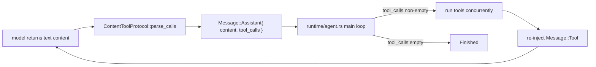

**Shirley technical design · Content tool-calling protocol (Content Tool-Calling Protocol)**

> **Status: landed (P1).** This document designs a **pluggable** "content tool-parsing protocol" --
> when a model / endpoint does not support native tool calling, it switches to a plain-text convention
> for the model to declare tool calls, and the SDK, in the adapter layer, parses the text back into
> `Message::Assistant.tool_calls`, thereby **reusing the existing ReAct loop**.
>
> The reference implementation comes from `figmaagent` (commit `86fd6e8^`; its XML protocol was later
> replaced by native function calling; that commit has been restored by rollback in the `figmaagent`
> repository, `63b4480`). This document only describes the landing design on the Shirley side, and does
> not copy figmaagent's business logic.
>
> **The review conclusions (section 12) are confirmed**: (1) v1 = two gears, declarative + a custom
> trait; (2) the termination semantics are the same as native function calling's stop (no tool call means
> end), and `is_terminal` is **not introduced**; (3) catalog injection goes through an extended
> `SystemPromptContext`; (4) `zod-to-doc` is **not ported for now**, to be decided based on later errors.
>
> **Landing status (current code)**: the protocol core is in
> `crates/shirley-agent-sdk/src/adapter/tool_calling.rs` (character-level state machine + streaming
> parser + `render_schema_doc` + `encode_messages_for_content` + `parse_content_response`), exposing
> externally only `ToolCallingMode::{Native,Tagged}` (attached to `ModelConfig.tool_calling`); the
> integration point is `adapter/mod.rs::invoke()`, with **zero runtime changes**. The prompt body text is
> extracted into `crates/shirley-agent-sdk/prompts/tool_calling_instructions.md` and
> `tool_calling_errors.md` (`include_str!`, consistent with the repository's prompts convention). For
> the end-to-end integration test see `crates/shirley-agent-sdk/tests/tool_calling_content.rs` (a mock
> plain-text endpoint runs a complete ReAct loop). For containment details and follow-ups see
> `docs/tool-calling-refactor.md`.

**1. What this document solves**

Status quo: Shirley's tool calling **depends entirely on the vendor's native tool_calls**.

- Request side: all three protocols' `encode_request` encode `ToolDefinition` into the `tools` field;
- Response side: `decode` / `decode_stream` parse `tool_calls` from structured fields;
- Run side: `runtime/agent.rs` **only recognizes `Message::Assistant.tool_calls`** -- if non-empty, run
  the tools concurrently, re-inject `Message::Tool`, and continue the next round; if empty, `Finished`.

Problem: **not all models / endpoints support native tool calling** (local small models, some
OpenAI-compatible gateways, pure completion endpoints). These models are not incapable of "using tools"
-- they can write in text "I want to call X with arguments Y", they just have no structured channel.

Goal: add a layer of **"tool transport mode" orthogonal to `ModelProtocol`**, so such models can also
drive tools, and **without breaking the existing native path**. The positioning is **capability
extension** (optional, pluggable), not replacement.

**2. Key insight: the integration point is the adapter layer, with zero loop changes**

figmaagent's approach confirms a minimal-change path: **parse the text content into `tool_calls`, and
everything else stays the same**.



Because the loop only recognizes `tool_calls`, the content protocol **does not need to touch the
runtime**. But it affects more than "decoding"; it affects three places:

| Stage | Native mode | content mode |
| --- | --- | --- |
| encoding (tools declaration) | send the structured `tools` field | **do not send** `tools`; instead write the tool catalog into the system prompt |
| decoding (produce calls) | read the structured `tool_calls` | **parse** `tool_calls` out of the text content |
| tool-result re-injection | `Message::Tool` (role=tool) | the model does not recognize role=tool -> **render back into text** (a user message) |

So it is a **dimension orthogonal to the protocol**, and the most natural landing point is a field of
`ModelConfig`.

**3. Design goals and non-goals**

**Goals**

1. **Pluggable**: the protocol format and parsing method are declarable and replaceable; XML is not
   hard-coded.
2. **Zero breakage**: `Native` is the default; the three existing protocols, the `Message` model, and
   the runtime main loop are all untouched.
3. **Converge in the adapter layer**: protocol differences do not leak into message / runtime (following
   the repository's existing principle).
4. **Observable**: parse failures / out-of-tag noise can be reported, not silently swallowed.

**Non-goals**

- ~~Do not do streaming "parse while receiving and execute immediately"~~ -> **streaming parsing is
  implemented** (see the supplement to section 5, and section 9): inside the SDK, incrementally parse
  the raw protocol text, emitting externally only the **visible increments** (`thinking` ->
  `ReasoningDelta`, `description` -> `ContentDelta`, with the tool block masked). But **tools are not
  executed during streaming** -- tool execution is still driven by `tool_calls` after `Finished` (this
  is unchanged).
- Do not introduce a second `Message` representation, and do not change the `ToolCall` structure.
- Do not write "what the tool catalog looks like" into the SDK's business logic -- the catalog text is
  provided by the protocol implementation, and the SDK only calls it.

**4. Protocol format (v1: XML tag protocol)**

The format comes from figmaagent `86fd6e8^`. One assistant reply is an XML-like document:

```xml
<thinking>analyze the user's intent, current progress, and what to do next (optional, internal thinking)</thinking>
<description>a short answer for the user, plain text or lightweight markdown</description>
<tool>
  <name>tool name</name>
  <params>a valid JSON string</params>
</tool>
```

**Rules**

- Each round has **exactly one** `<tool>` block (one call at a time; multiple calls = multiple loop
  rounds).
- Inside `<params>` there must be **valid JSON** (double quotes, escaped characters), with no comments.
- **No characters** are allowed outside the tags (including blank lines and explanatory text).
- `<thinking>` / `<description>` are optional and can be side by side; top-level tags must be explicitly
  closed. An XML example inside a code snippet is only text, and a tool call must have a complete
  `<tool>...</tool>` boundary.

**Parse output -> internal type mapping**

| XML fragment | Internal field |
| --- | --- |
| `<thinking>...</thinking>` | `Message::Assistant.reasoning_content` |
| `<description>...</description>` | `Message::Assistant.content` |
| `<tool><name>...</name>` | `ToolCall.name` |
| `<tool><params>...</params>` | `ToolCall.arguments` (a string, preserving the JSON as-is) |
| (the protocol has no id) | `ToolCall.id` is synthesized from an in-process incrementing sequence; different responses never reuse an ID |

**Tool-result re-injection format** (specific to content mode; native mode uses `Message::Tool`):

```text
{"status":"success","tool":"fig_add_rect"}
<the tool's output text data>
```

The first line is a **structured header**, and from the second line on is text. `status ∈ {success, parameter_error, not_found, error, cancel}`.

**5. Pluggable abstraction**

The SDK adds `ToolCalling`, as a `ModelConfig` field (default `Native`):

```rust
pub enum ToolCalling {
    Native,                                   // status quo: structured tools + structured tool_calls
    Content(Arc<dyn ContentToolProtocol>),    // extension: a text protocol
}

/// A pluggable content tool-parsing protocol: declares "the tool-call format" and "the parsing method".
pub trait ContentToolProtocol: Send + Sync {
    /// tool catalog + output contract -> text injected into the system prompt
    fn render_instructions(&self, tools: &[&ToolDefinition]) -> String;
    /// parse tool calls out of the assistant text (0..n)
    fn parse_calls(&self, text: &str) -> Vec<ParsedToolCall>;
    /// render a tool result into a re-injection message (role / wrapping decided by the protocol)
    fn render_result(&self, call: &ToolCall, outcome: &ToolOutcome) -> Message;
    /// whether this tool name means "task complete" (loop termination). Default false.
    fn is_terminal(&self, _name: &str) -> bool { false }
}
```

A built-in **declarative** implementation `TaggedToolProtocol` (`bon::Builder`) turns the XML protocol
into "configuration as declaration":

```rust
TaggedToolProtocol::builder()
    .tool_tag("tool")        // <tool>...</tool>
    .name_tag("name")        // <name>...</name>
    .params_tag("params")    // <params>{JSON}</params>
    .result_template("{\"status\":\"{status}\",\"tool\":\"{name}\"}\n{output}")
    .terminal_tool("fig_finish")
    .build()
```

Two gears of extensibility:

- Change the tag names / params encoding / re-injection template -> **change the declaration**;
- Fully custom (fenced-JSON, regex, other markers) -> `impl ContentToolProtocol` yourself.

**Supplement to section 5: capability declaration and automatic selection (the declaration comes from the model provider)**

Who decides `ToolCalling`? **The model provider declares it**, and the application layer selects
accordingly, rather than making the user configure it manually every time they switch models.

1. **Provider declaration**: the model-list interface (`GET /v1/models`) carries **one extra field** on
   each model entry as an identifier, conventionally `tool_mode` (`"native" | "content"`, optional).
   `src/models.rs`'s `ModelDto` reads it, and `ModelEntry` carries it (a new `tool_mode: Option<String>`,
   absent = undeclared).
2. **Selection rule** (**model-first**, priority from high to low):
   - read the **model entry** declaration: `content` -> `ToolCalling::Content`, `native` -> `ToolCalling::Native`;
   - if the model entry does not declare `tool_mode` (or the value is unrecognized) -> fall back to the
     **config-layer default** (`[provider] tool_mode = "native" | "content"`, default `Native`).
   > A model-entry declaration takes precedence over the config: the config is only the fallback default
   > "when the model does not express an opinion", and does not override the model's own declaration.
   > This way, when the user switches to a model that declares its capabilities, it takes effect
   > automatically, with no manual config change.
3. **"Degrade if unsupported"**: when the provider marks a model as `content` (i.e. it does not support
   function call), the application layer automatically uses the content protocol -- **this is exactly
   "discovering the current model does not support function call and using the current protocol"**.
   The detection method relies on the **declaration first** (zero cost, deterministic), and does not do
   capability probing.
4. **Landing seam (implemented)**: the parsing entry is the application layer
   `bootstrap::resolve_tool_calling_for(model_tool_mode, fallback)`;
   hot-switching goes through the SDK's newly added [`Agent::set_tool_calling`] (a runtime seam in the
   same style as `set_model` / `set_provider`, without rebuilding the `Agent`). **Both interfaces are
   wired in**:
   - **TUI** `/model`: `App::picker_confirm` already has the full `ModelEntry` in hand, and calls
     `set_tool_calling` after parsing directly;
   - **desktop** `agent_set_model`: looks up the model catalog entry by the `model` value to get
     `tool_mode` (the frontend is unaware of the protocol and only passes the model value), then parses
     + `set_tool_calling`.
   The fallback value `fallback` is provided by `AgentFactory::default_tool_calling()` (a config-layer
   product), injected into `App` when the TUI is constructed.

> Why put it in the "model catalog" rather than probing in the prompt: Shirley's principle is to **draw
> the boundary at the deterministic part** (see `docs/README.md` design principles); model capabilities
> are declared by provider metadata, which is more reliable than letting the model guess.

**6. Parser design (character-level state machine)**

Referencing `figmaagent/apps/figmaagent/src/shared/parser/parser.ts`, and tightening the boundary for
Shirley's tool execution:

1. **Arbitrary fragmentation**: `write(chunk)` is fed incrementally, with state maintained across
   fragments -- `<na` + `me>` split into two pieces can still be reassembled.
   (This is the kernel shared by "accumulate then parse once" and "streaming parse".)
2. **Protocol boundary**: parse only when the start of the reply is a protocol tag; protocol tags inside
   `thinking` / `description` are treated as body text, and tags inside Markdown code fences do not
   participate in parsing. An unclosed `tool` is not executed.
3. **Angle-bracket noise fallback**: on encountering an unmatched `</xxx>` or a bare `<`, **restore the
   sequence to ordinary text** and append it to the current content, rather than erroring -- the model
   occasionally outputting `a < b` must not ruin the whole round.
4. **Self-closing compatibility**: `<x/>`, `<></>` are skipped and produce no content.
5. **W3C XML name characters**: tag names are matched per the `NameStartChar` / `NameChar` spec
   (Unicode supported), and an illegal character falls back to text.

> **Streaming parsing is implemented** (`ContentStreamParser` / `TaggedStreamParser`): the same
> character-level state machine supports both
> **final-state parsing** (`parse` runs once over the complete content at `Finished`, producing
> structured `tool_calls`),
> and **streaming parsing** (`stream_parser()` is fed block by block, emitting only the `thinking` /
> `description` visible increments and masking the `<tool>` block). The two paths share the kernel and
> behave consistently (the unit test `stream_parser_is_split_insensitive` guarantees that the
> concatenation of visible increments is identical under arbitrary fragmentation).

**7. Integration points and change surface**

**SDK (`crates/shirley-agent-sdk`)**

| Location | Change |
| --- | --- |
| `adapter/tool_calling.rs` (new) | `ToolCalling` / `ContentToolProtocol` / `TaggedToolProtocol` / `ParsedToolCall` / `ToolOutcome` |
| `adapter/mod.rs` | add `tool_calling` to `ModelConfig` (default `Native`); do the **content wrapping** inside `invoke()` (see below) |
| `runtime/agent.rs` | `system_message()` appends `render_instructions(tools)` in content mode; after running tools, terminate this round's loop if `is_terminal` is hit |
| `lib.rs` | export the new types |

**The content wrapping inside `invoke()` (key -- zero changes to the three protocols)**

1. **Before encoding**: render `Message::Tool` into a text message via `render_result` (the model does
   not recognize role=tool);
2. **After encoding**: remove the native `"tools"` field from the request body (all three protocols put
   it at the top-level `"tools"`);
3. **After decoding**: if `Assistant.tool_calls` is empty, fill it with `parse_calls(content)`.

> Why put it in `invoke` rather than stuffing it into the three encoders: the content protocol is
> **independent of the underlying protocol**, made into a wrapper layer above the codec, so the three
> codecs do not change a single line, consistent with "protocol differences converge in the adapter
> layer".

**Application layer (`src/`)**

| Location | Change |
| --- | --- |
| `settings.rs` | add `tool_mode = "native" \| "content"` to `[provider]` (optional, `deny_unknown_fields` in sync) |
| `models.rs` | add a `tool_mode` field to `ModelDto` / `ModelEntry` (the capability identifier declared by the provider, see the supplement to section 5) |
| `bootstrap.rs` | resolve `ToolCalling` per "config > model declaration > default", and wire it into `ModelConfig` |

**8. system constraints (inject the tool catalog + the output contract)**

The usability of content mode **depends on whether the prompt states the contract clearly** -- the
model has no structured channel and relies entirely on a natural-language convention. figmaagent's
system prompt is a best-practice sample; the constraints that need porting (**all landed**, see below):

> **Landed**: `TaggedToolProtocol::render_instructions` (`tool_calling.rs`) now outputs figmaagent's
> four-section structure -- `# Tool-Calling Protocol` (ReAct loop explanation) / `# Output Format (strictly
> follow)` (the XML contract) / `# Available Tools` (the tool catalog) / `# Tool-Result Re-injection`
> (the re-injection recognition rule); `Agent::system_message()` splices it into the front of the system
> prompt. Tool parameters are no longer dumped as raw JSON Schema, but rendered by `render_schema_doc`
> (ported from figmaagent `zod-to-doc.ts`) into a compact, readable document (`key?: type  // comment`).

1. **Tool catalog** (**landed**): `render_instructions` outputs the tool list (name / description /
   parameter schema). figmaagent uses `zod-to-doc` to render JSON Schema into compact text; Shirley
   ports it 1:1 with `render_schema_doc` (its input consumes `ToolDefinition.parameters` directly):

   ```text
   ## 1. fig_add_rect
   description: create a rectangle on the canvas
   parameters:
   {
     count?: number (>=1)   // count
     color: {               // color
       r: number (>=0, <=1)
       g: number (>=0, <=1)
       b: number (>=0, <=1)
     }
   }
   ```

   Rendering rules: `key?: type // comment`; `enum` -> `a | b`; `number` with `>= / <=`; `string` with
   `len/format`; objects / arrays recursive. **Token friendliness takes priority over schema
   completeness**; the ±`MAX_SAFE_INTEGER` sentinel constraints injected by `schemars` are filtered out
   (meaningless to an LLM). An unconventional structure falls back to `any`, without panicking.
   (Shirley's `ToolDefinition.parameters` is already JSON Schema, so the renderer can consume it
   directly, with no need to build a separate intermediate model.)

2. **Output contract** (**landed**): make clear "each reply contains only XML, no characters outside
   tags, exactly one `<tool>` when a tool is needed, and params is valid JSON", and point out "not
   sending `<tool>` = this round ends".
3. **Re-injection recognition rule** (**landed**): tell the model "the latest user message starting with
   the re-injection template (default `{"tool":"..."}`) = a tool return value, not a new instruction",
   and judge the next step accordingly (on success, check whether it is complete / on failure, adjust
   and retry).
4. **Replay preserves tags (necessary for the KV cache)**: in content mode, **all** assistant messages
   (including ordinary answers with no tool call) are, on replay, **deterministically re-rendered** into
   the protocol's original text via [`ContentToolProtocol::render_assistant`] -- the `<thinking>` /
   `<description>` / `<tool>` tags are **preserved byte for byte**, and the shell-stripped plain text is
   not passed through. There are two reasons: (1) the model must see its own previous round's tagged
   original text for the tool-call chain to be unbroken; (2) **the tags themselves are part of the KV
   cache prefix** -- deterministic re-rendering guarantees a stable prefix across rounds, whereas
   deleting tags would make the prefix drift round by round and kill the cache. This is the two sides of
   the same cache constraint as "put the injection position at the front" (see the previous item).
   > The decoding side `parse_content_response` still **strips** the tags for the UI (the user does not
   > see the XML shell); preserving tags only happens in the **replay (encoding)** direction; the two
   > directions have different responsibilities.
5. **Termination semantics**: the same as native function calling's **stop** -- **no `<tool>` this round
   (`tool_calls` empty after parsing) = end**. Therefore **`is_terminal` is not introduced**, and there
   is no need for a termination tool like `fig_finish`; when the model "wants to end" it simply outputs
   only `<description>`. The contract should state clearly "to keep doing things you must send `<tool>`".
   (The reason figmaagent needs `fig_finish` is that its contract forces exactly one `<tool>` per round,
   so a "no tool" end state never occurs; Shirley follows "no tool = stop", so this special case is not
   needed.)
6. **Injection position (decided: extend `SystemPromptContext`)**: put it at the **front of the system
   prompt** (the tool set is stable within the session -> stable prefix -> KV-cache friendly). This is
   the **opposite** of `docs/todo.md`'s "append at the end" trade-off -- the ledger is volatile content
   that changes every round, while the tool catalog is stable content, so the positions should be
   opposite.

**Implementation path (decided)**: extend `SystemPromptContext`, so that the `SystemPrompt` function
gets the tool catalog at construction time (the tool set is known at `Agent::new`), and the prompt
function splices `render_instructions(tools)` into the front of the system prompt. **Stable prefix,
cache-friendly.** (Do not reuse `ContextProvider` -- it is at the end, and would break the prefix cache.)

**9. Trade-offs vs figmaagent**

| figmaagent | Shirley v1 | Reason |
| --- | --- | --- |
| Each round **must** have exactly one `<tool>`, stopped by `fig_finish` | "no `<tool>` = end", consistent with native stop; **does not introduce** `fig_finish` / `is_terminal` | consistent with the existing loop, minimal change |
| Frontend character-level **streaming** parsing (RxJS) | **streaming parsing of visible increments** (`ContentStreamParser`) + **final-state parsing of `tool_calls`** | the display stream is real-time (`thinking` / `description` emitted as they arrive, tool block masked), while the control flow is still at `Finished`; same origin as figmaagent |
| The backend only passes through the text stream | unified wrapping inside the SDK | orthogonal to the protocol, collected in one place |

**10. Rejected approaches**

- **Stuff it into the three encoders**: protocol differences pollute three places, and content is
  independent of the underlying protocol.
- **Make it a new `ModelProtocol` variant**: content can combine with any underlying protocol
  (OpenAI-compatible text endpoint / completion), and is an **orthogonal dimension**, not a parallel
  protocol.
- **Change the `Message` model**: not needed -- `tool_calls` can already express it.
- ~~**Do streaming parsing in v1**~~ -> **done**: see the supplement to section 5, item 2. The original
  concern (the cost of state machine + UI coordination) was resolved by "reusing the existing
  character-level state machine" + "the external output is still a unified `AgentEvent` (zero UI
  changes)".

**11. Verification checklist**

- **Unit tests**: `TaggedToolProtocol` covers the parser's key behaviors -- fragmentation, protocol
  boundary, noise fallback, self-closing, illegal tag names.
- **Integration**: mock a "text-only" endpoint, and verify one content tool call -> re-injection ->
  second round -> `Finished`.
- **Regression**: the `Native` path is completely unchanged (the three protocols' existing tests all
  green).
- **Cache**: in content mode, the system prompt prefix is stable (the tool-catalog position does not
  change).

**12. Confirmed decisions (review conclusions)**

| # | Question | Conclusion |
| --- | --- | --- |
| 1 | Scope | **two gears, "declarative `TaggedToolProtocol` + a custom trait", + streaming parsing**. The capability identifier is declared by the **model provider** in the model list (the `tool_mode` field, see the supplement to section 5); on discovering it does not support function call, automatically use this protocol. |
| 2 | Termination semantics | **the same as native function calling's stop**: decide whether to end by whether this round **has a tool call** -- no `<tool>` means end, yes means continue. **Does not introduce** `is_terminal` / `fig_finish`. |
| 3 | Catalog injection | **extend `SystemPromptContext`** (not reusing `ContextProvider`). |
| 4 | Parameter rendering | **do not port** `zod-to-doc` for now. A self-made protocol cannot guarantee the model passes arguments correctly, so in the future, **depending on the errors**, decide whether to add type constraints / rendering constraints. |

**Remaining (to be decided during later verification)**: under the content protocol, when the model
passes wrong arguments, whether "parameter type constraints / error re-injection and retry" is needed --
observe the real errors first before deciding (following decision 4).

**13. Relationship to other documents**

- `docs/adapter-layer.md`: this document is an **orthogonal** dimension beyond "multi-protocol"
  (transport mode vs protocol).
- `docs/responses-api.md` / `docs/anthropic-messages-api.md`: the native tool_calls path, untouched by
  this document.
- `docs/todo.md`: another user of the `ContextProvider` seam; the injection-position trade-off is
  opposite (see 8.5).
- `docs/security.md`: the tool calls parsed from content and native calls **go through the same
  execution path** (the same sandbox / permission layer), and the constraints are not lowered because of
  a different source.
