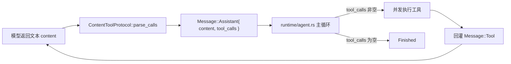

**Shirley 技术方案 · Content 工具调用协议（Content Tool-Calling Protocol）**

> **状态：已落地（P1）。** 本文设计一层**可插拔**的「content 工具解析协议」——
> 当某个模型 / 端点不支持原生 tool calling 时，改用纯文本约定让模型声明工具调用，
> SDK 在适配层把文本解析回 `Message::Assistant.tool_calls`，从而**复用现有 ReAct 循环**。
>
> 参考实现来自 `figmaagent`（commit `86fd6e8^`，其 XML 协议后被原生 function calling 取代；
> 该 commit 已在 `figmaagent` 仓库回滚恢复，`63b4480`）。本文只描述 Shirley 侧的落地设计，
> 不复制 figmaagent 的业务。
>
> **review 结论（第十二节）已确认**：① v1 = 声明式 + 自定义 trait 两档；② 终止语义与原生
> function calling 的 stop 一致（无工具调用即结束），**不引入** `is_terminal`；③ 目录注入走
> 扩展 `SystemPromptContext`；④ **暂不移植** `zod-to-doc`，视后续报错再定。
>
> **落地情况（当前代码）**：协议核心在 `crates/shirley-agent-sdk/src/adapter/tool_calling.rs`
> （字符级状态机 + 流式解析器 + `render_schema_doc` + `encode_messages_for_content` +
> `parse_content_response`），对外只暴露 `ToolCallingMode::{Native,Tagged}`（挂在
> `ModelConfig.tool_calling`）；接入点在 `adapter/mod.rs::invoke()`，**runtime 零改动**。
> 提示词正文抽到 `crates/shirley-agent-sdk/prompts/tool_calling_instructions.md` 与
> `tool_calling_errors.md`（`include_str!`，与仓库 prompts 约定一致）。端到端集成测试见
> `crates/shirley-agent-sdk/tests/tool_calling_content.rs`（mock 纯文本端点跑完整 ReAct）。
> 收口细节与后续项见 `docs/tool-calling-refactor.md`。

**一、这份文档要解决什么**

现状：Shirley 的工具调用**完全依赖供应商原生 tool_calls**。

- 请求侧：三个协议的 `encode_request` 都把 `ToolDefinition` 编码进 `tools` 字段；
- 响应侧：`decode` / `decode_stream` 从结构化字段解析 `tool_calls`；
- 运行侧：`runtime/agent.rs` **只认 `Message::Assistant.tool_calls`**——非空就并发执行工具、回灌
  `Message::Tool`、继续下一轮；为空就 `Finished`。

问题：**不是所有模型 / 端点都支持原生 tool calling**（本地小模型、部分 OpenAI 兼容网关、
纯 completion 端点）。这些模型并非不能「用工具」——它们能在文本里写出「我要调用 X，参数是 Y」，
只是没有结构化通道。

目标：加一层**正交于 `ModelProtocol` 的「工具传输模式」**，让这类模型也能驱动工具，
且**不破坏现有原生路径**。定位是**拓展能力**（可选、可插拔），不是替换。

**二、关键洞察：接入点在适配层，循环零改动**

figmaagent 的做法印证了一条最小改动路径：**把文本 content 解析成 `tool_calls`，其余一切照旧**。



因为循环只认 `tool_calls`，content 协议**不需要碰 runtime**。但它不止影响「解码」，还影响三处：

| 环节 | 原生模式 | content 模式 |
| --- | --- | --- |
| 编码（tools 声明） | 发结构化 `tools` 字段 | **不发** `tools`，改把工具目录写进 system prompt |
| 解码（产出调用） | 读结构化 `tool_calls` | 从文本 content **解析**出 `tool_calls` |
| 工具结果回灌 | `Message::Tool`（role=tool） | 模型不认 role=tool → **渲染回文本**（user 消息） |

所以它是一个**与协议正交的维度**，最自然的落点是 `ModelConfig` 的一个字段。

**三、设计目标与非目标**

**目标**

1. **可插拔**：协议格式与解析方法可声明、可替换；不写死 XML。
2. **零破坏**：`Native` 是默认；三个既有协议、`Message` 模型、runtime 主循环都不动。
3. **收敛在适配层**：协议差异不渗漏到 message / runtime（沿用仓库既有原则）。
4. **可观测**：解析失败 / 标签外噪音可上报，不静默吞掉。

**非目标**

- ~~不做流式「边收边解析并立即执行」~~ → **已实现流式解析**（见五之补 2、九）：SDK 内部增量解析原始协议文本、只对外吐**可见增量**（`thinking` → `ReasoningDelta`、`description` → `ContentDelta`，工具块屏蔽）。但**不在流式中执行工具**——工具执行仍由 `Finished` 后的 `tool_calls` 驱动（这点不变）。
- 不引入第二种 `Message` 表示，不改 `ToolCall` 结构。
- 不把「工具目录长什么样」写进 SDK 业务——目录文本由协议实现提供，SDK 只调用。

**四、协议格式（v1：XML 标签协议）**

格式源自 figmaagent `86fd6e8^`。一次 assistant 回复是一个 XML-like 文档：

```xml
<thinking>分析用户意图、当前进度、下一步要做什么（可选，内部思考）</thinking>
<description>给用户看的简短回答，纯文本或轻量 markdown</description>
<tool>
  <name>工具名</name>
  <params>合法 JSON 字符串</params>
</tool>
```

**规则**

- 每轮**恰好一个** `<tool>` 块（一次一个调用；多次调用 = 多轮循环）。
- `<params>` 内必须是**合法 JSON**（双引号、转义字符），不写注释。
- 标签外**禁止任何字符**（含空行、说明文字）。
- `<thinking>` / `<description>` 可选且可并列；顶层标签必须显式闭合。代码片段中的
  XML 示例只作为文本，工具调用必须有完整的 `<tool>…</tool>` 边界。

**解析产出 → 内部类型映射**

| XML 片段 | 内部字段 |
| --- | --- |
| `<thinking>…</thinking>` | `Message::Assistant.reasoning_content` |
| `<description>…</description>` | `Message::Assistant.content` |
| `<tool><name>…</name>` | `ToolCall.name` |
| `<tool><params>…</params>` | `ToolCall.arguments`（字符串，原样保留 JSON） |
| （协议无 id） | `ToolCall.id` 使用进程内递增序号合成；不同响应不会复用 ID |

**工具结果回灌格式**（content 模式特有；原生模式用 `Message::Tool`）：

```text
{"status":"success","tool":"fig_add_rect"}
<工具输出的文本数据>
```

首行是**结构化头**，第二行起是文本。`status ∈ {success, parameter_error, not_found, error, cancel}`。

**五、可插拔抽象**

SDK 新增 `ToolCalling`，作为 `ModelConfig` 字段（默认 `Native`）：

```rust
pub enum ToolCalling {
    Native,                                   // 现状：结构化 tools + 结构化 tool_calls
    Content(Arc<dyn ContentToolProtocol>),    // 扩展：文本协议
}

/// 可插拔的内容工具解析协议：声明「工具调用格式」与「解析方法」。
pub trait ContentToolProtocol: Send + Sync {
    /// 工具目录 + 输出契约 → 注入 system prompt 的文本
    fn render_instructions(&self, tools: &[&ToolDefinition]) -> String;
    /// 从 assistant 文本解析工具调用（0..n）
    fn parse_calls(&self, text: &str) -> Vec<ParsedToolCall>;
    /// 把工具结果渲染成回灌消息（角色 / 包裹由协议决定）
    fn render_result(&self, call: &ToolCall, outcome: &ToolOutcome) -> Message;
    /// 该工具名是否表示「任务完成」（循环终止）。默认 false。
    fn is_terminal(&self, _name: &str) -> bool { false }
}
```

内置一个**声明式**实现 `TaggedToolProtocol`（`bon::Builder`），把 XML 协议变成「配置即声明」：

```rust
TaggedToolProtocol::builder()
    .tool_tag("tool")        // <tool>…</tool>
    .name_tag("name")        // <name>…</name>
    .params_tag("params")    // <params>{JSON}</params>
    .result_template("{\"status\":\"{status}\",\"tool\":\"{name}\"}\n{output}")
    .terminal_tool("fig_finish")
    .build()
```

两档扩展性：

- 换标签名 / params 编码 / 回灌模板 → **改声明**；
- 完全自定义（fenced-JSON、正则、其他标记）→ 自己 `impl ContentToolProtocol`。

**五之补、能力标识与自动选择（声明来自模型提供商）**

`ToolCalling` 由谁决定？**由模型提供商声明**，应用层据此选择，而不是让用户每换一个模型就手动配。

1. **提供商声明**：模型列表接口（`GET /v1/models`）在每个模型条目上**多带一个字段**做标识，
   约定为 `tool_mode`（`"native" | "content"`，可选）。`src/models.rs` 的 `ModelDto` 读它、
   `ModelEntry` 携带它（新增 `tool_mode: Option<String>`，缺省 = 未声明）。
2. **选择规则**（**model-first**，优先级从高到低）：
   - 读**模型条目**声明：`content` → `ToolCalling::Content`，`native` → `ToolCalling::Native`；
   - 模型条目未声明 `tool_mode`（或值认不出）→ 回退**配置层默认**
     （`[provider] tool_mode = "native" | "content"`，缺省 `Native`）。
   > 模型条目声明优先于配置：配置只是「模型没表态时」的兜底默认，不覆盖模型自身的声明。
   > 这样用户换到支持声明能力的模型时自动生效，无需手动改配置。
3. **「不支持就降级」**：当提供商把某模型标为 `content`（即不支持 function call），
   应用层自动走 content 协议——**这就是「发现当前模型不支持 function call 就走当前协议」**。
   检测方式先以**声明为准**（零成本、确定性），不做能力探测。
4. **落地接缝（已实现）**：解析入口是应用层 `bootstrap::resolve_tool_calling_for(model_tool_mode, fallback)`；
   热切换经 SDK 新增的 [`Agent::set_tool_calling`]（与 `set_model` / `set_provider` 同风格的运行期接缝，
   不重建 `Agent`）。**两个界面都接入**：
   - **TUI** `/model`：`App::picker_confirm` 手里已有完整 `ModelEntry`，直接解析后 `set_tool_calling`；
   - **desktop** `agent_set_model`：按 `model` 值反查模型目录条目拿 `tool_mode`（前端不感知协议，
     只传模型值），再解析 + `set_tool_calling`。
   回退值 `fallback` 由 `AgentFactory::default_tool_calling()`（配置层产物）提供，经 TUI 构造时注入 `App`。

> 为什么放「模型目录」而不是 prompt 里试探：Shirley 的原则是**边界划在确定性部分**
> （见 `docs/README.md` 设计原则），模型能力由 provider 元数据声明，比让模型自己猜可靠。

**六、解析器设计（字符级状态机）**

参考 `figmaagent/apps/figmaagent/src/shared/parser/parser.ts`，并为 Shirley 的工具执行收紧边界：

1. **任意分片**：`write(chunk)` 增量喂入，状态跨分片保持——`<na` + `me>` 被切成两块也能拼回。
   （这是「累积后一次解析」与「流式解析」共用的内核。）
2. **协议边界**：只有回复开头是协议标签时才解析；`thinking` / `description` 内的协议标签
   视为正文，Markdown 代码围栏内的标签也不参与解析。未闭合的 `tool` 不执行。
3. **尖括号噪音回退**：遇到不匹配的 `</xxx>` 或裸 `<`，把该序列**还原为普通文本**追加到当前内容，
   而非报错——模型偶尔输出 `a < b` 不能毁掉整轮。
4. **自闭合兼容**：`<x/>`、`<></>` 跳过，不产内容。
5. **W3C XML 名称字符**：标签名按 `NameStartChar` / `NameChar` 规范匹配（支持 Unicode），
   非法字符即回退为文本。

> **流式解析已实现**（`ContentStreamParser` / `TaggedStreamParser`）：同一套字符级状态机既支持
> **最终态解析**（`parse` 在 `Finished` 时对完整 content 跑一次，产出结构化 `tool_calls`），
> 也支持**流式解析**（`stream_parser()` 逐块喂入，只吐 `thinking` / `description` 可见增量、
> 屏蔽 `<tool>` 块）。两路共用内核，行为一致（单测 `stream_parser_is_split_insensitive` 保证
> 任意分片下可见增量拼接结果一致）。

**七、接入点与改动面**

**SDK（`crates/shirley-agent-sdk`）**

| 位置 | 改动 |
| --- | --- |
| `adapter/tool_calling.rs`（新增） | `ToolCalling` / `ContentToolProtocol` / `TaggedToolProtocol` / `ParsedToolCall` / `ToolOutcome` |
| `adapter/mod.rs` | `ModelConfig` 加 `tool_calling`（默认 `Native`）；`invoke()` 内做 **content 包装**（见下） |
| `runtime/agent.rs` | `system_message()` 在 content 模式追加 `render_instructions(tools)`；执行完工具后若命中 `is_terminal` 则终止本轮循环 |
| `lib.rs` | 导出新类型 |

**`invoke()` 里的 content 包装（关键——三协议零改动）**

1. **编码前**：把 `Message::Tool` 经 `render_result` 渲染成文本消息（模型不认 role=tool）；
2. **编码后**：从请求体移除原生 `"tools"` 字段（三协议都在顶层 `"tools"`）；
3. **解码后**：若 `Assistant.tool_calls` 为空，`parse_calls(content)` 填充。

> 为什么放 `invoke` 而非塞进三个 encoder：content 协议**与底层协议无关**，做成 codec 之上的一层
> wrapper，三个 codec 一行不改，符合「协议差异收敛在适配层」。

**应用层（`src/`）**

| 位置 | 改动 |
| --- | --- |
| `settings.rs` | `[provider]` 加 `tool_mode = "native" \| "content"`（可选，`deny_unknown_fields` 同步） |
| `models.rs` | `ModelDto` / `ModelEntry` 增 `tool_mode` 字段（提供商声明的能力标识，见五之补） |
| `bootstrap.rs` | 按「配置 > 模型声明 > 默认」解析出 `ToolCalling`，接进 `ModelConfig` |

**八、system 约束（注入工具目录 + 输出契约）**

content 模式的可用性**取决于 prompt 是否把契约讲清楚**——模型没有结构化通道，全靠自然语言约定。
figmaagent 的 system prompt 是最佳实践样本，需要移植的约束（**均已落地**，见下）：

> **已落地**：`TaggedToolProtocol::render_instructions`（`tool_calling.rs`）现在按 figmaagent
> 的四节结构输出——`# 工具调用协议`（ReAct 循环说明）/ `# 输出格式（务必严格遵守）`（XML 契约）/
> `# 可用工具`（工具目录）/ `# 工具结果回灌`（回灌识别规则）；由 `Agent::system_message()`
> 拼进 system prompt 前部。工具参数不再 dump 原始 JSON Schema，改由 `render_schema_doc`
> （移植自 figmaagent `zod-to-doc.ts`）渲染成紧凑可读文档（`key?: type  // 注释`）。

1. **工具目录**（**已落地**）：`render_instructions` 输出工具清单（名 / 描述 / 参数 schema）。
   figmaagent 用 `zod-to-doc` 把 JSON Schema 渲染成紧凑文本，Shirley 以 `render_schema_doc`
   1:1 移植（输入直接吃 `ToolDefinition.parameters`）：

   ```text
   ## 1. fig_add_rect
   描述：在画布上创建矩形
   参数：
   {
     count?: number (>=1)   // 数量
     color: {               // 颜色
       r: number (>=0, <=1)
       g: number (>=0, <=1)
       b: number (>=0, <=1)
     }
   }
   ```

   渲染规则：`key?: type // 注释`；`enum` → `a | b`；`number` 带 `>= / <=`；`string` 带 `len/format`；
   对象 / 数组递归。**token 友好优先于 schema 完整**；`schemars` 注入的 ±`MAX_SAFE_INTEGER`
   哨兵约束被过滤（对 LLM 无意义）。非常规结构回退 `any`，不 panic。
   （Shirley 的 `ToolDefinition.parameters` 本就是 JSON Schema，渲染器可直接吃它，无需另造中间模型。）

2. **输出契约**（**已落地**）：明确「每次回复只含 XML、标签外禁止字符、需要工具时恰好一个 `<tool>`、
   params 是合法 JSON」，并点明「不发 `<tool>` = 本轮结束」。
3. **回灌识别规则**（**已落地**）：告诉模型「最新 user 消息以回灌模板（默认 `{"tool":"…"}`）开头 =
   工具返回值，不是新指令」，据此判断下一步（成功核对是否完成 / 失败调整重试）。
4. **回放保留标签（KV 缓存必要）**：content 模式下**所有** assistant 消息（含无工具调用的普通回答）
   回放时都经 [`ContentToolProtocol::render_assistant`] **确定性重渲染**成协议原文——`<thinking>` /
   `<description>` / `<tool>` 标签**逐字节保留**，不透传剥壳后的纯文本。原因有二：① 模型必须看到自己
   上一轮的带标签原文，工具调用链才不断；② **标签本身是 KV 缓存前缀的一部分**——确定性重渲染保证跨轮
   前缀稳定，删标签会让前缀逐轮漂移、缓存全灭。这与「注入位置放前部」（见上条）是同一条缓存约束的两面。
   > 解码侧 `parse_content_response` 仍把标签**剥掉**给 UI（用户看不到 XML 外壳）；保留标签只发生在
   > **回放（编码）**方向，两个方向职责不同。
5. **终止语义**：与原生 function calling 的 **stop 一致**——**本轮没有 `<tool>`（解析后
   `tool_calls` 为空）= 结束**。因此**不引入 `is_terminal`**，也不需要 `fig_finish` 这类终止工具；
   模型「想结束」就直接只输出 `<description>`。契约里要说清「要继续做事就必须发 `<tool>`」。
   （figmaagent 之所以需要 `fig_finish`，是因为它的契约强制每轮恰好一个 `<tool>`，永不出现
   「无 tool」的结束态；Shirley 沿用「无 tool = 停」，无需这个特例。）
6. **注入位置（已定：扩展 `SystemPromptContext`）**：放 **system prompt 前部**（工具集在会话内
   稳定 → 稳定前缀 → KV 缓存友好）。与 `docs/todo.md` 的「末尾追加」取舍**相反**——账本是每轮
   变化的易变内容，工具目录是稳定内容，位置应相反。

**实现路径（已定）**：扩展 `SystemPromptContext`，让 `SystemPrompt` 函数在构造时拿到工具目录
（工具集在 `Agent::new` 时已知），由提示词函数把 `render_instructions(tools)` 拼进 system prompt
前部。**前缀稳定、缓存友好。**（不复用 `ContextProvider`——它在末尾，会破坏前缀缓存。）

**九、与 figmaagent 的取舍**

| figmaagent | Shirley v1 | 理由 |
| --- | --- | --- |
| 每轮**必须**恰好一个 `<tool>`，靠 `fig_finish` 停 | 「无 `<tool>` = 结束」，与原生 stop 一致；**不引入** `fig_finish` / `is_terminal` | 与既有循环一致，最小改动 |
| 前端字符级**流式**解析（RxJS） | **流式解析可见增量**（`ContentStreamParser`）+ **最终态解析 `tool_calls`** | 显示流实时（`thinking` / `description` 边收边吐，屏蔽工具块），控制流仍在 `Finished`；与 figmaagent 同源 |
| 后端只透传文本流 | SDK 内统一包装 | 与协议正交，收在一处 |

**十、被否掉的方案**

- **塞进三个 encoder**：协议差异污染三处，且 content 与底层协议无关。
- **做成新的 `ModelProtocol` 变体**：content 可与任意底层协议组合（OpenAI 兼容文本端点 /
  completion），是**正交维度**，不是并列协议。
- **改 `Message` 模型**：不需要——`tool_calls` 已能表达。
- ~~**v1 就做流式解析**~~ → **已做**：见五之补 2。当初的顾虑（状态机 + UI 联动成本）由「复用既有字符级状态机」+「对外仍是统一的 `AgentEvent`（UI 零改动）」化解。

**十一、验证清单**

- **单测**：`TaggedToolProtocol` 覆盖 parser 关键行为——分片、协议边界、噪音回退、
  自闭合、非法标签名。
- **集成**：mock 一个「只回文本」的端点，验证一轮 content 工具调用 → 回灌 → 第二轮 → `Finished`。
- **回归**：`Native` 路径完全不变（三协议既有测试全绿）。
- **缓存**：content 模式下 system prompt 前缀稳定（工具目录位置不变）。

**十二、已确认决策（review 结论）**

| # | 问题 | 结论 |
| --- | --- | --- |
| 1 | 范围 | **「声明式 `TaggedToolProtocol` + 自定义 trait」两档 + 流式解析**。能力标识由**模型提供商**在模型列表里声明（`tool_mode` 字段，见五之补），发现不支持 function call 就自动走本协议。 |
| 2 | 终止语义 | **与原生 function calling 的 stop 一致**：判断本轮**是否有工具调用**决定是否结束——没有 `<tool>` 就结束，有就继续。**不引入** `is_terminal` / `fig_finish`。 |
| 3 | 目录注入 | **扩展 `SystemPromptContext`**（不是复用 `ContextProvider`）。 |
| 4 | 参数渲染 | **暂不移植** `zod-to-doc`。自研协议无法保证模型传参正确，将来**视报错情况**再决定是否加类型约束 / 渲染约束。 |

**遗留（待后续验证时定）**：content 协议下模型传参出错时，是否需要「参数类型约束 / 报错回灌
重试」——先观察真实报错再决定（承接决策 4）。

**十三、与其它文档的关系**

- `docs/adapter-layer.md`：本文是「多协议」之外的**正交**维度（传输模式 vs 协议）。
- `docs/responses-api.md` / `docs/anthropic-messages-api.md`：原生 tool_calls 路径，本文不动。
- `docs/todo.md`：`ContextProvider` 接缝的另一使用者；注入位置取舍相反（见八.5）。
- `docs/security.md`：content 解析出的工具调用与原生调用**走同一条执行路径**（同一沙盒 / 权限层），
  不因来源不同而降低约束。
