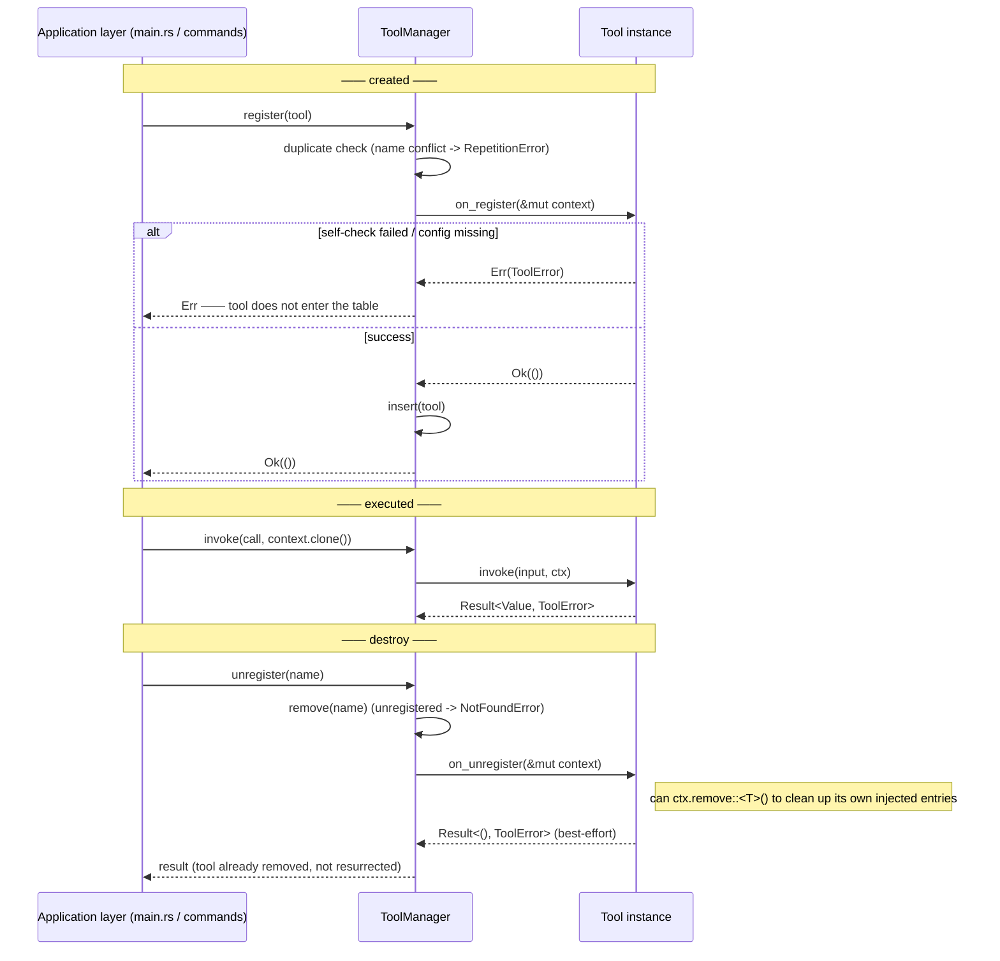

**Shirley technical design · Tool lifecycle (Tool Lifecycle)**

> **Status: implemented.** Both the trait side (`on_register` / `on_unregister` / `ToolContext::remove` /
> `ToolManager::unregister` / `Agent::unregister_tool`) and the macro side (`#[tool(on_register = ...,
> on_unregister = ...)]`) have landed, and `web_search` has been migrated to this form. For macro-side details, see
> `docs/tool-macro.md`; regression tests are in `crates/shirley-agent-sdk/tests/tool_lifecycle.rs`.
>
> The body of this document preserves the reasoning from the planning phase (including rejected forms); **the wording in the "implementation landed" section below is authoritative**.

**1. What this document solves**

`ToolContext` used to be a standalone builder parameter **manually created by the application layer and sitting alongside `ToolManager`**. It brought three concrete problems:

1. **Misplaced responsibility**. `ToolContext` semantically depends entirely on tools, yet it was independently constructed and passed in by the application layer, alongside `tools`. It had no reason to exist independently.
2. **Registration and injection drift**. Registering a tool (`tool_manager.register`) and injecting a dependency (`tool_context.with(state)`) were **two manual steps**. Doing only the former and forgetting the latter does not fail to compile, and only blows up at runtime when `ctx.get` returns `None`.
3. **No registration-time self-check**. Missing / wrong configuration could only be exposed on the first call.

The application-layer status quo (`src/main.rs`):

```rust
let mut tool_context = ToolContext::new();
match tools::WebSearchState::from_env() {
    Ok(Some(state)) => {
        let _ = tool_manager.register(tools::web_search_tool::tool());  // register
        tool_context = tool_context.with(state);                        // inject (another step)
    }
    Ok(None) => {}
    Err(error) => eprintln!("[web_search] not enabled: {error}"),
}
// ...
.tools(tool_manager)
.tool_context(tool_context)   // <- yet another standalone top-level parameter
```

The user's ask (their words): they want a "tool lifecycle" -- `created` / `executed` / `destroy` called at registration, execution, and unregistration respectively; and `ToolManager` should have the ability to **remove a tool**, giving `destroy` a real trigger path, and **cleaning up `ToolContext`** on removal.

---

**2. Phase mapping**

| As the user said it | What it actually maps to | Status / this plan |
| --- | --- | --- |
| **created** | at registration | ❌ add `on_register` |
| **executed** | **it is `invoke`** | ✅ already exists, no need to add |
| **destroy** | at unregistration | ❌ add `on_unregister` + `ToolManager::unregister` |

- `executed` is nothing new: `Tool::invoke(&self, input, ctx)` is itself the "execution" lifecycle event; observability before and after execution is already provided by `AgentEvent::ToolStarted` / `ToolFinished`. **Adding another `on_execute` layer is duplication.**
- `destroy` **this plan will do**. A previous version skipped it on the grounds of "no caller", but that reason does not hold -- **you can create a caller**: `ToolManager::unregister` is its trigger path. The hook and the trigger path **land together**, see sections 4 and 5.

So this plan adds **two** hooks: `on_register` (created) and `on_unregister` (destroy).

---

**3. Design goals and non-goals**

**Goals**

1. Move ownership of `ToolContext` from the application layer into the SDK (held by `ToolManager`).
2. Combine "register the tool" and "inject the dependency / self-check the config" into **the same step**, eliminating drift.
3. Provide the ability to **remove a tool** (`unregister`), triggering the cleanup hook and cleaning up `ToolContext` on removal.
4. Stateless tools need **zero changes** (backward compatible).

**Non-goals**

1. No dependency-injection container / typed provider registry (reasoning in section 7).
2. ~~Do not change the `#[tool]` macro~~ -> **changed to: give the function macro optional companion hooks**. The default methods let stateless tools need zero changes,
   but stateful tools (`web_search`) need the macro to wire the hooks into the generated `impl Tool` -- otherwise it can only fall back to
   "hand-writing `impl Tool`", and the user's core constraint is "the macro is the only entry point, the user does not touch tool details". See
   `docs/tool-macro.md`.

**One constraint that cannot be eliminated**

> The SDK cannot "create by itself" the **contents** of `ToolContext`.

The contents (`WebSearchState`, a session handle, credentials) are **concrete types the application layer owns** -- reading env, building an HTTP client, getting a key are all application-side matters. The SDK, to stay generic, cannot know these types. So "moving it into the SDK" can only be: **the SDK owns the container, and the application puts values in through a registration-time hook**. That the values are given by the application cannot be eliminated, but the responsibility for creating / holding / dispatching / **cleaning up** can move into the SDK, and it can make registration and injection the same step.

---

**4. Lifecycle design**

**4.1 `ToolContext`: add a `remove` (currently missing)**

The status quo (`tool/mod.rs`) only has `new` / `with` (insert) / `get`. To support "cleanup", `remove` must be added:

```rust
impl ToolContext {
    /// Remove a piece of application data and return the removed value (None if it does not exist).
    /// Internally it is `Arc<HashMap>` + `Arc::make_mut` copy-on-write:
    /// if an in-flight tool call currently holds an old clone, `make_mut` copies,
    /// and the in-flight call still sees the old data (safe, no dangling).
    pub fn remove<T: Any + Send + Sync>(&mut self) -> Option<Arc<T>> {
        Arc::make_mut(&mut self.inner)
            .remove(&TypeId::of::<T>())
            .and_then(|value| value.downcast::<T>().ok())
    }
}
```

> **Note (written into the doc to avoid a pitfall)**: `ToolContext` is indexed by `TypeId`. If two tools inject the **same type**, when one is unregistered its `remove` will also wipe the other's data. Convention: **each tool uses its own newtype** to carry its state; a shared handle (form B) should not be removed by a single tool in `on_unregister`, but managed explicitly by the application layer.

**4.2 `Tool` trait: add two default hooks**

```rust
pub trait Tool: Send + Sync {
    fn definition(&self) -> &ToolDefinition;

    /// Execution (= executed). Already exists, unchanged.
    fn invoke(&self, input: serde_json::Value, ctx: ToolContext) -> ToolFuture<'_>;

    /// Registration (= created). Called once by `ToolManager::register` after the duplicate check passes and before insertion.
    /// The tool here (a) writes shared runtime dependencies into the context / stores them in self;
    /// (b) self-checks the config, returning `Err` if missing -- registration fails, the tool does not enter the table.
    /// Default empty implementation: stateless tools need zero changes.
    fn on_register(&mut self, _ctx: &mut ToolContext) -> Result<(), ToolError> {
        Ok(())
    }

    /// Unregistration (= destroy). Called once by `ToolManager::unregister` after the tool is removed from the table.
    /// The tool here releases the context entries it injected (`ctx.remove::<T>()`), etc.
    /// Default empty implementation: stateless tools need zero changes.
    ///
    /// Semantics: **best-effort cleanup**. Regardless of whether it returns `Ok` or `Err`, the tool has already been removed
    /// from the table (see the order in 4.3); `Err` is only used to tell the caller "cleanup failed", and does not resurrect the tool.
    fn on_unregister(&mut self, _ctx: &mut ToolContext) -> Result<(), ToolError> {
        Ok(())
    }
}
```

**4.3 `ToolManager`: hold `ToolContext` + support removal**

```rust
pub struct ToolManager {
    tools: HashMap<ToolName, Box<dyn Tool>>,
    context: ToolContext,          // <- moved in from Agent
}

impl ToolManager {
    pub fn register(&mut self, mut tool: impl Tool + 'static) -> Result<(), ToolError> {
        let name = tool.definition().name.clone();
        if self.tools.contains_key(&name) {
            return Err(ToolError::RepetitionError(format!(
                "tool already registered: {name}"
            )));
        }
        tool.on_register(&mut self.context)?;   // created: failure means it does not enter the table
        self.tools.insert(name, Box::new(tool));
        Ok(())
    }

    /// Remove a tool: remove it from the table first, then trigger `on_unregister` (which can clean up `ToolContext`).
    /// An unregistered name returns `NotFoundError`.
    pub fn unregister(&mut self, name: &str) -> Result<(), ToolError> {
        let mut tool = self
            .tools
            .remove(name)
            .ok_or_else(|| ToolError::NotFoundError(name.to_string()))?;

        // Order: already removed from the table -> then call back. Even if the callback errors, the tool is not resurrected.
        tool.on_unregister(&mut self.context)
    }

    /// For the runtime to get the context (replacing the old `Agent.tool_context` field).
    pub fn context(&self) -> &ToolContext { &self.context }
    pub fn context_mut(&mut self) -> &mut ToolContext { &mut self.context }
}
```

**Key ordering**

- `register`: duplicate check -> `on_register` -> **`insert` only on success**. An initialization failure leaves no half-registered tool.
- `unregister`: **first `remove` (out of the table) -> then `on_unregister`**. A cleanup failure does not leave the inconsistent state of "destroy was called but it is still in the table".

**4.4 How values get into the hooks: two paths, by scenario**

The hook is `&mut self`; it either **carries its own state** or **is fed by the application at registration time**.

> **Landed conclusion**: `web_search` chose **form B** (keep the `#[tool]` function macro + a registration hook writing `ctx`),
> rather than form A's hand-written `impl Tool` -- because "the user does not touch tool details" is a hard constraint (see `docs/tool-macro.md`).
> Form A still applies to `todo` (it needs `impl Tool` to hold an `Arc<TodoStore>`, and it is an SDK-internal tool).
> Both forms below are kept, as a general explanation of "how values get into the hooks".

- **Form A: tool-private state -> the tool holds it itself (the existing precedent of `TodoTool`)**

  `TodoTool::new(store)` is exactly the tool directly holding an `Arc<TodoStore>` and ignoring `ToolContext` -- **this form already exists and is clean**. `web_search` fits this path:

  ```rust
  pub struct WebSearchTool { state: WebSearchState, definition: ToolDefinition }

  impl Tool for WebSearchTool {
      fn on_register(&mut self, _ctx: &mut ToolContext) -> Result<(), ToolError> {
          self.state.validate()?;   // registration-time self-check; a broken config is rejected on the spot
          Ok(())
      }
      fn invoke(&self, input: serde_json::Value, _ctx: ToolContext) -> ToolFuture<'_> {
          let state = self.state.clone();   // read self directly, no dependence on ctx
          Box::pin(async move { /* ... */ })
      }
      // the state drops with self; no on_unregister needed
  }
  ```

  The application side becomes "registration carries its own dependency":

  ```rust
  let mut tools = ToolManager::new();
  tools.register(tools::bash_tool::tool())?;
  tools.register(tools::read_file_tool::tool())?;
  match tools::WebSearchTool::from_env() {
      Ok(Some(tool)) => { tools.register(tool)?; }   // registration carries its own dependency, cannot drift
      Ok(None) => {}                                  // not configured, silently skip
      Err(e)  => eprintln!("[web_search] not enabled: {e}"),
  }
  ```

- **Form B: a runtime handle shared across tools -> the hook writes it into `ToolContext`**

  For example, multiple tools all need `Arc<Mutex<Session>>`. The application feeds it once at registration time:

  ```rust
  tools.register(BumpTool::new())?;
  tools.context_mut().with(session_handle);   // shared handle, placed only once
  ```

  Such shared handles have their lifecycle decided by the **application layer**; **do not `remove` them in a single tool's `on_unregister`** (it would hurt other tools).

---

**5. Lifecycle sequence**



---

**6. Where does the caller of `unregister` come from**

A previous version rejected `destroy` on the grounds of "no caller". This plan creates a caller by providing `unregister` **at the same time**. But we must honestly explain that "caller" has two layers:

1. **SDK layer**: `ToolManager::unregister` is a public API, and `Agent` should expose a symmetric seam (in the same style as `set_model` / `set_provider` / `unregister_tool`):

   ```rust
   impl Agent {
       /// Remove a registered tool. A runtime seam symmetric with register.
       pub fn unregister_tool(&mut self, name: &str) -> Result<(), AgentError> {
           self.tools.unregister(name).map_err(Into::into)
       }
   }
   ```

2. **Application layer (undecided, see decision 3 in section 9)**: currently no UI command calls it. Optional natural callers:
   - a `/tools` command to list / toggle tools (dynamic start/stop at runtime, e.g. temporarily turning off `web_search`);
   - when switching model / provider, some tools no longer apply.

   **If in the end there is no application-layer caller**, `unregister` still exists as an SDK **design seam** (covered by unit tests), but the doc should note "no application-layer consumer yet", to prevent the next Agent from mistaking it for dead code.

---

**7. Rejected plans**

| Plan | Why not |
| --- | --- |
| **Dependency-injection container / typed provider registry** (tools declare dependency types, the SDK resolves them from a registry) | Upgrading `ToolContext` into a DI framework is exactly the "anticipate every requirement" that `plan.md` warns against. There is currently only one consumer, `web_search`, so it is not worth it. |
| **An `on_execute` hook** | `invoke` is already the execution event; `AgentEvent::ToolStarted/ToolFinished` already provides observability. Duplication. |
| **Automatic context cleanup** (the manager records which TypeIds each tool injected, and removes them automatically on unregistration) | The manager cannot obtain the information "what a tool injected"; it can only rely on convention. An explicit `ctx.remove` is simpler and does not introduce tracking state. |
| **Making `on_unregister` async** | Current cleanup is synchronous (removing a map entry / dropping a handle). `Drop` itself cannot `await`. If async teardown is needed in the future, design it separately; do not bring in async ahead of time. |
| ~~**The `#[tool]` macro supporting `#[tool(on_register = ...)]`**~~ | **Adopted.** The reason at the time ("no consumer") was overturned: `web_search` is the consumer, and "the user does not touch tool details" requires the macro to wire the hooks. Landed as the optional attributes `on_register` / `on_unregister`, see `docs/tool-macro.md`. |

---

**8. Blast-radius checklist**

| Item | Impact | Breaking |
| --- | --- | --- |
| `ToolContext` | add `remove::<T>()` | no |
| `Tool` trait | add **default** `on_register` / `on_unregister`; stateless tools need zero changes | no |
| `ToolManager` | add a `context` field + `context()` / `context_mut()` / `unregister()`; `register` calls the hook | no |
| `Agent` | remove the `tool_context` field and builder parameter; add the `unregister_tool` seam | **yes** (`0.0.x` semantics) |
| `main.rs` | the only caller; remove `.tool_context(...)` and the assembly; the `web_search` registration hook takes over state injection | no |
| `#[tool]` macro | add **optional** attributes `on_register` / `on_unregister` (referencing companion functions); not written means an empty impl | no |
| Docs | the tool-system section of `Agent.md`, section 2 of `docs/web-search.md`, the `docs/README.md` index, `docs/tool-macro.md` | no |

---

**9. Decision points pending review**

1. **Which path `web_search` takes**: ~~A / B undecided~~ -> **decided: B** (keep the `#[tool]` macro + `on_register` writing
   `ctx`). Reason: the macro is the only entry point, and the user does not touch tool details.

2. **`Agent::builder().tool_context()`**: ~~A / B undecided~~ -> **decided: A (just delete it)**.
   `ToolContext` is owned by `ToolManager`; `Agent` no longer holds it.

3. **The application-layer caller of `unregister`**: ~~A / B undecided~~ -> **decided: B**. For now only do the SDK seam
   (`ToolManager::unregister` + `Agent::unregister_tool`) + unit tests, with **no application-layer consumer yet**.

4. **The failure semantics of `on_unregister`**: ~~to be confirmed~~ -> **decided: best-effort, the tool is not resurrected**. `unregister`
   first `remove`s then calls back; `Err` is only used to report a cleanup failure.

---

**10. Relationship to existing documents**

- This plan is the **continuation** of `docs/sdk-gaps.md` gap-1 (tool context injection): gap-1 lets tools "get" the context; this plan solves "who holds the context, when is it initialized, and when is it cleaned up".
- Boundary decisions still follow item 4 of section 8 of `Agent.md`: `ToolContext` / `on_register` / `on_unregister` are **generic mechanisms**, belonging to the SDK; a specific tool (`web_search`) and its state belong to the **application layer**.
